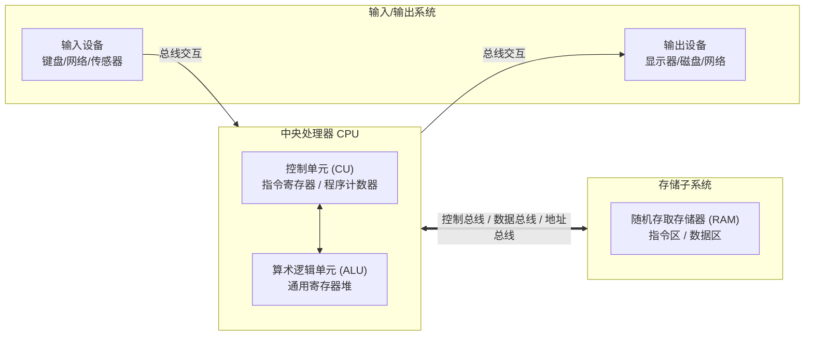

# Lec 01 计算机硬件与底层体系架构 (Fundamentals of Computing I: Hardware and Architecture)

> MIT Sloan School of Management · 15.561 Information Technology Essentials

## TL;DR

- 冯·诺依曼架构奠定了现代计算基石，确立了运算器、控制器、存储器、输入与输出五大部件解耦机制。
- 摩尔定律与登纳德缩放定律驱动半个世纪的算力爆发，但在纳米制程物理极限下正遭遇严重的功耗墙瓶颈。
- 存储层次结构通过寄存器、L1-L3 缓存、DRAM 与非易失性闪存的阶梯设计，化解处理器与内存间的速度鸿沟。

## 冯·诺依曼架构与现代计算机物理结构 / Von Neumann Architecture

现代通用计算机的核心设计思想源于约翰·冯·诺依曼（John von Neumann）在 1945 年提出的存储程序计算机模型。在冯·诺依曼架构确立之前，早期计算设备（如 ENIAC）执行特定任务必须依靠物理拔插跳线和重设开关，程序的修改即意味着硬件物理拓扑的重构。冯·诺依曼架构实现了革命性的跃迁：**将指令与数据以同等的二进制编码形式统一存储在可寻址的主存储器中**，使得机器能够通过读取指令流自主决定下一阶段的逻辑流转。

::: definition 冯·诺依曼计算架构 (Von Neumann Architecture)
冯·诺依曼架构由五大物理子系统构成：中央处理器内的**算术逻辑单元（ALU）**与**控制单元（CU）**、**主存储器（Memory）**、**输入设备（Input）**以及**输出设备（Output）**。其本质特征是程序内嵌于存储器中，CPU 遵循严格的“取指（Fetch）- 译码（Decode）- 执行（Execute）- 写回（Writeback）”时钟周期步进运行。
:::

在冯·诺依曼拓扑中，CPU 与存储器之间通过系统总线（包括数据总线、地址总线和控制总线）进行信息交互。这种共享总线结构不可避免地孕育了计算机科学中最经典的结构性制约——**冯·诺依曼瓶颈（Von Neumann Bottleneck）**：无论处理器内部的逻辑门翻转速度有多快，其吞吐上限始终受制于总线向存储器读写操作数的带宽与延迟。

上图展示了五大部件在物理与逻辑层面的协同流动。CPU 通过程序计数器（Program Counter）向总线输出内存地址，读取机器操作码，译码后调度内部寄存器与 ALU 进行微操作，并将计算结果通过数据总线写回 RAM 或外设缓冲器。

## 摩尔定律、登纳德缩放与功耗墙 / Moore's Law, Dennard Scaling & The Power Wall

信息技术在过去五十余年内之所以能够重构全球商业范式，其底层经济学驱动力完全植根于戈登·摩尔（Gordon Moore）在 1965 年提出的经验观察。

::: theorem 摩尔定律 (Moore's Law)
集成电路上可容纳的晶体管密度大约每 18 至 24 个月翻一番，单位芯片面积上的计算能力成倍增长，而单管成本呈指数级衰减。摩尔定律不是自然物理定律，而是一种由半导体产业路线图（ITRS）自我强化的技术经济学预期。
:::

与摩尔定律密切配合的是**登纳德缩放定律（Dennard Scaling）**。该定律指出，当晶体管尺寸按比例缩小时，其电容减小、工作电压降低，单位面积芯片的功耗密度保持恒定。这一优美特性使得工程师可以在缩小晶体管的同时不断拉升 CPU 的主频，从 1980 年代的几 MHz 一路飙升至 2000 年代初期的 3 GHz 以上。

::: pitfall 登纳德缩放失效与功耗墙危机 (Dennard Scaling Breakdown)
2005 年前后，半导体工艺进入 90 纳米以下节点，栅极氧化层厚度缩减至数十个原子级别，导致显著的量子隧穿效应。静态漏电流（Leakage Current）急剧攀升，使得芯片在不进行运算时依然散发巨大热量。登纳德缩放的终结直接宣告了“单核主频疯狂飙升”时代的终结，产业被迫撞上**功耗墙（Power Wall）**。
:::

功耗墙逼迫计算机架构设计发生重大范式转移：从依赖单核指令级并行（ILP）与主频提升，转向多核（Multi-core）并行架构、超标量执行（Superscalar）、投机执行（Speculative Execution）以及针对特定负载的领域专用加速器（DSA, 如 GPU、TPU、NPU）。

## 存储体系金字塔与缓存层级 / Memory Hierarchy & Caching

计算系统中存在着不可调和的物理矛盾：存取速度越快的介质，其每比特制造成本越高、晶体管体积越大、物理容量越有限；而容量巨大且成本低廉的介质，其访问延迟往往高出数个数量级。

为化解 CPU 计算速度（纳秒级）与外部存储延迟（毫秒级）之间高达数万倍的“内存墙（Memory Wall）”，现代体系架构构建了金字塔式的分层存储拓扑。

| 存储层级 | 典型介质 | 访问时钟周期 | 典型容量 | 每 GB 成本区间 |
| :--- | :--- | :--- | :--- | :--- |
| **L0: 寄存器堆 (Registers)** | 双极型晶体管 / 触发器 | 1 周期 (< 0.5 ns) | 1 KB - 2 KB | 极高（仅成百上千个字） |
| **L1/L2 缓存 (SRAM Cache)** | 6T 静态 RAM | 3 - 15 周期 (1 - 4 ns) | 64 KB - 1 MB | 极高 |
| **L3 共享缓存 (Shared Cache)** | 密集 SRAM / eDRAM | 30 - 60 周期 (10 - 20 ns) | 16 MB - 128 MB | 高 |
| **主存 (Main Memory)** | 1T-1C 动态 RAM (DRAM) | 100 - 200 周期 (50 - 80 ns) | 8 GB - 256 GB | 中等 |
| **固态硬盘 (Solid State Drive)** | 3D NAND Flash 闪存 | 10,000+ 周期 (10 - 50 μs) | 512 GB - 8 TB | 低 |
| **传统机械硬盘 (HDD)** | 磁性旋转盘片 | 数百万周期 (5 - 10 ms) | 2 TB - 24 TB | 极低 |

存储分级之所以能够以接近主存的容量提供逼近 SRAM 缓存的性能，其底层统计学前提在于程序的**局部性原理（Principle of Locality）**：

::: definition 局部性原理 (Locality Principles)
1. **时间局部性 (Temporal Locality)**：如果某指令或数据被访问，在不久的将来它极可能被再次访问（例如循环迭代中的控制变量与累加器）。
2. **空间局部性 (Spatial Locality)**：如果某存储单元被访问，其地址相近的相邻单元在不久的将来极可能被访问（例如连续内存布局的数组遍历与顺序执行的指令块）。
:::

硬件控制器通过维护缓存行（Cache Line, 通常为 64 字节）并运用 MESI 等缓存一致性协议，在多核心竞争写入共享数据时保障状态同步与系统正确性。

## 我的理解与实践洞察 / Personal Insight

::: insight 硬件抽象边界与技术管理者的架构直觉
作为企业技术主管或数字化转型领导者，理解计算机硬件底层并不意味着要亲自编写微码或画电路图，而是建立对**物理边界与成本交换比的直觉**：
1. **没有任何抽象是完全免费的**：云计算、微服务、对象关系映射（ORM）等高级抽象让开发极其迅捷，但底层最终仍然是在特定的 CPU 周期、内存分页和 I/O 中断中消耗电力。不理解物理存储金字塔的工程师，往往会在高并发系统中写出导致频繁磁盘随机 I/O 或跨网络序列化的灾难性代码。
2. **阿姆达尔定律（Amdahl's Law）的硬性约束**：向不可并行的串行系统增加再多 CPU 核心也无法无限缩短响应时间。企业 IT 系统升级如果不能解耦核心事务的串行瓶颈，盲目堆砌算力硬件只是在浪费资本支出（CapEx）。
:::
