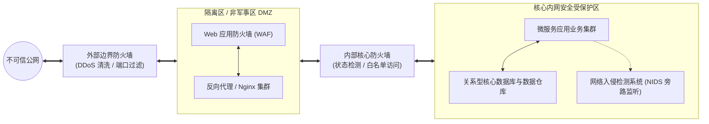

# Lec 10 网络安全防御与企业级攻防体系 (Computer Security II: Network Security)

> MIT Sloan School of Management · 15.561 Information Technology Essentials

## TL;DR

- 现代网络攻击贯穿网络层到应用层全栈，防守方必须从被动边界封堵转向纵深防御架构。
- 防火墙从无状态包过滤演进至状态检测与应用层 WAF，结合入侵检测 IDS 形成多维拦截网。
- 零信任架构打破传统内网默认授信假定，确立持续验证、最小权限与微隔离的企业安全新范式。

## 经典网络威胁与攻击面剖析 / Attack Vectors & Threat Landscapes

随着企业资产全面接入互联网，攻击者的手段已经从早期炫技式的单机脚本病毒演进为组织化、经济利益驱动的跨国网络犯罪与高级持续性威胁（APT）。现代企业面临的攻击面覆盖了 OSI 全栈：

::: definition 典型企业级网络攻击向量
1. **分布式拒绝服务 (DDoS)**：利用僵尸网络（Botnet）向目标服务器集群发起洪水攻击（如 SYN Flood、DNS 放大、HTTP GET Flood），以海量垃圾报文耗尽带宽、连接表或应用 CPU，使正常业务陷入瘫痪。
2. **应用层代码注入 (Injection Attacks)**：
   - **SQL 注入 (SQLi)**：利用后端未经转义的动态拼接 SQL 语句，绕过身份验证并盗取整张数据库数据；
   - **跨站脚本 (XSS)**：在受信任的网页中注入恶意 JavaScript，窃取受害访客的 Session Cookie 或执行挂马操作。
3. **缓冲区溢出 (Buffer Overflow)**：向 C/C++ 等未受内存安全保护的服务程序输入超长载荷，覆盖栈帧返回地址，劫持执行流获取操作系统最高控制权。
4. **中间人劫持 (MitM) 与 ARP 欺骗**：在未加密的内网广播域中伪造网关 MAC 地址，嗅探并篡改全部敏感通信明文。
:::

## 纵深防御网络拓扑：DMZ、防火墙与入侵防御 / Defense-in-Depth Architecture

没有任何单一技术可以一劳永逸阻断所有攻击。企业网络安全的核心范式是**纵深防御（Defense-in-Depth）**——通过设置多道相互独立、职责各异的安全防线，确保即便外部边界被穿透，核心数据资产依然受到深层隔离保护。

如上图所示，企业网络拓扑中设立了至关重要的缓冲区——**DMZ（Demilitarized Zone，隔离区 / 非军事区）**：
- **外部防火墙**：直接面对公网流量，仅对外暴露标准的 80/443 等安全端口，并过滤明显的畸形报文；
- **DMZ 区域**：安放直接面向外部用户的 Web 接入层和应用代理。**DMZ 中的任何机器被严格禁止直接向内部核心受保护网络发起任意连接**；
- **内部核心防火墙**：只允许内部应用主动向 DMZ 轮询拉取数据，或者通过严格的单向白名单端口通信，彻底阻断了黑客拿下一个 Web 容器后直接横向渗透企业内网的可能性。

::: definition 防火墙技术演进层级 (Firewall Evolution)
1. **第一代：无状态包过滤防火墙 (Stateless Packet Filter)**：仅检查每个独立数据包的源 IP、目的 IP、源端口与目的端口，匹配预设规则表，无法感知连接状态。
2. **第二代：有状态检测防火墙 (Stateful Inspection)**：在内核维护动态连接状态表（State Table）。只有符合 TCP 三次握手合法迁移或内部主动发起的请求所对应的回程报文才允许通过。
3. **第三代：应用层网关与 WAF (Web Application Firewall)**：重组并深度解析 HTTP/HTTPS 载荷内容，基于正则与语义模型拦截 SQLi、XSS、Log4j 等应用层攻击。
:::

## 入侵检测（IDS）与入侵防御（IPS）机制 / IDS vs. IPS Mechanisms

防火墙是守卫城门的“卫兵”，只放行持合法通行证（IP 和端口）的流量；而**入侵检测系统（IDS）**与**入侵防御系统（IPS）**则是城内的“便衣巡警”，负责审查通行者是否携带暗藏武器或异常举动。

::: definition IDS 与 IPS 的核心区别
- **入侵检测系统 (IDS, Intrusion Detection System)**：采用**旁路镜像部署（Out-of-Band / Tap）**，抓取网络核心交换机上的镜像流量副本进行离线分析。当检测到木马病毒、端口暴力扫描或可疑反弹 Shell 时，仅向安全运营中心（SOC）发出警报，**不会对生产数据包产生任何转发延迟阻断**。
- **入侵防御系统 (IPS, Intrusion Prevention System)**：采用**串行串联部署（In-Line）**，真实业务流量必须穿透 IPS 硬件。一旦发现攻击特征，IPS 能够立即重置连接（发送 TCP RST）或丢弃恶性报文。缺点是若出现误报（False Positive），将直接导致正常商业交易中断。
:::

IDS/IPS 的分析引擎主要基于两套互补算法：
1. **特征签名匹配 (Signature-Based)**：对比已知黑客漏洞利用载荷（CVE 签名库），准确率极高但无法识别 0-day 未知漏洞；
2. **异常行为基线分析 (Anomaly-Based)**：利用统计学或机器学习模型建立网络正常流量模式基线，当突发高频异常连接或冷门协议通信时触发告警，具备发现未知高级威胁潜力但误报率较高。

## 现代安全演进：从边界防御到零信任架构 / Paradigm Shift to Zero Trust

传统网络安全架构基于一种脆弱的“城堡与护城河”假设：在护城河（边界防火墙）之外的公网是充满敌意的，而在护城河之内的企业内网（Intranet）默认是完全可信的。员工只要连上内网网线或接入企业内网 VPN，便可以在内网畅通无阻。

这种假设在现代云原生与远程混合办公时代已被彻底证伪：内部员工的受感染电脑、被离职人员窃取的凭据以及供应链第三方的后门，使得“内部可信”沦为空谈。

::: definition 零信任安全模型 (Zero Trust Architecture)
零信任架构由约翰·金德维格（John Kindervag）提出，其核心公理为：**“持续验证，永不信任”（Never Trust, Always Verify）**。
1. **消灭基于网络位置的默认信任**：无论流量来自星巴克公共 Wi-Fi 还是总部数据中心核心机架，均被视为同等不可信；
2. **最小权限原则 (Least Privilege)**：每次请求仅授予完成当前微操作所需的绝对最低权限；
3. **软件定义边界 (SDP) 与微隔离 (Micro-segmentation)**：服务在网络上默认不可见，必须先通过动态多因素认证（MFA）与设备健康状态评估（Posture Check），方可建立点对点加密隧道。
:::

## 我的理解与实践洞察 / Personal Insight

::: insight 安全是商业连续性的使能者，而非阻碍业务的官僚部门
在企业技术战略中，安全团队与业务团队常常处于对立紧张关系中。CIO 与架构师必须重构安全哲学的组织定位：
1. **将安全左移（Shift-Left Security）融入工程流水线**：不要等到系统上线前一天才让安全团队进行渗透测试。在软件开发生命周期的第一天（需求设计阶段）就引入威胁建模，在 CI/CD 编译环节自动运行静态代码分析（SAST）与开源软件依赖漏洞扫描（SCA）。修复一个架构设计阶段的安全缺陷成本只有几小时，而系统被黑客攻破后再停机修复的声誉和财务损失往往以百万元计。
2. **安全防护的设计边界必须对齐商业资产价值**：不存在 100% 绝对安全的系统。如果攻破一个系统需要攻击者消耗价值一千万元的算力资源，而其窃取的数据黑市价值只有十万元，那么该系统在经济学意义上就是绝对安全的。安全架构师的职责不是追求空洞的乌托邦式免责，而是在用户体验、系统吞吐量与商业风险成本之间做出最清醒的边际平衡。
:::
