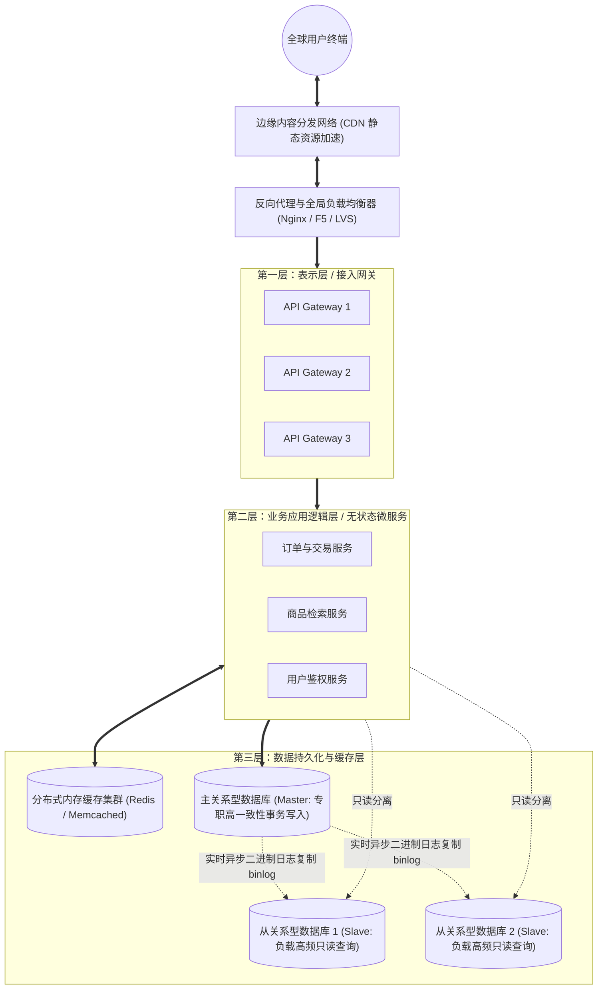

# Lec 11 商业网站底层技术揭秘与高并发架构 ("Under the Hood" of a Commercial Website)

> MIT Sloan School of Management · 15.561 Information Technology Essentials

## TL;DR

- 现代高并发商业网站彻底抛弃单体黑盒，建立表示层、业务应用层与数据持久层严密分工的三层架构体系。
- 负载均衡器通过轮询、加权最小连接与哈希一致性算法，化解千万级流量向无状态应用实例的水平扩散压力。
- 分布式多级缓存拓扑（CDN、网关缓存、Redis 集群）是保护数据库瓶颈的关键护城河，需妥善解决穿透、击穿与雪崩危机。

## 商业网站的系统全景：从单体服务器到经典三层架构 / Commercial Website Topologies

在互联网商业发展的极早期，绝大多数商业网站均构建在高度简陋的单机“灯塔（LAMP/WAMP，即 Linux/Windows + Apache + MySQL + PHP）”环境之上。在这一极其脆弱的模型中，单一一台物理服务器必须同时承担接收公网 HTTP 请求、解析动态脚本语言、执行业务判定逻辑以及向本地机械硬盘读写关系型数据库记录的全部沉重任务。

当网站仅仅面向几百个日均访问者时，这种一体化架构凭借其极速的开发部署速度尚能胜任。然而，一旦商业业务迎来爆发式增长——例如突发新闻事件、假日大规模电商打折秒杀或是电视营销广告投放，瞬时涌入的数万个并发 TCP 握手请求便会瞬间将这台单体服务器的 CPU 算力打满、内存耗尽、磁盘 I/O 读写队列彻底阻塞，最终导致整个商业门户陷入完全无响应的瘫痪死锁。

为了打破单机物理性能的铁顶，软件架构工业经历了一场波澜壮阔的解耦革命，形成了现代分布式计算的黄金标准——**经典三层架构（Three-Tier Architecture）**以及向微服务治理体系的全面升华。

上图展示了现代商业网站在高并发流量洪峰下的典型分层拓扑结构。在这个严密协作的有机体中，每一层都遵循严格的单一职责原则，并且在物理上实现了完全的网络与硬件隔离：
1. **第一层：表示层与网关接入层 (Presentation & Gateway Tier)**：直接面对公网终端或 CDN 回源流量，专门负责终结昂贵的 SSL/TLS 证书加解密运算、校验 HTTP 请求头格式的合法性、防范跨域攻击，并根据统一的 API 路由规则将清洗后的请求快速分派至后方内网集群；
2. **第二层：业务应用逻辑层 (Application Logic Tier)**：纯粹的业务计算与规则裁决中心。这一层的计算实例被严格设计为**无状态（Stateless）**，绝不在本地磁盘或内存中固化用户会话，使得运维系统可以在秒级弹性启动数百个新容器实例来迎战突发洪峰；
3. **第三层：数据持久化与分布式缓存层 (Data Persistence Tier)**：负责保障商业资产数据的绝对可靠与 ACID 事务一致性。通过将读多写少的查询请求卸载至从库和高速内存缓存，最大程度缓解了核心主库的写入压力。

## 流量调度枢纽：反向代理与负载均衡算法 / Reverse Proxies & Load Balancing

当每秒请求数（QPS）从几百飙升至数十万时，入口流量必须通过**负载均衡器（Load Balancer）**进行多路径扩散。

::: definition 反向代理 vs. 正向代理 (Reverse vs. Forward Proxy)
- **正向代理 (Forward Proxy)**：客户端的代理人。客户端知晓代理的存在（如办公网出网代理），代理服务器代表客户端向外部不可控互联网发起请求，隐藏了真实客户端的 IP。
- **反向代理 (Reverse Proxy)**：后端的保护伞。外部用户以为自己正在直接访问目标网站（如 `example.com`），实际上请求全部打在反向代理接入层上，由反向代理依据内部调度算法分发给后方庞大的无状态工作集群，隐藏了内网拓扑。
:::

负载均衡调度器依赖不同的调度策略在集群节点间分配权重：

| 算法类型 | 工作原理 | 适用场景与优缺点 |
| :--- | :--- | :--- |
| **轮询 (Round Robin)** | 按顺序将请求依次循环分发给后端实例 | 适用于后端服务器硬件规格完全相同、且每个任务计算开销大致相等的轻量服务 |
| **加权最小连接 (Weighted Least Connections)** | 优先分发给当前处理中活跃 TCP 连接数最少且配置更高的实例 | 最适合长生命周期请求（如大文件上传下载、复杂事务结算），能有效避免个别节点过载 |
| **源 IP 哈希 (Source IP Hash)** | 对客户端 IP 计算哈希值取模，同一 IP 始终路由至同一后端服务器 | 能解决单机 Session 亲和性，但若大量用户位于同一大企业 NAT 网关下会导致严重的负载倾斜 |
| **一致性哈希 (Consistent Hashing)** | 将节点和请求映射至 $2^{32}-1$ 的虚拟哈希环上，增删节点仅影响相邻分区 | 分布式缓存节点与微服务状态集群扩容缩容的标准解法，将数据再平衡震荡降至最低 |

## 缓存为王：多级缓存拓扑与三大经典危机 / Caching Topologies & Classic Pitfalls

在计算机体系中，关系型数据库永远是高并发架构中最先倒下的阿喀琉斯之踵。磁盘 I/O 和行级锁竞争决定了单库每秒写事务承载力通常在数千至万级。要想支撑十万、百万级并发，必须构建**多级缓存（Multi-Level Caching）体系**。

读取请求沿着金字塔层层拦截：
1. **浏览器客户端缓存**：通过 HTTP 响应头 `Cache-Control: max-age` 与协商缓存 `ETag`，让用户直接读取本地内存或磁盘静态资源，网络请求甚至不用发出；
2. **边缘 CDN 缓存**：分布在全球运营商边缘机房，命中静态 HTML、图片、视频和热点商品静态 JSON 接口，消除跨国跨网骨干延迟；
3. **应用内存堆内缓存**：微服务本地 Guava/Caffeine 缓存，纳秒级读取最高频配置；
4. **分布式共享缓存**：基于内存的 Redis/Memcached 集群，微秒级读取高频动态业务数据。

然而，引入缓存必然引入系统复杂性。分布式缓存架构中存在三大经典致死故障模式：

::: pitfall 缓存三大经典危机与工程防御
1. **缓存穿透 (Cache Penetration)**：恶意黑客持续高频查询一个**在数据库和缓存中都根本不存在的伪造 ID**。由于缓存未命中，每个请求都会被击穿至底层数据库，瞬间将关系数据库 CPU 打满。
   - *防御手段*：对空结果也进行短时间缓存（缓存空对象），或在最前端构建布隆过滤器（Bloom Filter）极速拦截不存在的键。
2. **缓存击穿 (Cache Breakdown)**：某个承载百万流量的**超级热点 Key（如爆款秒杀商品）在缓存中过期的瞬间**，恰好有数万个并发请求涌来。由于缓存失效，海量请求同时向数据库发起读写重构。
   - *防御手段*：使用互斥锁（Mutex Lock）确保只有一个工作线程去数据库加载并回写缓存，其他线程等待重试；或设置热点数据永不过期，由后台定时任务异步续期。
3. **缓存雪崩 (Cache Avalanche)**：由于运维失误或大批数据集中导入，**大量缓存 Key 被设置了完全相同的过期时间**，在某一时刻集中大面积失效；或者 Redis 集群整体宕机。洪峰流量如同雪崩般全数压在数据库上导致全线瘫痪。
   - *防御手段*：在设置失效时间时增加随机抖动偏移量（Random Jitter），防止同步失效；同时搭建高可用 Redis Sentinel / Cluster 集群并配置限流熔断降级中间件（如 Sentinel/Hystrix）。
:::

## 我的理解与实践洞察 / Personal Insight

::: insight 可扩展性（Scalability）的本质：消除共享状态
高并发架构设计的全部智慧，可以用八个字彻底概括——**水平扩展，消灭状态**：
1. **纵向扩展（Scale-up）是昂贵的死胡同**：通过采购更顶级的八路小型机、堆砌 2TB 内存来解决性能问题，不仅硬件成本呈超线性飙升，更最终会撞上单机总线与物理散热的坚固天花板。
2. **无状态化是无限水平扩展（Scale-out）的前提**：如果一个 Web 实例在本地内存中保存了用户的登录状态或购物车对象，该实例就变成了具有“个性和记忆”的特殊节点，负载均衡器就无法随意将请求打给其他机器，宕机也无法自愈。真正的云原生架构必须把所有计算节点彻底“家畜化（Cattle, not Pets）”——任何一个应用容器在下一秒崩溃被销毁，或者新启动一百个容器加入集群，对整个系统运转完全透明无感。状态全部下沉至专门的分布式存储系统，计算节点方能实现弹性的呼之即来、挥之即去。
:::
