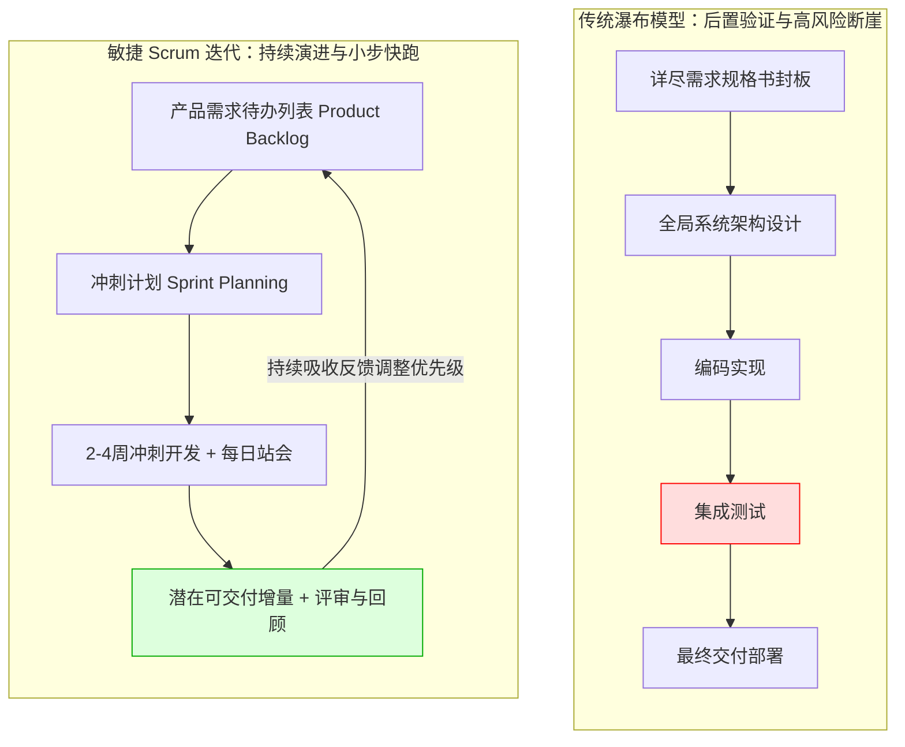

# Lec 12 软件开发项目管理与工程敏捷实践 (Managing Software Development)

> MIT Sloan School of Management · 15.561 Information Technology Essentials

## TL;DR

- 软件开发不仅是一门计算机科学，更是一项涉及人类认知协作、不确定性治理与复杂系统工程的组织管理挑战。
- 经典瀑布模型试图以线性阶段门控消除风险，但在需求动态漂移与真实市场反馈延迟下往往孕育系统性失控灾难。
- 敏捷方法论通过短周期冲刺迭代、持续集成 CI/CD 与测试驱动，将风险前置显性化，并以纪律严明的代码重构偿还技术债务。

## 软件危机的根源与布鲁克斯人月神话 / The Software Crisis & Brooks' Law

1968 年，北大西洋公约组织（NATO）在德国加尔米施召开了历史上著名的学术会议，首次正式确立了“**软件危机（Software Crisis）**”这一概念。随着硬件算力的暴涨，企业试图构建越来越庞大、复杂的软件系统，然而随之而来的却是系统性的预算严重超支、交付无限延期、代码质量千疮百孔以及大量大型系统在上线前夕被迫报废。

IBM System/360 操作系统项目的总指挥弗雷德里克·布鲁克斯（Fred Brooks）在传世经典《人月神话》（*The Mythical Man-Month*）中，剖析了软件工程区别于传统土木工程的本质特征：

::: theorem 布鲁克斯法则 (Brooks' Law)
**“向一个已经延期的软件项目增加人手，只会让项目延期更加严重。”（Adding manpower to a late software project makes it later.）**
:::

布鲁克斯指出，复杂软件开发绝非“搬砖”或“割麦子”式的线性劳动：
1. **培训与磨合成本 (Ramp-up Cost)**：新加入的工程师在数月内几乎无法产出有效代码，反而需要资深工程师停下手头核心工作为其讲解业务领域模型与遗留系统暗坑；
2. **沟通组合爆炸 (Communication Complexity)**：在一个有 $n$ 名工程师的团队中，沟通渠道的数量以组合数规模增长：
   $$\text{Channels} = \frac{n(n - 1)}{2} = \mathcal{O}(n^2)$$
   当团队由 5 人增加到 50 人时，人际沟通渠道从 10 条暴增至 1225 条，团队成员将几乎所有精力消耗在开会、邮件与对齐接口规范上，真正用于写代码的有效工时被严重稀释。

## 瀑布模型 vs. 敏捷开发范式大演进 / Waterfall vs. Agile Frameworks

为了应对混乱，温斯顿·罗伊斯（Winston Royce）在 1970 年提出了**瀑布模型（Waterfall Model）**。瀑布模型将开发划分为严格顺序推进的阶段：需求分析、系统设计、代码编写、系统测试、部署运维。上一阶段文档未经过委员会签署封板，严禁进入下一阶段。

瀑布模型在航天飞控、核电站控制等需求极端确定且不容微小瑕疵的场景中依然有其价值，但在商业应用软件中，它面临着根本性的**认知盲区**：客户在亲眼看见并用鼠标点击可运行的原型之前，根本不知道自己真正想要什么。瀑布模型把最关键的系统集成与用户验证推迟到了项目周期的最后 10%，一旦此时发现架构根本错误，返工代价将彻底摧毁整个项目。

2001 年，十七位软件工程大师在美国犹他州雪鸟滑雪胜地共同签署了《敏捷软件开发宣言》（*Manifesto for Agile Software Development*），彻底逆转了工业界的方法论：

::: definition 敏捷宣言四大核心价值观 (Agile Manifesto)
1. **个体与互动** 高于 流程和工具；
2. **可工作的软件** 高于 详尽的文档；
3. **客户协作** 高于 合同谈判；
4. **响应变化** 高于 遵循计划。
:::

在敏捷最流行的工业实现 **Scrum** 框架中，跨职能团队（包含产品负责人 PO、Scrum Master、研发与测试）将庞大的项目切分为 2 至 4 周的固定周期**冲刺（Sprint）**。每个冲刺结束时，团队必须交付一个端到端可运行、经过全面测试的**潜在可交付软件增量（Potentially Shippable Increment）**，确保管理层与业务方每两周都能获得真实的产品进度证明。

## 工程卓越体系：CI/CD、自动化测试与代码重构 / Engineering Excellence: CI/CD & DevOps

敏捷绝不是“没有纪律的随意乱写”，更不是拒绝写文档的借口。敏捷的轻盈必须建立在极其严酷、自动化的工程流水线基础设施之上。

::: definition 现代 DevOps 持续交付流水线核心组件
1. **持续集成 (Continuous Integration, CI)**：开发人员每天多次将本地代码合并（Git Push）至主干分支。每次提交自动触发远程构建服务器，执行单元测试、集成测试、代码静态合规分析与依赖安全扫描。任何破坏构建的提交必须在 10 分钟内被修复或回滚。
2. **持续交付与部署 (CD, Continuous Delivery/Deployment)**：通过容器镜像（Docker）和基础设施即代码（IaC, Terraform），实现一键式或完全自动化的多环境（开发、测试、预发、生产）灰度金丝雀发布（Canary Release）与蓝绿部署（Blue-Green Deployment）。
3. **自动化测试金字塔 (Test Pyramid)**：底部是执行极快、成本极低的海量单元测试（Unit Tests），中部是验证模块间 RPC 与数据库交互的集成测试（Integration Tests），顶部是少量模拟真实浏览器点击的端到端 UI 测试（E2E Tests）。
:::

## 技术债务的累积与治理法则 / Technical Debt Economics

沃德·坎宁安（Ward Cunningham）提出了具有深刻金融隐喻的概念——**技术债务（Technical Debt）**。

::: definition 技术债务 (Technical Debt)
为了赶在业务截止日期前快速上线，开发团队有意识或无意识地采用了粗糙简陋的架构设计、硬编码临时方案、忽略单元测试或未做抽象封装。这就好比向未来的自己借了一笔金融高利贷。
系统随后所开发的每一个新功能，都必须为这笔债务支付高额的**利息（Interest）**——即在越来越混乱的代码迷宫中排查 Bug 和理解逻辑所耗费的额外延误工时；如果不定期主动重构偿还**本金（Principal）**，当利息总额超过团队全部生产力时，系统便陷入彻底的技术破产。
:::

高水平的技术管理者绝不纵容技术债务野蛮生长，他们通常在每个 Sprint 冲刺中强制预留 15% 至 20% 的工程容量，专门用于技术债务重构、底层依赖版本升级与核心测试补齐。

## 我的理解与实践洞察 / Personal Insight

::: insight 敏捷不是银弹，管理软件开发的本质是管理信任与心理安全感
回顾全球无数企业推行“敏捷转型”的失败案例，绝大多数团队只是在搞“敏捷形式主义（Cargo Cult Agile）”——每天站立开会 15 分钟，把 Jira 看板上的卡片挪来挪去，实质上却仍然在执行高压瀑布式微观管理：
1. **用可度量的真实工作软件建立业务与技术的信任**：业务部门之所以喜欢在项目初期逼迫技术团队签署几百页不可更改的需求规格书并约定死期，是因为历史上他们被技术团队交付的巨大延误和漏洞伤透了心。当技术团队能够稳定地以两周为节拍，端出高质量、可运行的增量原型给业务试用时，死板的官僚控制自然会退场。
2. **培养团队的高心理安全感（Psychological Safety）**：哈佛商学院艾米·埃德蒙森（Amy Edmondson）的研究证明，最高效的技术团队不是不犯错的团队，而是成员敢于第一时间在站会上坦白“这个架构我之前设计失误了，需要重构”的团队。如果企业文化惩罚失败，工程师就会千方百计掩盖架构缺陷和代码异味，最终引爆摧毁整座大厦的系统性灾难。
:::
