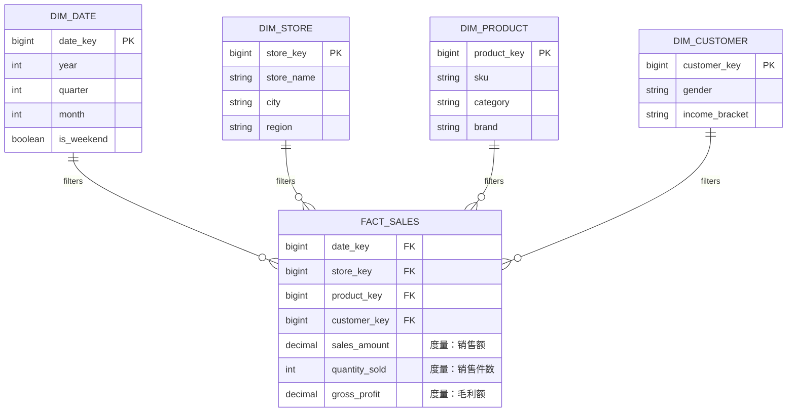

# Lec 15 商业智能：数据仓库与数据挖掘 (Business Intelligence: Data Mining and Data Warehousing)

> MIT Sloan School of Management · 15.561 Information Technology Essentials

## TL;DR

- 商业智能构建了从日常海量交易流水向高阶管理决策智慧跃迁的分析型数据处理体系。
- 数据仓库在底层彻底隔离 OLTP 联机事务与 OLAP 联机分析负载，星型与雪花模型提供多维切片切块基础。
- 数据挖掘算法涵盖关联规则、分类预测与聚类细分，现代架构正全面融合实时流计算与大数据湖仓底座。

## 商业智能的范式分野：OLTP 与 OLAP 的本质对偶 / The Divide: OLTP vs. OLAP

企业在日常经营中每分每秒都在产生海量数据：收银台扫描的每一笔销售流水、ATM 机取款的每一次扣款记录、仓储出入库的每一次扫码。然而，许多坐拥数以 TB 计交易数据的企业高管，却在面对“我们上季度哪个客户群体的终身价值最高？哪款产品组合最有交叉销售潜力？”时陷入彻底的**数据丰富而知识匮乏（Data Rich, Information Poor）**窘境。

导致这种现象的底层技术根源，在于**事务处理与分析处理之间不可调和的系统冲突**：

| 维度 | 联机事务处理 (OLTP, Operational / Transactional) | 联机分析处理 (OLAP, Analytical / Informational) |
| :--- | :--- | :--- |
| **系统核心定位** | 支撑企业日常运营（如 ERP、CRM、银行核心交易系统） | 支撑战略决策、趋势预测、业务审计与高管仪表盘分析 |
| **数据操作模式** | 高频、短小、并发的单条记录 `INSERT`、`UPDATE`、`DELETE` | 复杂的长事务多表大范围 `SELECT`，海量历史聚合统计 |
| **响应时延要求** | 毫秒级极速响应，严防锁等待 | 秒级至分钟级均可接受 |
| **数据建模范式** | 严格规范化（3NF/BCNF），消除冗余以保障写事务 ACID | 高度反规范化（维度建模/星型模型），冗余字段以加速大表读吞吐 |
| **数据时间跨度** | 仅保留当前最新即时状态（当前有效数据） | 跨越数年乃至数十年的历史快照序列（只追加不修改） |

如果在生产业务数据库（OLTP）上直接运行一个耗时 10 分钟、扫描全表数千万行历史订单的复杂分析 SQL，数据库的 CPU 与磁盘 I/O 资源将被瞬间榨干，导致前线正在付款的顾客全部遭遇超时锁死。因此，构建独立的**数据仓库（Data Warehouse, DW）**并进行物理隔离，是企业迈向商业智能的唯一技术出路。

## 数据仓库与维度建模：星型模型 vs. 雪花模型 / Data Warehousing & Dimensional Modeling

拉尔夫·金博尔（Ralph Kimball）开创了数据仓库的**多维建模（Dimensional Modeling）**理论。与传统关系型数据库晦涩的表结构不同，维度建模天然贴合商业分析师的心智直觉：**以特定的商业度量事实为核心，围绕多种业务考察角度展开观测**。

如上图所示，这是经典的**星型模型（Star Schema）**：
- **事实表 (Fact Table)**：位于中心，记录业务度量值（如销售额、利润、件数），包含大量高基数的外键指向周边维度表；
- **维度表 (Dimension Tables)**：环绕在四周，提供切片观察的上下文属性（如时间维度、商品维度、门店地域维度、顾客客群画像）。

在星型模型中，维度表被完全扁平化（反规范化），极大地减少了执行复杂分析查询时多表关联（JOIN）的开销；而如果将维度表进一步按第三范式规范化拆解（如将门店表中的城市进一步抽离出省份表），则演化为了**雪花模型（Snowflake Schema）**。

基于维度立方体（Data Cube），分析师可以自如执行四大 OLAP 基础操作：
1. **切片与切块 (Slice and Dice)**：选定特定维度子集（例如仅观察“2005 年”且“华东大区”的数据）；
2. **钻取 (Drill-down / Roll-up)**：在层级维度间上下穿梭（从“按年度”下钻细化至“按月度”与“按日”，或反向向上卷起汇总）；
3. **旋转 (Pivot)**：改变坐标轴观察视角，将原本在行展示的商品类别旋转至列对比。

## 数据管道 ETL：构建真实可信的数据湖泊 / The ETL Pipeline & Data Quality

数据绝不会自发地以优雅的星型模型躺在数据仓库中。将数十个业务系统、遗留主机以及外部 API 的异构数据抽取至分析引擎，必须依赖庞大的 **ETL（Extract, Transform, Load）** 管道：
- **抽取 (Extract)**：定时或实时从各个 OLTP 生产库拉取增量变更日志（CDC, Change Data Capture）；
- **转换 (Transform)**：数据工程中最消耗精力的环节——包括格式统一（如不同系统的日期格式归一）、编码转码、异常值过滤、主键冲突合并以及缺失值插补；
- **加载 (Load)**：将清洗后的标准干净数据批量加载至分析型数据仓库引擎中。

::: pitfall 垃圾进，垃圾出 (Garbage In, Garbage Out)
如果在 ETL 阶段缺乏严谨的数据质量治理（Data Governance），业务系统前端脏数据（如顾客随意填写的出生年份 1800 年、重复创建的手机号）未经校验直接灌入数据仓库，最终无论算法模型多么高级，仪表盘输出的所谓“智能商业洞察”都完全是荒唐的误导。
:::

## 数据挖掘经典技术与算法谱系 / Classical Data Mining Algorithms

商业智能的第一阶段是“描述性分析（Descriptive Analytics）——过去发生了什么”，而更高级的阶段则是利用**数据挖掘（Data Mining）与机器学习**实现“预测性分析（Predictive Analytics）——未来可能会发生什么，我们应该如何决策”。

数据挖掘技术通常分为三大阵营：

::: definition 数据挖掘三大主流流派
1. **关联规则挖掘 (Association Rule Mining)**：发现海量交易篮子中商品共现的潜在规律。最著名的是阿格拉瓦尔（Rakesh Agrawal）提出的 **Apriori 算法**。通过计算支持度（Support）与置信度（Confidence），挖掘出诸如著名的“尿布与啤酒”（父亲在周五晚上为婴儿买尿布时顺便买啤酒）这一跨品类摆放交叉销售洞察。
2. **分类与回归预测 (Classification & Regression)**：通过历史已标注数据训练模型预测未来结果。经典算法涵盖决策树（C4.5、CART）、朴素贝叶斯（Naive Bayes）以及逻辑回归（Logistic Regression）。在金融信用卡反欺诈、客户流失预警（Churn Prediction）中发挥决定性作用。
3. **聚类分析 (Clustering)**：无监督学习算法（如 K-Means 算法）。算法在没有预设标签的情况下，根据顾客的购买频次、客单价和偏好特征向量之间的欧几里得距离，自动将数百万客户聚类为几个高内聚、低耦合的天然细分客群，为精细化客群运营提供数据支撑。
:::

## 我的理解与实践洞察 / Personal Insight

::: insight 商业智能的终局不是漂亮的图表，而是决策流程的闭环重塑
许多企业在数据治理上豪掷数千万元，采购了最顶级的数据仓库和 BI 大屏可视化软件，最后却发现系统的唯一用途是每天早晨在管理层会议室展示花哨的折线图，战略决策依然完全依靠老板拍脑袋：
1. **指标体系必须与商业战略对齐，而非盲目罗列虚荣指标（Vanity Metrics）**：PV、UV、总注册用户数等指标往往只能抚慰虚荣心。真正有价值的商业智能指标是那些**直接反映单位经济学（Unit Economics）与业务健康度的硬核指标**——例如获客成本（CAC）、客户终身价值（LTV）、次月留存率、净推荐值（NPS）与现金流跑道。
2. **从“被动报表查看”进化到“自动化业务闭环（Actionable Insights）”**：真正高段位的数据架构，绝不满足于让分析师隔天生成一份 PDF 报告。现代 BI 强调**反向 ETL（Reverse ETL）**与智能策略联动——当风控模型在数据仓库中检测到某账户呈现欺诈特征的毫秒内，系统能自动调用业务 API 冻结其支付权限；当用户流失预警模型给出高风险评级时，系统能自动触发营销中台发放专属抵用券，将数据洞察瞬间转化为真实的商业自愈行动。
:::
