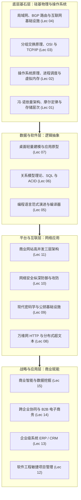
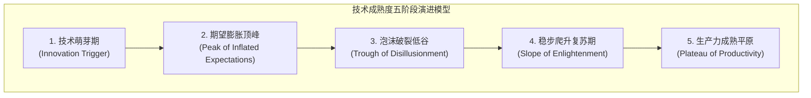

# Lec 16 新兴信息技术展望与课程大收官 (Emerging Technologies and Digital Transformation Wrap-up)

> MIT Sloan School of Management · 15.561 Information Technology Essentials

## TL;DR

- 全课完成了从微观硅基逻辑门、网络协议栈到企业级业务系统与数据智能的宏大架构全景穿透。
- 高德纳技术成熟度曲线为技术管理者提供了识别过热炒作与技术实质落地生产力窗口的理性框架。
- 数字化转型的终极壁垒不在于采购前沿技术工具，而在于重塑组织的敏捷演化心智与技术战略对齐能力。

## 课程宏大拼图的回溯与技术栈透视 / Comprehensive Technology Synthesis

在麻省理工学院斯隆管理学院 15.561 这一学期的探索中，我们跨越了计算机科学与现代管理科学最广阔的疆域。作为未来企业的数字化领军者与技术架构决策者，我们在这门课程中完成了一场系统性的认知登顶之旅：我们没有停留在商业管理的高谈阔论中，也没有迷失在细枝末节的代码语法泥潭里，而是从最底层的微观物理计算原理一路向上穿透，直至跨国企业的复杂战略价值网络。

现代信息技术绝非孤立知识碎片的杂乱拼凑，而是一座逻辑严密、层层嵌套的宏伟科技金字塔。回顾这十六讲的智力探险，每一个关键知识模块都在特定的工程维度上解决了前一个层级的核心瓶颈，共同构成了现代数字文明的基石：

从底层的硅晶片和冯·诺依曼总线出发，我们见证了操作系统如何以优美的抽象屏蔽物理复杂性；网络协议栈如何以分组交换和端到端哲学连接全球；关系型数据库如何以严谨的代数理论承载商业信任；最后，ERP、B2B 网络和商业智能如何在这一层层技术金字塔上构筑起现代全球经济的繁荣奇迹。

这套四层体系不仅是技术的分类目录，更是企业数字化成熟度的演进路线图。任何一家成功的现代企业，都必须在第一层确保计算和网络基础设施的高可用与抗毁性；在第二层确立严格规范、无冗余的数据建模规范；在第三层打造抵御公网黑客攻击并能从容应对洪峰流量的弹性平台；最终在第四层将前台的敏捷用户体验与后台的供应链闭环咬合，并在海量数据金矿中提炼出驱动未来商业创新的敏锐洞察。

每一位技术管理者都应当深刻铭记：**上层繁复商业应用的每一次平稳运行，底层都有成千上万个微观协议、硬件时钟周期与抽象层在默默提供坚如磐石的支撑**。

## 新兴技术研判框架：高德纳技术成熟度曲线 / The Gartner Hype Cycle

技术世界永远在翻滚着新的热词：从早期的云计算、大数据、物联网，到后来的区块链、元宇宙、再到如今的生成式大语言模型（Generative AI）。面对铺天盖地的媒体炒作与供应商推销，技术管理者如何避免成为“盲目追新的试验品”或“顽固保守的淘汰者”？

国际著名咨询机构高德纳（Gartner）提出的**技术成熟度曲线（Hype Cycle）**模型，为我们提供了宝贵的理性决策坐标系：

::: definition 高德纳技术成熟度五阶段生命周期
1. **技术萌芽期 (Innovation Trigger)**：实验室概念突破，媒体争相报道，概念引起风投极度狂热，但尚未出现经受工业检验的商业产品。
2. **期望膨胀顶峰 (Peak of Inflated Expectations)**：媒体与公众热情达到非理性狂欢，个别早期成功案例被无限放大，公众产生“该技术将彻底颠覆一切行业”的不切实际幻想。**（在此阶段盲目巨额投资，最容易沦为接盘侠）**。
3. **泡沫破裂低谷 (Trough of Disillusionment)**：技术由于工程成熟度欠缺、实施成本超预期、缺乏商业闭环，大量试验性项目失败，媒体风向骤变转为全面唱衰与冷落。
4. **稳步爬升复苏期 (Slope of Enlightenment)**：第二代和第三代企业深刻理解了该技术的真正适用边界，脚踏实地研发出可复制、可盈利的垂直应用方案。
5. **生产力成熟平原 (Plateau of Productivity)**：该技术褪去神秘光环，成为企业日常运营中如同水暖电气般不可或缺的基础设施，带来持续稳定的生产率提升。
:::

成熟的技术领袖应当在“顶峰期”保持克制与怀疑，在“低谷期”逆向研究其真正的核心价值，并在技术步入“复苏期”时果断实施战略布局。

## 新兴浪潮研判：云原生、泛在感知与生成式智能 / Emerging Paradigms: Cloud, IoT & GenAI

站在现代视口审视，当前信息技术正经历三大纵深突破：

### 1. 云计算与无服务器无状态化 (Cloud & Serverless)
企业基础设施彻底完成了从自建机房（On-Premise）向公有云与混合云的迁移。以 Kubernetes 为核心的容器编排体系让多云调度成为日常；而 **Serverless（无服务器计算）**更让工程师只需专注于编写纯粹的业务函数（FaaS），底层的一切扩缩容、高可用与机器运维全部由云厂商代管，计算彻底变为随用随开的纯粹公用事业。

### 2. 物联网（IoT）与边缘计算 (Ubiquitous Computing & Edge)
计算能力正从中心化云数据中心以放射状扩散至物理世界毛细血管。从智能汽车车载芯片、智能电网传感器到工厂机械臂，数十亿智能终端在数据产生的源头直接执行毫秒级实时推断（边缘计算），再将精炼元数据回传云端进行全局训练优化。

### 3. 生成式人工智能与大语言模型 (Generative AI & LLMs)
这是自万维网诞生以来最具革命性的范式飞跃。基于 Transformer 架构的大模型打破了传统自然语言与机器代码的界限，不仅能极大地辅助软件开发（AI 结对编程、测试用例自动生成），更正在重塑人机交互界面——从传统的鼠标图形界面（GUI）跃迁至自然语言意图驱动的自主智能体（AI Agents）协同网络。

## 数字化转型的终极心法 / The Core Mindset of Digital Transformation

完成 15.561 的全部研讨，我们最终提炼出统领全课的三大核心心法：

::: definition 数字化转型的三大核心公理
1. **技术是杠杆，业务与组织才是支点**：用最尖端的人工智能和云原生技术去武装一个流程混乱、权责不清、官僚僵化的传统组织，得到的只会是一个“以极高成本自动化生产混乱的高科技官僚组织”。技术永远无法弥补战略与流程的本质缺陷。
2. **拥抱模块化与松耦合（Loose Coupling）**：未来的唯一确定性就是不确定性。无论是软件架构中的微服务与 API 契约，还是组织架构中的扁平化小团队，保持模块间的低依赖度，才能在外部黑天鹅事件降临时拥有瞬间掉头重组的系统反脆弱性（Antifragility）。
3. **持续学习与跨界穿透力**：优秀的技术领袖必须既能与一线架构师就数据库锁机制和协议时延展开深入探讨，又能与董事会成员就资本回报率（ROIC）和竞争护城河侃侃而谈。**成为技术与商业两大陆地之间不可替代的桥梁，这正是 MIT Sloan 培养每一位技术管理者的终极期望**。
:::

## 我的理解与实践洞察 / Personal Insight

::: insight 技术的宿命是隐入尘烟，留下的是人性的洞察
回顾技术演进史，最伟大的技术最终都会变得“看不见”：
1. **当一项技术不再被称为新兴技术时，它才真正获得了成功**：在二十年前，人们谈论计算机网络、电力或关系型数据库时充满着技术崇拜；而今天，几乎没有人会在战略计划书里大肆宣扬“我们要引入电力或使用 TCP 协议”。它们已经彻底变成了人类社会的呼吸与心跳。
2. **在硅基算法爆炸的时代，碳基判断力反而是最稀缺的资产**：当 AI 大模型能够在一秒钟内写出完美的 SQL 查询、调通复杂的网络配置甚至生成完整的商业计划书时，对问题的定义能力、对人类真实痛苦的同理心、对商业道德边界的坚守以及在信息极其不完备时押上声誉进行关键决策的勇气，才是任何算法都无法取代的领导力灵魂。
:::
