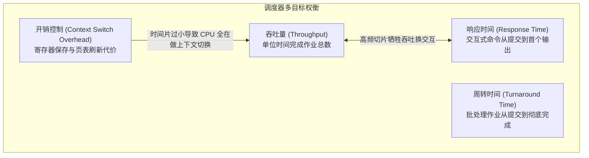

# Lec 02 操作系统原理与系统资源管理 (Fundamentals of Computing II: Operating Systems & Resource Management)

> MIT Sloan School of Management · 15.561 Information Technology Essentials

## TL;DR

- 操作系统是硬件资源的虚拟化中介，核心职责在于提供进程抽象、内存隔离与跨设备统一部件接口。
- 进程与线程构建了现代软件并发执行模型，抢占式调度器需在吞吐量、响应时间与上下文切换开销间寻求帕累托最优。
- 虚拟内存通过分页表与 TLB 硬件加速机制，赋予应用程序私有连续地址空间幻觉，同时实现底层的物理内存保护与动态交换。

## 操作系统的核心定位与抽象职责 / Role and Abstraction of Operating Systems

如果计算机仅仅由裸机硬件（Bare Metal）构成，软件开发者就必须为每一个不同的显卡控制器、磁盘寻址柱面和网络适配器手写低级控制指令。操作系统的诞生，彻底确立了软件工程分层治理的现代格局。

::: definition 操作系统 (Operating System)
操作系统（OS）是运行在硬件最高特权级（内核态/Kernel Mode）的基础软件。它承担两大对偶核心职责：
1. **资源管理者 (Resource Manager)**：在竞争的多任务程序之间裁决并分配有限的硬件资源（CPU、内存、I/O 设备），防范恶意代码独占或破坏系统。
2. **虚拟机抽象提供者 (Extended/Virtual Machine)**：将复杂的底层异构物理硬件封装为优雅、统一的逻辑抽象接口（如进程、虚拟内存、文件描述符与套接字 Socket）。
:::

双模式（Dual-Mode）运行是现代 OS 实现系统完整性保护的基石。硬件通过特权环（Ring 0 内核态 vs. Ring 3 用户态）划分执行权限。用户空间程序无法直接执行 I/O 指令或修改中断向量表，必须通过**系统调用（System Call）**触发软中断，陷入内核由 OS 代理执行，校验无误后方可返回结果。

## 进程、线程与并发调度模型 / Processes, Threads & CPU Scheduling

为了让多个业务程序在物理核心有限的 CPU 上看似“同时”运行，操作系统引入了**进程（Process）**与**线程（Thread）**两级并发实体。

::: definition 进程与线程的区别 (Process vs. Thread)
- **进程 (Process)**：操作系统进行资源分配和保护的独立实体。拥有私有的地址空间、页表、文件描述符表和环境变量。进程间通信（IPC）需要跨越内核边界（如管道、消息队列、共享内存）。
- **线程 (Thread)**：操作系统内核调度的最小执行单元。同一进程内的多个线程共享该进程的代码段、数据段和堆空间，仅拥有各自独立的程序计数器（PC）、寄存器上下文和调用栈（Stack）。线程轻量且切换成本低，但多线程并发读写共享变量极易诱发竞态条件（Race Conditions）。
:::

操作系统内核的 CPU 调度器（Scheduler）根据特定策略分配时间片。经典调度算法涵盖先来先服务（FCFS）、短作业优先（SJF）、轮转调度（Round Robin, RR）以及多级反馈队列（MLFQ）。调度器必须在多个相互冲突的指标之间平衡：

当多个并发线程或进程同时请求多项排他性系统资源时，如果不加节制地申请与占用，系统极易陷入完全停滞的**死锁（Deadlock）**状态。

::: theorem 产生死锁的四大必要条件 (Coffman Conditions)
1. **互斥条件 (Mutual Exclusion)**：资源必须具有排他性，同一时刻只能由一个进程占用。
2. **占有且等待 (Hold and Wait)**：进程持有至少一项资源的同时，又发出了申请其他资源的新请求。
3. **不可剥夺条件 (No Preemption)**：已被进程占用的资源在其主动释放前，不能被内核强行夺走。
4. **循环等待条件 (Circular Wait)**：存在一个进程集合 $\{P_0, P_1, \dots, P_n\}$，其中 $P_i$ 等待的资源正被 $P_{i+1}$ 占有，且 $P_n$ 等待 $P_0$ 占有的资源。
:::

现代高并发架构设计（如数据库连接池、分布式微服务事务）必须通过打破上述四条件之一（如统一加锁顺序、超时主动释放重试）来根绝死锁灾难。

## 虚拟内存与分页机制 / Virtual Memory & Paging

早期的实模式计算中，程序直接访问物理内存地址，一个程序的内存泄漏或越界指针可直接导致整个机器崩溃蓝屏。**虚拟内存（Virtual Memory）**技术通过硬件 MMU（内存管理单元）和操作系统协同，为每个用户空间进程构建了一个完全独立的虚拟地址空间。

::: definition 分页机制与页表 (Paging & Page Tables)
虚拟地址空间被切分为固定大小的块，称为**虚拟页（Virtual Page, VP）**，通常为 4 KB；物理内存同样切分为等大的**物理页框（Physical Frame, PF）**。
操作系统在内存中维护多级页表（Page Table），建立虚拟页号到物理页框号的映射关系。处理器内部的**快表（TLB, Translation Lookaside Buffer）**缓存热点映射，将两级查表延迟压缩至 1 个时钟周期。
:::

当进程访问的虚拟地址在页表中被标记为“不在物理内存中”（即被系统置换到了外部磁盘的 Swap 交换分区），MMU 触发**缺页异常（Page Fault）**。CPU 暂停当前进程，内核捕获该中断并执行磁盘 I/O 将页面调入物理内存，随后恢复进程指令执行。

::: pitfall 页面抖动与系统瘫痪 (Thrashing)
当系统运行的进程总工作集（Working Set）超过了可用物理 RAM 容量时，操作系统会将大量 CPU 算力消耗在频繁的“缺页中断-磁盘置换-重新调入”恶性循环中。CPU 利用率急剧跌入冰点，磁盘 I/O 队列彻底打满，这一灾难性现象被称为**抖动（Thrashing）**。对于现代企业级服务，抖动意味着服务假死，必须通过工作集容量规划或熔断限流手段规避。
:::

## 我的理解与实践洞察 / Personal Insight

::: insight 虚拟化技术与云计算范式演化的本质同构
审视从单机 OS 到现代云原生基础设施的进化历程，会发现深刻的**体系结构同构性**：
1. **多租户与隔离哲学的复用**：单机操作系统通过进程虚拟化了 CPU 和物理内存；而二十年后，VMware 虚拟化管理程序（Hypervisor）将整台裸机虚拟化为多台虚拟机；紧接着 Docker 容器利用 Linux 内核的原生能力（cgroups 与 namespaces）再次回到了“轻量进程级隔离”。技术演进不是线性的推翻重来，而是在更高系统层级上对“资源隔离”与“抽象复用”的周期性螺旋上升。
2. **基础设施开销与业务敏捷的平衡**：技术决策者在选型裸金属服务器、虚拟机还是 Serverless 无服务器架构时，核心考量始终是上下文切换与系统调用的税（Tax）。追求极限微秒级高频交易必须穿透 OS 直接绕过内核（Kernel Bypass/DPDK）；而面向快速迭代的消费互联网业务，采用高抽象度的无状态容器化方案则是节约工程人力成本的最佳选择。
:::
