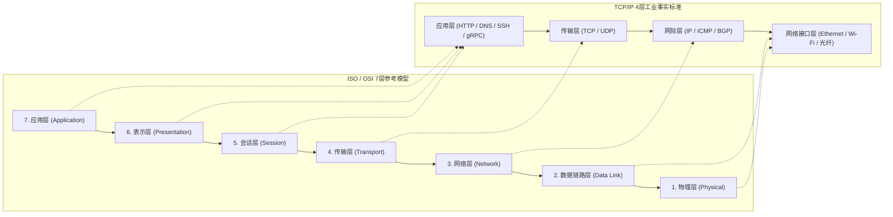

# Lec 03 计算机网络与通信协议栈 (Networks I: OSI Model, TCP/IP, and Protocols)

> MIT Sloan School of Management · 15.561 Information Technology Essentials

## TL;DR

- 计算机网络以分组交换替代传统电路交换，通过端到端原则极大提升了链路利用率与去中心化抗毁容灾韧性。
- OSI 七层概念模型与 TCP/IP 四层工业模型构成了全球网络协同规范，每一层通过报头封装实现职责严格正交解耦。
- 传输层 TCP 协议通过三次握手、滑动窗口与 AIMD 拥塞控制建立可靠双工字节流，UDP 则在低开销低延迟场景发挥不可替代价值。

## 分组交换革命与端到端网络原则 / Packet Switching vs. Circuit Switching

在计算机网络出现之前，全球通信网络完全基于传统电信系统的**电路交换（Circuit Switching）**。在电路交换模式下（如传统固定电话网），两台终端发起通信时，沿途的所有物理交换机必须预先建立一条专用的端到端物理电路。

::: pitfall 电路交换在计算机互联中的结构性浪费
计算机之间的数据通信具有显著的**突发性（Burstiness）**——系统在短时间内传输大量报文，随后陷入长时间的静默等待。在电路交换模式下，通信双方即使不发送任何数据，也必须独占该条链路的固定带宽，导致极其昂贵的干线带宽利用率极低；此外，中间任意单一交换节点发生物理故障，整个通信链路便会瞬间崩溃。
:::

为了支撑冷战时期的生存能力并提高利用率，保罗·巴兰（Paul Baran）与伦纳德·克兰罗克（Leonard Kleinrock）等先驱奠定了**分组交换（Packet Switching）**理论。在分组交换网络中：
1. 原始数据被切分为具有特定长度上限的独立**数据包（Packets）**；
2. 每个数据包携带源地址与目标地址元数据（Header）；
3. 沿途路由器根据实时网络拥塞拓扑，采用“存储转发（Store-and-Forward）”机制独立选路。

伴随分组交换诞生的是著名的**端到端原则（End-to-End Principle）**：网络的底层通信设施应该尽可能简单、通用且保持“哑（Dumb）”状态；复杂的状态维护、可靠性保障、加解密与应用逻辑应当被置于通信的两端终端（End Hosts）之中。这一哲学奠定了互联网跨越半个世纪爆炸式创新的核心基础。

## 协议分层体系：OSI 七层模型与 TCP/IP 体系 / OSI 7-Layer vs. TCP/IP Architecture

在网络互联发展的早期，IBM 的 SNA、DEC 的 DECnet 以及各类硬件厂商的私有通信标准互不兼容，跨异构网络的数据交互几乎是一场灾难。为了从理论上厘清网络通信必须解决的全部逻辑职责，国际标准化组织（ISO）在 1984 年正式提出了著名的 **OSI 七层参考模型（Open Systems Interconnection Reference Model）**。

OSI 模型从纯概念严谨性出发，自底向上严格划分为七个正交层级：物理层定义原始比特的电压波形与接口机械特性；数据链路层负责点对点无差错帧传输与介质访问控制；网络层执行全球逻辑编址与路径路由；传输层提供端到端的进程通信与可靠性保障；会话层负责建立与同步长效通信对话；表示层处理数据格式转换与加解密编码；应用层直接为终端用户应用程序暴露语义接口。

然而，在产业真实演进的战场上，由美国国防高级研究计划局（DARPA）资助并在开源 Unix 操作系统中广泛落地的 **TCP/IP 协议族**最终彻底击败了 OSI，成为了全球互联网事实上的工业标准。TCP/IP 遵循务实的工程哲学——“大致的共识与可运行的代码（Rough consensus and running code）”，将过于繁复的会话层和表示层直接并入应用层，形成了精炼实用的四层架构。

在两套体系中，分层设计的核心目的完全一致：每一层向上层暴露清晰的抽象接口，同时向下层发起标准服务调用，内部实现细节的变更绝不影响上下层协议。在发送端，数据逐层自顶向下流动，每一层依次在数据前端追加本层特有的协议控制信息（Protocol Control Information, 报头封装 Encapsulation）；在接收端，数据自底向上穿透，各层按协议规范剥离属于自己的报头（解封装 Decapsulation）并将净荷递交给上层协议。

::: definition 协议数据单元 (Protocol Data Unit, PDU)
在 TCP/IP 协议栈的不同层级，流动的数据单元拥有严格的行业术语定义：
- **应用层**：报文（Message）
- **传输层**：段（Segment, TCP）或数据报（Datagram, UDP）
- **网际层**：分组 / 数据包（Packet, IP）
- **数据链路层**：帧（Frame）
- **物理层**：比特流（Bits）
:::

## 传输层核心机制：TCP 可靠传输与拥塞控制 / TCP Transmission & Congestion Control

网络层的 IP 协议是纯粹的**尽力而为（Best-Effort）**协议——它不保证数据包不丢失、不重复、不失序，亦不保证端到端时延。现代复杂应用之所以能稳定传输海量文件与金融交易指令，完全依赖于传输层 TCP（Transmission Control Protocol）在不可靠物理信道上构建的虚拟可靠字节流服务。

### 1. 三次握手与双向连接初始化 (Three-Way Handshake)

TCP 连接通过三次报文交互协商通信初始序列号（ISN），防止历史失效的连接请求意外复活引发数据污染：
1. **客户端 -> 服务端**：`SYN=1, seq=x`（客户端进入 SYN_SENT 状态）；
2. **服务端 -> 客户端**：`SYN=1, ACK=1, seq=y, ack=x+1`（服务端分配资源，进入 SYN_RCVD 状态）；
3. **客户端 -> 服务端**：`ACK=1, seq=x+1, ack=y+1`（客户端与服务端均进入 ESTABLISHED 状态，可携带数据载荷）。

### 2. 滑动窗口与流量控制 (Sliding Window & Flow Control)

为避免接收方因内存缓冲区打满而丢弃数据包，TCP 通过接收窗口（`rwnd`）实现基于接收方处理能力的**流量控制**。发送方允许发送但未确认的字节序号跨度不能超过当前接收方通告的窗口上限。

### 3. 网络拥塞控制算法：AIMD 范式 (Congestion Control)

拥塞控制着眼于**整个网络公共信道的负载容量**，防止过多数据涌入中间交换节点造成链路崩溃。经典 TCP 拥塞控制采用**加法增大乘法减小（AIMD）**算法：

::: theorem AIMD 拥塞控制稳定性定理
在分布式竞争共享瓶颈带宽的网络系统中，各端点采用线性增加拥塞窗口（Additive Increase, 每个 RTT 内 $cwnd \leftarrow cwnd + 1$）与乘性衰减（Multiplicative Decrease, 发生丢包时 $cwnd \leftarrow cwnd / 2$）的状态迁移策略，可以在没有中心调度器的情况下，在纳什均衡意义上逼近帕累托最优与最大公平性（Max-Min Fairness）。
:::

与 TCP 形成鲜明对比的是 **UDP（User Datagram Protocol）**。UDP 仅在 IP 数据包上封装了 8 字节极简报头（源端口、目的端口、长度与校验和），放弃了确认重传、流控与拥塞调节。在实时音视频通话（WebRTC）、竞技网游状态同步与高频 DNS 查询等对单次抖动延迟极端敏感而允许微量丢包的场景中，UDP 拥有不可撼动的工程地位。

## 我的理解与实践洞察 / Personal Insight

::: insight 协议契约与分布式微服务架构的底层隐喻
理解网络协议的设计哲学，对现代企业构建大规模分布式系统具有直接的方法论指导：
1. **网络不可靠是一切分布式架构的公理**：墨菲定律在网络中被无限放大。任何微服务远程过程调用（RPC）都必须假定网络会发生分区、丢包、乱序和超时。如果在软件中将跨机网络调用简单等同于本地函数调用（如盲目使用同步阻塞远程调用），最终必然导致雪崩式故障扩散。必须引入幂等性设计、自适应重试退避与熔断断路器。
2. **端到端原则在云计算时代的再平衡**：虽然纯粹互联网坚持网络核心只负责无状态路由，但在现代企业多云与全球化业务中，软件定义网络（SDN）、应用交付网络（ADC）与边缘 CDN 节点正在把越来越多的“智能”（如应用层路由、TLS 终结、Web 应用防火墙）重新推回网络骨干之中。优秀的技术架构师需要在“端系统的灵活敏捷”与“中间件的全局优化”之间动态寻找系统最优点。
:::
