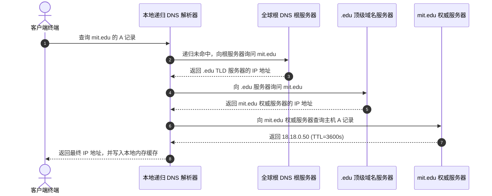

# Lec 04 局域网、广域网与互联网基础设施 (Networks II: LAN, WAN, Routing, and Internet Architecture)

> MIT Sloan School of Management · 15.561 Information Technology Essentials

## TL;DR

- 局域网从经典以太网 CSMA/CD 共享冲突域演进为全双工交换架构，奠定了现代企业内部微秒级通信基石。
- 全球互联网通过层次化自治系统（AS）实现解耦互联，内部网关协议 IGP 与外部边界网关协议 BGP 承担全球拓扑路由路由裁决。
- 域名解析系统 DNS 构成数字世界的基石寻址目录，通过树状递归/迭代解析与根服务器体系保障数十亿设备的地址映射。

## 局域网演进：从以太网冲突域到全双工交换 / LAN Evolution: CSMA/CD to Switched Ethernet

局域网（LAN, Local Area Network）覆盖有限地理范围（如办公室、数据中心机房或校园网）。在 1970 年代鲍勃·梅特卡夫（Bob Metcalfe）发明以太网（Ethernet）之初，局域网是通过同轴电缆构建的物理共享介质网络。

::: definition 载波侦听多路访问/冲突检测 (CSMA/CD)
在早期共享总线以太网中，所有主机挂载在同一根物理缆线上，构成单一**冲突域（Collision Domain）**。CSMA/CD 机制通过“先听后发、边发边听、冲突停发、随机退避（二进制指数退避算法）”来仲裁公共信道的使用权。
:::

当连接主机数量增加时，总线上的碰撞概率呈指数级上升，信道有效利用率大幅跌落。现代以太网彻底淘汰了共享总线与集线器（Hub），全面转向基于微处理器和高速转发表的**第二层交换机（Layer-2 Switch）**。

交换机通过硬件 ASIC 芯片自学习主机的 MAC 地址并建立 MAC-端口映射表，实现微秒级微切片转发。每台主机独占独立的物理端口与全双工收发信道，彻底消除了物理冲突域，将局域网带宽从早期的 10 Mbps 推向现代数据中心的 100 Gbps 乃至 800 Gbps。

## 广域网互联与自治系统路由博弈 / WAN, Autonomous Systems & BGP Routing

当数以万计的局域网需要跨越城市、大洋乃至全球进行通信时，网络架构必须引入具备拓扑抽象与长途光缆互联能力的**广域网（WAN, Wide Area Network）**。

全球互联网并非单一实体管理的中心化网络，而是由数万个独立的**自治系统（Autonomous Systems, AS）**互相串联而成的“网络的网络”。每个自治系统通常对应一家大型电信运营商（如 AT&T、中国电信）、互联网科技巨头（如 Google、Microsoft）或研究机构。

```mermaid
flowchart TD
    subgraph AS1 [自治系统 AS 100: 一级运营商 Tier-1 ISP]
        R1[核心路由器 R1] <-->|OSPF / IS-IS 协议| R2[边界路由器 R2]
    end

    subgraph AS2 [自治系统 AS 200: 大型云服务商 Cloud Provider]
        R3[边界路由器 R3] <-->|OSPF / IS-IS 协议| R4[核心路由器 R4]
    end

    R2 <==>|外部 BGP 协议 (eBGP 对等直连)| R3
```

路由协议在体系上被严格划分为两套不同层次：
1. **内部网关协议 (IGP, Interior Gateway Protocol)**：运行在单一 AS 内部，追求计算速度与最短路径最优性（如基于 Dijkstra 算法的链路状态协议 OSPF、IS-IS）；
2. **外部网关协议 (EGP, Exterior Gateway Protocol)**：运行在不同 AS 之间，当前全球唯一的工业标准是**边界网关协议（BGP, Border Gateway Protocol）**。

::: insight BGP 的本质不是寻找“物理最短路径”，而是“商业与政治策略路由”
BGP 是一种路径矢量（Path Vector）协议。在跨 AS 交换路由信息时，决定数据包走向的不仅是跳数或延迟，更是**商业对等互联协议（Peering vs. Transit）**与地缘合规政策：
- **Transit 商业转接**：小型 ISP 向大型 Tier-1 运营商按带宽流量支付巨额费用以获取全球可达性；
- **Peering 对等互联**：两家规模相当的巨头（如 Netflix 与 Comcast）在互联网交换中心（IXP）达成互不结算的流量对称免费交换协议。
BGP 路由器通过应用精密的本地区域偏好（Local Preference）、AS-Path 过滤规则，强制流量沿着符合公司最大商业利益的路径前行，即便那条路径在物理距离上更长。
:::

## 域名系统（DNS）的层级解析与全球基础设施 / DNS Architecture & Global Root Servers

IP 地址（如 `18.18.0.50` 或 `2600:1901:...`）适合底层路由器进行硬件掩码匹配和快速转发，但对于人类用户与业务系统而言，具有语义特征的域名（如 `mit.edu`）是必不可少的认知中介。**域名系统（DNS, Domain Name System）**构成了现代互联网的分布式命名树。

DNS 采用树状分层委派架构：
- **根域名服务器 (Root DNS Servers)**：位于解析树的顶端，全球逻辑上共有 13 组根服务器（标注为 A 至 M），底层通过任播（Anycast）技术分布于全球数百个物理数据中心；
- **顶级域名服务器 (TLD DNS Servers)**：管理通用顶级域（如 `.com`、`.edu`、`.org`）及国家顶级域（如 `.cn`、`.uk`）；
- **权威域名服务器 (Authoritative DNS Servers)**：特定组织或企业（如 `mit.edu`）自行维护的服务器，拥有其管辖域内各主机名到 IP 记录（A 记录、AAAA 记录、CNAME 别名、MX 邮件交换等）的最终解释权。



::: pitfall 缓存中毒与 DNS 单点劫持风险 (Cache Poisoning)
DNS 早期设计运行在无状态的 UDP 53 端口上，未对响应报文进行密码学生份认证。攻击者可利用伪造 IP 发起事务 ID 盲猜攻击，向递归解析器注入恶意 IP 映射，将千万级用户引向钓鱼假网站（即 DNS 缓存污染/中毒）。现代网络基础设施正全面推行 **DNSSEC（DNS 安全扩展）** 与基于加密传输的 **DoH（DNS over HTTPS）/ DoT（DNS over TLS）**，以抵御中间人监听与篡改。
:::

## 我的理解与实践洞察 / Personal Insight

::: insight 网络拓扑演化对企业多活与容灾架构的深远影响
深入理解网络底层基础设施，是大型企业 CTO 和基础架构团队进行跨云多活与容灾设计的关键底层能力：
1. **别把 DNS 当作毫秒级全局负载均衡器**：很多技术团队曾试图通过动态修改 DNS 记录在主备机房故障时实现“秒级秒切”，但由于全球各级运营商 Local DNS 普遍违规忽略 TTL 强行长久缓存，解析修改往往需要数小时才能全球收敛。现代弹性业务必须依赖 BGP Anycast 边缘路由配合云原生应用网关实现毫秒级故障自愈。
2. **警惕“网络距离”与“物理距离”的认知错位**：在企业全球跨地域办公网与专线（MPLS / SD-WAN）规划中，相距仅几十公里的两处分支机构，如果由于运营商对等互联策略限制，报文可能先跨洋绕行第三方国家交换中心再返回，导致看似局部的业务发生严重超时。技术管理者必须保持对物理链路与自治路由拓扑的清醒穿透力。
:::
