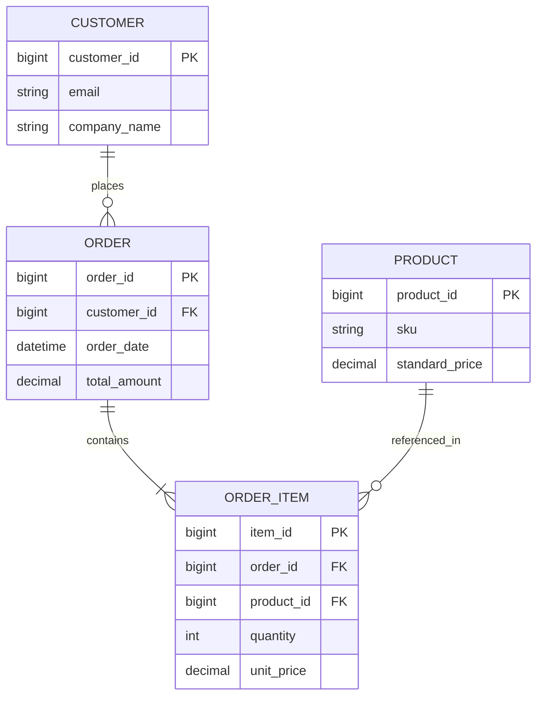

# Lec 06 关系型数据库与 SQL 核心原理 (Relational Databases: Data Modeling, ERD, and SQL)

> MIT Sloan School of Management · 15.561 Information Technology Essentials

## TL;DR

- 埃德加·科德关系模型通过严格的关系代数与二维表抽象，彻底实现了数据逻辑视图与物理存储机制的独立解耦。
- 规范化设计理论通过分解关系消除冗余与插入/删除/更新异常，现代架构在范式与读性能间寻求反规范化平衡。
- ACID 事务特性是企业核心资产记账的生命线，底层借助预写日志 WAL、锁机制与多版本并发控制 MVCC 坚实保障。

## 关系模型的诞生与数据独立性革命 / The Relational Model Revolution

在 1970 年代之前，企业级数据管理被层次数据库（Hierarchical, 如 IBM IMS）和网状数据库（Network, 如 CODASYL）所统治。这些早期系统的致命弱点在于**数据与物理存储路径的深度绑死**：应用程序必须显式知道数据指针在磁盘扇区上的物理链表跳转路径。一旦数据库管理员调整了索引或重构了磁盘结构，依赖该数据的所有上层业务应用程序代码必须全部重写。

IBM 科学家埃德加·F·科德（Edgar F. Codd）在 1970 年发表了具有划时代意义的论文，创立了**关系数据模型（Relational Model）**。

::: definition 关系模型核心定义 (The Relational Model)
关系模型将所有数据严格抽象为数学意义上的**关系（Relation, 即二维表）**。关系由行（元组 / Tuple / Record）和列（属性 / Attribute / Field）构成。
最核心的突破在于确立了**物理数据独立性（Physical Data Independence）**：用户和应用程序只需关心“数据之间的逻辑数学关系是什么”，而根本无需理会底层数据是存在 B+ 树、哈希表还是顺序文件中。
:::

伴随关系模型诞生的是声明式查询语言 **SQL（Structured Query Language）**。开发者用 SQL 描述“想要获取什么样的数据结果”，而数据库内核中高度精密的**基于代价的查询优化器（Cost-Based Optimizer, CBO）**负责推导底层最有效率的执行计划。

## 概念数据建模与范式化理论 / ER Modeling & Normalization

设计一个健壮的企业数据库，首要任务是将混乱的现实业务逻辑抽象为严密的数据架构。工业界通行的设计工具是彼得·陈（Peter Chen）提出的**实体-关系模型（Entity-Relationship Model, ERD）**。

为了防止数据库在长期运行中出现数据严重冗余与状态不一致，数据库理论确立了严格的**规范化（Normalization）**层级：

::: theorem 数据库范式分层判定 (Normal Forms)
1. **第一范式 (1NF)**：表中所有字段的属性值必须是原子不可分的（不能有重复组或逗号分隔的复合值列表）。
2. **第二范式 (2NF)**：在满足 1NF 前提下，每个非主键属性必须**完全函数依赖**于主键，消除复合主键下的部分函数依赖。
3. **第三范式 (3NF)**：在满足 2NF 前提下，任何非主键属性不得**传递依赖**于候选键（例如，通过部门 ID 关联出部门地址，部门地址应剥离至独立的部门表中）。
4. **BC 范式 (BCNF)**：在 3NF 基础上进一步消除所有主属性对候选键的部分与传递依赖。
:::

::: pitfall 过度规范化导致的性能陷阱 (Over-normalization)
严格满足 3NF/BCNF 的数据库消除了冗余，但将现实业务对象打散到了数十张微型表中。在面对高并发复杂报表查询时，系统不得不执行极其昂贵的多表联接（JOIN）操作，急剧消耗 CPU 与磁盘 I/O。因此，现代互联网与数据仓库架构普遍采取**有意识的反规范化（Controlled Denormalization）**策略，通过适当冗余字段换取极速单表读性能。
:::

## 事务与 ACID 黄金法则 / Transactions and the ACID Guarantee

在商业系统中，许多业务逻辑必须以“全有或全无”的原子单元执行（如银行转账：账户 A 扣减 100 元，账户 B 必须同时增加 100 元）。这一业务单元在数据库中被称为**事务（Transaction）**。

::: definition ACID 事务特性 (The ACID Properties)
1. **原子性 (Atomicity)**：事务中的所有操作要么全部成功持久化，要么在遇到任何异常时全部自动回滚，绝无中间半生半熟状态。
2. **一致性 (Consistency)**：事务的执行必须使数据库从一个合法的完整性状态转换到另一个合法的状态，不能违背外键、唯一约束等业务公理。
3. **隔离性 (Isolation)**：并发执行的多个事务之间互不干扰，其外部观测行为与这批事务按某种串行顺序单线程执行的结果相同。
4. **持久性 (Durability)**：事务一旦提交成功，其对数据库数据的修改就是永久性的，即使发生断电宕机也绝不丢失。
:::

现代企业级关系型数据库依靠精密的底层技术实现 ACID：
- **预写日志 (WAL, Write-Ahead Logging)**：任何数据页在写入磁盘之前，对应的修改日志必须先行落盘，系统崩溃后依靠 Redo/Undo 日志实现快速故障恢复（ARIES 算法）；
- **锁与多版本并发控制 (MVCC)**：通过为每条记录保存时间戳版本链，实现“读不阻塞写，写不阻塞读”，大幅提升了高并发交易系统的吞吐量。

## 我的理解与实践洞察 / Personal Insight

::: insight 关系型数据库是企业业务架构的“真理之源”
在当代技术选型中，各种新型 NoSQL、图数据库与键值存储层出不穷，但关系型数据库（如 PostgreSQL、MySQL、Oracle）依然稳固占据企业技术栈的心脏：
1. **数据模型决定组织的演进成本**：表结构设计得糟糕，业务代码写得再优雅也如同建立在沙滩之上的城堡。规范化设计所培育出的严谨实体边界，往往直接镜像了企业的组织架构与权力分工。
2. **不要轻易为了短期的“开发快”放弃 ACID 保障**：许多团队为了逃避严格建表约束转投无模式（Schema-less）文档数据库，结果不久后就发现在应用层手工编写成百上千行防御性代码来校验数据完整性与事务一致性。专业数据库内核经过数十年工业锤炼的并发控制机制，永远比普通业务工程师在应用代码里手写的临时逻辑更加稳定可靠。
:::
