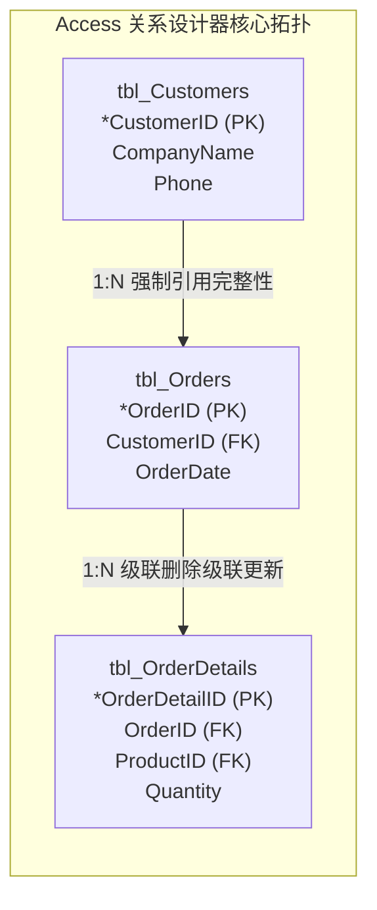

# Lec 07 桌面数据库与数据模型实战 (Database Implementation and Application Modeling: Microsoft Access Case)

> MIT Sloan School of Management · 15.561 Information Technology Essentials

## TL;DR

- 微软 Access 作为桌面轻量级数据库典范，将关系引擎、窗体界面与报表生成器融为一体，开创了敏捷办公数据自动化先河。
- 桌面数据库核心实战在于严谨确立主外键级联更新与删除约束，防止底层业务逻辑在去中心化填报中沦为孤岛数据。
- 清晰识别桌面单机数据库向企业级客户端-服务器 RDBMS 迁移的性能拐点与并发死锁瓶颈，是技术治理的关键决策。

## 桌面数据库的定位与商业价值 / Role and Positioning of Desktop Databases

在企业信息化历程中，并非所有业务需求都需要从第一天起就动用庞大的 Oracle 或 DB2 集群。在部门级办公自动化、快速原型开发以及业务人员自主探索场景中，诸如 **Microsoft Access** 和 FileMaker 之类的桌面数据库（Desktop Database）扮演了极为关键的“平民化赋能”角色。

::: definition 桌面数据库系统 (Desktop Database System)
桌面数据库是将**关系数据库引擎（如 Access 的 Jet / ACE 引擎）**、**可视化图形用户界面（GUI Form）**、**查询设计器（Query-by-Example, QBE）**以及**报表打印引擎（Report Engine）**深度集成在单一本地文件（如 `.mdb` / `.accdb`）中的低代码应用开发环境。
:::

与仅具备二维平铺网格的 Excel 电子表格相比，桌面数据库带来了本质维度的跃进：它强制建立了**实体关联完整性**，支持多用户基础并发，并消除了 Excel 中因自由复制粘贴导致的大量拼写歧义与冗余孤儿记录。

## 实体建模实战：表间关联与引用完整性 / Schema Modeling & Referential Integrity

在 Access 实战建模中，学员首次直面从现实世界需求到严格关系模式的映射推导。以一个典型的“客户-订单-发票”业务系统为例，必须确立三大基石规则：

::: definition 引用完整性与级联规则 (Referential Integrity Constraints)
1. **强制引用完整性 (Enforce Referential Integrity)**：确保子表（`tbl_Orders`）中的外键值必须在父表（`tbl_Customers`）的主键集合中明确存在，严禁创建无归属客户的“幽灵订单”。
2. **级联更新关联字段 (Cascade Update Related Fields)**：当父表中的主键值被修正时，数据库引擎自动更新所有引用该主键的子表外键记录，确保关联链条不断裂。
3. **级联删除关联记录 (Cascade Delete Related Records)**：当父表中的某条主记录被删除时，系统自动联动清空所有从属子记录，杜绝无效垃圾数据堆积。
:::

通过可视化拖拽确立的关系连线，实际上是在底层文件目录中构建了 B-Tree 索引与外键元数据校验触发器。

## 窗体驱动、QBE 查询设计与报表输出 / Forms, QBE Queries & Reports

Access 能够风靡全球企业一线办公场景，核心在于其降低了非计算机专业分析师的认知门槛：
- **QBE (Query by Example) 可视化查询**：用户无需手写复杂的 `SELECT ... JOIN ... GROUP BY` 语句，只需在可视表格中拖入字段并勾选筛选条件，Access 内部编译器自动将其编译为标准 SQL 执行；
- **交互式数据录入窗体 (Forms)**：通过子窗体（Subforms）机制，天然展现 1 对多层级结构（例如在主窗体展示客户基础信息，内嵌子窗体中直接平铺列出该客户过去一年的所有历史订单项），并在输入框失去焦点时实时触发有效性规则校验（Validation Rules）；
- **像素级报表输出 (Reports)**：支持按照业务维度进行多层级汇总排序（如先按销售大区分组，再按客户信用评级分组，最后计算季度销售额小计与全公司总计），一键导出符合财务规范的打印报表。

## 架构演进：从单机文件共享到 C/S 架构迁移 / Architecture Transition: File-Share to Client/Server

尽管 Access 在小团队内表现极其敏捷，但当业务规模突破特定阈值时，基于文件共享机制（File-Sharing Architecture）的底层架构缺陷便会致命爆发。

::: pitfall Access 文件共享架构的物理极限与并发崩溃
在 Access 默认网络拓扑中，数据库文件存放在局域网 Windows 共享文件夹（SMB 协议）上。每台客户端工作站都各自运行独立的 Jet 引擎。这意味着：
- **网络开销极其恐怖**：当用户执行一条只匹配 1 条记录的查询时，如果涉及全表扫描，客户端必须通过局域网将整张数以百兆的物理表文件全部下载到本地内存中计算；
- **文件级锁冲突严重**：当并发并发编辑用户超过 10 至 20 人时，并发锁竞争急剧恶化，极易诱发锁等待超时与 `.ldb` 锁文件损坏，最终导致整个数据库文件崩溃（Corrupted）。
:::

| 架构维度 | 桌面数据库 (Access / FileMaker) | 客户端-服务器数据库 (Client/Server, 如 SQL Server / Postgres) |
| :--- | :--- | :--- |
| **计算位置** | 客户端 PC 本地执行过滤与运算 | 远端高性能服务器直接执行，仅将最终结果集回传网络 |
| **并发容量** | 5 - 15 个并发用户 | 数千至数万并发用户 |
| **单库数据容量** | 硬上限 2 GB | 百 GB 到数十 TB 弹性扩展 |
| **容灾备份机制** | 手工或脚本拷贝整份本地文件 | 持续 WAL 日志归档、热备份与主从实时流复制 |

明智的技术管理者会在系统演进到临界点之前，果断推行 **Access 升迁向导（Upsizing）**：保留前端熟悉的 Access 窗体报表作为交互界面（通过 ODBC 连接），而将底层后端存储与关系逻辑平滑迁移至企业级 SQL Server 数据库中。

## 我的理解与实践洞察 / Personal Insight

::: insight 影子 IT（Shadow IT）的治理智慧：疏导重于封堵
在企业数字化管理实践中，Access 现象揭示了一个永恒的组织张力——业务部门对数据敏捷的渴求与中央 IT 部门对合规风控的管控博弈：
1. **“影子 IT”是真实业务痛点的温度计**：当业务分析师冒着数据丢失风险用 Access 或 Excel 搭建核心运营工具时，往往是因为中央 IT 部门的立项开发周期长达半年以上，根本无法响应前线的瞬息万变。粗暴地下令禁用只会让业务转入更隐蔽的不可控离线表格。
2. **构建“沙盒-扶持-收编”的良性生命周期**：优秀的 CIO 应该把 Access 这类低代码桌面工具视为组织的“敏捷创新孵化沙盒”。允许业务团队自由试错、验证数据模型；一旦某套系统的日活与业务依赖度达到核心级别，中央 IT 团队应主动介入提供架构辅导，将其优雅重构并收编至企业级云原生受控平台，实现敏捷与稳定的双赢。
:::
