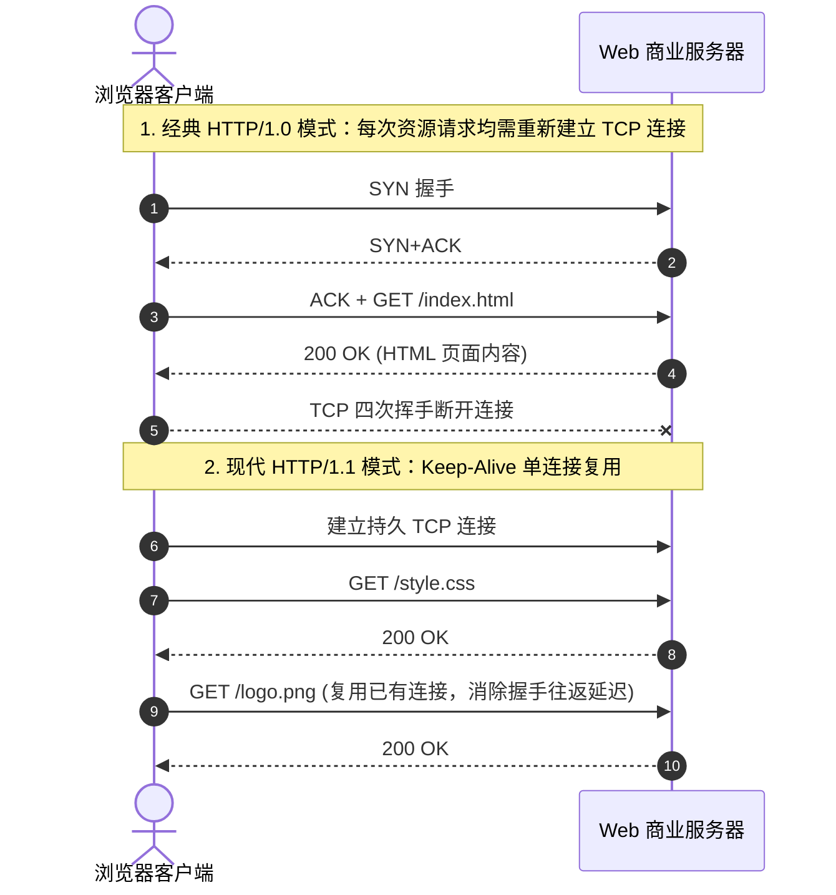

# Lec 08 Web 技术基础与分布式超文本架构 (Web Technologies Fundamentals: HTTP, HTML, CSS, and Client-Server)

> MIT Sloan School of Management · 15.561 Information Technology Essentials

## TL;DR

- 蒂姆·伯纳斯-李三位一体（URI、HTTP、HTML）构想奠定了万维网去中心化超媒体网络基石。
- HTTP 协议从简单的无状态单向请求响应演进为高并发持久连接与多路复用，深刻重塑了端云交互范式。
- 客户端渲染引擎、状态管理机制与 RESTful 架构约束共同推动 Web 从静态文档陈列跃迁为富互联网应用平台。

## 万维网的诞生：分布式超文本的三位一体 / The World Wide Web Trinity

在 1989 年，欧洲核子研究组织（CERN）的英国计算机科学家蒂姆·伯纳斯-李（Tim Berners-Lee）提交了一篇名为《信息管理：一个构想》的备忘录。这一构想催生了人类文明史上最具颠覆性的信息分发网络——**万维网（World Wide Web, WWW）**。

伯纳斯-李的精妙之处不在于发明某项复杂的低级网络硬件，而是在已有的互联网通信基础设施之上，构建了优雅易用的**超文本（Hypertext）应用层三位一体架构**：

::: definition 万维网三位一体技术支柱 (The Web Trinity)
1. **统一资源标识符 (URI / URL)**：为全球网络上任何一台物理机器上的任意多媒体文件提供全球唯一的、去中心化的定位地址。
2. **超文本传输协议 (HTTP)**：定义客户端（浏览器）与服务端之间请求、路由和递送超文本文档的标准应用层协议。
3. **超文本标记语言 (HTML)**：一种用尖括号标签描述多媒体文档逻辑结构、排版语义并内嵌超链接（Hyperlink）的自解释标记语言。
:::

正是超链接的自由跳转，打破了传统图书与数据库线性的索引限制，让数十亿人类与文档节点编织成了动态生长的无边界网状知识图谱。

## HTTP 协议演进：从无状态明文到高并发多路复用 / HTTP Evolution: 1.0, 1.1, 2.0 & Beyond

超文本传输协议本质上是一个基于**请求-响应（Request-Response）**模型的应用层协议。客户端建立 TCP 连接，发出 ASCII 纯文本格式的 HTTP 请求行与头部字段，服务端处理后返回状态码（如 200 OK、404 Not Found、500 Internal Server Error）和响应实体。

协议经历了数代关键重构以适配爆炸增长的数据载荷：
- **HTTP/1.0**：短连接机制。传输一个包含 10 张图片的网页需要先后建立 11 次完整的 TCP 三次握手与四次挥手，网络延迟极高；
- **HTTP/1.1**：引入持久连接（`Connection: Keep-Alive`）与流水线技术（Pipelining），允许在一个 TCP 连接上串行处理多个请求，并引入分块传输编码（Chunked Transfer）与 `Host` 请求头以支持单机多虚拟主机；
- **HTTP/2**：将传输协议重构为二进制分帧层，实现真正的**多路复用（Multiplexing）**——单一 TCP 连接上可并发双向交错传输成百上千个数据流，彻底根除了 HTTP 队头阻塞（Head-of-Line Blocking）；
- **HTTP/3 (QUIC)**：基于 UDP 彻底解决传输层 TCP 偶发丢包导致全局停顿的问题，结合 TLS 1.3 实现 0-RTT 极速安全建连。

## 客户端体系：HTML、CSS、JavaScript 与浏览器渲染流水线 / Client-Side Architecture

早期的浏览器仅仅是一个只读的排版展示器，而现代浏览器已经成长为一个全功能的分布式操作系统环境。其核心体系结构包含三大技术分工：
1. **HTML (结构层)**：定义内容的逻辑层次骨架（如 `<header>`, `<article>`, `<form>`）；
2. **CSS (表现层)**：通过级联规则与选择器，彻底实现文档内容与视觉呈现样式（布局、色彩、响应式断点）的解耦；
3. **JavaScript (行为层)**：布兰登·艾克（Brendan Eich）在网景公司仅用 10 天发明的脚本语言，使网页拥有了监听用户交互事件、动态修改文档对象模型（DOM）和异步收发数据的全套编程能力。

::: definition 关键渲染路径 (Critical Rendering Path)
浏览器在获取 HTML 原始字节流后，执行以下流水线将网页像素绘制上屏：
1. **构建 DOM 树**：解析 HTML 标签并转化为节点树结构；
2. **构建 CSSOM 树**：解析 CSS 规则生成样式规则树；
3. **合成渲染树 (Render Tree)**：合并 DOM 与 CSSOM，剔除不可见节点（如 `display: none`）；
4. **布局 (Layout / Reflow)**：计算每个可见几何元素在视口中的精确物理坐标与尺寸；
5. **绘制 (Painting)**：遍历渲染树调用底层图形引擎将各图层像素栅格化，最终合成输出到显示屏。
:::

## 状态困境：Cookie、Session 与现代无状态身份认证 / State Management: Cookies to JWT

HTTP 协议在设计之初被严格定义为**无状态协议（Stateless Protocol）**：服务器处理完一个请求并返回响应后，不会在内存中保留任何关于该客户端的历史记忆。下一个请求到来时，服务器完全无法直接分辨它来自刚才的用户还是一个全新的访客。

这一无状态特征保障了 Web 服务器的极简性与横向伸缩能力，却与商业网站的核心需求（如用户登录会话、购物车结算）产生根本冲突。

::: definition Web 状态保持机制演进
1. **Cookie 机制**：由卢·蒙图利（Lou Montulli）在网景公司发明。服务端在 HTTP 响应中通过 `Set-Cookie` 指令向浏览器写入微小键值对，后续请求浏览器自动携带该 Cookie 发往同源服务器。
2. **服务端 Session 模式**：浏览器 Cookie 中仅存放一个随机不透明的 `SessionID`，真实的购物车数据与用户身份沉淀在服务器内存或 Redis 集群中。缺点是服务端必须维护昂贵的状态集中存储。
3. **JSON Web Token (JWT) 无状态令牌**：客户端登录后，服务端返回一个经由私钥密码学签名的 Base64 编码令牌（包含过期时间与声明权限）。客户端后续在 `Authorization: Bearer <token>` 头部携带该令牌，任何分布式微服务节点只需校验签名公钥即可验证身份，彻底回归了服务端的纯无状态架构。
:::

## 我的理解与实践洞察 / Personal Insight

::: insight Web 架构的演化本质：计算能力的端云再平衡
站在技术战略的高度回望 Web 技术三十五年的发展轨迹，会发现计算范式始终在“集中化”与“去中心化”两极之间摆动：
1. **从瘦客户端到富客户端的轮回**：早期的 Web 是纯服务端渲染（SSR）——浏览器只是个哑终端，任何一个点击都需要向服务器请求刷新整页 HTML；随着 AJAX 与 SPA 单页应用框架（React, Vue）崛起，浏览器端承担了大量前端路由与状态计算；而到了当今的 Next.js 与 Astro 时代，架构师们又开始推崇“服务端组件（Server Components）”与“静态优先渐进增强”，追求极速首屏与极致交互的最佳折中。
2. **REST 架构风格的深远约束力**：罗伊·菲尔丁（Roy Fielding）在 2000 年博士论文中提出的 REST 架构风格，其核心思想是面向资源的统一接口（Uniform Interface）。很多企业团队将 Web API 当成简单的 RPC 隧道随意乱设 URL，不仅破坏了 HTTP 协议天然的缓存能力（Cacheability），更使得外部合作伙伴的集成成本指数级攀升。尊重标准 Web 语义，往往是构建高扩展性开放生态的最短路径。
:::
