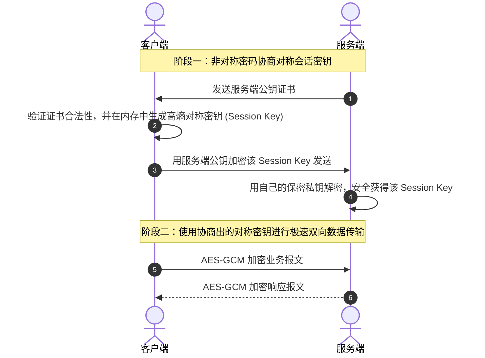
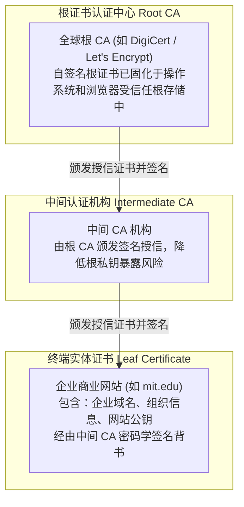

# Lec 09 计算机安全与现代密码学基础 (Computer Security I: Encryption and Digital Signatures)

> MIT Sloan School of Management · 15.561 Information Technology Essentials

## TL;DR

- 现代密码学从基于算法隐藏的古典隐蔽安全转向基于数学难解性假定的公开算法与密钥分离原则。
- 对称加密（AES）与非对称加密（RSA/ECC）结合构成混合加密体系，兼顾计算性能与密钥分发安全。
- 公钥基础设施 PKI 与数字证书（X.509）通过权威 CA 机构背书，为不可信公共网络构建了防篡改身份信任链。

## 现代密码学基石：柯克霍夫原则与计算复杂性 / Kerckhoffs' Principle & Modern Cryptography

在古典通信时代，保密性往往依赖于算法本身的隐秘性（Security through Obscurity）——例如古罗马凯撒密码的位移规则或恩尼格玛（Enigma）机的转轮接线。然而历史反复证明，一旦敌方截获加密机或逆向工程出算法，整套安全防线便瞬间崩塌。

现代密码学由 19 世纪荷兰密码学家奥古斯特·柯克霍夫（Auguste Kerckhoffs）确立的公理奠基：

::: definition 柯克霍夫原则 (Kerckhoffs' Principle)
密码系统的安全性必须**仅仅依赖于密钥（Key）的机密性**，而绝不能依赖于加密算法本身的保密性。即使算法的数学公式、执行源代码和物理硬件设计全部向敌方公开，只要密钥未泄露，系统在计算复杂度意义上就必须是不可破解的。
:::

现代密码学的不可攻破性建立在计算复杂性理论的硬性假设之上：单向陷门函数（One-Way Trapdoor Function）在正向计算时极其飞速（如大素数相乘），但在缺乏秘密陷门（密钥）的情况下，反向推导（如大整数因数分解或离散对数问题）在多项式时间内数学上是不可行的，需要超级计算机计算数十亿年。

## 对称加密、非对称加密与混合密码体制 / Symmetric, Asymmetric & Hybrid Cryptography

密码学体系按照加解密密钥是否相同，分为两大根本流派：

| 维度 | 对称加密算法 (如 AES-256, ChaCha20) | 非对称公钥密码 (如 RSA-4096, ECC/ECDSA) |
| :--- | :--- | :--- |
| **密钥结构** | 加密与解密使用完全相同的单一秘密密钥 | 密钥成对生成：公开的公钥（Public Key）与绝对保密的私钥（Private Key） |
| **计算吞吐量** | 极快（硬件支持 AES-NI 指令集，数 GB/s） | 极慢（涉及大数模幂运算与椭圆曲线点乘，较对称慢 1000 倍以上） |
| **密钥分发困境** | 致命痛点：通信双方如何在不可靠公网初次安全共享该密钥？ | 完美化解：公钥可随意在全网广播，任何人可用公钥加密，唯有私钥能解密 |
| **核心应用** | 海量业务报文、磁盘全盘加密、数据库列加密 | 身份认证、数字签名、会话对称密钥的安全协商交换 |

在工程现实中，没有系统会孤立使用非对称加密传输海量数据。工业界普遍采用**混合密码体制（Hybrid Cryptosystem）**（如 TLS/HTTPS 握手）：

上图展示了混合加密的协同逻辑：通信初期借助非对称公钥算法的数学特性安全传递轻量的临时会话密钥，一旦双方握手确立共享秘密，后续的全部大流量数据传输立刻切换至硬件加速的对称 AES 算法，实现了安全与性能的帕累托最优。

## 数字签名与公钥基础设施（PKI） / Digital Signatures & PKI Trust Hierarchy

信息安全不仅关乎“防窃听”（机密性），更关乎“防篡改”（完整性）与“防冒名”（不可抵赖性）。**数字签名（Digital Signature）**机制彻底解决了这一挑战。

::: definition 密码学哈希函数与数字签名 (Cryptographic Hash & Digital Signature)
1. **密码学哈希 (Hash, 如 SHA-256)**：将任意长度的数据映射为固定长度的雪崩摘要（Digest）。具备抗原像性、弱抗碰撞性与强抗碰撞性。
2. **数字签名**：发送方用 SHA-256 计算正文的哈希摘要，随后用自己的**私钥**对该哈希值进行加密生成签名；接收方使用发送方的**公钥**解密签名获得期望哈希，并与接收正文重新计算的哈希值比对。若两者完全一致，数学上证明了数据未经篡改且确由私钥持有者发送。
:::

然而，公钥自身存在严重的“中间人冒充漏洞”：攻击者可以在网络中间拦截通信，将自己的公钥伪造为合法银行的公钥。为了解决“如何证明公钥确实属于其声明的持有者”这一难题，**公钥基础设施（PKI, Public Key Infrastructure）**应运而生。

PKI 通过分层证书颁发机构（CA）签发的 **X.509 标准数字证书**，构建了全球信任链条。客户端操作系统在出厂时便预装了知名根 CA 的公钥指纹。当浏览器访问网站时，递归向上验证证书签名，直至抵达受信任的根 CA，从而以密码学方式锚定了通信实体的真实身份。

## 我的理解与实践洞察 / Personal Insight

::: insight 密码学工程实现比数学理论更脆弱
技术管理者在主持企业信息安全体系设计时，必须清醒区分“数学算法安全”与“工程实现安全”：
1. **永远不要自己发明加密算法，也尽量不要手写加密底层实现**：AES 和 RSA 在数学上无懈可击，但业余工程师手写的加解密代码往往存在致命的时序攻击（Timing Attack）、侧信道功耗泄露或随机数发生器熵池耗尽缺陷。必须直接复用经过严格审计的开源工业级密码学库（如 OpenSSL、libsodium、BoringSSL）。
2. **安全链条的强度取决于最脆弱的那一环——人**：世界上大部分重特大安全事故都不是因为黑客用超级计算机暴力破解了 2048 位的 RSA 私钥，而是因为运维人员将包含硬编码明文密钥的配置文件随手提交到了公开代码仓库，或是管理员遭遇了钓鱼邮件社会工程学攻击。建立零信任（Zero Trust）访问控制和密钥轮换（Key Rotation）制度，远比纠结密钥长度更具现实防卫价值。
:::
