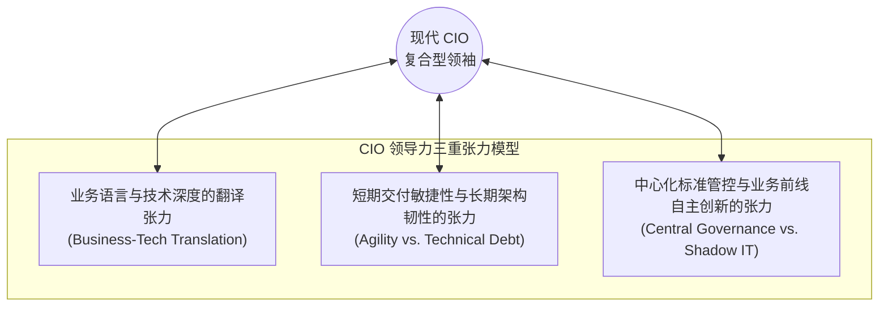

# Lec 01 IT 实践管理导论与技术领导力挑战 (Course Overview & The Art of IT Leadership)

> MIT Sloan School of Management · 15.568 Practical Information Technology Management

## TL;DR

- 信息技术管理已从单纯的后台运维保障职能跃迁为驱动企业商业模式创新与组织转型的核心引擎。
- 现代首席信息官 CIO 面临着连接业务战略、驾驭不可控技术不确定性与化解组织变革阻力的三重张力。
- 课程确立以真实商业案例为载体的实践方法论，覆盖项目管理、组织实施、IT 职能治理与战略对齐五大板块。

## IT 管理的范式跃迁：从成本中心到价值引擎 / The Paradigm Shift of IT Management

在商业信息化的早期阶段，企业内部的信息技术部门通常被贴上“数据处理中心（EDP）”或“计算机机房（Computer Room）”的标签。在这一古典范式下，IT 的职责高度局限：维护大型机打印财务工资条、采购桌面 PC、拉设局域网网线以及在系统故障时提供桌面技术支持。在财务报表上，IT 投资被 CFO 严格视为一项必须压缩的**间接管理费用（Overhead Cost）**与纯粹的“成本中心（Cost Center）”。

然而，进入互联网、移动计算与大数据时代，这一陈旧观念遭遇了毁灭性的打击。现代企业的几乎所有关键核心资产与日常运营流程，已经彻底数字化与代码化：

::: definition IT 管理现代定位 (Modern IT Management Definition)
现代 IT 管理是**技术能力、商业战略与组织设计的高度交汇点**。它不再关注“如何廉价地购买服务器”，而是聚焦于：
1. **战略赋能 (Strategic Enablement)**：如何利用前沿技术重新定义行业进入壁垒与客户价值主张；
2. **流程重组 (Process Orchestration)**：如何利用软件契约穿透跨部门壁垒，实现端到端敏捷流动；
3. **风险与治理 (Risk & Governance)**：如何在网络攻击、合规监管与技术债务中维护系统抗毁性与商业连续性。
:::

在这个全新的竞争地貌中，IT 已经变成了驱动商业模式创新的**核心价值引擎（Value Engine）**。无法理解数字技术底层规律的企业领导者，终将在数字化原生新势力的降维打击下丧失生存空间。

## 首席信息官（CIO）的三重领导力张力 / The Triple Tension of Modern CIOs

作为统领企业技术蓝图的最高统帅，首席信息官（CIO, Chief Information Officer）被公认为现代 C-Suite 高管层中最艰难的职位之一。CIO 必须在三个往往相互冲突的维度上进行高难度的钢丝漫步：

上图展示了现代 CIO 必须时刻平衡的三大张力：
1. **语言隔阂与价值互信**：业务部门高管（如 CMO、CFO、业务 VP）习惯于用 ROI、客单价、市场份额思考问题，而技术架构团队习惯于讨论微服务延迟、容器编排、数据库分库分表与死锁。CIO 必须作为超级翻译官，既能用董事会听得懂的语言解释为何需要花费三千万元重构遗留核心系统，又能向一线研发精准传达战略诉求；
2. **短期冲刺与长期债务的博弈**：前线业务永远在催促“下个月必须上线新功能以抢占市场”，如果一味妥协，技术团队必然会通过硬编码和跳过测试累积起庞大的技术债务，最终导致系统雪崩；CIO 必须顶住压力，在快速商业变现与底层系统稳健性之间划定红线；
3. **中央管控与影子 IT（Shadow IT）的冲突**：过于严苛的中央审批会导致业务敏捷性被扼杀，业务团队便会绕过 IT 部私自采购外部 SaaS 软件造成严重合规漏洞；CIO 必须构建敏捷的赋能型服务平台，变封堵为疏导。

## 课程知识蓝图与五大实战模块 / Course Framework & Practical Modules

麻省理工学院斯隆管理学院开设的 **15.568 实用信息技术管理（Practical Information Technology Management）**，摒弃了空洞的说教，完全采用哈佛与 MIT 斯隆最具代表性的全真商业案例，带领学员以 CIO、业务领袖和咨询顾问的第一视角经历生死考验：

::: definition 15.568 五大核心模块设计
1. **模块一：项目管理——击中动态靶心的现实挑战 (Project Management)**：深入剖析大型 IT 项目为何普遍陷入预算严重超支与范围漂移的泥潭，从皇家加勒比邮轮（RCCL）的前沿探索到行政数据系统（ADP）的危机重组，掌握项目挽救与范围治理精髓。
2. **模块二：系统实施与组织变革——“技术从来不是我们最大的问题” (Implementation & Change)**：解构花旗银行运营组金融自动化重组与道康宁（Dow Corning）全球 SAP ERP 实施，剖析文化惯性与利益博弈。
3. **模块三：IT 职能治理——幕后的魔术师 (Management of the IT Function)**：探讨 RFID 泛在技术商业化、CareGroup 医院核心网络灾难性瘫痪背后的架构隐患，以及印度塔塔咨询（TCS）代表的离岸外包战略。
4. **模块四：业务运营支撑——更快更好地做事 (IT Support for Business Operations)**：掌握从 IT 框架捕获商业价值的方法论，深入解析 MIT 流程手册与面向服务的架构（SOA/BPM）。
5. **模块五与六：战略系统、数字转型与全课总结 (Strategic Systems & Wrap-up)**：泰科国际（TYCO）危机重组、美国海关 ACE 国家级工程、Nicholas Carr“IT 是否重要”世纪大辩论，提炼 CIO 终极心法。
:::

## 我的理解与实践洞察 / Personal Insight

::: insight CIO 的终极护城河是“商业信任”而非技术指标
在深入研究了全球数十家跨国企业的 IT 转型案例后，可以得出一个颠覆性的结论：**CIO 之所以被董事会解雇，很少是因为他的服务器宕机了半小时，几乎全是因为他失去了业务伙伴的信任**：
1. **别做“说不先生”（Mr. No）**：传统的 IT 部门主管面对业务部门的新需求，第一反应永远是“这违反了安全规范”、“系统当前不支持”、“排期至少半年以后”。这种官僚作风不仅无法防范风险，反而会彻底边缘化 IT 部门，迫使业务部门将 IT 当成敌人。真正的技术领袖应当说：“为了达成您的商业目标，当前的方案存在安全缺陷，但我为您设计了两套替代路线，我们一起来权衡取舍”。
2. **用共同承担的商业指标（Skin in the Game）绑定利益**：在传统组织中，业务部门只负责要功能，IT 部门只负责按期交付，一旦系统上线后无人使用或 ROI 极低，双方互相甩锅。卓越的组织治理应当将系统的最终商业成果（如库存周转率改善幅度、线索转化率提升比例）同时作为业务 VP 和 IT 负责人的共同考核指标，促成真正的战略共谋。
:::
