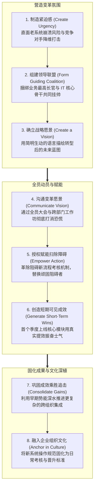

# Lec 10 企业级系统实施复盘与变革管理法则 (Implementation Readings & Enterprise ERP Lessons: EMC Experience)

> MIT Sloan School of Management · 15.568 Practical Information Technology Management

## TL;DR

- 企业级系统实施的成败并非纯粹的技术编码问题，而是组织变革管理与利益格局重构的严峻考验。
- 柯特八步变革模型为化解企业内部惰性与政治抵触提供了系统性的路线图与心理学支撑。
- EMC 公司的实战经验揭示：业务高管联合挂帅、强硬的主数据治理与上线后收益实现机制是通关黄金法则。

## 实施复盘：为什么 70% 的大型系统未能达成预期？ / The Implementation Conundrum

在企业信息化领域，长期流传着一条残酷的统计规律：根据 Standish Group 著名的 CHAOS 报告，超过 70% 的大型企业级系统（ERP、大型 CRM、核心供应链套件）在实施中陷入严重延误、大幅超支，或者在上线后未能达成最初商业立项时承诺的战略收益，甚至有近四分之一的项目最终以彻底废弃烂尾告终。

客座嘉宾、全球存储与信息管理巨头 EMC 公司资深副总裁迈克·沙诺（Mike Shanno）在 15.568 课堂上直指问题核心：**大型系统实施之所以频频遭遇滑铁卢，是因为绝大多数企业犯了严重的“唯技术论”认知偏差——把一场本质上极其复杂的“组织外科手术”当成了简单的“安装一套高级软件包”！**

::: definition 企业级系统实施的三大铁律公理
1. **软件只是流程重组的载体**：采购全球最顶级的 ERP 软件并不能自动解决企业的管理低效；如果组织内部原本的权责不清、物料编码混乱，强推系统只会把混乱以光速放大。
2. **上线（Go-Live）不是终点，而是阵痛的起点**：系统割接上线的第一天往往是全公司生产率骤降至冰点的“生产率低谷期（Productivity Dip）”。只有穿越随后三到六个月的磨合与优化，真实的商业回报才会逐步显现。
3. **变革阻力的大小与受影响者的数量呈指数关系**：系统每穿透一个新的部门，就多出一批需要重新学习操作界面的基层员工，以及一批失去传统信息垄断权的中层经理。
:::

## 柯特八步变革模型在 IT 落地中的实战映射 / Kotter's 8-Step Change Framework in IT

在传统管理中，许多技术团队错误地认为“只要系统功能设计得足够完美，员工自然会主动使用”。然而行为经济学与组织心理学研究反复证明，人类对未知的新事物、新界面和新流程抱有深层的防御性恐惧与抵触本能。强推新系统若缺乏对组织心理节拍的精细掌控，势必引发全员的被动抵抗与消极怠工。

为了战胜深植于人性的心理惰性，哈佛商学院约翰·柯特（John Kotter）提出的八步变革模型被广泛奉为 IT 实施项目经理的行动指南。柯特将一场成功的组织大手术划分为环环相扣、不可跳步推进的三大战略阶段与八个战术步骤：

在 IT 实践落地的漫长征途中，绝大多数项目往往倒在以下几个致命的心理盲区之中：
- **第一阶段的“虚假安全感”**：许多管理层在推行新系统时，未能向全员诚实、清晰地解释“为什么老系统已经不可持续”。员工误以为“老系统我们用了十年顺风顺水，公司高层只是吃饱了撑的想要折腾我们”，紧迫感无法建立，变革在起跑线便失去了势能；
- **第二阶段的“沟通严重不足”**：高管层在动员大会上仅仅宣读了十分钟充满管理术语的 PPT，便以为愿景已经传达完毕。实际上，根据柯特的研究，高管传达愿景的频次通常不足实际所需沟通量的万分之一！必须在每周例会、内部内网和非正式沟通中反复回答一线员工最现实的利益关切——“新系统上线后，我的工作量会增加吗？我会不会面临被裁员的风险？”；
- **第三阶段的“过早宣布胜利”**：很多团队在核心模块勉强上线、系统勉强没有崩溃的那一天便大肆开庆功宴，随后立刻撤走全部驻场技术顾问。此时新流程尚未内化为员工的下意识肌肉记忆，一旦外部压力撤除，基层员工便会在两周之内迅速退回旧有的离线 Excel 和私下手写单据，导致数百万元的投资彻底付诸东流。必须持续巩固成果，直至新规范被固化为组织的制度基因。

## EMC 公司的实操经验：业务所有权与数据纪律 / The EMC Corporation Playbook

迈克·沙诺结合 EMC 自身数次跨国并购整合与大规模 SAP 实施的血泪经验，分享了三条不可妥协的实战心法：

### 1. 业务所有权（Business Ownership），而非 IT 独角戏
EMC 严禁由技术部门独自作为项目发起人。每一个子模块的实施小组，必须实行**双组长制（Dual Leads）**：一名来自 IT 架构团队，另一名必须是业务部门最骨干、最有前途的高级经理（而非被边缘化闲置的员工）。将该业务骨干的全年奖金与升职评定与新系统的平稳上线直接绑定，彻底杜绝了业务方在上线时指责“这是 IT 搞出的烂玩意儿”的推诿空间。

### 2. 铁血主数据清洗与治理（Data Cleansing）
在旧系统向新系统导入数据时，必须执行“零容忍”的数据治理规则。垃圾数据一旦进入新系统，会如同病毒一样腐蚀所有报表。EMC 在项目早期专门抽调业务人员组建“数据突击队”，逐行核对数万个客户名称、税号、配送地址与产品物料清单，确保新系统在新开张时拥有纯净无暇的数据底座。

### 3. 上线后收益实现治理（Benefits Realization）
大多数企业在系统上线切断旧服务器的那一天，便开香槟庆祝并解散了项目组。EMC 建立了严格的**上线后百日收益审计机制**：CFO 办公室介入，逐项对比立项报告书中的预期收益（如库存减少 15%、发票处理提速 30% 是否真实转化为财务报表上的现金流改善）。没有达成收益的部门，必须限期向董事会提交流程再造纠偏方案。

## 我的理解与实践洞察 / Personal Insight

::: insight 变革管理的最高段位：把“被动受害者”转化为“变革受益者”
EMC 的实践为现代企业技术决策者提供了无价的心理学洞察：
1. **理解员工在面对新软件时的深层焦虑**：当一个习惯了绿色荧光屏终端快捷键、闭着眼睛都能盲打录入的发票录入员，突然被要求使用一个全新的鼠标图形界面系统时，他的第一反应一定是愤怒与恐惧——因为他的“熟练度”被清零了，他感到自己从一个受人尊敬的业务老手瞬间退化为了笨拙的实习生。卓越的领导者必须提前安排耐心、充满尊重的培训导师，设置合理的保护期容错指标，抚平基层的技术恐慌。
2. **一把手必须展现出“无路可退”的战略定力（Burning the Boats）**：在系统刚上线的前两周，由于大家都不熟练，各部门经理一定会蜂拥至 CEO 办公室抱怨：“新系统太慢了，我们想退回老系统去干活！”如果最高统帅此时动摇、允许大家私下退回旧系统，整个数千万元的项目便会彻底夭折。真正的领袖必须坚定地告诉全员：“旧系统服务器已经在上周末彻底拆除报废了，我们唯有全力以赴向前跑，一起攻克这个难关！”
:::
