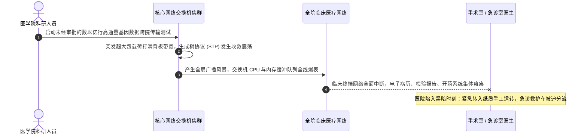

# Lec 12 医疗 CareGroup 危机：灾难性网络瘫痪与高可用容灾 (Case: CareGroup Network Collapse and Disaster Recovery)

> MIT Sloan School of Management · 15.568 Practical Information Technology Management

## TL;DR

- 波士顿大型医疗系统 CareGroup 核心网络长达 3.5 天的灾难性大瘫痪，是信息系统历史上最震撼的运维灾难之一。
- 单点故障蔓延、生成树协议 STP 震荡与核心交换机内存耗尽引发了毁灭性的全局广播风暴。
- 危机迫使医院重回纸质处方与手工叫号的黑暗时代，催生了现代数据中心物理隔离与分层高可用容灾黄金架构。

## 案例背景：波士顿顶级医疗航母的神经中枢 / Case Context: CareGroup Healthcare System

CareGroup 是新英格兰地区规模最大、最受尊敬的综合性医疗网络之一，旗下包括著名的哈佛医学院主要教学医院**贝斯以色列女修道院医学中心（Beth Israel Deaconess Medical Center, BIDMC）**、多家区域社区医院以及数百家专科诊所：
- 拥有超过 3000 名顶级医生、数万名医护人员，每年接待数百万名患者，承担着极其密集的急诊抢救、开颅外科手术与重症监护（ICU）任务；
- 医疗系统极其依赖其开创性的**电子病历与临床医嘱系统（EMR / CPOE）**——病人的过敏史、核磁共振影像（PACS）、血液检验报告、手术实时生命体征监控以及所有药品的下达与静脉注射核对，全部 100% 依赖遍布全院的计算机网络进行毫秒级流转；
- 时任 CIO 约翰·哈拉姆卡博士（Dr. John Halamka）是一位兼具哈佛急诊医学临床博士与 MIT 计算机技术背景的传奇先锋领袖。

2002 年 11 月 13 日清晨，一场几乎将整座医疗帝国彻底摧毁的技术浩劫，毫无预警地降临了……

## 灾难降临：3.5 天黑色浩劫的全景演进 / The 3.5-Day Nightmare Timeline

这场灾难的爆发过程堪称墨菲定律在网络工程领域的极致演绎：
1. **第一天（11 月 13 日，星期三）**：一位医学科研人员在未经向网络运维团队报备的情况下，在其个人工作站上启动了一个传输海量基因测序数据的批处理脚本。数据流瞬间吞噬了核心交换机的主干链路；
2. **核心交换机沦陷与生成树协议（STP）崩溃**：当时全院的网络拓扑采用了一种脆弱的“大二层（Flat Layer-2）”扁平架构。为了防止物理环路，网络依靠 IEEE 802.1D 生成树协议（Spanning Tree Protocol）自动阻塞冗余端口。然而，突发的海量载荷导致交换机无法及时处理 STP 根桥的心跳保活报文（BPDU）。交换机误以为网络拓扑发生改变，疯狂地重新计算生成树拓扑；
3. **毁灭性的广播风暴（Broadcast Storm）**：反复的拓扑震荡导致部分端口在阻塞与转发状态间剧烈颠簸，全网瞬间形成恶性物理网络环路！广播报文在整个环路中以光速成倍自我复制并无休止循环，核心交换机内存彻底被垃圾报文耗尽崩溃重启；一旦重启上线，又立刻被广播风暴再次淹没，陷入无限死机循环；
4. **全线瘫痪四天三夜**：全院数千台临床电脑、检验仪器、药房机器人全部失去连接。灾难整整持续了 84 个小时（3.5 天），才在 Cisco 顶级技术特工队与哈拉姆卡团队的联手救火下最终物理拔线隔离、逐步复苏。

## 黑暗时刻的医疗人道考验 / The Human Cost: Back to the Stone Age

在这长达 84 个小时的系统真空期内，现代高科技医院瞬间跌回了 19 世纪的石器时代：
- 医生在抢救室完全无法调阅患者的历史药物过敏史和血型报告，每一次下达处方都面临着巨大的医疗过失与致死风险；
- 医院不得不紧急从地下室翻出几年前落满灰尘的纸质处方本，设立由实习生充当的人肉“奔跑员（Runners）”，在几栋大楼之间气喘吁吁地手递手传送纸质验血报告与胶片；
- 重症急诊救护车被强制分流去其他竞争对手医院，原本安排的大量高难度择期心脏手术被无限期取消；全院医护人员处于精神高度紧绷、濒临崩溃的边缘。

极其万幸的是，由于哈拉姆卡博士本人是急诊医生，他在灾难发生的第一小时便果断启动最高级别医疗应急预案，全院临床医护凭借崇高的职业素养与极度谨慎的双人手工复核，**在整个 84 小时网络瘫痪期间，奇迹般地没有让任何一名患者因系统故障而丧失生命！**

## 架构重生：医院核心网络的彻底推倒重构 / The Architectural Rebirth

灾难平息后，哈拉姆卡博士展现了非凡的领导力与透明度——他没有隐瞒丑闻，而是向全美公开发布了长达数十页的事故深度复盘报告，并斥资数百万美元推倒了全部脆弱网络，树立了现代企业高可用容灾的行业灯塔：

::: definition CareGroup 重构确立的现代网络三大防线
1. **彻底终结“扁平大二层”，全面转向“第三层路由隔离（Layer-3 Routed Architecture）”**：通过划分严格的 VLAN，将每个病区、每个楼层彻底划定为独立的 IP 子网。网段之间全部通过第三层路由器与三层交换机基于 OSPF 路由协议进行转发。**哪怕某个科研实验室再次爆发恶性广播风暴，风暴也只能局限在其所属的微小局域网内，绝对无法穿透三层路由边界扩散至隔壁的手术室网络**；
2. **临床医疗业务网与科研办公网的绝对物理/逻辑隔离**：严禁科研人员的大数据传输任务与救死扶伤的临床 EMR 系统共用同一物理交换机背板与核心干线，开辟专属带宽配额与服务质量保障（QoS）；
3. **核心网硬件的 N+1 绝对冗余与热备**：在核心机房部署双活高可用交换机架构（Cisco Catalyst 6500 双机冗余），配置双路供电、双主控板卡与跨机箱链路聚合（EtherChannel），消除一切形式的单点故障（SPOF）。
:::

## 我的理解与实践洞察 / Personal Insight

::: insight 系统韧性的底色，是危机降临时对业务最深沉的敬畏
CareGroup 危机复盘为所有技术管理者提供了刻骨铭心的启示：
1. **不要让“业务敏捷”的借口，掩盖了底层架构的技术债务**：在危机发生之前，CareGroup 为了节省采购预算并方便科研人员随时连接，一直采取修修补补的方式扩建网络，放任大二层广播域野蛮膨胀到数千台设备。工程师其实早就知道生成树协议在庞大网络中存在隐患，但抱着“过去几年都没出事”的侥幸心理一拖再拖。**墨菲定律永远不会缺席，在基础设施上欠下的架构高利贷，终有一天会以百倍的代价在最脆弱的时刻连本带利引爆**。
2. **最高级的容灾不是技术手册，而是业务降级预案（Business Continuity Plan）**：许多技术团队在做灾难恢复计划时，只在纸面上写满了数据库备份和冷备机房，却从未组织业务人员进行过真实的“断网应急演练”。CareGroup 之所以能在大崩溃中没有出现患者伤亡，正是因为医生护士在入职第一天就接受过“一旦电脑黑屏，如何使用纸质处方和手工标本标签进行双人核对”的严酷训练。**技术可能随时倒下，唯有人性对职责的坚守与成熟的业务应急韧性，才是守护生命与企业的最后一道马奇诺防线**。
:::
