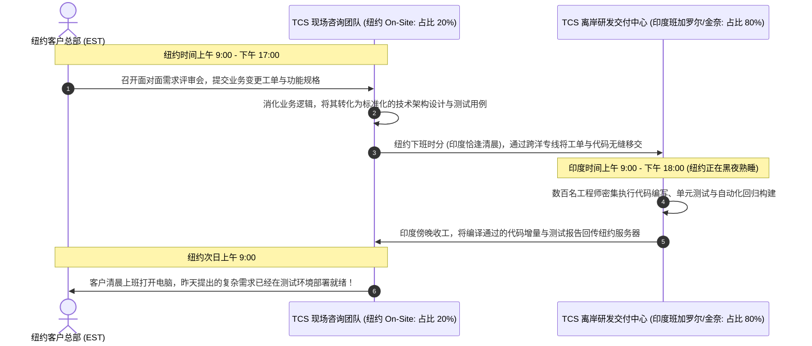

# Lec 15 塔塔咨询（TCS）与全球 IT 离岸外包战略 (Global IT Outsourcing: Tata Consultancy Services)

> MIT Sloan School of Management · 15.568 Practical Information Technology Management

## TL;DR

- 印度塔塔咨询服务公司（TCS）开创了依托全球交付模型 GDM 重构欧美企业 IT 成本结构的离岸外包时代。
- CMMI 5 级极度严苛的软件工程过程控制与纪律，彻底打破了西方世界对发展中国家软件质量低下的偏见。
- 时区套利、跨文化协作阻尼与从低端编码向全生命周期战略合作伙伴的转型，构成了离岸战略的深层命题。

## 案例背景：全球离岸交付革命的崛起 / Case Context: The Rise of the Indian IT Engine

在 1990 年代末，全球商业界正被“千年虫（Y2K，Year 2000 Problem）”危机的阴影所笼罩。全球成千上万家银行、航空公司和跨国企业的大型机系统中，沉淀着数以十亿行在冷战时期编写的 COBOL 老旧代码。为了防止系统在进入 2000 年的一瞬间把年份误认为 1900 年而引发金融与交通大崩溃，欧美企业急需数以万计的软件工程师逐行翻查、测试并修改古董代码。

然而在当时的欧美本土，精通 COBOL 的老工程师大多已退休，新一代工程师身价高昂且极度短缺。在这场全球危机中，一个原本被西方主流商界忽视的技术巨人在南亚次大陆石破天惊地崛起——**印度软件与 IT 服务工业，及其无可争议的领头羊塔塔咨询服务公司（TCS, Tata Consultancy Services）**。

客座嘉宾、TCS 首席执行官阿鲁普·古普塔（Arup Gupta）亲临 15.568 课堂，向斯隆师生解密了这家年复合增长率超 30%、拥有数十万名软件工程精兵的跨国巨头如何从根本上颠覆了全球软件工程的生产范式。

## 全球交付模型（GDM）与时区套利机制 / The Global Delivery Model & Time-Zone Arbitrage

TCS 商业模式的核心发明，是著名的**全球交付模型（GDM, Global Delivery Model）**。GDM 打破了传统咨询公司必须将几十名昂贵顾问派遣至客户办公室现场出差（On-Site）的重资产模式，将软件生命周期进行了高度精密的地理与时空解耦：

上图生动展示了 GDM 的两大颠覆性核心优势：
1. **惊人的成本套利 (Labor Cost Arbitrage)**：在 2000 年代初期，一名印度顶级工程学院（如 IIT/NIT）毕业生的年薪仅为硅谷同等资质工程师的五分之一甚至八分之一。将 80% 的繁复编码与测试工作置于离岸，客户能够以原先三分之一的总预算完成系统交付；
2. **无缝的“日不落”24 小时接力开发 (Follow-the-Sun 24/7 Cycle)**：印度与美国东部有着接近 10.5 小时的天然时差。当华尔街客户在傍晚离开办公室回家时，印度班加罗尔的太阳正好升起。这种跨越地球自转的接力赛，使得复杂软件的交付周期被压缩了一半以上。

## 质量之战：用 CMMI 5 级的严苛流程粉碎西方偏见 / Overcoming Biases with CMMI Level 5

在离岸外包发展的早期，欧美跨国企业的董事会充满了深层的怀疑与傲慢：“隔着半个地球、说着带有口音英语的印度程序员，写出的代码质量怎么可能比得上我们本土的高薪工程师？数据安全和知识产权如何保障？”

面对这一严苛挑战，TCS 做出了极具远见卓识的战略选择：**不仅要在流程上达标，更要在工程过程规范性上彻底碾压西方同行！**

::: theorem 软件能力成熟度集成模型 (CMMI Level 5) 工业神话
由卡内基梅隆大学软件工程研究所（SEI）制定的 CMMI 模型，将软件组织的成熟度划分为五个层级（从初始级到最高优化管理级）。
在 1990 年代末，全球绝大多数欧美软件企业普遍徘徊在 CMMI 2 级至 3 级（主要依靠个人英雄主义和临时过程）；而 TCS 率领印度软件业，在全公司强制推行极端严酷的**第 5 级（优化级，Optimizing）**过程控制：
- 每一行代码的编写、每一个模块的评审、每一个 Bug 的归因分析，全部拥有严密量化的数学统计过程控制（SPC）图表；
- 代码缺陷率被控制在每千行代码少于 0.1 个缺陷的军工级水平，将“写软件”这项原本充满手工作坊偶然性的劳动，打造成了如同波音飞机装配线一样确定、可预测、高品质的现代化工业工程。
:::

当花旗银行、通用电气（GE）和瑞士航空派出高级技术审计团前往印度现场视察，亲眼目睹洁净如手术室般的研发园区、受过严密训练且纪律森严的工程师大军、以及无可挑剔的 CMMI 5 级质量日志时，所有偏见被彻底击碎，数十亿美元的巨额长期外包订单如雪片般涌向 TCS。

## 战略演进困局：逃离“人月外包”的低端微笑曲线 / Beyond Body Shopping

然而，阿鲁普·古普塔在课堂上也深刻剖析了 TCS 面临的长期战略天花板：
- **“人头买卖（Body Shopping）”陷阱**：单纯按人头工时向客户开账单的商业模式，其收入增长完全依赖于员工人数的线性膨胀，人均产出极低；
- **缺乏业务战略决策权**：欧美客户往往把系统顶层设计、前沿技术选型和关键战略规划牢牢留在本土昂贵的麦肯锡或埃森哲手中，只把最脏、最累、最枯燥的遗留系统维护和测试脏活外包给印度；
- **跨文化沟通摩擦与隐性知识流失**：缺乏对欧美特定行业本土商业潜规则（如复杂的地方金融衍生品交易习惯）的同理心，完全照本宣科，难以主动发起业务模式创新。

为了打破天花板，TCS 启动了波澜壮阔的**向价值链顶端攀登战役**：从单纯的代码代工，演进为研发自主知识产权的行业级核心套件（如著名的 TCS BaNCS 银行核心系统）、设立全球联合创新实验室、以及为跨国巨头提供端到端企业数字化转型咨询服务。

## 我的理解与实践洞察 / Personal Insight

::: insight 离岸外包的成败，核心在于“接口契约的解耦度”
TCS 案例为企业技术管理者在制定外部采购与外包战略时，提供了不可动摇的方法论准则：
1. **严禁把“缺乏清晰定义的混乱需求”抛给外包团队**：很多企业技术团队误以为外包是甩锅的万灵丹，在自己连业务想要什么都还没想明白、没有清晰的架构接口契约时，便急匆匆招揽离岸外包团队进场，结果必然导致数月后的彻底烂尾并互相指责。**能够成功进行离岸交付的前提，是甲方自身拥有极高水平的架构抽象能力，能够将任务解耦为边界清晰、输入输出严谨、验收标准量化的独立模块**。
2. **“廉价工程师”带来的隐性管理成本往往超过薪酬差额**：如果只看账面时薪，离岸外包看似节约了 60% 的资金；然而，加上跨洋远程沟通的误解返工、时差对齐导致高管睡眠剥夺、跨文化信任建立成本以及严格审计合规的人力开销，真实的**总拥有成本（TCO）**优势往往被大幅摊薄。只有当外包被作为一种长期的全球人才弹性池与能力互补战略、而非短视的单季度成本缩减把戏时，离岸外包才能释放其真正的全球化竞争红利。
:::
