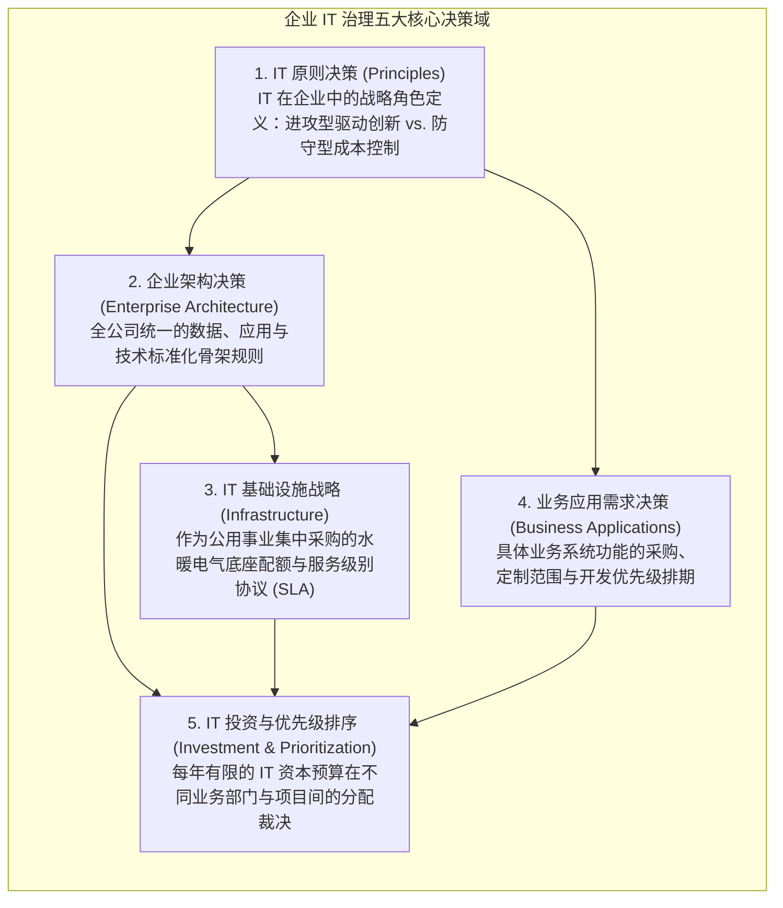
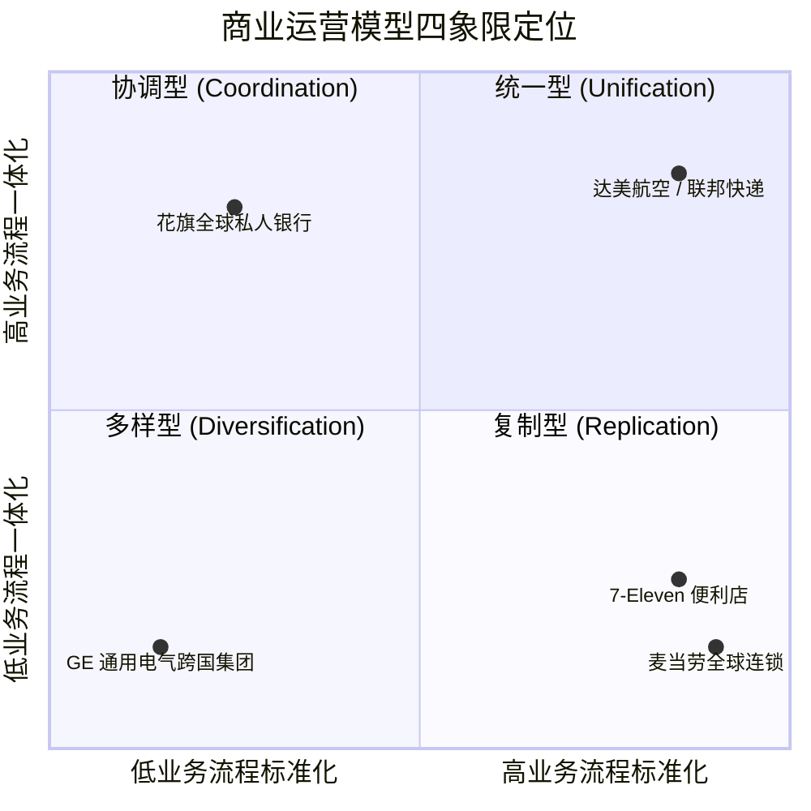

# Lec 16 从 IT 框架中捕获商业价值的方法论 (Getting Business Value from IT Frameworks)

> MIT Sloan School of Management · 15.568 Practical Information Technology Management

## TL;DR

- 彼得·维尔与珍妮·罗斯经典治理矩阵确立了企业在五大关键 IT 决策领域分配权力与责任的机制。
- 商业运营模型由业务标准化与业务一体化两个正交维度定义，分为多样化、协调型、复制型与统一型四大象限。
- 数字化转型的本质是构建由可复用技术与数据构成的基础执行引擎，使企业在面临新商业机会时实现极低边际敏捷创新。

## IT 投资的商业价值悖论与治理盲区 / The Productivity Paradox & Governance Vacuum

在现代商业竞争中，各行业领军企业每年在信息系统、服务器机房、云服务与软件许可上砸下数以千万计的巨资。然而，当董事会向 CEO 和 CIO 严厉发问：“**我们过去五年累计投入的两个亿 IT 资本，到底为企业创造了多少可量化的商业竞争优势？**”绝大多数企业高管陷入了尴尬的沉默。

由 MIT 斯隆信息系统研究中心（MIT CISR）主任彼得·维尔（Peter Weill）与珍妮·罗斯（Jeanne Ross）开展的长达数年的全球调研揭示了一个震撼的真相：
- 在同一行业中，拥有相同技术投资规模的企业，其财务绩效（ROA、净利润率、新产品上市周期）呈现出高达三倍的巨大离散度；
- **高绩效企业（Top Performers）的秘密，绝不在于他们采购了多么昂贵的服务器或采用了多么时髦的框架，而在于他们拥有极其严密、清晰且贯穿全员的“IT 治理与价值捕获机制（IT Governance）”！**

::: definition IT 治理的权威定义 (IT Governance Definition)
IT 治理绝不是指日常的系统运维和机房管理，而是指：**为了在信息技术的使用中诱发期望的组织行为，企业所确立的关于决策权归属（Decision Rights）与责任共担机制（Accountability Framework）的系统性制度安排**。
:::

## 维尔-罗斯 IT 治理五大决策域矩阵 / The Weill-Ross IT Governance Matrix

维尔与罗斯指出，一家成熟的企业必须在五个核心技术领域清晰界定“谁拥有建议权（Input）”、“谁拥有最终裁决权（Decision）”以及“如何问责”：

在决策权力的组织分配上，存在六种经典的政治原型（Archetypes）：从由高管层完全垄断的“商业君主制（Business Monarchy）”、由技术部门独断的“IT 君主制（IT Monarchy）”、各诸侯国割据的“封建制（Feudal）”，到全员拉扯的“无政府状态（Anarchy）”。

MIT CISR 的大数据实证研究证明：**在所有高绩效跨国巨头中，最成功的治理模式是“联邦制（Federal）”与“双寡头制（Duopoly）”的高效结合**——即商业高管与 IT 领袖在原则和架构层面结成权力对等的战略同盟，共同拍板投资优先级，彻底消灭技术与业务的对立割裂。

## 四大商业运营模型：数字化转型的罗盘 / The Four Operating Models

企业如何确定自己到底需要什么样的 IT 架构？珍妮·罗斯提出了震撼全球企业界的**四大商业运营模型（Four Operating Models）**。该模型由两个核心维度定义：
1. **业务流程标准化程度 (Standardization)**：企业在不同地理区域或业务单元之间，是否必须强制执行完全相同、不可妥协的业务操作步骤？（追求效率、规模效应与质量一致性）；
2. **业务流程一体化程度 (Integration)**：不同业务单元之间，是否需要共享客户、供应商数据并实现跨部门实时事务协同？（追求跨销售、全流程客户体验与单一事实之源）。

这四大象限决定了完全不同的 IT 架构宿命：
- **多样型 (Diversification，低标准化/低一体化)**：如早期的 GE 或伯克希尔·哈撒韦。旗下业务跨越航空发动机、医疗设备、金融保险，业务互不相干。此时强行推行全球大一统 ERP 是灾难性的自杀行为。各业务只需自主建设，中央仅需汇总财务报表；
- **协调型 (Coordination，低标准化/高一体化)**：如多业务综合金融集团。投行、零售银行和财富管理的作业流程完全不同，但必须共享统一的“高净值客户主数据视图”，以实现精准交叉销售并控制客户授信风险；
- **复制型 (Replication，高标准化/低一体化)**：如麦当劳、万豪酒店或 7-Eleven。每个门店在物理上是独立的，相互之间几乎没有实时业务往来；但每一个新开业的门店，必须像复印机一样 100% 完整复制总部的标准化 POS 收银、库存排盘与出餐流程系统；
- **统一型 (Unification，高标准化/高一体化)**：如联邦快递（FedEx）或联合包裹（UPS）。全球的每一个网点、每一辆货车必须执行绝对一致的揽件派件规范，且所有包裹在跨越七个转运中心时必须在中央核心数据库中实时保持唯一状态可见。这是架构复杂度最高、对技术底座要求最严酷的象限。

## 打造基础执行引擎（Foundation for Execution） / The Foundation for Execution

数字化转型最核心的战略资产，是珍妮·罗斯定义的**数字化基础执行引擎（Foundation for Execution）**。

在传统低效企业中，每一个新业务需求（如开展线上拼团或接入新支付通道）都被视为一个独立的“烟囱项目”，从零开始采购服务器、建表、开发接口，导致耗时长达一年、成本居高不下；而拥有坚固基础执行引擎的企业，已经将通用的用户认证、统一支付网关、实时物流轨迹跟踪与订单生命周期封装为了**可复用、松耦合的标准化数字化积木（Digital Building Blocks）**。

当市场出现新的商业风口时，企业能够以搭积木的方式，在短短两周之内将已有核心能力组合装配出全新的业务前端，从而以极低的边际成本与近乎瞬时的敏捷度，彻底甩开竞争对手。

## 我的理解与实践洞察 / Personal Insight

::: insight 战略与架构对齐的最大障碍，是领导层缺乏“运营模型的定力”
维尔与罗斯的理论为我们提供了穿透纷繁管理热词的定海神针：
1. **不要在没有明确运营模型前妄谈数字化转型**：许多企业高管在参加了外部论坛后，盲目下达指示“我们要向阿里巴巴学习建业务中台，或者向苹果学习做开放生态”。然而他们没有意识到，中台模式本质上是为“统一型”或“高一体化协调型”企业量身定制的高成本武器。如果一家企业本质上是一个靠不同独立业务打拼的“多样型集团”，强推中央数据中台只会引发各业务子公司的疯狂反弹，并在耗费数千万元后沦为一个无人问津的摆设。**先明确组织在四象限中的核心坐标，再选择与之相符的技术架构，是技术领导力的第一法则**。
2. **拒绝“局部最优（Local Optimization）”对全局战略的蚕食**：在企业运营中，各业务部门经理永远只关心自己本部门的短期考核，本能地希望购买最适合自己单个部门的独立小软件。如果 CIO 缺乏治理原则与制度定力、一味迎合纵容，不出五年，企业就会被无数互相割裂的散装软件割裂为一座无法沟通的巴别塔。**坚守企业级核心主数据与统一架构底线，需要技术管理者拥有捍卫全局利益的钢铁意志与政治智慧**。
:::
