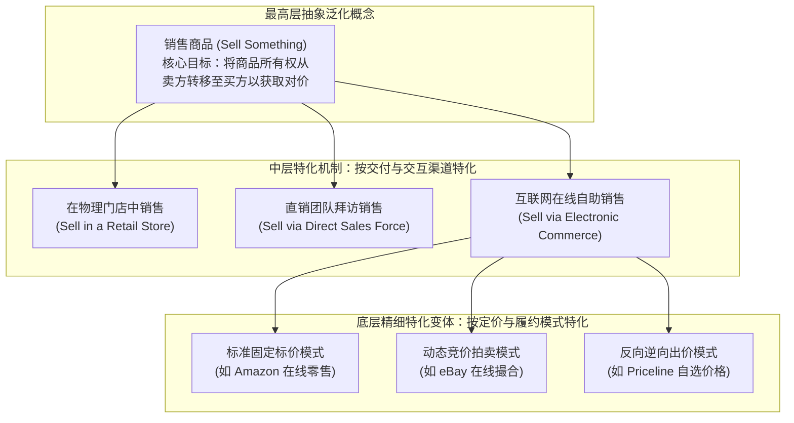

# Lec 17 MIT 流程手册（Process Handbook）：业务流程形式化与重组 (The MIT Process Handbook: Malone Framework)

> MIT Sloan School of Management · 15.568 Practical Information Technology Management

## TL;DR

- MIT 流程手册开创性地将面向对象的分类学继承机制与泛化特化逻辑引入人类商业流程建模领域。
- 托马斯·马隆协调理论将复杂业务解耦为活动、参与者与资源之间共享/流转/匹配等基本依赖关系的治理。
- 通过在流程概念树中自如穿梭与跨行业知识复用，为企业突破传统思维定式提供了系统化流程创新引擎。

## 业务流程的表述困境与知识沉淀危机 / The Challenge of Process Representation

在商业世界中，业务流程（Business Process）是企业组织协作与创造价值的根本载体。从波音组装一架 787 客机，到星巴克制作一杯焦糖玛奇朵，一切皆是流程。然而在很长一段历史时期内，管理学界和工程界对流程的描述却处于极其原始的“手工作坊阶段”：
- 咨询顾问使用流程图（Flowchart）软件绘制出动辄上百页的流程泳道图，充斥着数以千计的方框、菱形判定符与连线；
- 这些图表不仅极其晦涩难读，而且存在致命的**一次性浪费缺陷**：一家制造企业花费数百万元请麦肯锡梳理出的“采购审批流程图”，无法被另一家零售企业直接复用或比较；甚至在同一家公司内部，不同的业务部门使用的画图规范都互不理解；
- 传统的流程图只能描述“**当前是怎么做的（As-Is）**”，却完全无法系统性地启发管理者“**未来还可以怎么做（To-Be）**”，业务重组往往沦为个别专家拍脑袋的灵光一现。

为了攻克这一知识沉淀难题，麻省理工学院斯隆管理学院著名管理科学家**托马斯·马隆教授（Prof. Tom Malone）**领导的研究团队历时十余年，研发出了划时代的企业知识基础设施——**MIT 流程手册（The MIT Process Handbook）**。

## 核心理论创新：将“面向对象继承性”引入流程分类学 / Inheritance and Taxonomy of Processes

马隆教授及其团队的绝顶天才之处，在于敏锐地将计算机科学中面向对象编程（OOP）的**继承（Inheritance）与泛化/特化（Generalization / Specialization）**概念，开创性地移植到了人类商业流程的分类学体系中。

::: definition 流程继承与特化分类学 (Process Taxonomy via Inheritance)
在 MIT 流程手册中，流程不再是孤立平铺的连线图，而是被组织成一棵严密的**概念继承树**：
1. **泛化流程 (General Process)**：位于树的上层，定义了该类活动最本质的抽象动作（例如“向客户销售商品”）；
2. **特化流程 (Specialized Process)**：位于树的下层，继承父流程的所有核心属性，并针对特定环境或机制进行特化变体（例如“在物理零售店中面对面销售”、“通过电话直销”、“通过互联网无人工自助销售”）。
:::

这种面向对象的树状分类法带来了革命性的商业认知飞跃：
- **知识的高度复用性**：当一家传统百货商场试图建立自己的电商业务时，他们不需要从零发明一套全新的商业逻辑，只需沿着流程树从“销售商品”分支下钻探索“互联网在线销售”，即可完整继承行业沉淀的支付、退换货与履约最佳实践；
- **发掘隐匿的创新空白点**：在流程树的每一个分叉节点，管理团队可以像玩魔方一样排列组合不同的特化机制——“既然飞机票可以采用 Priceline 的反向拍卖模式，为什么长途卡车货运运力的采购不能采用同样的特化模式？”

## 托马斯·马隆协调理论（Coordination Theory） / Malone's Coordination Theory

与流程分类学相辅相成的是马隆教授创立的**协调理论（Coordination Theory）**。该理论提出了对商业组织的全新抽象视角：

::: theorem 协调理论核心公理
组织管理在本质上是由“**执行具体任务的活动（Activities）**”与“**管理活动之间相互依赖关系的协调机制（Coordination Mechanisms）**”所构成的双重系统。
一切流程创新的实质，都是在寻找**管理特定依赖关系（Dependencies）的更低成本替代机制**。
:::

协调理论将现实世界中所有错综复杂的业务依赖，高度提炼为三种基本拓扑类型及其对应的管理机制：

| 依赖关系类型 (Dependency) | 依赖的物理与逻辑特征 | 传统物理世界的协调机制 | 现代信息技术驱动的替代创新机制 |
| :--- | :--- | :--- | :--- |
| **共享依赖 (Shared Resource)** | 多个并行活动同时竞争同一项有限的稀缺资源（如机床设备、会议室、救护车） | 先来先服务（FCFS）、管理者行政等级权力裁决、排队抢占 | 动态基于实时市价的电子内部竞价市场、中央智能排程算法自动切片分配 |
| **流转依赖 (Flow Dependency)** | 一个活动产出的中间结果是另一个活动的输入原料（存在先后时序与因果约束） | 设置昂贵且庞大的物理安全库存（Buffer Inventory）、专人手工催办流转 | 跨组织实时 EDI 消息驱动、看板准时制生产（JIT）、敏捷事件流协同 |
| **匹配依赖 (Fit / Constraint)** | 多个活动产出的不同子零部件必须在特定时间地点精准无缝地咬合拼接在一起 | 极其冗长的跨部门对齐协调会议、层层签字图纸人工核对防错 | 全球统一 CAD/CAM 共享数字孪生模型、版本化可自验证 API 契约 |

当信息技术的成本呈指数级衰减时，传统依赖人工官僚、物理库存和冗长会议的昂贵协调机制被彻底摧毁，使得过去在经济学上不可行的创新组织形态（如全球无边界开源社区、Uber 动态运力实时撮合匹配）得以大规模繁荣诞生。

## 我的理解与实践洞察 / Personal Insight

::: insight 商业模式创新不是玄学，而是一套可形式化的搜索算法
托马斯·马隆的流程手册为所有立志于商业模式重构的创新者提供了一把无坚不摧的手术刀：
1. **打破“行业思维定式（Not-Invented-Here Syndrome）”的牢笼**：传统行业的企业家常常陷入深厚的经验盲区，坚信“我们钢铁行业具有不可动摇的特殊性，绝不可能照搬快消品的做法”。然而，在 MIT 流程手册的数学级抽象透视下，钢铁厂的钢坯调拨与可口可乐的糖浆采购在底层完全属于同一种“流转依赖（Flow Dependency）”。通过剥离表象行业名词、直接在底层的活动与依赖层面进行跨界移植，创新者往往能为传统死气沉沉的行业带来降维打击式的颠覆。
2. **在“解构”与“重组”中发现新商业蓝海**：所有震撼时代的商业创新（如戴尔的直销模式、Airbnb 的闲置房屋共享、Zara 的极速敏捷供应链），如果用协调理论去审视，本质上都是**用极低成本的数字信息通信，取代了极其昂贵物理资源协调**。卓越的技术领袖不应等待灵感的偶然降临，而应当像一位严谨的算法工程师一样，系统性遍历企业价值链中的每一个共享依赖、流转依赖与匹配依赖，用现代云原生与数据智能去重写其底层的调度公式。
:::
