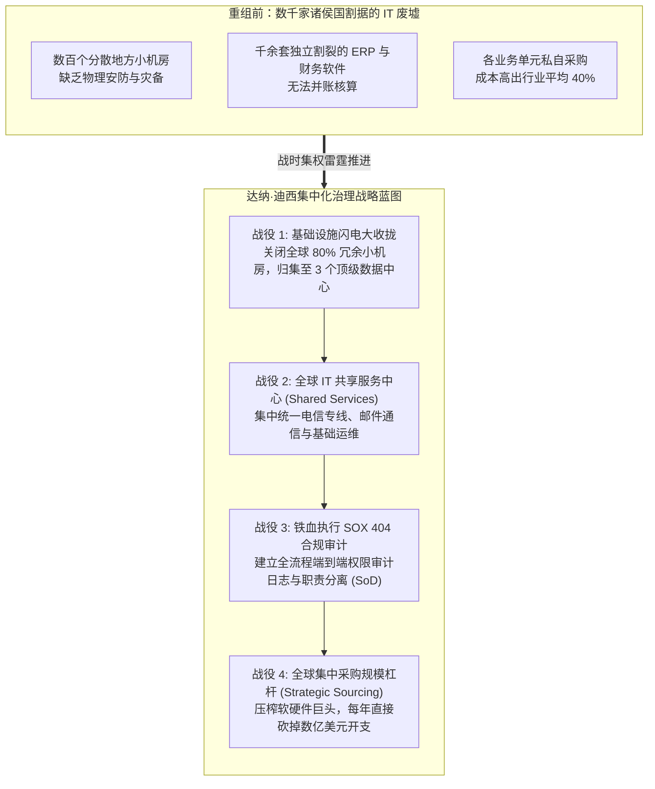

# Lec 19 泰科国际（TYCO）：危机重组中的 IT 整合与治理 (Case: TYCO International & CIO Dana Deasy)

> MIT Sloan School of Management · 15.568 Practical Information Technology Management

## TL;DR

- 泰科国际（TYCO）在遭遇世纪财务贪腐丑闻后，面临着上千家并购企业留下的极其破碎分散的 IT 废墟。
- 新任 CIO 达纳·迪西（Dana Deasy）雷厉风行推行全球 IT 共享服务中心与合规审查，消灭数以千计的割裂孤岛。
- 在萨班斯-奥克斯利法案（SOX 404）的高压合规倒逼下，IT 从边缘运维逆袭为重塑企业公信力的核心定海神针。

## 案例背景：世纪丑闻后的破碎帝国 / Case Context: The Fall of an Empire

在 2000 年代初期，泰科国际（TYCO International）曾是全球最耀眼的跨国超级混合财团之一。通过数十年来无休止的高频杠杆并购，TYCO 将业务触角疯狂延伸至消防安全（SimplexGrinnell）、医疗器材（Kendall）、电子元器件（AMP）以及海底光缆工程等数百个完全互不相关的行业，年收入突破近 400 亿美元。

然而，2002 年，一场震动全球华尔街的惊天丑闻爆发：前 CEO 丹尼斯·科兹洛夫斯基（Dennis Kozlowski）因侵吞公款数亿美元、极其奢靡的私人派对以及严重的财务造假被美国检方刑事起诉并判刑入狱。

新任临危受命的董事长兼 CEO 爱德华·布林（Edward Breen）进驻总部后，发现整座商业帝国的内部运营完全处于失控状态：
- TYCO 在全球疯狂并购了**数千家独立法人子公司**，但此前为了追求账面每股收益（EPS）的虚假膨胀，前管理层**从未对被收购公司进行过任何深度的后台 IT 整合**；
- 全公司运行着超过 1000 套互不兼容的 ERP 系统、数百个各自为政的机房数据中心，拥有上万个不同的供应商代码；
- 当美国《萨班斯-奥克斯利法案》（Sarbanes-Oxley Act, SOX 404 条款）强制要求跨国企业必须对全部财务报告流程的内部控制进行透明度审计签字时，TYCO 甚至连“全公司在全球到底有多少台服务器、有多少员工使用哪个系统”都无法统计清查。

面对随时可能被退市甚至分拆清算的绝境，传奇 CIO **达纳·迪西（Dana Deasy，日后历任摩根大通全球 CIO、西门子全球 CIO 及美国国防部中央 CIO）**被空降至泰科，打响了一场惊心动魄的 IT 废墟大重组战役。

## 迪西的“战时状态”改革四部曲 / Dana Deasy's Turnaround Blueprint

达纳·迪西踏入泰科的第一天，便向管理层明确宣示：在企业生死存亡的至暗时刻，温和的官僚协商只会导致全体溺亡，必须实施**战时集权与雷霆归并策略**：

上图展示了达纳·迪西在泰科推行的四大硬核战略步骤：
1. **建立绝对的中央技术控制权**：迪西强行修改全公司汇报线，各地所有 IT 主管的汇报关系从原本听命于地方厂长，一律变更为**单线向集团 CIO 汇报**；剥夺所有子公司的独立软硬件采购权，严禁任何地方私自购买未经集团认证的服务器与软件；
2. **机房与基础设施的大规模“物理拔线”**：在短短 18 个月内，迪西顶住各地地方总经理的强烈抗议，以钢铁意志强行关闭了全球 80% 以上分散在各个工厂角落的私设小机房，将核心负载全部集中迁移至三个具备军工级高可用灾备的区域超级数据中心；
3. **将 SOX 404 合规打造成推进变革的“尚方宝剑”**：联邦法律对造假违规高管处以刑事监禁的威慑力，成为了迪西摧毁地方诸侯抵触的最大政治杠杆。迪西向所有业务 VP 亮出法律条款：“配合 IT 标准化，不仅是为了省钱，更是为了保证你们和各位董事明天早上不会被联邦调查局戴上手铐带走！”全公司迅速凝聚了空前的合规纪律；
4. **共享服务与全球供应商议价**：此前，泰科各个子公司各自向 IBM、微软、Oracle 采购软件，不仅无法享受大客户折扣，反而支付着最昂贵的分散零售价。迪西组建集团集中采购战队，直接与巨头 CEO 谈判，凭借数百亿美元的集团总体采购体量，一举将全公司的 IT 采购与维护成本砍掉了 35% 以上，每年直接为公司贡献数亿美元净现金流。

## 泰科涅槃：从危机废墟到治理标杆 / The Phoenix Rises

在达纳·迪西的高超统帅下，泰科国际在短短两年之内完成了商业史上最不可思议的 IT 绝地反击：
- 顺利 100% 通过了美国证监会极其严苛的 SOX 404 内部控制审计，彻底甩掉了财务欺诈的污名，赢回了全球资本市场的崇高信誉；
- 累计节约的 IT 运营支出超过 5 亿美元，IT 部门从过去人人喊打的腐败黑洞，转变为全集团最透明、最高效的治理灯塔；
- 这一辉煌战役直接奠定了达纳·迪西作为全球顶级技术统帅的江湖地位，成为日后全美企业界竞相聘请的危机救火大师。

## 我的理解与实践洞察 / Personal Insight

::: insight 危机是进行深水区架构重组的“最大赠礼”
泰科案例为所有身处困境之中的技术管理者留下了极其深刻的战略启迪：
1. **永远不要浪费一场好危机（Never waste a good crisis）**：在平稳繁荣的承平年代，任何试图收拢子公司权力、削减冗余系统的技术重构，都会遭遇地方利益集团极其顽固的阻挠，最终往往在无休止的政治拉扯中妥协流产。然而，当企业遭遇外部黑天鹅、监管重锤或生死存亡的财务危机时，旧有的权力结构瞬间瓦解，全员充满了生存恐惧。**卓越的技术领袖必须敢于在暴风雨中挺身而出，借由危机的合法性，大刀阔斧推行在平时根本不可能被批准的颠覆性重构**。
2. **用“安全与合规”做盾，用“成本与效益”做剑**：许多 CIO 在汇报工作时，只懂得空谈“我们的技术架构多么先进优雅”，这对陷入危机的董事会毫无吸引力。达纳·迪西的绝顶聪明之处在于：他右手拿着严苛的联邦法律（防范刑事责任），左手拿着数以亿计的真金白银成本削减支票（改善现金流）。**当你的技术战略直接切中董事会最关心的“免除法律牢狱之灾”与“拯救财报现金流”两大命门时，你将获得组织内无与伦比的绝对授权与信任**。
:::
