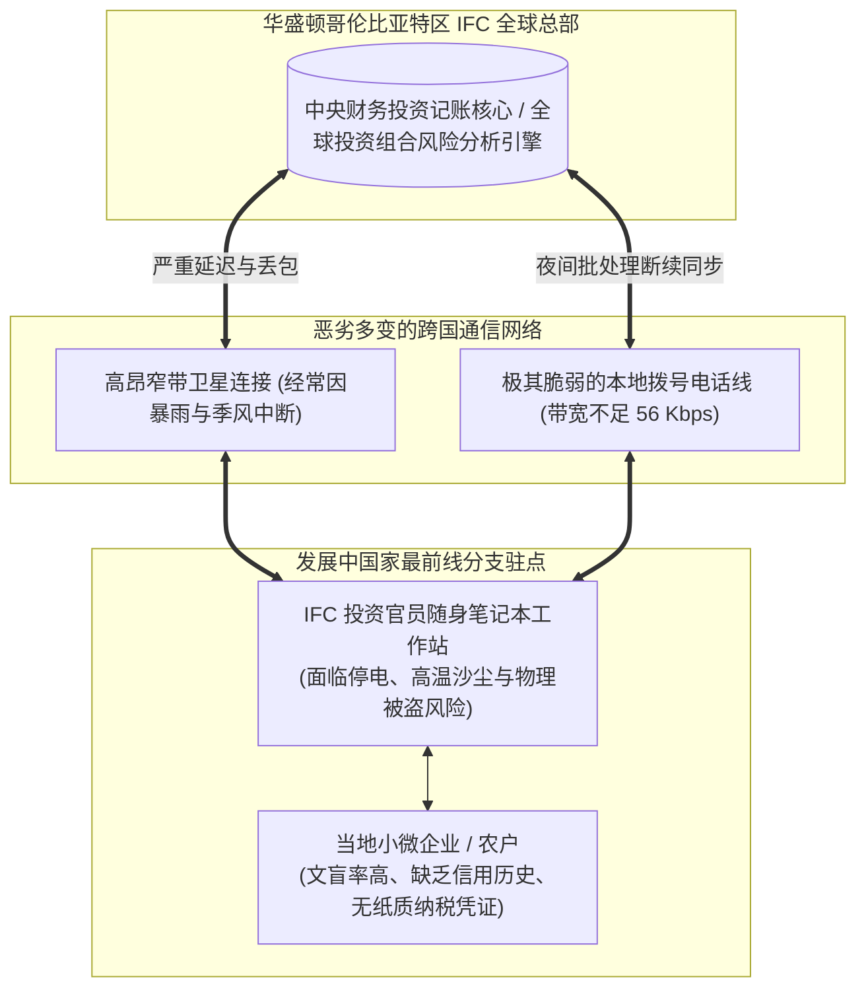

# Lec 22 国际金融公司（IFC / 世界银行）：跨国援助中的数字化赋能 (IT in Global Development: IFC and World Bank)

> MIT Sloan School of Management · 15.568 Practical Information Technology Management

## TL;DR

- 世界银行集团旗下国际金融公司 IFC 展示了在全球极端贫困与基础设施匮乏地区推行数字化的非凡挑战。
- 全球分布式知识管理系统将分散在数十个发展中国家的援助与投资经验转化为可复用的智慧资本。
- 在电力不稳、网络极度脆弱且政局动荡的恶劣地缘环境下，技术的极简性与离线抗毁性是人道援助的生命线。

## 案例背景：在世界的最边缘点亮金融之光 / Case Context: The Mission of IFC

国际金融公司（IFC, International Finance Corporation）是世界银行集团（World Bank Group）旗下专注于私营部门投资与发展援助的全球多边金融机构：
- 投资足迹遍布全球 100 多个发展中国家和最不发达国家（涵盖撒哈拉以南非洲、饱受战乱的中东、拉美偏远雨林以及南亚贫民窟）；
- 核心使命是通过为当地私营企业提供股权投资、长期贷款、结构化融资以及专业管理咨询，激发当地市场活力，从而消除极端贫困、促进包容性经济增长；
- 面对的客户往往是传统商业银行根本不屑于顾及的脆弱实体：喀麦隆的微型可可种植农户、孟加拉国贫困妇女开办的手工纺织作坊、肯尼亚偏远村庄的简易太阳能发电站。

客座嘉宾、IFC 全球技术架构领袖奥马尔·贝格（Omar Baig）亲临 15.568 课堂，向斯隆师生揭开了一个与华尔街或硅谷完全不同的真实数字世界：**在极端缺乏水暖电气、网络随时中断、政治动荡频发的世界底层，信息技术如何跨越鸿沟，成为守护人类尊严与希望的火种？**

## 极端恶劣环境下的全球技术挑战 / The Hard Realities of Global Development IT

在欧美发达国家，架构师们在云计算数据中心里讨论着微秒级低延迟、无限弹性伸缩与海量并发；然而，当 IFC 的投资官员和技术专家深入阿富汗、海地或刚果（金）的现场时，他们直面的是人类工业文明最残酷的物理约束：

前线技术落地面临四大深层危机：
1. **基础设施的彻底真空**：偏远地区每天停电长达十几个小时，电压剧烈波动，轻易烧毁精密服务器电源；网络带宽极其狭窄且费用惊人，网络丢包率高达 30% 以上；
2. **物理安全与地缘政治动荡**：分支机构随时面临军事政变、武装暴动或自然灾害，现场电脑设备面临被洗劫的巨大风险；系统必须具备瞬时**远程数据擦除（Remote Wipe）**能力，防范敏感借贷客户名单落入军阀手中引发人道屠杀；
3. **“无历史信用记录（Thin-File）”的死结**：发展中国家的穷人没有银行账户、没有社保记录、更没有不动产抵押证明。传统依赖 FICO 信用分的信贷风险算法在这些地区完全彻底失效；
4. **多币种恶性通胀与外汇管制**：部分国家年通胀率高达数千倍，本地货币每天大幅贬值，核心财务系统必须支持多本位币与动态汇率对冲核算。

## 数字化破局之道：全球知识管理与微型金融革命 / Innovation at the Bottom of the Pyramid

面对绝境，IFC 技术团队开创了一系列极具社会温情与工程智慧的创新实践：

### 1. 全球分布式知识管理系统（Global Knowledge Bank）
IFC 发现，机构最宝贵的财富不是账面上的几十亿美元资金，而是**分散在全球各地的投资官员在泥土中摸索出的实战经验**。
- 例如：某位官员在哥伦比亚成功设计了一套“咖啡豆小农户微型降雨指数气象保险”流程，这套流程稍作调整便可直接救活千里之外由于干旱面临破产的埃塞俄比亚咖啡农户；
- 团队构建了开创性的去中心化知识库系统，打破不同国家分支办公室的竖井，允许前线官员在离线状态下检索全球同类投资项目的尽职调查模板、环保合规评估与违约重组案例，实现了全机构集体智慧的跨大洲赋能复用。

### 2. 拥抱移动功能机与短信金融（SMS & USSD Banking）
在智能手机尚未普及的时代，IFC 率先联合当地电信运营商（如肯尼亚 Safaricom），大力投资孵化了划时代的 **M-Pesa 移动货币系统**。
- 穷人不需要拥有电脑，甚至不需要拥有银行账户；只要手头有一台破旧的诺基亚黑白功能手机，老人和妇女就可以通过极简的 USSD 短信代码，在几秒钟内完成借款申请、微额水电费缴纳以及远方打工子女汇款的接收；
- 数字化信贷技术彻底斩断了传统高利贷对底层贫民的残酷剥削，被联合国誉为发展中国家减贫史上最伟大的金融创新。

## 我的理解与实践洞察 / Personal Insight

::: insight 技术的最高善意，在于看见那些“被世界遗忘的角落”
IFC 的跨国援助案例为身处优渥环境的技术管理者带来了灵魂级的震撼洗礼：
1. **好的技术不一定要追求极致的复杂与前沿**：在硅谷或大厂，技术人员往往盲目追求最新的大模型、最复杂的分布式算法；而在真实的世界底层，一个仅仅依靠 160 个字符短信、哪怕在停电时依然能稳定工作的 USSD 脚本，却能够拯救一个面临饥荒威胁的非洲村庄。**技术的伟大从来不在于代码有多深奥，而在于它是否在真实人类的痛苦面前提供了最坚实的救赎**。
2. **在“最恶劣的环境”中淬炼出的架构，拥有最高的生命力**：能够在非洲沙漠和战乱地区稳定跑通的离线同步协议、断点续传机制与轻量数据模型，迁移到现代企业面对极端黑天鹅灾难时，展现出了令人惊叹的抗毁韧性。正如一位老资深架构师所言：“如果你能在阿富汗的山区把分布式数据系统调通，世界上就再也没有任何商业环境能够难得倒你。”
:::
