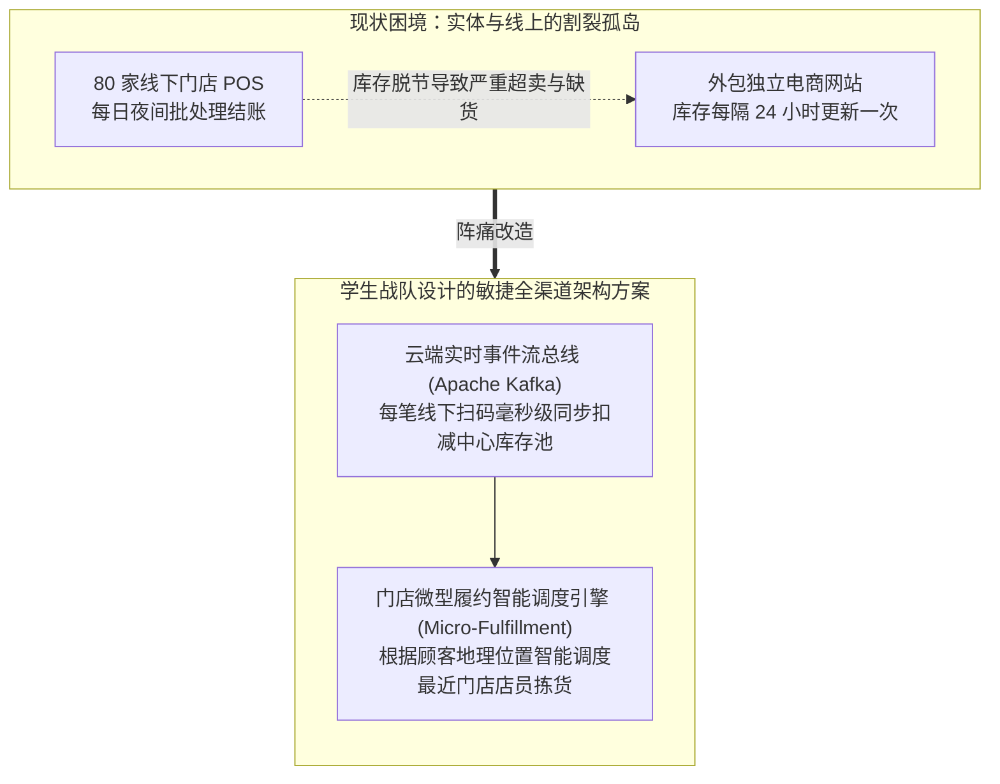

# Lec 23 团队实战项目展示与企业数字化架构评审 I (Team Project Presentations I)

> MIT Sloan School of Management · 15.568 Practical Information Technology Management

## TL;DR

- 全真企业现场咨询课题首场答辩展示了斯隆学员深入商业前沿进行数字化架构审计的丰富成果。
- 评审聚焦传统零售供应链重构与跨国制造巨头遗留系统解耦方案的商业可行性与投资回报测算。
- 跨职能团队在多方利益相关者博弈、技术债务定性与渐进式迁移路线图设计上展现了专业咨询功底。

## 研讨背景：走出象牙塔的真实战火 / Background of Field Project Presentations

在麻省理工学院斯隆管理学院，**15.568 实用信息技术管理**绝不仅止于课堂上的案例研讨与理论推导。课程最核心的实战精髓，在于为期整学期的**全真企业现场咨询实战课题（Enterprise IT Field Projects）**：
- 3 至 5 名来自 MBA、工程管理硕士（SDM）以及计算机系的高年级学员组成联合咨询战队；
- 每支战队深入一家真实的外部企业客户（涵盖新英格兰地区的零售巨头、传统制造工厂、生物科技新星、区域连锁医院以及市政公共机构）；
- 战队直接向客户公司的最高决策层（CEO、CIO 或运营副总裁）汇报，进行实地访谈、代码与机房架构审计、财务数据剖析，并最终向全班师生及特邀外部企业评审团提交一份具有可操作性的**企业数字化架构重构与商业战略路线图方案**。

本讲为首场答辩汇报，聚焦两大极具代表性的传统实体行业数字化破局实战切片。

## 实战案例一：老牌区域连锁超市的“全渠道（Omnichannel）生死战” / Case Presentation: Regional Grocery Chain

第一战队深入了一家拥有 80 家门店、年销售额超 10 亿美元的新英格兰老牌区域连锁超市巨头。

### 1. 核心商业病灶诊断
在亚马逊（Amazon）收购全食超市（Whole Foods）的强烈外部冲击下，该超市仓促上线的线上买菜送货服务陷入惨败：
- 线上网站与线下门店的库存系统完全互不连通，数据每天仅在午夜同步一次；
- 顾客在线上下单购买了一盒新鲜三文鱼，但当一小时后拣货员走到货架前时，该商品早已被线下顾客买走，线上订单缺货率高达 25%，引发海量差评与客户流失；
- 履约成本居高不下，线上订单平均每笔亏损 4 美元。

### 2. 学生战队开出的数字化处方
- **推行“共享全局动态库存池（Single Inventory Pool）”**：引入基于轻量云原生事件流的 CDC 机制，线下收银机每扫一件商品，实时广播事件扣减线上可售配额，将缺货率压降至 1% 以下；
- **重构门店为“前置微型履约中心（Micro-Fulfillment Center）”**：为拣货员工配备手持智能终端，利用算法优化店内拣货走动路径，将单笔订单拣货时间从 28 分钟压缩至 9 分钟，成功实现单笔履约转亏为盈。

## 实战案例二：百年重型机械制造企业的“物联网预测性维护转型” / Case Presentation: Industrial Machinery Manufacturer

第二战队深入了一家拥有百年历史的工业泵与重型压缩机制造工厂。

### 1. 核心商业病灶诊断
该企业长期依赖传统的“一次性卖设备硬件”商业模式，面临着全球新兴市场廉价仿制品的残酷价格战，毛利率连年跌落；同时，由于设备在客户化工厂内突发故障停机，经常面临客户高额索赔。

### 2. 学生战队开出的数字化处方：Servitization（产品服务化）
学生团队建议客户彻底打破“设备制造者”的传统定位，跃迁为“设备全生命周期运行保障服务商”：
- **物联网边缘传感改造**：在核心压缩机轴承上加装低成本振动、温度与油液压力传感器，通过边缘网关将运行遥测数据加密回传云端；
- **时序大数据异常预测模型**：利用机器学习算法分析机械振动频谱，在轴承发生物理损坏前两周精准预警，自动向客户售后团队生成派单，实现**预测性维护（Predictive Maintenance）**；
- **商业模式颠覆：按有效运行时长（Power-by-the-Hour）收费**：效仿劳斯莱斯航空发动机，向高端化工客户推出“设备免费赠送，按每小时无故障稳定输出的气量收费”的全新订阅制合同，一举摆脱价格战泥潭，将客户终身黏性与服务高毛利牢牢锁定。

## 现场评审团交锋与犀利质询 / The Grand Jury Cross-Examination

在答辩现场，来自波士顿咨询集团（BCG）、富达投资（Fidelity）以及 MIT 教授组成的专家评审团进行了极其严苛的实战质询：
- **针对超市案例**：“你们方案中测算的 Kafka 事件总线改造成本看似只有 20 万美元，但你们有没有考虑过 80 家门店老旧收银机升级固件所面临的巨大停机风险？如果周六上午系统闪退导致顾客无法排队买单，这个潜在商业损失你们如何在投资回报率（ROI）模型中进行风险对冲？”
- **针对制造案例**：“化工客户对核心生产数据的外泄怀有极深警惕，你们凭什么认为石化巨头会允许你们把压缩机的实时运行数据上传到公有云端？你们是否设计了本地边缘私有化部署与零信任数据脱敏方案？”

学员们在唇枪舌剑的交锋中，深刻体会到了真实商业世界中技术选型背后的深水博弈。

## 我的理解与实践洞察 / Personal Insight

::: insight 咨询方案的生命力，在于“可实施性（Feasibility）”而非词汇的华丽
首场实战项目答辩为所有技术管理者提供了无价的方案设计方法论：
1. **警惕“咨询 PPT 泡沫”**：很多初涉商业的技术团队在给管理层做方案汇报时，充斥着“大数据驱动”、“人工智能赋能”、“生态闭环重塑”等空洞的高大上词汇，但在被追问“下周一早上具体该干什么、第一阶段到底花谁的预算、谁来对系统指标负责”时哑口无言。**一份真正能够改变企业命运的方案，必须精确到人员编制表、技术选型矩阵、逐月甘特图以及详尽到美分的现金流敏感度测算**。
2. **在“客户的心理舒适区边缘”推进变革**：卓越的架构师绝不试图一次性向客户兜售全套革命性方案，因为那会把客户吓退。聪明的做法是“用保守的外壳包裹前沿的内核”——让客户的前端操作习惯尽可能保持微调，而在底层通过松耦合的适配器逐步替换陈旧腐烂的引擎。当客户在不经意间享受到提效的甜头后，组织变革的滚滚车轮便再也无法停下。
:::
