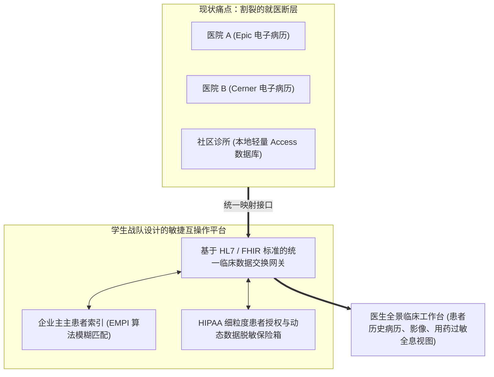

# Lec 24 团队实战项目展示与企业数字化架构评审 II (Team Project Presentations II)

> MIT Sloan School of Management · 15.568 Practical Information Technology Management

## TL;DR

- 第二场实战项目评审深入医疗大健康与金融科技两大极端注重合规与风控的复杂垂直领域。
- 解构综合性医疗网络在跨院电子病历互联中打破数据孤岛与遵循 HIPAA 隐私法规的艰难权衡。
- 金融资管实战项目展示了如何用现代化微服务架构重组老旧遗留核心主机并保障零差错交易结算。

## 研讨背景：在合规与风控的风暴中心 / Background: High-Stakes Enterprise Audits

延续前一讲的精彩交锋，本次研讨会迎来了企业数字化现场课题的第二批实战汇报。本轮展示的两大项目聚焦于现代商业世界中监管最严酷、容错率最低、数据价值最敏感的两个核心战场：**医疗大健康网络（Healthcare Systems）** 与 **金融资产管理（Financial Asset Management）**。

在这些领域，系统架构师的一个低级错误不仅会导致数百万元的商业损失，更会直接引发监管机构的天价罚单、客户隐私泄露的集体诉讼乃至致命人道危机。学员们展示了在极端合规约束下推进架构创新的高超智慧。

## 实战案例三：区域医疗联合体的“全生命周期健康档案互通” / Case Presentation: Regional Health Network

第三战队深入调研了一家由三家急性期医院、十五家专科诊所及数十家体检中心联合组建的区域医疗集团。

### 1. 核心商业与临床病灶诊断
各机构由于历史上多次并购组建而成，内部使用了不同厂商的电子病历软件（EMR）：
- 患者在社区诊所看完高血压后，若突发急症被救护车送到中心医院，中心医院的急诊医生无法调阅其在诊所的服药记录，不得不重新安排繁琐耗时的重复化验与 CT 扫描；
- 医疗账单报销（Billing）流程跨院对账极其缓慢，拒赔率居高不下；
- 集团多次尝试打通系统，但由于美国联邦《健康保险流通与责任法案》（HIPAA）对患者电子受保护健康信息（ePHI）的泄露设置了极其严酷的刑事处罚，各院院长因害怕担责而互相封锁数据。

### 2. 学生战队的破局架构
- **确立企业主患者索引（EMPI, Enterprise Master Patient Index）**：运用概率模糊匹配算法（结合姓名、出生日期、社保后四位），在不侵犯隐私的前提下，将分散在七套系统中的数百万个碎片就医记录在后台唯一归并至真实自然人名下；
- **全面拥抱 HL7 / FHIR（快速医疗互操作资源）微服务契约**：不强求推翻各医院成熟的 EMR，而是在顶层搭建统一的 FHIR RESTful API 适配器，将临床数据标准化为轻量 JSON 资源流；
- **细粒度隐私授权保险箱**：在系统中嵌入基于角色的动态数据脱敏引擎，肿瘤科医生只能调阅肿瘤相关病史，普通护士无法查看精神心理科的隐私记录，在赋能临床救治的同时实现了 100% 的合规严丝合缝。

## 实战案例四：老牌资管基金的“遗留核心主机现代化与实时风控” / Case Presentation: Wealth Management Firm

第四战队深入了一家管理着 500 亿美元高净值客户资产的老牌财富管理公司。

### 1. 核心商业病灶诊断
公司的股票债券交易结算与总账核算，依然运行在一台服役了二十五年的 IBM AS/400 遗留主机上：
- 系统的清算完全基于“夜间批处理（Batch Processing）”：白天的全部交易指令直到半夜才开始串行跑账；
- 投资经理和风控总监在白天交易时段完全无法获知当前各个投资组合的实时风险敞口（VaR, Value at Risk）。面对日间金融市场的剧烈黑天鹅震荡，公司处于事实上的“风险失明状态”；
- 维护主机的三名核心老工程师平均年龄已达 63 岁，后继无人危机迫在眉睫。

### 2. 学生战队的“绞杀者架构（Strangler Pattern）”拯救方案
学生战队断然否决了外部软件商兜售的“斥资 8000 万美元全面推倒主机”的自杀式建议，而是提出了经典的**绞杀者演化路线**：
- **第一阶段（非侵入数据捕获）**：利用 CDC 变更数据捕获技术，旁路监听 AS/400 主机的数据库日志，将每笔白天发生的实时交易日志无感镜像推送到云端内存数据库中；
- **第二阶段（实时日间风控先锋）**：在云端基于实时数据流构建现代化的实时风控与投资经理仪表盘，让投资总监首次拥有了秒级全盘风险穿透力；
- **第三阶段（模块化渐进剥离）**：按照客户账户管理、合规申报、清算结算的顺序，逐一将业务逻辑用现代微服务重构并接管，主机逐步降级为一个纯粹的数据归档备份节点，平滑完成了向现代云原生架构的软着陆。

## 教授大总结与评审裁决 / Faculty Synthesis & Final Verdict

在两场共八个战队的精彩答辩圆满收官之际，15.568 教授团队对全场成果进行了高度凝练的终极大盘点：
- **学术与实战的黄金闭环**：所有战队都没有停留在虚妄的技术狂欢中，每一个技术建议都附带了严密贴合现实的组织变革管理计划（Change Management Plan）与财务盈亏平衡分析；
- **展现了 MIT Sloan 学员独特的品格**：既拥有敢于向 CEO 提出尖锐批评的专业直率，又拥有能与一线程序员和基层操作员促膝长谈的深厚同理心。这种复合型的系统思维能力，正是未来商业领军者最宝贵的无形资产。

## 我的理解与实践洞察 / Personal Insight

::: insight 在极端复杂系统面前，“渐进演进”是对生命的敬畏
第二场实战答辩为我们揭示了高风险关键系统的重构公理：
1. **永远推崇“绞杀者模式（Strangler Pattern）”，远离“一次性推翻大切换（Big Bang）”**：许多年轻架构师拥有致命的激进倾向，总想一口气用最新最酷的技术把运行了二十年的老旧系统彻底废除。然而在医疗和金融领域，老旧系统虽然难看，但它内部的数万行代码凝聚着整整二十年间修补的无数业务边界特例与血泪教训。盲目推翻重来的失败率接近 100%。**像绞杀植物攀附古树一样，在老系统外围搭建现代微服务逐步蚕食、渐进替代，方是大师风范**。
2. **安全与隐私是架构的“第一序公理”，绝不能是事后打的补丁**：很多团队在设计系统时，先把数据共享和流程跑通，等到快上线了才让安全人员来看一眼。在强监管行业，这无异于犯罪。优秀的设计必须在画第一张表、写第一个 API 时，就将权限最小化、数据脱敏、加密审计深深烙印在架构的骨髓之中。合规不是阻碍创新的手铐，而是保障企业这辆高速赛车在弯道上不至于坠崖的坚固刹车系统。
:::
