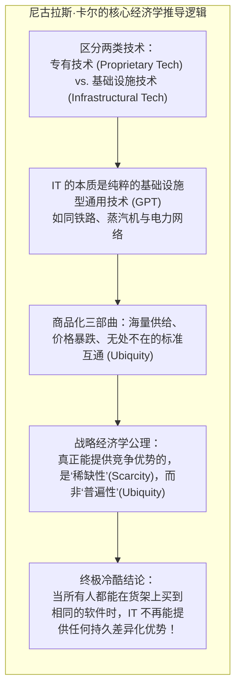

# Lec 25 “IT 不再重要？”Nicholas Carr 大辩论与竞争优势重估 (Debate: "Does IT Matter?" Nicholas Carr vs. Enterprise Reality)

> MIT Sloan School of Management · 15.568 Practical Information Technology Management

## TL;DR

- 哈佛商业评论尼古拉斯·卡尔世纪之问‘IT 不再重要’引发了全球商业与技术界的惊天大辩论。
- 卡尔主张 IT 已退化为易于复制、无处不在的通用商品化技术，因而不再能赋予企业持久的战略差异化优势。
- MIT 学术界与产业领袖强力反击：纯技术易于购买，但与组织资本、人力培训及专有流程深度咬合的 IT 构成了坚不可摧的护城河。

## 世纪大争鸣：一颗引爆全球商界与科技界的核弹 / The Spark of the Century

2003 年 5 月，全球最具声望的管理学期刊《哈佛商业评论》（Harvard Business Review, HBR）刊登了一篇由资深编辑**尼古拉斯·卡尔（Nicholas G. Carr）**撰写的封面文章，标题极其惊世骇俗、甚至带有公然挑衅意味——**《IT 不再重要》（*IT Doesn't Matter*）**。

这篇文章如同一颗重磅核弹，瞬间在整个硅谷、全球跨国企业董事会以及顶级商学院中掀起了史无前例的惊涛骇浪：
- 微软公司董事长比尔·盖茨（Bill Gates）在公开演讲中斥责卡尔的观点是“胡说八道（Phooey）”；
- 英特尔 CEO 克雷格·贝瑞特（Craig Barrett）公开反击：“卡尔完全不懂技术的持续演进力！”
- 惠普 CEO 卡莉·费奥莉娜、通用电气 CIO 以及各大咨询公司巨头纷纷发表万字长文口诛笔伐；
- 而另一方面，各大跨国企业的首席财务官（CFO）和华尔街分析师们却在私下击节叫好，拿着卡尔的文章去严厉质问 CIO：“看吧！管理大师都说了 IT 已经不重要了，你们明年休想再申请千万级的系统预算！”

在 15.568 课堂上，全体师生展开了一场火星四溅的现场大辩论：**IT 到底还重不重要？信息技术究竟还能否为企业提供持久的竞争优势？**

## 卡尔的核心论辩：通用技术商品化诅咒 / Carr's Thesis: The Commoditization of IT

卡尔的论证逻辑极其严密、冷酷，并且拥有深厚的经济学史与工业革命历史纵深。其核心论点可高度提炼为以下推导链条：



### 1. 专有技术 vs. 基础设施技术 (Proprietary vs. Infrastructural)
- **专有技术**：被单一企业通过专利或商业秘密独占（如可口可乐的原浆配方、辉瑞的抗癌药物分子结构）。这种排他性稀缺能够长期为企业构筑高额垄断租金；
- **基础设施技术**：其内在价值依赖于**全网共享与互联互通**（如 19 世纪的铁路网、电网、电话电报网）。基础设施技术在诞生初期或许能赋予尝鲜者短期先发优势；但随着技术标准统一，其宿命必然是**彻底商品化（Commoditization）**——最终沦为如同自来水与电暖气一样，任何企业按月交电费即可获得的公用事业水暖设施。

### 2. 边际可复制性消灭了差异化
企业如今使用的 Windows 操作系统、SAP ERP 软件、Oracle 数据库或 Dell 服务器，都是直接在公开市场上批量采购的现成货（COTS）。如果一家公司花五百万买了一套先进的供应链软件，他的竞争对手在下周同样可以开一张五百万的支票买一模一样的系统。**买来的标准化商品，无法构成不可复制的竞争优势**。

### 3. 卡尔对企业管理者的残酷建议
基于上述判断，卡尔对 CIO 提出了三条颠覆传统的“防守型管理法则”：
1. **少花钱，严控成本 (Spend Less)**：IT 投资已经严重过剩，不要在技术上盲目烧钱；
2. **成为快速跟随者，绝不做先驱先烈 (Follow, Don't Lead)**：新技术的成熟极其迅速，早期的尝鲜者往往承担了极其昂贵的 Bug 调试与沉没成本，等待技术标准成熟后再廉价采购才是明智之举；
3. **关注脆弱性风险，而非盲目追求创新机会 (Focus on Vulnerabilities, Not Opportunities)**：系统不出事、防范宕机、防范黑客病毒与数据丢失，比指望系统帮你增加营收重要得多。

## MIT 与学术界的大反击：组织资本与无形资产的力量 / The Academic Rebuttal: Intangible Capital

面对卡尔的猛烈冲击，麻省理工学院斯隆管理学院著名经济学家**埃里克·布林约尔松教授（Prof. Erik Brynjolfsson）**领导学术界和产业前线，进行了极其精彩的底层反击。

布林约尔松指出：**卡尔犯了一个极其致命的“还原论谬误”——他错误地把“企业信息系统”等同于“装在纸箱里的软硬件光盘和服务器金属外壳”！**

::: theorem 布林约尔松的“IT 互补性资产理论” (Complementary Organizational Capital)
纯粹的硬件和通用软件确实是标准化的无处不在的商品；然而，**真正的商业竞争优势，从来不是来自于单纯采购软件，而是来自于技术与企业内部专有的“互补性组织资本（Complementary Capital）”之间的深度咬合与共生演化！**
企业在软件硬件上每投入 1 美元，往往需要配套投入高达 9 美元的资金用于：
1. 彻底推倒重塑专属的业务流程（BPR）；
2. 员工数千小时的认知技能重塑与组织培训；
3. 全新的权力考核制度与企业文化变革。
这 9 美元的**互补性无形资产（Intangible Assets）**深植于企业的组织毛细血管之中，极度复杂且无法在公开市场上被竞争对手用钱直接买走！
:::

```mermaid
flowchart TD
    subgraph Market [公开技术商品市场 (任何人花钱可买)]
        Hard["标准硬件服务器 / 云算力"]
        Soft["商用标品软件 / 开源框架"]
    end

    subgraph Firm [企业内部独一无二的专有熔炉 (极度难以复制)]
        BPR["经过深度定制磨合的专有流程"]
        People["受过严密训练的高忠诚度团队"]
        Culture["鼓励快速试错与数据决策的文化基因"]
        Data["数十年沉淀的海量专属高精业务数据"]
        
        BPR <--> People <--> Culture <--> Data
    end

    Market ==>|仅仅是原材料投入| Firm
    Firm ==> Moat["不可撼动的持久竞争护城河 (Sustainable Competitive Advantage)"]
```

现实商业世界提供了最响亮的耳光：
- **沃尔玛 vs. 凯马特（Kmart）**：两家零售巨头都采购了 IBM 的大型机与相似的库存软件，但沃尔玛通过技术与自身独特的“天天低价”文化、交叉转运（Cross-Docking）物流流程深度结合，最终成长为全球零售霸主；而凯马特却因内部流程混乱破产倒闭；
- **戴尔电脑（Dell）**：戴尔采购的全部零部件和服务器与惠普、康柏毫无二致，但戴尔利用信息系统将“直接订单定制”与“零库存准时制装配”咬合到了极致，构筑了长达十余年的惊人统治力。

如果技术真的不再重要，为什么那些数字化原生巨头（亚马逊、谷歌、苹果）反而在随后的二十年里，成为了全球商业史上统治力最强、市值最恐怖的超级帝国？

## 我的理解与实践洞察 / Personal Insight

::: insight IT 的平庸化在于工具，IT 的神圣化在于融合
尼古拉斯·卡尔的大辩论是每一位数字化战略家必须定期重温的思维疫苗：
1. **感谢卡尔：他刺破了“IT 技术图腾崇拜”的虚荣泡沫**：卡尔的论点并非一无是处，他的警世恒言精准击中了那些盲目给供应商送钱的昏庸高管。如果你的企业所谓的数字化转型，仅仅是按部就班地采购了一套外部标准 CRM 或 ERP，内部流程毫无改变、组织文化依然官僚僵化，那么卡尔对你的预言就是 100% 正确的——你所购买的技术不仅无法为你带来任何竞争优势，反而只会成为拖垮企业现金流的沉重财务负担。
2. **真正的胜负手，永远发生在“技术与组织的结合部”**：作为卓越的 CIO 或商业领袖，永远不要把希望寄托在“买到某款神秘的神仙软件”上。在软件开源化、算力云端公用事业化的今天，算法和模型终将走向平民化。**唯有你对特定行业客户痛点的极致洞察、唯有你在泥土中摸索出的专有流程、唯有你凝聚的一支能够基于数据快速迭代的人才铁军，当这些独特的组织基因与冰冷的数字技术发生深度化学反应时，不可战胜的护城河才会真正拔地而起**。
:::
