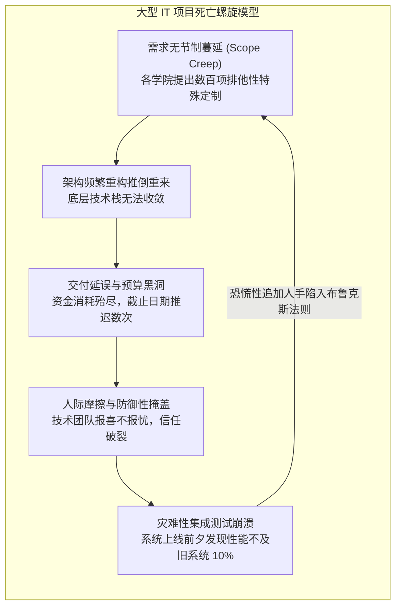

# Lec 03 行政数据系统项目危机（ADP A）：大型 IT 项目失控之谜 (Case: Administrative Data Project A)

> MIT Sloan School of Management · 15.568 Practical Information Technology Management

## TL;DR

- 行政数据系统（ADP A 阶段）生动呈现了大型公共部门与大学系统在缺乏强力治理下陷入失控的经典轨迹。
- 需求无节制膨胀（Scope Creep）与利益相关者权责模糊，导致项目在交付死线临近时不仅严重超支且核心代码无法运行。
- 技术团队对底层复杂性的掩盖和管理层防御性乐观心态，构成了系统性灾难爆发的心理学温床。

## 案例背景：雄心勃勃的现代化宏图 / Case Context: The Grand Vision of ADP

在 1990 年代中后期，一所世界顶尖的研究型大学（化名为大学，基于真实历史事件）面临着严重的行政基础设施老化危机：
- 学校运行着数十套建于 1970 年代的大型机古董系统（Mainframe），代码由过时的 COBOL 与汇编语言混合编写；
- 学生选课、学籍注册、教工工资核发、科研经费报销以及校友捐赠，各自存放在完全互不连通的专有磁带库与扁平文件中；
- 维护老旧系统的资深程序员相继退休，新招聘的年轻工程师根本无法读懂没有文档说明的遗留代码，系统随时面临不可逆的数据损坏风险。

面对迫在眉睫的危机，学校领导层决定启动代号为 **ADP（Administrative Data Project，行政数据系统）** 的宏大工程。该项目的目标极其宏伟：斥资数千万美元，一举推翻全部旧主机，采购最前沿的分布式客户端-服务器软件套件，彻底重建全校统一的端到端集成行政信息系统。

校方聘请了全球顶级管理咨询公司负责方案设计，并组建了由校级高级领导任委员会主席、各院系行政长官参与的庞大指导委员会，宣布系统将在三年内全面上线交付。

## 灾难酝酿：失控的五大经典症状 / The Anatomy of Failure: Five Warning Signs

然而，当项目进入第二年下半程时，原本充满乐观的交付承诺开始急剧变味。ADP 项目呈现出了大型软件工程失控的所有经典教科书级症状：

### 1. 范围蔓延（Scope Creep）与“镀金”陷阱
大学具有高度去中心化（Decentralized）的联邦制组织特征。商学院、医学院、工程学院和文理学院各自拥有完全不同的选课规则、学分核算方式和财务报销流程。各院系代表在需求收集会议上争相提出自己的独特诉求，坚决拒绝任何标准化妥协。需求规格书从最初的 100 页疯狂膨胀到超过 1500 页，开发范围彻底脱缰。

### 2. 谁也不负责的多头治理委员会
项目的“指导委员会（Steering Committee）”拥有多达二十名委员，但其中没有一个人对最终的商业成败全权负责。会议充斥着冗长的学术辩论与利益拉锯，重大技术路线决策（如数据库选型、数据模型定义）被搁置数月之久。

### 3. 缺乏真实里程碑的“90% 完工综合征”
在项目周期的前 24 个月里，项目经理向校领导提交的月度汇报永远是一片绿色的“按计划推进”，宣称“代码开发已完成 90%”。然而，这所谓的 90% 仅仅是工程师在本地机器上编写的孤立模块，从未在真实网络环境、真实并发数据载荷下进行过任何端到端的贯通集成测试。

### 4. 供应商利益不对齐与时间/物料合同（T&M）陷阱
项目采用了基于“工时与材料（Time and Materials）”的咨询服务合同。这意味着外部咨询公司派驻的顾问越多、项目耗时越漫长，咨询公司能够开出的账单金额反而越高。承包商缺乏尽早封板范围、促成系统上线的内生财务动力。

## 危机引爆：不可回避的真相时刻 / The Moment of Truth in ADP (A)

在原定全面上线截止日期前两个月，技术团队终于将财务和学籍模块部署到测试集群中进行首次全链路压力测试。测试结果引发了整座大学高层的彻底震恐：
- 仅仅模拟了 200 个并发教工登录，服务器 CPU 和数据库锁队列便瞬间打满锁死，报销单提交响应时间长达 45 秒；
- 跨模块数据同步中出现了大量脏数据，数千名学生的账单金额被错误扣除；
- 预算已经超支 60%，资金链即将断裂，而核心业务功能竟然有一半无法正常跑通。

在 ADP (A) 案例的结尾，老校长在董事会紧急质询上面对愤怒的院系院长与董事，陷入了前所未有的战略绝境：**是宣布彻底失败、注销数千万美元资本投资并退回老主机，还是硬着头皮向董事会申请追加巨额紧急预算继续挽救？**

## 我的理解与实践洞察 / Personal Insight

::: insight 组织政治比技术代码对大型项目具有更致命的毁灭性
ADP (A) 案例是所有立志领导企业数字化的技术管理者必须反复默诵的警世恒言：
1. **去中心化组织的“假性共识”陷阱**：在大学、医疗系统或跨国事业部制企业中，当委员会表面上全票通过一项宏伟系统方案时，往往不是因为大家达成了真诚共识，而是因为每个人都认为“反正系统最终会按照我们部门的定制规则去修改”。如果在项目第一天没有铁血的最高统帅确立强制标准、斩断多余定制分支，庞大的 IT 项目注定会沦为各方政治争宠的牺牲品。
2. **警惕“绿水青山”汇报中的深水炸弹**：项目周期的前 80% 往往是在风平浪静中度过的，因为写代码和编文档不会暴露出致命的架构断裂。优秀的 CIO 必须拒绝查看基于“任务完成百分比”的虚荣汇报，而是强制推行**基于真实运行增量的灰度集成测试**。让风险在项目第三个月就狠狠暴露出来，远比在交付前两个月引爆整个大厦要便宜一千倍。
:::
