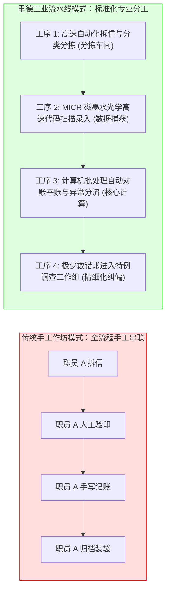

# Lec 07 花旗银行运营组（FNCB I）：金融自动化与流水线再造 (Case: First National City Bank Operating Group I)

> MIT Sloan School of Management · 15.568 Practical Information Technology Management

## TL;DR

- 花旗银行（FNCB）在 1970 年代面临着由于交易量暴增引发的纸质支票堆积如山与严重后台运营危机。
- 约翰·里德（John Reed）引入工业制造业流水线哲学与管理科学，对传统的作坊式银行后台进行彻底手术。
- 将复杂的银行业务拆解为标准化、可度量、分步流转的独立工序，奠定了现代金融高吞吐自动化处理基石。

## 案例背景：堆积如山的支票危机 / Case Context: The Paper Blizzard Crisis

在 1960 年代末至 1970 年代初，花旗银行（First National City Bank of New York，即当今全球金融巨头花旗集团 Citi 的前身）遭遇了由于业务狂飙突进带来的生存级运营危机。

作为华尔街的顶级金融机构，花旗银行的商业贷款与个人零售支票业务迅猛膨胀：
- 每天有数百万张纸质支票从全美乃至全球汇聚到华尔街华尔街总部大楼的**运营组（Operating Group）**后台进行清算与人工核对；
- 传统的银行后台运营方式与 19 世纪的手工作坊几乎没有任何本质区别：数百名西装革履的银行职员在堆积如山、甚至快要没过头顶的纸质支票与信件中手工翻找、人工肉眼比对签名、手写账簿；
- 系统陷入了灾难性的**运营泥潭（Operational Nightmare）**：错账率飙升，一笔普通客户转账清算耗时经常长达数周；银行每天因未能在规定时间内完成清算而向美联储支付的滞纳利息高达数百万美元；后台员工疲惫不堪，加班成风，离职率突破惊人的 50%。

时任花旗银行董事长沃尔特·里斯顿（Walter Wriston）做出了一个惊世骇俗的决定：任命年仅 30 岁、拥有 MIT 斯隆管理学院背景的管理科学奇才**约翰·里德（John Reed，日后花旗集团传奇董事长兼 CEO）**出任运营组最高统帅，全权负责这场后台挽救战役。

## 颠覆性理论引入：将银行后台重构为“现代制造工厂” / Banking as a Manufacturing Plant

年轻的约翰·里德踏入杂乱无章的银行后台机房时，立刻洞察到了危机的本质根源：**银行家们一直错误地把支票处理当成高深莫测的“专业金融艺术”，而实际上它在本质上就是流水线上的“制造业零部件加工”！**

::: definition 约翰·里德的“工厂化运营再造模型” (Factory Model of Operations)
1. **重新定义业务对象**：将支票、汇款单和转账凭据抽象为流水线上流动的**工业原材料与半成品**；
2. **引入科学管理原理 (Taylorism)**：运用弗雷德里克·泰勒的“时间与动作研究”，测量一名操作员拆信封、盖章、磁墨水字符（MICR）扫描的每一个微动作耗时，消除一切无效冗余动作；
3. **工业流水线解耦**：废弃过去“一个人从头到尾手工处理一张支票全部流程”的低效全能工模式，将其切分为高度标准化、职责正交的工序工位。
:::

如上图所示，里德对运营流程进行了无情的解耦与工业化标准化改造。原本高度混乱的支票处理大厅，被重构成了纪律森严、按照时间节拍稳定吐出清算结果的现代化数字金融工厂。

## 自动化计算技术的大规模浸润 / Early Infiltration of IT Automation

在流程解耦的基础上，里德果断引入了当时最先进的信息技术工具，彻底消灭纸质凭证的人肉传递：
- **磁墨水字符识别（MICR, Magnetic Ink Character Recognition）**：在支票底部印制标准磁性数字，利用大型自动读取机每分钟分拣数百张支票；
- **批处理大型机数据库核心（Batch Mainframes）**：建立计算机化日终清算系统，将原本耗时数天的人工翻查总账账簿过程，压缩为大型机磁带驱动器在夜间数小时内自动完成的批处理平账作业；
- **建立量化看板与关键运营指标（KPIs）**：里德在每个车间悬挂巨大的看板，实时展示当天的“未处理积压单据数（Backlog）”、“单笔交易处理成本（Unit Cost）”以及“差错发生率（Error Rate）”，让运营效率首次变得完全可度量、可归因。

## 初战告捷与暗流涌动 / Initial Triumphs and Looming Conflicts

里德的强力手术取得了令人瞠目结舌的商业奇迹：
- 在短短两年内，运营组积压的数百万张滞留支票被全部清空；
- 单笔支票的处理成本下降了 70% 以上，处理周期从数周压缩至数小时；
- 银行因清算延误遭受的巨额罚息被彻底抹平，运营组从吞噬利润的黑洞奇迹般地转变为全行最稳健的效率护城河。

然而，在巨大胜利的耀眼光芒之下，一场更加凶猛、更具破坏力的组织政治与文化海啸，正在花旗银行内部悄然酝酿……

## 我的理解与实践洞察 / Personal Insight

::: insight 业务流程重组（BPR）的本质是“思维隐喻的跃迁”
花旗银行运营组第一部分案例，为现代企业管理留下了极其经典的知识启示：
1. **隐喻（Metaphor）决定了创新的天花板**：如果花旗银行继续停留在“我们是一家优雅绅士的百年传统银行”这一隐喻中，他们的解决方案只能是雇佣更多戴着金丝眼镜的记账员，并在支票雪崩中彻底窒息。约翰·里德的绝顶天才在于**大胆偷换了组织心智底层的物理隐喻**——“我们不是银行后台，我们是一家生产金融清算产品的汽车制造工厂！”一旦这个制造流水线隐喻被确立，福特汽车的流水线经验、统计质量控制（SPC）和自动化机械臂逻辑便能顺理成章地降维赋能金融业务。
2. **技术必须建构在清洗后的流程骨架之上**：许多当代企业在搞数字化转型时，往往本末倒置：在原有极其混乱、臃肿、充满官僚内耗的旧流程之上，生搬硬套地采购最新的人工智能与微服务系统，结果只是把“低效的手工混乱”升级为了“以纳秒级速度狂飙的自动化混乱”。**在写下任何一行自动化代码之前，先拿起手术刀对流程本身进行解耦、裁撤与标准化重构，这才是 IT 发挥万钧威力的绝对前提**。
:::
