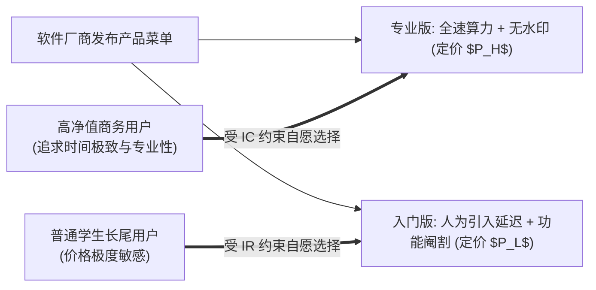

# Lec 01 版本化与价格歧视 (Versioning and Price Discrimination)

> MIT Sloan School of Management · 15.575 Economics of Information and Information Technology · Prof. Erik Brynjolfsson

## TL;DR

- 信息商品具备高固定初始生产成本与零边际复制成本的极端经济学特征，摧毁了边际成本定价公理。
- 二级价格歧视通过精心设计差异化的功能、延迟与格式版本菜单，诱导不同支付意愿的用户实现自我甄别筛选。
- 版本化策略的核心权衡在于高阶版本的价值增值与低阶版本的人为减配损耗，以杜绝高净值客户反向下行套利。

## 信息商品的微观经济学特异性 / The Economic Nature of Information Goods

在亚当·斯密与阿尔弗雷德·马歇尔奠定的传统古典微观经济学中，商品的市场均衡价格（$P$）是由其边际成本（$MC$）与边际收益的交点所决定的。在完全竞争市场中，企业的长期均衡必定收敛于价格等于边际成本（$P = MC$）。

然而，当人类社会步入软件、数字媒体与信息技术时代，信息商品（Information Goods）展现出了彻底颠覆传统微观理论的**极端成本结构**：

::: definition 信息商品的成本函数 (Cost Function of Information Goods)
信息商品是一切能够被数字化编码为比特流（Bits）的智力资产（如操作系统、专业数据库软件、金融研究报告、数字音乐）。其成本函数表现为：
$$C(q) = F + c \cdot q$$
其中，$F$ 代表高昂且沉没的**初始固定创造研发成本（First-Copy Sunk Cost）**，开发一套 Windows 或训练一个大模型可能需要数亿至百亿美元；而 $c$ 代表生产额外一份副本的**边际复制与分发成本（Marginal Cost）**。在互联网公网分发时代：
$$c \approx 0$$
:::

如果信息产品供应商愚蠢地遵循古典经济学“按边际成本定价”的教条，将售价定为零（$P = 0$），企业将瞬间因无法收回巨额沉没研发成本 $F$ 而宣告破产。因此，信息经济学的核心课题是：**企业必须彻底放弃边际成本定价，转向基于“客户感知价值（Value-Based Pricing）”与“价格歧视（Price Discrimination）”的商业模式**。

## 三类经典价格歧视与信息租金剥离 / Classical Price Discrimination Taxonomy

在微观经济学理论中，当厂商面对具备不同支付意愿（Willingness-to-Pay, WTP）的消费者群体时，若强制推行全员单一标价，必然会产生两败俱伤的福利损失：一方面，那些对产品评价极高的高净值客户享受了大量本可被厂商转化为研发资本的消费者剩余；另一方面，广大大批具有一定支付意愿但低于单一标价的长尾用户被彻底拒之门外，形成了严重的社会无谓损失（Deadweight Loss）。

为了尽可能消除这种无谓损失并收割消费者剩余，福利经济学先驱阿瑟·庇古（Arthur Pigou）将厂商的价格歧视行为划分为三大经典类型。在信息产品与数字经济的真实商业土壤中，这三类价格歧视展现出了极其精妙的微观机制分工：

```mermaid
flowchart TD
    subgraph PD1 [一级价格歧视: 完全个性化定制 (First-Degree / Personalized)]
        direction TB
        p1["厂商掌握每个消费者的绝对最高保留支付意愿<br/>对每个人收取不同的离散垄断价格<br/>(现实中因信息不对称极难完全实现，受大数据动态定价逼近)"]
    end

    subgraph PD2 [二级价格歧视: 菜单版本化自我筛选 (Second-Degree / Versioning)]
        direction TB
        p2["厂商无法直接观测消费者个体特征<br/>精心设计包含不同性能、延迟、功能的版本菜单<br/>诱导高支付意愿与低支付意愿客户实现自动分离"]
    end

    subgraph PD3 [三级价格歧视: 细分群体基于信号定价 (Third-Degree / Group)]
        direction TB
        p3["厂商根据可直接观测的群体外生信号进行分割<br/>(如学生优惠证、老年人折扣卡、跨国地域定价)<br/>禁止跨群体套利"]
    end

    PD1 --- PD2 --- PD3
```

深入剖析这三大价格歧视范式在现代数字平台中的演变，可以清晰洞察信息租金的剥离路径：
1. **一级价格歧视（完全个性化定价）**：在理论上，如果厂商能够通过全网行为追踪、设备型号与历史购买记录精准推断出某个特定用户对当前软件的最高心理底线，厂商便可以对每个单独的个体报出完全排他的定制价格。虽然纯粹的一级价格歧视由于消费者对“价格公平感”的道德愤怒而受到法律与公关制约，但现代数字平台通过动态优惠券与算法推荐，正在无限逼近这一理论极限；
2. **二级价格歧视（菜单版本化与数量折扣）**：这是信息经济中最主流、合规风险最低的商业实践。当厂商无法直接窥探消费者的内心保留价格时，最聪明的办法不是去猜，而是设计出一套“版本菜单（Menu of Choices）”——让消费者用真金白银的购买行为自己为自己归类；
3. **三级价格歧视（群体分割与信号机制）**：厂商依据某些不可伪造或伪造代价极高的外生群体信号（如持有 `.edu` 邮箱的学生认证、地理 IP 所在国家的购买力平价指数 PPP）进行严格分割，向不同人群提供差异化定价，前提是必须通过技术手段严格封杀跨群体反向套利（如严格禁止通过 VPN 跨区购买廉价游戏激活码）。

## 版本化策略的微观机制设计：自我甄别与激励相容 / The Mechanics of Versioning

卡尔·夏皮罗（Carl Shapiro）与哈尔·瓦里安（Hal Varian）在传世名著《信息规则》（*Information Rules*）中，系统建立了版本化的微观机制模型。

假设市场上存在两类异质客户：
- **专业商务大客户（High Type, $H$）**：对时间极端敏感、对功能完备性要求极高，其最大支付意愿（保留价格）为 $V_H$；
- **普通个人/学生用户（Low Type, $L$）**：价格敏感度极高，其最大支付意愿为 $V_L$（其中 $V_H \gg V_L$）。

如果厂商只推出一款统一的专业软件，定价为 $V_H$，虽然能从商务客户身上榨取丰厚利润，但彻底放弃了占人口大多数的普通用户长尾市场；如果定价降至 $V_L$，虽然全员覆盖，但白白损失了来自高净值客户的高额利润。

厂商的最佳策略是推出两个差异化版本：
1. **专业旗舰版（Gold / Pro Version）**：具备全功能、无延迟、专属客服支持，定价为 $P_H$；
2. **基础入门版（Standard / Lite Version）**：经过**人为降级（Damaged Good）**减配，定价为 $P_L$。

::: theorem 版本化机制的激励相容约束 (Incentive Compatibility Constraints)
为了确保高类型客户不被低价吸引去反向购买低配入门版，产品定价与效用设计必须严格满足两大博弈约束：
1. **个人理性约束 (Individual Rationality, IR)**：
   $$U_H(\text{Pro}) - P_H \ge 0 \quad \text{且} \quad U_L(\text{Lite}) - P_L \ge 0$$
   （两个群体的消费者剩余均非负，保证其愿意购买）；
2. **激励相容约束 (Incentive Compatibility, IC)**：
   $$U_H(\text{Pro}) - P_H \ge U_H(\text{Lite}) - P_L$$
   （高类型客户购买旗舰版获得的净剩余，必须严格大于其购买低配版所获得的净剩余）。
:::



上图展示了版本菜单如何让异质客户在没有任何强制审查的前提下，自发地完成“自我甄别（Self-Selection）”。

## 经典版本化维度：甚至不惜“花钱把产品改差” / The Economics of "Damaged Goods"

在信息经济学中，存在一个极其违背直觉但普遍存在的奇特现象——**人为劣化产品（Damaged Goods）**：

::: example IBM LaserPrinter 激光打印机的人为阉割
1990 年，IBM 推出了两款几乎一模一样的激光打印机：一款面向高端企业的打印机每分钟打印 10 页，售价 2388 美元；另一款面向家庭办公的“廉价版（LaserPrinter E）”每分钟仅打印 5 页，售价 1495 美元。
令人震惊的是，硬件工程师拆解后发现：**两台打印机的物理机械结构、主板电路完全一模一样；但在廉价版的主板上，IBM 的工程师专门额外焊上了一块微芯片——这块芯片的唯一功能，就是在检测到打印信号时强制发出空等待中断，强行将打印速度拖慢一半！**
这意味着：**生产这台更慢的廉价打印机，其真实制造成本实际上比制造高速高端打印机还要昂贵！**
:::

IBM 之所以愿意额外花钱将产品改差，正是为了在两类消费者之间设立一道难以逾越的性能护城河——确保预算充裕的企业客户不会为了省钱去偷买廉价版，成功捍卫了高阶市场的超额利润。

在纯数字软件与信息产品中，常见的版本化切割维度包括：
- **时间延迟 (Delay)**：金融证券行情软件，实时毫秒级报价按月收取高额专业授权费，而延迟 15 分钟的行情则完全免费向散户开放；
- **用户界面与自动化接口 (UI vs. API)**：个人免费版只能通过网页手工单次点击查询，而企业付费版提供高吞吐的 RESTful API 批量调用权限；
- **使用权限制 (Rights Management)**：免费版 PDF 仅供屏幕浏览，禁止复制文本和打印；商业付费版开放全功能编辑与高精打印。

## 我的理解与实践洞察 / Personal Insight

::: insight 版本化设计的本质是“尊重人性的异质性”
版本化理论为现代 SaaS 企业与数字产品经理提供了最根本的定价指引：
1. **不要试图做一款“适合所有人的中庸产品”**：试图兼顾所有人诉求的单一版本产品，最终往往沦为“高净值客户嫌功能单薄，长尾小白嫌操作繁琐且昂贵”的夹生饭。卓越的产品经理必须学会用刀锋般的洞察，将核心功能拆解为多维特化版本。
2. **Freemium（免费增值）是版本化在数字时代的终极形态**：在移动互联网时代，最低配置版本往往演变为彻底免费的“Freemium 漏斗”。由于数字产品边际分发成本为零，免费版能够以近乎零成本的代价占据数以亿计用户的桌面，构建强大的网络外部性与品牌心智；随后，仅需将 2% 至 5% 的重度专业用户转化为付费 Pro/Enterprise 订阅会员，便足以支撑起百亿美元市值的商业神话。
:::
