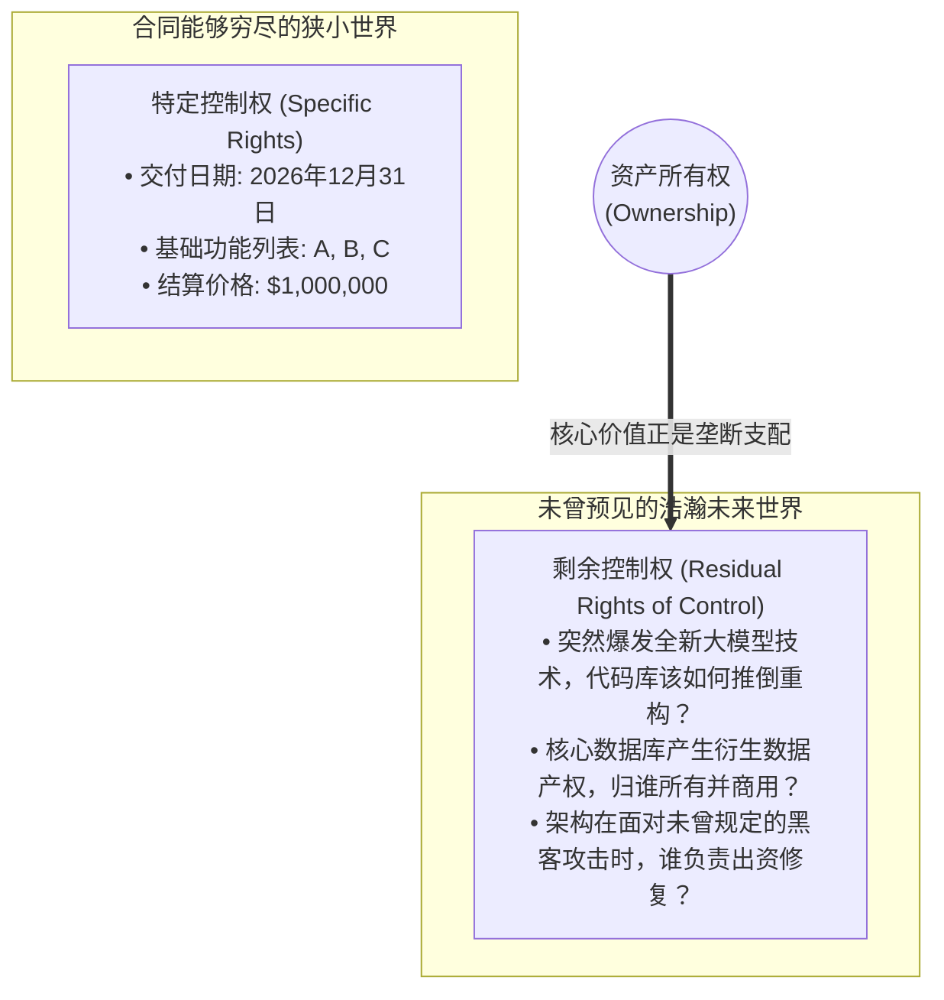
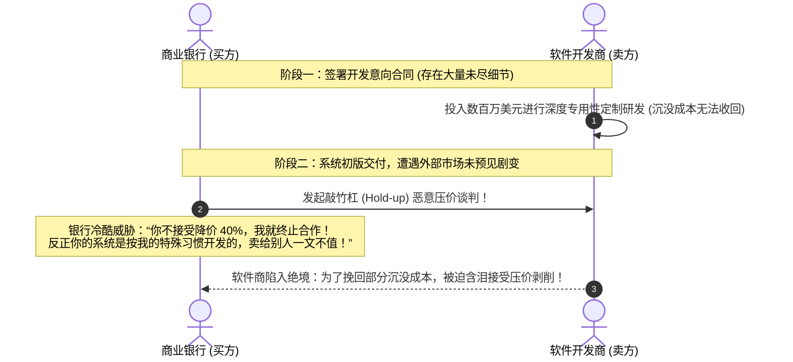

# Lec 10 不完全契约与企业边界：产权理论与 IT 专用性投资 (Incomplete Contracts and Firm Boundaries: Property Rights and IT Investment)

> MIT Sloan School of Management · 15.575 Economics of Information and Information Technology · Prof. Erik Brynjolfsson

## TL;DR

- 格罗斯曼-哈特-摩尔 GHM 产权理论确立了在无法预见一切未来的不完全契约下，剩余控制权的最优配置准则。
- 技术投资的资产专用性决定了套牢困境（Hold-up）的严重程度，是决定企业兼并收购与研发外包的底层试金石。
- 将关键数字代码与数据要素的所有权赋予对不可约减创新投资贡献最大的一方，是实现社会总产出最大化的博弈均衡。

## 不完全契约的现实公理：人类理性与法官的盲区 / The Incompleteness of All Contracts

在古典微观经济学中，经济学家常常沉浸在“完全契约（Complete Contracts）”的乌托邦幻想中：假定买卖双方可以坐在一起，起草一份厚达一万页的完美法律合同，把未来十年内可能发生的一切突发事件（包括金融海啸、战争爆发、技术突破、病毒疫情）、以及在每一种状态下各方的权利与义务全部无遗漏地详尽列明。

然而，诺贝尔经济学奖得主奥利弗·哈特（Oliver Hart）与桑福德·格罗斯曼（Sanford Grossman）、约翰·摩尔（John Moore）创立的**不完全契约理论与现代企业产权理论（GHM Model / Property Rights Theory）**，彻底打破了这一脱离现实的幻觉。

::: theorem 契约不完全性的三大根源公理 (Hart's Incomplete Contracts)
在现实商业世界中，**一切现实合同注定是不完全的（Inherently Incomplete）**，其根源在于：
1. **人类有限理性 (Bounded Rationality)**：面对复杂动态的未来，签约双方根本不可能预料到所有可能发生的情形；
2. **描述语言的天然贫困 (Cost of Contracting)**：即使人们预料到了某种微妙的未来状态（如“软件系统必须具备优雅的架构扩展性”），也根本无法用精确、无歧义的法律文本将其形式化写进合同；
3. **法庭与第三方的不可证实性 (Unverifiability by Courts)**：即使买卖双方在私下里心知肚明对方在软件开发中是否偷工减料，但当闹上法庭时，外行的法官与陪审团根本没有足够的专业技术能力去证实哪一方在说谎。
:::

正是因为现实合同必然充满漏洞与未尽事宜，一个新的核心问题浮出水面：**当未来发生了合同中从未预料到的意外情况时，由谁说了算？**

## 剩余控制权与企业所有权的微观定义 / Residual Rights of Control

哈特与 GHM 模型对经济学做出了革命性的贡献——**重新定义了什么是“所有权（Ownership）”**：

::: definition 剩余控制权 (Residual Rights of Control)
合同通常只能明确规定有限的“特定控制权（Specific Rights）”。而**剩余控制权**，是指对资产在**合同中未明确规定的所有用途和决策空间**进行排他性最终裁决的法定权力。
在现代产权理论中：**拥有某项物理或智力资产的“所有权”，在本质上就是拥有对该资产的“剩余控制权”！**
:::

当合同不可避免存在大量空白时，拥有剩余控制权的一方在未来的重新谈判（Renegotiation）中将占据绝对的战略主导地位，能够攫取绝大部分新增的准租金（Quasi-Rents）。

## 专用性投资与被敲竹杠的噩梦（Hold-up Problem） / The Hold-up Problem in IT

在软件系统研发与数字化基础设施建设中，契约不完全性引发了极其残酷的**套牢/敲竹杠困境（Hold-up Problem）**。

考虑一个典型的企业技术投资场景：
一家大型跨国银行（买方）委托一家软件初创企业（卖方）为其定制开发一套核心风险控制系统。为了让这套系统发挥最大效能，软件公司的首席科学家必须投入长达一年的心血，进行高度**专用性人力资本投资（Relationship-Specific Investment）**——深入钻研这家银行极其特殊的历史坏账业务习惯与专有数据格式。

这项投资具有致命的特征：**它在离开这家银行之后，在外部市场上毫无通用价值（价值降为零）！**

上图展示了令人胆寒的敲竹杠机制：由于知晓在项目后期会被买方利用合同漏洞进行无情勒索，理性的软件开发商在最初阶段**根本不敢全力以赴进行深度的专用性定制投资，而是倾向于使用粗制滥造的通用平庸方案敷衍了事**，最终导致双方共同蒙受巨大的效率损失（社会投资不足）。

## 产权最优配置原则：谁最重要，资产就归谁！ / Optimal Allocation of Ownership

GHM 模型给出了破解敲竹杠困境的**所有权最优配置黄金定理**：

::: theorem GHM 产权最优配置法则
为了最大化系统总产出并最小化投资不足扭曲：
**资产的物理与法定所有权（剩余控制权），必须严格配置给那一方——其“事前不可约减、不可合同化的专有创新投资对整个项目的最终商业成功价值贡献最大”的核心当事方！**
:::

这一理论为企业界回答了一系列极其关键的技术战略抉择：
1. **什么时候应该直接兼并收购技术团队（Insourcing / M&A）？**
   如果系统的成功极端依赖于企业自身的专有业务诀窍，外部软件商只是纯机械代工，企业必须自己买断系统代码与软硬件资产的所有权；
2. **什么时候应该赋予外部开发商自主知识产权（SaaS / Outsourcing）？**
   如果系统的技术突破极端依赖于外部顶尖极客的天才算法研发与持续迭代动力，企业强行用霸王条款抢夺软件版权只会扼杀极客的创造力。明智的做法是让软件商拥有平台版权，允许其向全行业推广，企业自身仅作为租户按年支付 SaaS 订阅费，从而保护软件商进行颠覆性创新的内生资本动力。

## 我的理解与实践洞察 / Personal Insight

::: insight 在数字时代，“数据资产的剩余控制权”是终极权力王座
不完全契约与产权理论为当今大模型与大数据时代的企业博弈提供了极具穿透力的战略武器：
1. **合同中最值钱的条款，往往不是当前的价格，而是未来的“数据剩余控制权”**：许多传统企业在与大型科技巨头或 AI 大模型厂商签署合作协议时，只关心当下对方能打几折，却在合同条款中漫不经心地允许外部服务商“使用企业上传的全部数据进行算法优化与模型训练”。这无异于自掘坟墓！你实际上将企业数十年来最宝贵的数据要素资产的剩余控制权拱手送给了潜在的颠覆者。
2. **警惕技术锁定带来的长期“被敲竹杠”风险**：如果你的整套数字化业务完全建立在某家单一闭源云厂商高度专有的私有 API 与专有数据库引擎之上，随着业务代码的深度捆绑，你的资产专用性将逼近极限。三年后，当云厂商宣布将其算力价格上调 50% 时，你将丧失任何谈判筹码，沦为任人宰割的羔羊。**在架构设计中强制推行基于开放标准与开源容器化的多云抽象层，不仅是工程设计的优雅追求，更是高管在法理上防范被商业敲竹杠的核心博弈护盾**。
:::
