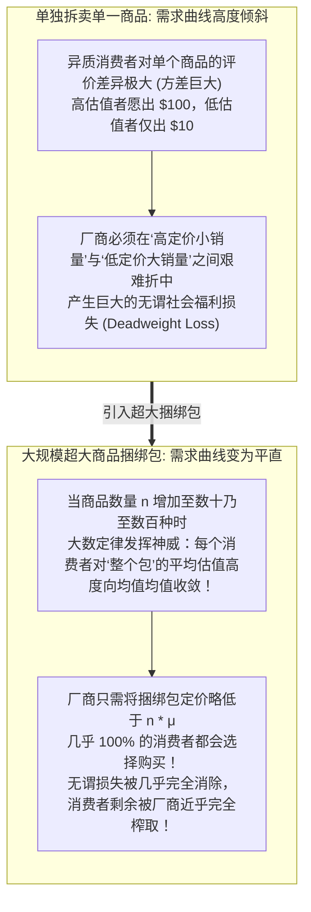
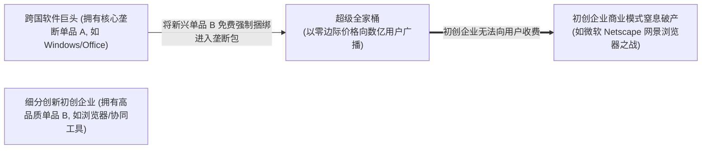

# Lec 02 信息产品定价：捆绑定价与零边际成本 (Pricing Information: Bundling and Marginal Cost)

> MIT Sloan School of Management · 15.575 Economics of Information and Information Technology · Prof. Erik Brynjolfsson

## TL;DR

- 大数定律驱动的捆绑定价机制能够有效降低异质消费者保留价格的方差，大幅压榨无谓损失并攫取消费者剩余。
- 纯捆绑与混合捆绑在数字产品边际成本为零的环境下展现出极其恐怖的利润锁定与市场封杀威力。
- 微支付聚合与大规模跨品类内容订阅服务（如微软 Office 套件）构成了现代数字生态垄断的核心经济学护城河。

## 捆绑定价的数学魔术：方差缩减与大数定律 / The Magic of Bundling & Variance Reduction

在传统商业世界中，如果你去快餐店，汉堡包和可乐通常既可以单点，也可以作为套餐一起购买。但在软件和数字信息领域，**捆绑定价（Bundling）**被推向了前所未有的极致——例如，微软将 Word、Excel、PowerPoint、Access 打包为一套不可分割的 Microsoft Office 销售；Spotify 和 Apple Music 以每月固定订阅费向用户打包开放数千万首歌曲的无限畅听。

为什么将异质商品强行打包能够创造出远超单独拆卖的惊人商业利润？埃里克·布林约尔松（Erik Brynjolfsson）教授与扬尼斯·巴科斯（Yannis Bakos）在经典论文中揭示了这一隐藏在大数定律背后的数学魔术。

::: definition 捆绑定价的大数定律机制 (Law of Large Numbers in Bundling)
假设市场上存在大量消费者，对单一数字商品 $i$ 的保留价格（最大支付意愿）为独立同分布的随机变量 $v_i$，其期望值为 $\mu$，方差为 $\sigma^2$。
当厂商将 $n$ 种互不相关的数字商品捆绑为一个商品包（Bundle）时，消费者对这个商品包的总保留价格为：
$$V_n = \sum_{i=1}^n v_i$$
根据概率论大数定律与中心极限定理，消费者对整个商品包的**平均保留价格** $\bar{V}_n = \frac{V_n}{n}$，其期望值依然为 $\mu$，但其方差急剧收缩为：
$$\text{Var}(\bar{V}_n) = \frac{\sigma^2}{n} \xrightarrow{n \to \infty} 0$$
:::

如上图所示，捆绑的本质是**利用商品之间的互补性对冲消费者偏好的离散方差**。某位用户可能极其酷爱 Excel 而完全不碰 Access，另一位用户可能每天需要 Access 却从不用 PowerPoint；但当把所有软件打包在一起时，两个人对整个“Office 套件”的总估值变得惊人地一致！

## 极简数值推导：纯拆卖 vs. 纯捆绑的利润对比 / A Numerical Demonstration

为了直观体会捆绑的威力，考虑一个只有两名消费者和两款软件的极简微观市场，且软件边际复制成本为零（$c = 0$）：

| 消费者类型 | 对 Word 的保留价格 | 对 Excel 的保留价格 | 对“Word + Excel”捆绑包的保留价格 |
| :--- | :--- | :--- | :--- |
| **作家爱丽丝 (Alice)** | **$100** (高频写作需求) | **$20** (基本用不到算表) | **$120** |
| **精算师鲍勃 (Bob)** | **$20** (偶尔写封信件) | **$100** (每天重度建模) | **$120** |

### 策略一：单独拆卖（Separate Selling）
- **Word 定价**：若定为 $100，只有爱丽丝购买，收益为 $100；若定为 $20，两人均买，收益为 $40。最优定价为 $100，收益 $100；
- **Excel 定价**：同理，最优定价为 $100，只有鲍勃购买，收益 $100；
- **拆卖总利润**：$$\Pi_{\text{Separate}} = 100 + 100 = \$200$$
（在此策略下，爱丽丝无法享用 Excel，鲍勃无法享用 Word，社会产生高达 $40 的福利无谓损失）。

### 策略二：纯捆绑销售（Pure Bundling）
- 厂商将 Word 与 Excel 彻底打包为不可分割的套装，定价为 **$120**；
- 爱丽丝对套装总估值为 $100 + $20 = $120，欣然购买；
- 鲍勃对套装总估值为 $20 + $100 = $120，欣然购买；
- **纯捆绑总利润**：$$\Pi_{\text{Bundle}} = 120 \times 2 = \$240$$

::: theorem 零边际成本下的纯捆绑主导定理 (Pure Bundling Dominance)
在数字信息商品中，只要消费者的偏好呈负相关或弱相关，且商品的边际复制成本趋近于零（$c \to 0$），**纯捆绑策略所攫取的利润在数学上严格弱优于单独拆卖策略**。捆绑不仅消除了消费者的多余剩余，更使得商品能够零成本渗透至潜在的低估值场景中，实现了社会总使用效率与厂商垄断利润的双重最大化。
:::

## 混合捆绑与市场进入壁垒的构建 / Mixed Bundling & Foreclosure

当市场不仅存在上述负相关的两栖用户，还存在大量“只对单项商品拥有极端偏好且完全排斥其他商品”的极端群体时，最优策略演进为**混合捆绑（Mixed Bundling）**——既提供以极高溢价单独购买单品的选项，又提供极具性价比的超值大礼包。

更为深远的是，捆绑在反垄断与竞争战略中，被视为一种极具威慑力的**市场封杀（Foreclosure）与生态护城河武器**：

如上图所示，当在单品 A 上拥有垄断地位的巨头（如微软拥有 Windows），将自己在单品 B（如 Internet Explorer 浏览器、Teams 协同软件）上的功能以**零边际增量价格直接捆绑**进核心大包中时，独立研发单品 B 的初创企业（如网景 Netscape、Slack）将遭遇毁灭性打击。初创企业哪怕产品品质稍优，也根本无法说服用户在已经免费获得了捆绑功能的前提下，额外掏出数十美元去单买软件。

## 我的理解与实践洞察 / Personal Insight

::: insight 订阅制时代的本质：以时间跨度为维度的超大规模终极捆绑
理解捆绑定价的微观数学原理，为我们透视现代互联网巨头的订阅制商业模式提供了根本的解题钥匙：
1. **流媒体与云服务的本质是大数定律的极致演绎**：Netflix 每月向用户收取 15 美元，允许观看平台上的全部数万部影视剧。没有一个正常人类能够在单月内看完所有电影；用户每个月可能只看了一部爆款剧，而这个“爆款”在不同人眼中千差万别。正是因为影视库构成了上千种内容的巨型商品包，每个用户在月度尺度上的平均估值被极度熨平稳定，为平台创造了极其可预测的持续现金流管道。
2. **警惕“盲目微支付（Micropayments）”的认知摩擦陷阱**：在互联网早期，许多经济学家曾天真地预言：未来的网络内容应该实行微支付——“看一篇新闻扣 1 美分，听一首歌扣 5 美分”。然而这一模式在商业实践中全面溃败。为什么？因为**每一次单独付费都会强制用户暂停下来，在脑海中进行一次痛苦的微观利弊权衡与心理计费摩擦（Mental Accounting Tax）**。而包月无限订阅通过捆绑消除了每一次点击的认知决策痛苦，让用户在“零边际消费阻尼”中彻底沉浸，这正是订阅制横扫全球的心理学与经济学双重密码。
:::
