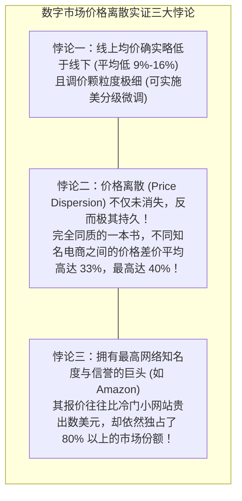
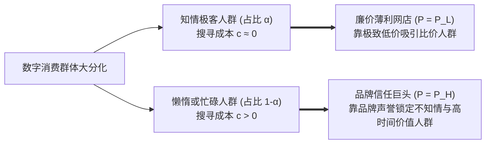

# Lec 03 搜寻与竞争 I：搜寻摩擦与价格离散 (Search and Competition I: Search Friction and Price Dispersion)

> MIT Sloan School of Management · 15.575 Economics of Information and Information Technology · Prof. Erik Brynjolfsson

## TL;DR

- 互联网技术曾被预言将彻底消灭搜寻摩擦并构建符合一价定律的极度透明完全竞争摩擦力市场。
- 实证研究表明：数字市场并未导致同质商品价格均一化，反而催生了持久、显著的价格离散与溢价鸿沟。
- 萨洛普-斯蒂格利茨搜寻模型揭示了信息不对称下知情消费者与不知情消费者的两极分化均衡。

## 互联网黎明的乌托邦预言：摩擦消失与一价定律 / The Frictionless Commerce Myth

在 1990 年代互联网商业爆发的黎明期，主流经济学家、华尔街投资银行以及科技媒体不约而同地提出了一个极其乐观的激进预言：**万维网的普及将彻底终结商业世界中的搜寻摩擦（Search Frictions），全球商业即将迈入“摩擦力为零的资本主义（Friction-Free Capitalism）”！**

这一预言背后的理论推导看似无懈可击：
- 在物理实体世界中，消费者要想比对不同书店同一本教科书的售价，必须开车穿梭于几座城市之间，耗费大量汽油费与数小时时间；因此，本地书店可以凭借地理位置垄断维持高昂的垄断溢价；
- 而在互联网上，物理距离被彻底抹平。消费者只需动动鼠标，在比价搜索引擎（Shopbots）中输入商品 ISBN 编号，0.1 秒之内全美所有网上书店的实时报价便会整齐排列在屏幕上；
- 古典经济学**一价定律（Law of One Price）**断言：当同质商品的搜寻成本趋近于零时，任何敢于定高价的商家将在瞬间失去全部顾客，价格竞争将残酷地逼迫所有商家的售价无限跌落至边际成本，商家的超额利润将被彻底抹平。

然而，随后的真实世界狠狠嘲弄了这一乌托邦幻想。

## 令人震惊的实证反叛：布林约尔松与史密斯的开拓性研究 / Brynjolfsson & Smith Empirical Findings

麻省理工学院斯隆管理学院埃里克·布林约尔松（Erik Brynjolfsson）教授与其合作者迈克尔·史密斯（Michael Smith）在 2000 年发表了一篇震惊经济学界的奠基性实证论文——《数字市场中的摩擦与摩擦力》（*Frictionless Commerce? A Comparison of Internet and Conventional Retailers*）。

研究团队编写了自动化爬虫，对全美主流线上电商（如 Amazon、Barnes & Noble）与线下实体书店的数千种完全同质的书籍与 CD 唱片价格进行了长达数月的微观高频追踪。

实证数据揭示了三大令人瞠目结舌的悖论性事实：

为什么在比价工具仅需一次点击的互联网时代，价格离散不仅没有收敛，反而长期顽固存在？为什么消费者明知小网站更便宜，却依然心甘情愿在昂贵的 Amazon 处多掏几美元？

## 萨洛普-斯蒂格利茨搜寻模型解构 / The Salop-Stiglitz Search Model

诺贝尔经济学奖得主约瑟夫·斯蒂格利茨（Joseph Stiglitz）与史蒂文·萨洛普（Steven Salop）提出的经典搜寻模型，为理解这一离散现象提供了坚实的理论底座。

假设市场上有 $N$ 家销售完全相同标准化商品的零售商。消费者被分化为两大异质阵营：
1. **知情消费者（Informed Consumers, 占比 $\alpha$）**：搜寻成本极低（$c \approx 0$），熟练掌握比价工具，永远知晓市场上哪家店铺报价最低；
2. **不知情消费者（Uninformed Consumers, 占比 $1 - \alpha$）**：面临非零的心理搜寻摩擦、时间机会成本或认知障碍（搜寻成本 $c > 0$），习惯于直接在自己熟悉的第一家店铺随机进店购买。

::: theorem 萨洛普-斯蒂格利茨双价均衡定理 (Two-Price Equilibrium)
在搜寻摩擦存在的前提下，市场无法收敛于单一价格，而是必定分裂为**两极分化的双价稳定混合纳什均衡**：
1. **低价竞争店铺 (P_L = MC)**：以边际成本定价，专门收割所有具备完全信息的知情消费者（$\alpha$ 群体）。这类店铺利润微薄，完全依赖极致的销量周转；
2. **高价收割店铺 (P_H = V)**：直接以消费者的最大保留价格（垄断高价）定价，放弃知情群体，专职在不知情消费者（$1 - \alpha$ 群体）身上赚取暴利。只要不知情客户进店产生的单客暴利能够覆盖放弃知情客户的机会成本，高价店铺便能在竞争中永久稳定存活！
:::

## 信任溢价、认知摩擦与品牌护城河 / Trust Premium & Cognitive Lock-in

布林约尔松的研究进一步揭示：**数字交易中的搜寻摩擦，已经从物理维度的“寻找价格”，升华为心理与信用维度的“搜寻履约确定性与信任”**。

在网上购物时，消费者在点击“付款”的瞬间，面临着巨大的**交易后风险（Post-Purchase Risk）**：
- 这个不知名的便宜网站会不会盗刷我的信用卡？
- 货物能不能在两天内准时送达，还是会延误两周？
- 收到坏了的商品时，能不能丝滑退货退款，还是会遭遇客服的恶意推诿？

正是为了对冲这种深层的安全感焦虑，消费者自愿向 Amazon 等知名巨头支付 5% 至 10% 的**信任溢价（Trust Premium）**。对于一名时薪数十美元的专业人士而言，花费 20 分钟在十几个陌生小网站之间反复对比并承受信用卡泄露风险去省下 3 美元，在经济学上完全是非理性的愚蠢行为。巨头通过极致的退换货履约体验，将用户的搜寻摩擦转化为坚固的品牌护城河。

## 我的理解与实践洞察 / Personal Insight

::: insight 商业竞争的终局不是打价格战，而是打消消费者的“认知摩擦”
搜寻摩擦与价格离散理论彻底颠覆了初创企业的竞争观：
1. **永远不要以“全网最低价”作为核心战略护城河**：试图通过比别人便宜 5% 来赢得市场，是缺乏战略想象力的自杀式路径。依靠低价吸引来的客户，是一群全网忠诚度最低、搜寻成本为零的“价格游牧民”，下周别的网站只要便宜 1 美分，他们便会瞬间流失。低价从来不是护城河，低边际履约成本才是。
2. **消灭消费者的信任决策摩擦，你就能合法获得定价权**：亚马逊开创的“一键下单（1-Click Ordering）”、无条件极速退款以及 Prime 会员次日达，本质上是在用极致确定的工程体系消灭用户脑海中的一切决策阻尼。当用户确信“在你的平台上买东西绝对不会踩坑、甚至不用思考”时，用户的需求弹性将急剧变小，你便获得了跨越周期的正向定价自主权。
:::
