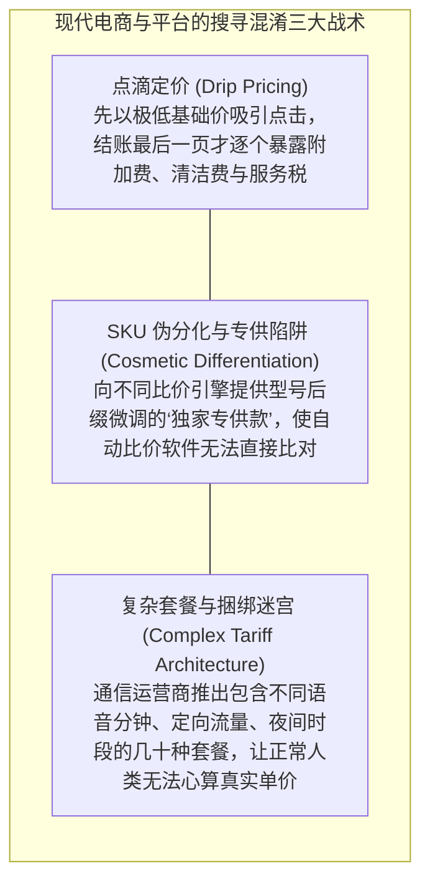

# Lec 04 搜寻与竞争 II：双边平台匹配与混淆策略 (Search and Competition II: Platform Matchmaking and Obfuscation)

> MIT Sloan School of Management · 15.575 Economics of Information and Information Technology · Prof. Erik Brynjolfsson

## TL;DR

- 双边平台通过降低买卖双方的双向搜寻与匹配摩擦，释放海量长尾交易并重构市场组织范式。
- 当价格透明度威胁到厂商垄断利润时，零售商演化出精细的混淆策略（Obfuscation）人为抬高搜寻阻尼。
- 平台算法推荐在高效促成交易匹配与通过隐性加价/自营偏袒榨取生态剩余之间存在着内生利益冲突。

## 双边平台的本质：搜寻匹配中介与网络外部性 / Platforms as Search & Matching Engines

在传统单边企业模式中，企业从供应商处采购原材料，经过内部组装加工后向消费者销售；而在以 eBay、Uber、Airbnb、淘宝为代表的**双边与多边平台（Two-Sided Platforms）**中，企业的核心业务发生了根本跃迁：
**平台不拥有物理资产，其核心使命是充当协调双边用户的“智能搜寻与撮合匹配引擎（Search and Matchmaking Engine）”**。

让·梯若尔（Jean Tirole）因在双边市场理论的开创性贡献斩获诺贝尔经济学奖。双边平台最核心的动力学特征是存在显著的**跨边网络外部性（Cross-Side Network Effects）**：

::: definition 跨边网络外部性 (Indirect / Cross-Side Network Effects)
某一边市场参与者获得的效用，不仅取决于自身群体的规模，更直接正向依赖于**另一边市场参与者的数量与活跃度**。
- 对于打车平台：乘客越多，司机空驶等待时间越短、收入越高；司机越多，乘客叫车的平均接驾等待时间越短；
- 平台的微观匹配算法，本质上是在高维状态空间中解决买卖双方的搜寻摩擦。
:::

```mermaid
flowchart LR
    subgraph Buyers [需求端: 买家 / 乘客 / 租客]
        B["数以千万计的离散消费者<br/>痛点：寻找高性价比可信供给的搜寻成本极高"]
    end

    subgraph Platform [双边智能撮合平台 (Amazon / Uber / Airbnb)]
        direction TB
        MatchEngine["双向精准搜寻推荐引擎<br/>(基于位置/偏好/价格动态排序)"]
        TrustEscrow["信任托管与双向信用评分体系<br/>(资金暂扣担保 + 履约仲裁)"]
        MatchEngine <--> TrustEscrow
    end

    subgraph Sellers [供给端: 卖家 / 司机 / 房东]
        S["数以百万计的中小微供给方<br/>痛点：获客成本高昂、存在严重产能闲置"]
    end

    Buyers <==>|网络效应: 更多买家吸引更多卖家| Platform
    Platform <==>|网络效应: 更多卖家带来更高转换率| Sellers
```

平台通过降低信息搜寻成本，激活了传统物理世界中由于高昂交易成本而无法发生的“超长尾碎片化交易”（如闲置民居的周末短租、私家车下班途中的顺风搭乘）。

## 厂商的反击：搜寻混淆策略的博弈经济学 / Search Obfuscation Strategies

然而，博弈论的无情逻辑表明：**市场从来不是被动接受透明度的机器，当信息变得过于透明导致价格战恶化时，厂商必然会主动采取对抗措施！**

埃里森（Glenn Ellison）与沃利茨基（Alexander Wolitzky）等学者在顶刊论文中提出了著名的**搜寻混淆理论（Obfuscation Theory）**：

::: definition 搜寻混淆 (Search Obfuscation)
厂商通过**故意增加信息的复杂性、制造歧义或人为隐蔽真实全量价格**，从而在算法层面刻意推高消费者的搜寻成本与比价阻尼。混淆的本质是厂商为了逃脱激烈价格竞争、维护局部垄断租金而发起的主动防御。
:::

在现代数字商业中，厂商操纵混淆策略的常见手段屡见不鲜：



通过引入混淆策略，厂商成功让相当一部分消费者在中途感到心智疲惫并放弃继续比价，从而在高位实现了价格锁定。

## 平台中介的利益冲突：算法排序偏袒与寻租 / Algorithmic Bias & Self-Preferencing

作为搜寻匹配的中心裁判，双边平台应当保持绝对的“算法中立”吗？经济学现实给出了冷酷的否定回答。

当平台成长为具有准公共基础设施性质的超级垄断巨头时，它面临着严重的**双重身份利益冲突（Dual-Role Conflict of Interest）**：
1. **裁判员与运动员并存**：平台不仅提供第三方卖家入驻集市，同时自身大力开展自营业务（如 Amazon Basics 自营品牌）；
2. **算法排名的权力寻租**：平台搜索框输入某个关键词后，排在首页前五位的结果，不再纯粹是“全网性价比最高、好评最多”的自然匹配商品，而是充斥着大量支付了高额“推广费/广告竞价（Sponsored Ads）”的付费广告位；
3. **掠夺性数据监控与降维打击**：平台通过全局数据后台监控第三方卖家的爆款交易数据，一旦发现某款小众创新产品利润丰厚且增长迅猛，平台便立即利用自营供应链进行像素级仿制，并利用算法权重将自营竞品置顶展示，同时打压原创新卖家。

这一现象引发了全球反垄断监管机构对平台“自我优待（Self-Preferencing）”与算法黑箱的空前严厉打击。

## 我的理解与实践洞察 / Personal Insight

::: insight 平台的长期生命力，取决于“交易撮合价值”与“抽成寻租摩擦”的剪刀差
双边平台经济学为技术架构师与平台创业者指明了不可动摇的底线：
1. **不要把“搜寻混淆”当成聪明的商业护城河**：很多中小型电商为了短期财报好看，大搞隐藏费用和虚假折扣算法，短期内或许能骗取部分不知情用户的溢价，但这本质上是在**急速透支用户对平台的信任资本**。在互联网时代，一旦第三方出现一个真正践行“终极价格透明（如全包一口价、零套路）”的新型挑战者，传统玩弄混淆伎俩的平台将被瞬间抛弃。
2. **警惕平台从“创新生态孵化器”堕落为“跨边收税收费站”**：平台的繁荣建立在健康的双边生态之上。如果平台利用信息中介垄断地位，向供给端商户征收高达 30% 以上的综合抽成与广告竞价费，供给端最终只能被迫偷工减料或提高售价，买家体验随之恶化，整个双边网络外部性将逆转为**恶性负向螺旋崩溃**。懂得克制自身贪婪、将大部分效率红利留在双边参与者手中，方能成就百年不倒的超级生态平台。
:::
