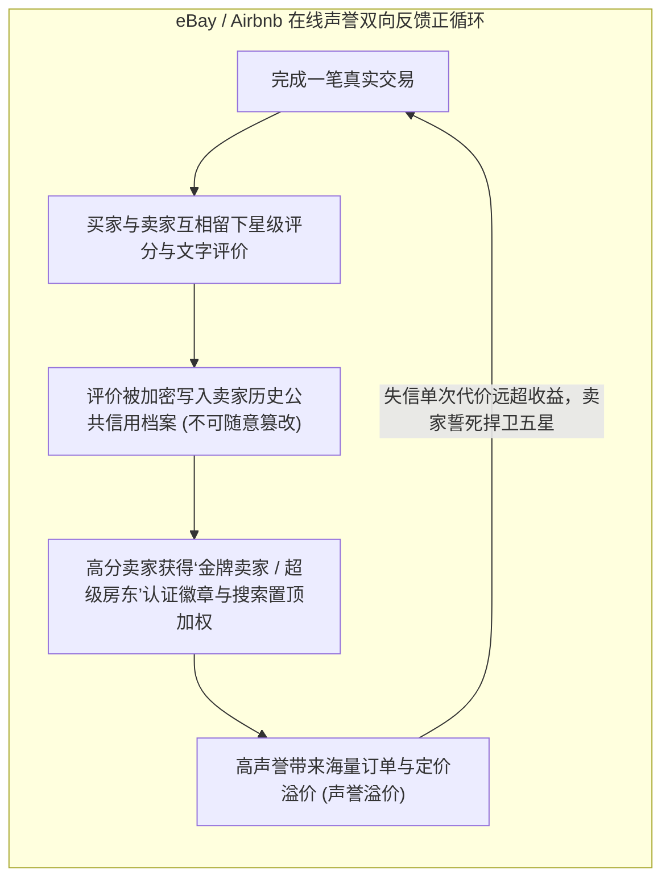

# Lec 05 声誉、信任与协同推荐系统机制设计 (Reputation, Trust and Recommender Systems)

> MIT Sloan School of Management · 15.575 Economics of Information and Information Technology · Prof. Erik Brynjolfsson

## TL;DR

- 在线声誉与信用反馈机制彻底化解了阿克洛夫柠檬市场由于信息不对称引发的逆向淘汰死结。
- 双向盲评机制有效规避了恶意报复性差评（Retaliatory Feedback）与刷评共谋博弈漏洞。
- 协同过滤推荐算法实现了从传统群体大众广播向基于矩阵分解的高维个性化兴趣挖掘范式飞跃。

## 柠檬市场危机：信息不对称如何摧毁数字商业 / The Lemons Problem in Cyberspace

在数字经济中，买家与卖家相隔千里、素昧平生。买家在付款前既无法亲手触摸商品的质感，也无法核实卖家的道德品行。

诺贝尔经济学奖得主乔治·阿克洛夫（George Akerlof）在传世论文《柠檬市场：质量不确定性与市场机制》（*The Market for "Lemons"*）中，推导出了信息不对称对自由市场的毁灭性诅咒：
- 如果买家无法准确辨别好车（Peaches）与烂车（Lemons），买家只愿意按照市场平均质量支付期望价格；
- 这一平均价格必然低于好车车主的心理保留价格，导致好车车主愤而退出交易市场；
- 市场上好车的比例进一步下降，买家进一步压低出价；如此循环往复，**劣币驱逐良币（Adverse Selection，逆向选择）**，最终导致整个市场彻底崩溃消亡。

在 1990 年代末 eBay 诞生之初，全美评论家断言线上二手交易市场必定因充斥着骗子和假货而迅速夭折。然而，eBay 不仅没有死亡，反而繁荣成长为全球商业奇迹。其挽救市场的核心法宝，正是**分布式在线声誉系统（Reputation & Feedback System）**。

## 在线声誉系统的博弈论设计：重复博弈与声誉资本 / Economics of Reputation Mechanisms

在线声誉系统的本质，是将单次匿名的囚徒困境博弈，转变为**跨期无限次重复博弈（Infinitely Repeated Game）**：

::: theorem 声誉机制的纳什均衡条件 (Reputation Equilibrium)
假设卖家单次背叛行骗（发假货）可获取一次性超额不法收益 $B$；而恪守诚信每期可获得持续正向利润 $\pi$。贴现因子为 $\delta \in (0, 1)$。
只要声誉系统能够将卖家的历史失信行为完全透明地公之于众，且满足：
$$\sum_{t=1}^{\infty} \delta^t \pi = \frac{\delta \pi}{1 - \delta} > B$$
那么，**理性卖家选择永远保持诚信、累积五星好评声誉资本，在博弈论意义上将成为唯一的子博弈精炼纳什均衡（SPNE）！**
:::



然而，早期的单向声誉系统存在着严重的**博弈漏洞**：
- **报复性差评（Retaliatory Feedback）**：如果买家如实给不良卖家打了差评，卖家随后也会恶意给买家打差评以报复，导致理性的买家为了自保选择保持沉默，系统中充斥着虚假的 99% 好评；
- **刷单共谋与女巫攻击（Sybil Attacks）**：不良团伙通过注册成百上千个虚假小号互相刷单，在低值小商品上积累虚假信誉，随后突然在一个高价值大单中卷款跑路。

现代平台通过推行**双向双盲评价机制（Double-Blind Feedback）**——即在交易结束后 14 天内，双方必须在完全看不到对方评价内容的前提下各自提交评分，只有双方均提交完毕或超时后，系统才同时向全网揭开评价——彻底根除了恶意报复性差评的温床。

## 协同过滤推荐算法：从内容匹配到高维协同 / Collaborative Filtering Mechanics

解决了“信任”问题之后，平台面临的下一个核心挑战是：面对平台上数以百万计的海量商品，如何精准向用户推送其真正感兴趣的标的？**个性化推荐系统（Recommender Systems）**应运而生。

推荐算法在体系上经历了三大范式跃迁：

```mermaid
flowchart LR
    subgraph Paradigm1 [1. 基于内容的推荐 (Content-Based)]
        C1["分析物品本身的元数据标签 (如电影类型、导演、演员)<br/>向喜欢《黑客帝国》的用户推荐其他科幻电影"]
    end

    subgraph Paradigm2 [2. 基于用户的协同过滤 (User-Based CF)]
        U1["寻找在历史行为向量上与你最相似的‘数字孪生邻居’<br/>将邻居喜欢但你尚未接触的商品推荐给你"]
    end

    subgraph Paradigm3 [3. 基于物品的协同过滤 (Item-Based CF)]
        I1["计算物品被共同购买/喜好的关联相似度矩阵<br/>(Amazon 核心工业级算法，计算极度稳健)"]
    end

    Paradigm1 --> Paradigm2 --> Paradigm3
```

### 1. 基于物品的协同过滤核心算法 (Item-to-Item Collaborative Filtering)
亚马逊先驱格雷格·林登（Greg Linden）提出的 Item-to-Item CF，摆脱了计算亿级用户之间瞬时相似度的庞大计算开销：
- 算法不关心用户主观特征，而是预先离线计算并维护一个巨大的**物品共现相似度矩阵**；
- 两个物品 $i$ 与 $j$ 的余弦相似度定义为共同评分过两者的用户向量夹角：
  $$\text{Sim}(i, j) = \cos(\vec{r}_i, \vec{r}_j) = \frac{\sum_{u \in U} (r_{u, i} - \bar{r}_i)(r_{u, j} - \bar{r}_j)}{\sqrt{\sum_{u \in U} (r_{u, i} - \bar{r}_i)^2} \sqrt{\sum_{u \in U} (r_{u, j} - \bar{r}_j)^2}}$$
- 当用户将某本书加入购物车时，系统只需在毫秒内检索该书最相似的 Top-K 物品列表并完成实时推荐。

### 2. 矩阵分解与潜在隐向量模型 (Matrix Factorization)
在著名的 Netflix 百万美金挑战赛中，以奇异值分解（SVD）为代表的**隐语义模型（Latent Factor Models）**夺冠。算法将极其稀疏的“用户-电影”评分大矩阵，分解为两个低维稠密矩阵的乘积：
$$\hat{R} \approx P \cdot Q^T$$
其中，$P$ 矩阵刻画每个用户对各个潜在抽象隐维度（如文艺忧郁指数、硬核烧脑指数）的偏好程度；$Q$ 矩阵刻画每部电影在这些隐维度上的特征暴露度。通过随机梯度下降（SGD）最小化均方根误差，算法能够洞察人类自己都无法用语言描述的潜意识深层兴趣。

## 我的理解与实践洞察 / Personal Insight

::: insight 推荐系统的终极陷阱：信息茧房与多样性退化
在线声誉与推荐系统为技术伦理与产品设计敲响了警钟：
1. **警惕五星通胀（Rating Inflation）引发的信任衰竭**：当平台上的每个卖家和每位司机都拥有 4.9 星的超高评价时，声誉系统事实上已经走向了名存实亡的坏死状态——因为缺乏方差和区分度。优秀的算法必须引入贝叶斯平滑先验校准，结合文字评价的情感分析与真实复购行为加权，防止信用资产贬值。
2. **在“精准利用（Exploitation）”与“多样探索（Exploration）”之间保持生态张力**：如果算法永远只向用户推荐其过去点击过的同质内容，用户很快会陷入视野极度狭隘的**信息茧房（Echo Chambers）**，导致审美疲劳与平台长期活跃度衰竭。卓越的推荐引擎必须遵循多臂老虎机（Multi-Armed Bandit）理论，在精准命中的同时，永远留出 10% 至 20% 的流量配额去探索冷门长尾商品与意外之喜（Serendipity），唯有保持生态的多样性，数字商业才能永葆生机。
:::
