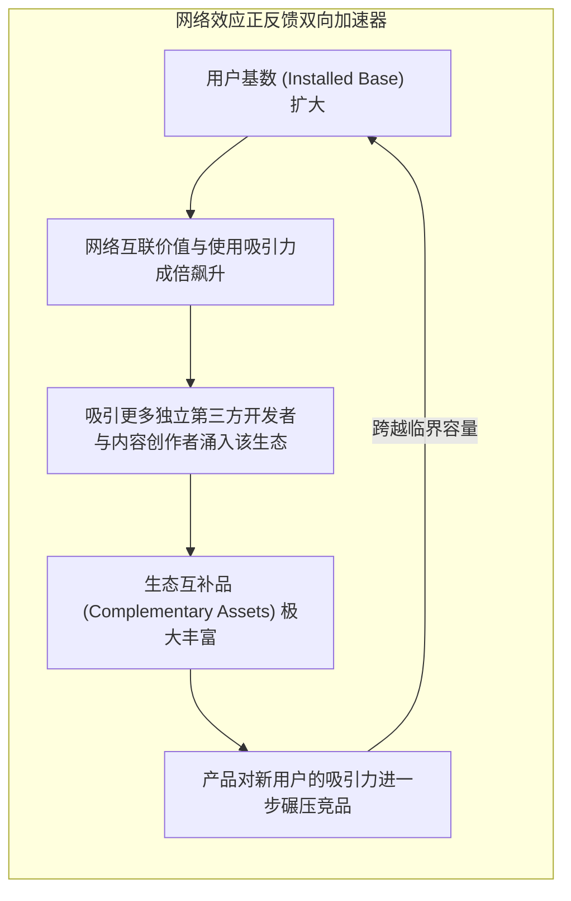
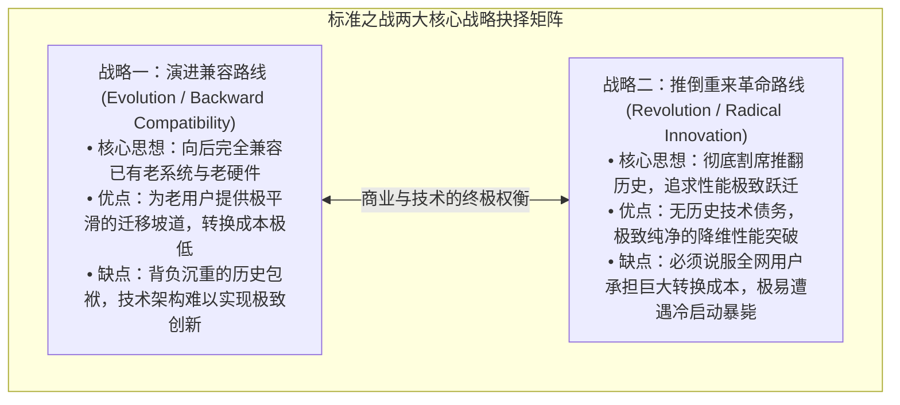

# Lec 06 网络效应、技术标准与锁定效应 (Economics of Networks, Standards and Lock-In)

> MIT Sloan School of Management · 15.575 Economics of Information and Information Technology · Prof. Erik Brynjolfsson

## TL;DR

- 网络外部性驱动正向反馈循环，使高科技市场天然呈现赢家通吃（Winner-Take-All）的倾斜临界点格局。
- 高昂的用户转换成本构成了锁定效应，企业的资产价值在微观上等于其客户群转换成本的总和折现。
- 标准之战中‘完全兼容演进’与‘推倒重来革命’的博弈，决定了技术生态能否突破启动冷启动困境。

## 梅特卡夫定律与正反馈飞轮：赢家通吃的宿命 / Metcalfe's Law & Positive Feedback Loops

在传统工业制造中，收益递减规律（Diminishing Returns）扮演着核心制衡力量——一家钢铁厂规模越大，其管理协调成本越高，最终抑制无限扩张；
然而，在信息技术与软件网络市场中，统治竞技场的是截然相反的经济学规律——**收益递增规律（Increasing Returns）与正反馈循环（Positive Feedback）**。

其底层动力学引擎，正是著名的**网络外部性（Network Externalities / Network Effects）**：

::: theorem 梅特卡夫定律与网络外部性公理 (Metcalfe's Law)
1. **直接网络外部性 (Direct Network Effects)**：当某种商品或服务的价值随着**使用该商品的其他用户数量的增加而内生增长**时，便存在直接网络效应（如电话网络、微信、电子邮件）。
2. **梅特卡夫定律**：以以太网发明人鲍勃·梅特卡夫命名，断言一个由 $n$ 个节点构成的通信网络的系统商业价值，与网络用户数的平方成正比：
   $$V \propto n^2$$
   （因为网络中潜在的可能连接与交互组合总数为 $\frac{n(n-1)}{2} = \mathcal{O}(n^2)$）。
:::

这种正反馈飞轮使得网络型市场表现出极具戏剧性的**临界容量（Critical Mass）**与**倾斜（Tipping）**特征：
在达到临界点之前，技术在黑暗中缓慢挣扎；一旦某家企业的用户规模率先跨过临界点，市场将在极短时间内以雪崩之势向其倾斜，最终形成“**赢家通吃（Winner-Take-All）**”或“赢家独占绝大部分（Winner-Take-Most）”的自然垄断格局。

## 锁定效应与转换成本微观解构 / Lock-In Economics & Switching Costs

一旦用户采纳了某种技术标准或软件生态，他们便会陷入深浅不一的**锁定状态（Lock-In）**。

::: definition 转换成本与锁定效应 (Switching Costs & Lock-In)
**转换成本（Switching Cost）**是指消费者或企业从当前使用的产品 A 彻底迁移至竞品 B 时，所必须承担的一切显性与隐性经济、技术与心理代价。
在信息经济学中，**一家拥有网络效应企业的真实企业价值，在数学上直接等价于其全部存量用户群（Installed Base）的转换成本总额的贴现现值！**
:::

转换成本广泛渗透在以下各大维度中：

| 转换成本类型 | 微观表现机制 | 经典商业案例 |
| :--- | :--- | :--- |
| **契约型承诺 (Contractual Commitments)** | 提前终止长期服务合同面临的高额违约金罚款 | 电信运营商两年合约机、长期企业云服务预留实例 |
| **耐久性专用设备投资 (Durable Purchases)** | 购买了昂贵的核心硬件设备后，被专用耗材所套牢 | 惠普打印机与原装墨盒、半导体光刻机专有配件 |
| **专有数据资产沉淀 (Data Lock-in)** | 历史数据存储在专有闭源格式中，导出与迁移代价极其高昂 | 苹果 iCloud 专有格式相册、老牌企业 ERP 专有存储 |
| **学习曲线与习惯磨合 (Learning Curves)** | 用户花费数年时间建立的快捷键肌肉记忆与熟练度清零 | 习惯了 Vim/Photoshop 快捷键的设计师对更换工具的极度抗拒 |
| **搜寻与信任成本 (Search & Trust Costs)** | 寻找新供应商、重新验证其财务与交付可靠性的风险与时间 | 银行核心主机放弃 IBM 迁移至新供应商面临的合规恐惧 |

## 技术标准之战：演进兼容 vs. 革命推覆 / Standards Wars: Evolution vs. Revolution

当两套互不兼容的技术标准争夺行业未来霸权时，便爆发了惊心动魄的**标准之战（Standards Wars）**（如历史上著名的交流电 vs. 直流电、VHS 录像带 vs. Betamax、微软 Windows vs. 苹果 Mac OS、蓝光 DVD vs. HD-DVD）。

卡尔·夏皮罗（Carl Shapiro）与哈尔·瓦里安（Hal Varian）将标准竞争者的核心战略路径，精妙地归纳为两大经典范式：

标准之战成功的关键，在于**生态系统管理（Ecosystem Orchestration）**。掌握先机者往往采取以下杀手锏战术：
1. **建立强大的互补品联盟**：拉拢核心独立软件开发商（ISV）为本平台开发独占应用（如索尼 PlayStation 绑定独占大作）；
2. **预告与预期管理（Pre-announcements）**：在产品尚未量产时提前向媒体高调预告颠覆性新标准的诞生，冻结市场需求，阻止竞争对手抢先跨越临界容量（FUD 战术：Fear, Uncertainty, Doubt）；
3. **价格补贴跨越冷启动**：在初期不惜亏本向终端用户赠送或超低价补贴硬件（如游戏主机硬件亏本销售），依靠后续软件抽成与网络效应回本。

## 我的理解与实践洞察 / Personal Insight

::: insight 开放还是封闭？标准战争中的“控制权与生态体量之争”
标准与网络效应理论为企业高管在做顶层战略规划时，揭示了一条残酷而深刻的黄金公理——**“你宁愿拥有一块小馅饼的 100%，还是拥有一块巨大无朋世界级大馅饼的 10%？”**：
1. **控制权与市场规模的永恒悖论**：如果企业选择完全封闭与专有控制（如早期的苹果 Macintosh），虽然能独占全部软硬件利润，但在开放标准的群狼环伺（如 IBM PC + 微软 Windows 联盟）面前，由于缺乏第三方伙伴的繁荣协同，极易在正反馈飞轮的碾压下丧失统治地位。**很多时候，主动开放标准接口、出让部分控制权去换取整个生态网络飞速膨胀跨越临界点，才是活下去并赚大钱的最高智慧**。
2. **锁定的另一面是“被锁定”**：当企业沾沾自喜于通过专有闭源协议成功“锁定”了客户时，必须清醒地意识到：**你自己同时也已经被这个专有架构深深地反向锁定了！** 当外部开源技术浪潮发生剧烈范式转移时，那些背负着数百万存量用户专有系统包袱的老牌巨头，往往因为不敢自我革命打破向后兼容性，最终眼睁睁看着轻装上阵的新势力完成降维颠覆。
:::
