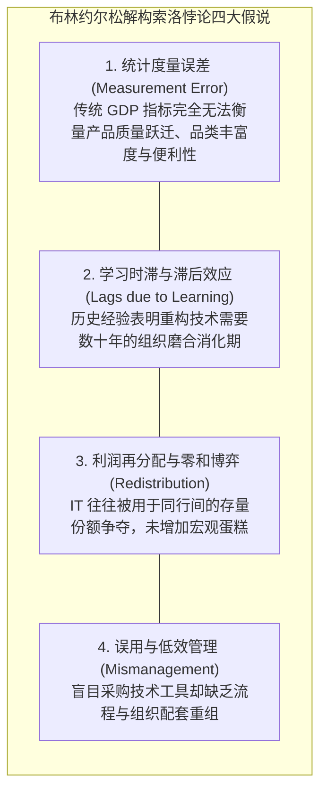

# Lec 07 IT 与生产率：生产率悖论的破解与无形资产 (IT and Productivity: The Productivity Paradox Solved)

> MIT Sloan School of Management · 15.575 Economics of Information and Information Technology · Prof. Erik Brynjolfsson

## TL;DR

- 诺贝尔奖得主索洛著名的生产率悖论（Solow Paradox）曾断言：计算机时代无处不在，唯独在统计数据中缺席。
- 实证计量经济学突破揭示：早期的宏观统计失灵源于度量滞后、质量改善漏计与组织重塑学习时滞。
- 布林约尔松终极破解悖论：IT 投资必须与高达十倍的互补性组织资本深度绑定，方能释放惊人的全要素生产率跃迁。

## 索洛悖论的幽灵：计算机到处可见，唯独在生产率统计中缺席 / The Solow Computer Paradox

在 1970 至 1980 年代，随着微型计算机、大型机与局域网在欧美企业界全面铺开，全美企业在 IT 软硬件上的投资呈现出指数级的狂飙突进。然而，令经济学家大惑不解的是，整个西方世界的宏观经济生产率增长率，却在这一时期陷入了令人震惊的停滞甚至倒退（年均劳动生产率增速从二战后的 3% 骤跌至不足 1%）。

1987 年，麻省理工学院著名经济学大师、诺贝尔经济学奖得主**罗伯特·索洛（Robert Solow）**在《纽约时报书评》上写下了一句载入现代经济史册的名言：

::: theorem 索洛生产率悖论 (The Solow Productivity Paradox)
**“你可以在除了生产率统计数据之外的任何地方，看见计算机时代的影子！”（You can see the computer age everywhere but in the productivity statistics.）**
:::

索洛的尖锐嘲讽引发了全球政界与学术界的空前震恐：如果企业在信息技术上烧掉了数万亿美元，却在宏观与微观层面根本没有带来任何实质性的生产率提升，这是否意味着信息革命从头到尾只是一场华尔街与科技巨头联合炮制的巨大“资本骗局”？

## 悖论的四维解构：为什么早期的统计失灵了？ / Four Explanations for the Paradox

作为索洛悖论终极破解者的麻省理工学院斯隆管理学院**埃里克·布林约尔松教授（Prof. Erik Brynjolfsson）**，在 1993 年发表了里程碑式的综述论文，系统提出了破解生产率悖论的四大核心解释假说：

### 1. 致命的统计度量失灵（Measurement Error）
传统宏观经济学的 GDP 核算体系是为**工业制造时代有形物理商品**设计的（如生产了多少吨钢材、造了多少辆汽车）。然而，信息技术带来的绝大多数商业价值，体现为**质量的爆发、品种的激增、交易时延的缩短以及客户体验的便利性**：
- 现代电子转账让跨国汇款从两周压缩至两秒，但在 GDP 统计上，银行按单收取的服务手续费反而大幅下降了；
- 维基百科彻底消灭了昂贵的大英百科全书纸质书印刷产业，在传统经济学账面上看它“导致了 GDP 下降”，但全人类获取知识的福利却迎来了千倍的跃迁。传统的投入产出表在无形数字福利面前彻底失明。

### 2. 技术的历史滞后效应（Historical Lags）
保罗·大卫（Paul David）通过对比 19 世纪末**电动机革命**的历史证明：爱迪生在 1880 年代就发明了实用的电力发电机，但全美工厂的劳动生产率直到 1920 年代（整整 40 年后）才出现井喷式爆发！
为什么？因为早期的工厂仅仅是用一台大电动机简单替换了原有的蒸汽机，工厂依然保留着笨重的纵向多层传动轴布局；只有当整整一代厂长全部退休、新一代工程师根据电动机的分布式特性彻底将工厂推倒重建为单层横向流水线车间时，电力的万钧威力才真正释放。计算机革命同样需要漫长的组织再造时滞。

## 终极破解：IT 互补性组织资本的微观计量实证 / The Intangible Capital Resolution

进入 1990 年代末，布林约尔松与洛林·希特（Lorin Hitt）等人运用前所未有的微观企业级面板大数据（追踪全美数百家大型企业长达十年的 IT 支出、组织变革与财务回报），终于从计量经济学上**彻底攻克并宣告了索洛悖论的死亡！**

微观计量回归模型给出了极其震撼的实证结论：
- **IT 投资对企业全要素生产率（TFP）的长期贡献不仅真实存在，而且回报率高出传统机械投资三倍以上！**
- 但这一超额回报有着严苛的**前提条件**：它**仅仅发生在那些同时实施了深度“组织重组”的企业群体之中！**

::: definition IT 互补性组织资本模型 (Complementary Organizational Capital)
如果一家企业仅仅把钱花在购买电脑和软件上，其生产率提升基本为零（甚至为负）；
真正的商业回报，来自于软件与一套**由七大互补性管理实践构成的“无形组织资产（Intangible Capital）”**之间的剧烈化学聚变：
1. **下沉权力与去中心化决策**：赋予一线员工直接根据系统数据做出自主决定的裁量权；
2. **高强度的广泛专业技能培训**；
3. **基于客观绩效与数据看板的透明激励薪酬机制**；
4. **跨职能团队协作与消灭部门官僚藩篱**；
5. **高度标准化、可复用的端到端数字流程**。
:::

在企业的资产负债表上，这些互补性管理投入通常被记为当期的管理费用（SGA Expense），而没有被作为资本资产进行资本化核算。因此，传统财务分析完全低估了数字化企业的真实资本存量，进而引发了虚假的“生产率悖论”。

## 我的理解与实践洞察 / Personal Insight

::: insight 数字化不是买工具，而是一场痛苦的“组织重编程”
埃里克·布林约尔松破解生产率悖论的伟大历程，为现代企业数字化转型确立了不可动摇的底层信念：
1. **不要抱怨“IT 没有产出商业价值”，先反思你的组织机制是否依然停留在封建时代**：采购最昂贵的 AI 大模型或数据中台，如果公司内部依然是审批层层汇报、部门割裂扯皮、奖惩依靠裙带关系，这套系统只会成为极其昂贵的电子打字机。**技术是放大器，它只能放大一个健康组织的敏捷，或者放大一个病态组织的混乱**。
2. **转型最艰难的本金，是组织心理的“重塑成本”**：购买软件只需要 CFO 签一张支票，耗时只需一天；而重塑数千名员工的工作习惯、淘汰不适应数字时代的官僚中层、建立公开透明的用数据说话的文化，需要领导层耗费数年心血并承受剧烈的阵痛。**唯有敢于支付这 9 美元“无形组织资本”重构代价的勇敢企业，才能最终摘下数字生产力爆发的璀璨王冠**。
:::
