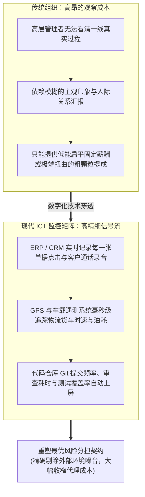

# Lec 08 委托代理理论与企业组织：监控技术、激励契约与信息技术 (The Principal-Agent Model of the Firm: Monitoring, Incentives, and ICT)

> MIT Sloan School of Management · 15.575 Economics of Information and Information Technology · Prof. Erik Brynjolfsson

## TL;DR

- 经典委托代理理论揭示了所有权与控制权分离下，由于努力不可观测性诱发的道德风险困境。
- 信息通信技术通过极低成本的数字化监控大幅收窄了信息不对称，重构了最优风险分担与绩效契约。
- 霍姆斯特朗-米尔格罗姆多任务代理模型警示：过度依赖可量化的机器指标将毁灭性扭曲员工的创新与长远投入。

## 企业内部的微观裂痕：委托代理困境与道德风险 / The Microeconomic Foundation of Principal-Agent

在经典新古典经济学中，企业被高度简化为一个冰冷的、无内在摩擦的“生产函数黑盒（Production Function Black Box）”——投入资本与劳动，自动吐出最优产出。然而，罗纳德·科斯（Ronald Coase）与现代组织经济学家指出：**真实的商业企业不是黑盒，而是一个由拥有独立利益诉求的利己人类构成的复杂契约集合体**。

在这个集合体中，最核心的结构性矛盾正是**委托代理问题（Principal-Agent Problem）**：
- **委托人（Principal，如股东、企业董事会、部门总监）**：拥有资本或管理职权，雇佣代理人代为行使日常经营决策，期望利润与组织产出最大化；
- **代理人（Agent，如职业经理人、一线工程师、销售代表）**：拥有自身独立的效用函数，追求更高的薪酬福利、更轻松的工作节奏（偏好偷懒 Shirk），且厌恶承担不可控的市场外部风险。

当委托人无法 100% 实时洞察代理人的真实努力程度（Effort $e$），且最终的业务产出 $y = e + \epsilon$ 受到不可控的外部随机环境噪音 $\epsilon \sim \mathcal{N}(0, \sigma^2)$ 扰动时，代理人便拥有了充足的动机进行偷懒，将不良业绩归咎于“大环境不好”——这就是经典的**道德风险（Moral Hazard）**。

## 信息技术对监控成本的颠覆性重塑 / How ICT Transforms Monitoring Costs

诺贝尔经济学奖得主本格特·霍姆斯特朗（Bengt Holmström）在信息经济学奠基论文中确立了**信息量原则（Informativeness Principle）**：

::: theorem 霍姆斯特朗信息量原则 (Holmström's Informativeness Principle)
在设计最优高管与员工激励薪酬合同时，**任何能够提供关于代理人真实努力程度（Effort）的额外信号（Signal），无论该信号多么微小，只要将其纳入绩效考核方程，在数学上都必然能改善契约效率**——即在不增加代理人风险溢价成本的前提下，诱发出更高的努力水平。
:::

在过去，获取关于员工真实努力的信号是极其昂贵的（例如雇佣大量中层监工在车间来回巡视、或者派遣私家侦探核查差旅发票）；而现代**信息与通信技术（ICT）的本质，正是一个“全方位、微秒级、边际成本趋近于零的高维信号捕获机器”**：

如上图所示，当出租车安装了 GPS 轨迹定位、销售员必须在手机 CRM 打卡上传客户拜访照片、软件工程师的每一次代码提交被自动记录时，委托人与代理人之间的信息不对称被急剧压缩。企业因此能够设计出更加精密、基于真实贡献的激励契约。

## 致命的副作用：多任务代理模型与激励扭曲 / The Curse of Multitask Agency

然而，信息技术的大规模监控是否必然带来组织生产率的提升？霍姆斯特朗与保罗·米尔格罗姆（Paul Milgrom）共同创立的**多任务代理模型（Multitask Agency Model）**给出了冷水浇头般的深刻警示：

::: definition 多任务代理理论 (Multitask Agency Theory)
在现实复杂工作中，员工的职责从来不是单一的，而是由多个相互竞争精力的任务维度构成的复合体：
- **任务一（易于量化测量的任务）**：如客服接听了多少个电话、销售员今天打了多少个骚扰电话、程序员今天写了多少行代码；
- **任务二（极度重要但难以短期精确量化的任务）**：如耐心倾听并彻底解决客户深层愤怒、维护企业的长期品牌商誉、花费三天时间优雅重构核心代码以消除未来的系统技术债务。
:::

::: pitfall 数字化强激励的“毁灭性反噬” (The Metric Fixation Trap)
如果技术团队自作聪明地利用 IT 监控工具，将员工的奖金与那些“最容易被系统自动采集的可量化指标”进行强行绑定挂钩，理性的代理人将立即展现出极端的机会主义行为：
**员工会将 100% 的精力疯狂倾注在刷高那些显性的容易量化的机器指标上，而彻底放弃、甚至故意牺牲那些真正关乎企业长期生死存亡但无法被算法直接衡量的深层价值！**
- 客服人员为了压降“平均通话时长指标”，在客户还没说完话时便强行挂断电话；
- 工程师为了刷高“代码提交行数指标”，故意将简单的三行函数拆写为毫无意义的三百行冗余模板代码。
这就是著名的**古德哈特定律（Goodhart's Law）**——“当一项指标变成了目标本身，它便不再是一项好指标！”
:::

## 我的理解与实践洞察 / Personal Insight

::: insight 监控技术的最高境界是“克制的留白”
委托代理经济学为数字化时代的高管团队提供了至关重要的管理哲学定力：
1. **警惕“数字化数字全景监狱（Panopticon）”摧毁组织灵魂**：今天许多企业通过在员工电脑上安装截屏监控、统计键盘敲击频次甚至用摄像头识别人脸微表情来考核员工。这种粗暴的技术应用，不仅在法律伦理上践踏了员工的尊严，更在经济学上制造了巨大的内耗——它将企业内部的互信资本彻底摧毁，培养出一群只懂得机械应付指标的“提线木偶”，彻底扼杀了高价值创新的空间。
2. **在“硬指标约束”与“内在动机（Intrinsic Motivation）”之间寻找黄金分割**：顶级技术领袖应当深刻明白：代码可以度量执行，但无法度量忠诚；算法可以追踪动作，但无法激发激情。IT 监控系统应当被克制地定位于“防范重特大违规与底线风控的防波堤”，而在核心创新领域，给员工留出充分的自主裁量权与心理安全感，依靠崇高的使命感与长期的合伙人文化去激发人类潜意识中最伟大的智力创造力。
:::
