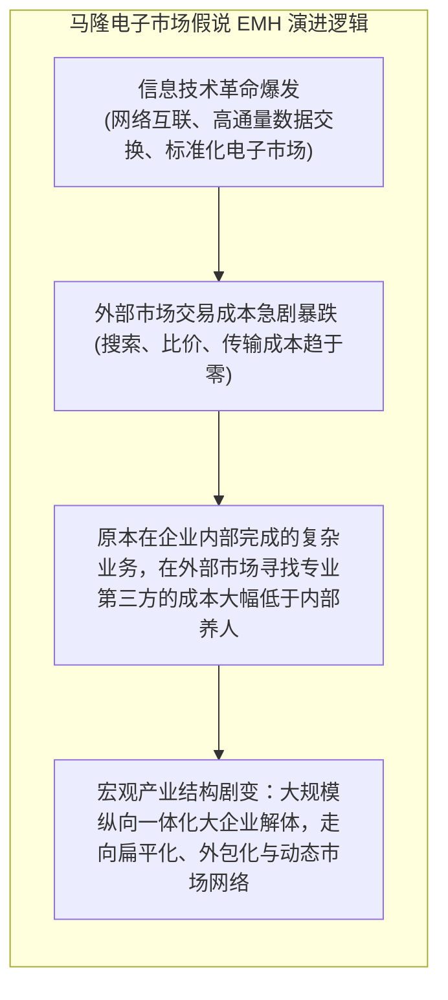
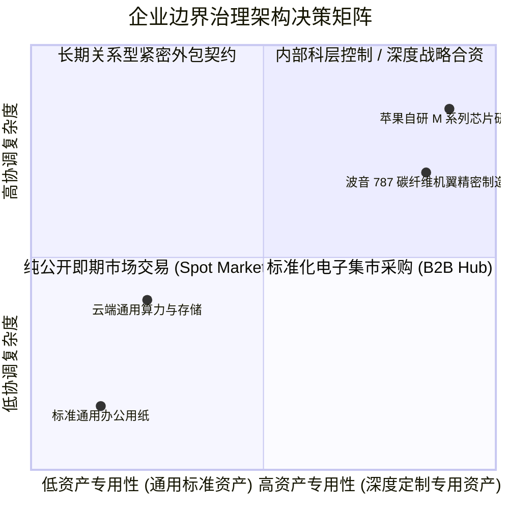

# Lec 09 企业管理视角：协调成本假说与组织架构设计 (Managerial Views of the Firm: Coordination Costs and Organizational Design)

> MIT Sloan School of Management · 15.575 Economics of Information and Information Technology · Prof. Erik Brynjolfsson

## TL;DR

- 托马斯·马隆电子市场假说 EMH 预测：信息技术大幅降低买方搜寻与协调成本，将推动市场契约取代科层企业内部制造。
- 交易成本经济学 TCE 揭示：高资产专用性与有限理性依然维系着企业科层层级制的不可替代壁垒。
- 现代组织架构摆脱了纯市场与纯科层的二元对立，演化出动态协同、敏捷蜂窝化的虚拟网络型企业形态。

## 科斯之问与企业边界的经济学起源 / The Coasian Question of Firm Boundaries

在 1937 年发表的颠覆性经典论文《企业的性质》（*The Nature of the Firm*）中，诺贝尔经济学奖得主罗纳德·科斯（Ronald Coase）提出了经济学历史上最震撼的核心追问：
**如果亚当·斯密所赞美的“自由市场价格机制”是全社会资源配置效率最高的手段，为什么现实世界中还会存在庞大的、依靠行政命令层级制运转的“企业（Firm）”？为什么我们不把所有员工都解雇，让他们每天早上在公开市场上竞标当天要干的每一个螺丝拧紧任务？**

科斯的解答奠定了现代组织经济学的基石：**因为利用市场价格机制本身，是存在高昂代价的——即交易成本（Transaction Costs）！**

::: definition 交易成本三大核心构成 (Transaction Cost Economics, TCE)
1. **搜寻与信息成本 (Search Costs)**：在浩瀚的市场中寻找合适的供应商、比对价格与质量的代价；
2. **讨价还价与缔约成本 (Bargaining & Contracting Costs)**：跨组织商务谈判、拟定详尽法律合同条款以及聘请律师的开销；
3. **监督与履约执行成本 (Policing & Enforcement Costs)**：在合同签署后，监控对方是否偷工减料，以及在违约时提起法律诉讼强制执行的巨大司法摩擦。
:::

当外部公开市场的交易成本高于企业内部通过管理者的行政等级命令直接调配资源的**内部组织协调成本（Internal Coordination Costs）**时，企业便会选择将该环节“纵向一体化（Vertical Integration）内部自建”；反之，企业便会选择向外部市场采购。**企业与市场的边界，精确收敛于企业内部组织边际成本等于外部市场交易边际成本的均衡点！**

## 马隆的“电子市场假说”（EMH）与解构浪潮 / Malone's Electronic Markets Hypothesis

在 1987 年，麻省理工学院斯隆管理学院著名管理学者托马斯·马隆（Thomas Malone）、乔安妮·耶茨（JoAnne Yates）与罗伯特·本杰明（Robert Benjamin）联合发表了具有极高前瞻性的著名论文，提出了**电子市场假说（EMH, Electronic Markets Hypothesis）**。

马隆团队指出，协调商业活动存在两种根本治理机制：
- **科层企业制 (Hierarchies)**：通过自上而下的行政命令，控制专门的内部资产与员工，资产专用性高，但缺乏市场竞争压力；
- **市场机制 (Markets)**：通过价格信号在众多竞争性买家与卖家之间自由匹配，能够实现生产规模效应的最优配置，但过去受制于高昂的搜寻与沟通成本。

由于信息技术对“外部搜寻与信息传输成本”的削减幅度，远远超过了对“内部行政官僚内耗”的削减幅度，马隆大胆预言：**未来的经济形态将不再由无所不包的巨型“联合企业（Conglomerates）”所统治，产业边界将被彻底打散，取而代之的是由数以万计独立专业小微实体通过电子网络瞬时协同的“流动市场网络”！**

## 现实的修正：为什么巨石企业没有彻底消亡？ / The TCE Rebuttal: Asset Specificity

然而，现实商业世界的演化再次展现了复杂的辩证法。在随后的三十年里，虽然耐克将全部鞋类制造外包给代工厂、苹果将组装外包给富士康，但与此同时，苹果牢牢掌控了芯片架构自研与操作系统生态，亚马逊自建了庞大的全球航空物流仓储网络，特斯拉建立了自己的超级垂直一体化电池与压铸工厂。

为什么巨型企业没有如同马隆假说预测的那样彻底化解为纯粹的液态小微市场？奥利弗·威廉姆森（Oliver Williamson）的交易成本理论指出了马隆忽视的核心变量——**资产专用性（Asset Specificity）与机会主义敲竹杠（Opportunistic Hold-up）**：

::: theorem 资产专用性与企业边界不可动摇的公理
如果某项业务所依赖的资产具有极高的**专用性（Specific Assets）**——即该资产一旦转作他用，其经济价值将出现断崖式损耗（如针对苹果手机专门开模的特殊高精度机床）：
即使信息网络再发达、搜寻成本再低，**由于未来的商业世界充满了不可预知的未知突发事件，任何合同在法理上都注定是“不完全的（Incomplete）”**！
一旦企业将这项高度专用性的核心业务完全外包给独立外部第三方，外部承包商在投资后必然面临被买方恶意压价的恐慌，或者反过来利用断供勒索买方。为了根绝这种致命的机会主义博弈，**企业必须毫不犹豫地将高专用性核心资产牢牢留在企业法人的边界之内！**
:::

## 现代混合形态：虚拟网络与敏捷蜂窝组织的崛起 / The Rise of the Networked Enterprise

在纯市场与纯科层的激烈碰撞中，现代数字化企业演进出了迷人的**混合治理形态（Hybrid / Network Forms）**：
1. **企业内部的“市场化机制”**：像字节跳动、海尔一样，在企业内部推行扁平化的“微小自主经营体（小微/内部创业团队）”，利用数字中台提供通用技术底座，团队之间通过内部 API 结算与虚拟核算进行动态竞合；
2. **企业外部的“科层化控制”**：像苹果对待供应链供应商一样，虽然在法律上是独立的外部企业，但苹果的技术工程师常驻供应商厂房，通过跨组织信息系统对供应商的生产良率、原材料采购价格实施长臂管辖与军工级实时监控，形成了一种超越法律边界的“数字虚拟科层帝国”。

## 我的理解与实践洞察 / Personal Insight

::: insight 企业的边界，就是“控制欲与灵活性”的纳什均衡点
企业组织经济学为技术战略家提供了判断“自研还是外包、合并还是解耦”的终极定盘星：
1. **千万不要为了“虚假的灵活性”外包你的命脉**：很多企业高管盲目听信外包咨询公司的游说，把原本构成企业灵魂的核心软件开发团队全部解雇、整体外包给外部软件商，美其名曰“轻资产运营”。结果不出三年，企业便陷入了被外包商恶意加价、系统迭代缓慢、核心机密外泄的绝境。**凡是具有高资产专用性、直接定义了企业商业护城河的核心数字资产，必须永远保持 100% 的内部自研与自主控制**。
2. **利用现代 API 契约扩大组织的协同外延**：技术的发展虽然没有消灭企业，但确实以惊人的速度重构了组织的协作半径。通过定义标准化、高内聚、松耦合的现代微服务 API 契约，企业能够像拼积木一样在几分钟内接入全球最顶级的支付、地图、物流与云原生 AI 能力，将过去需要数万人才能完成的庞大商业构想，由几十人的精英敏捷战队以极低成本迅速落地，这正是当代数字化企业最壮丽的竞争奇迹。
:::
