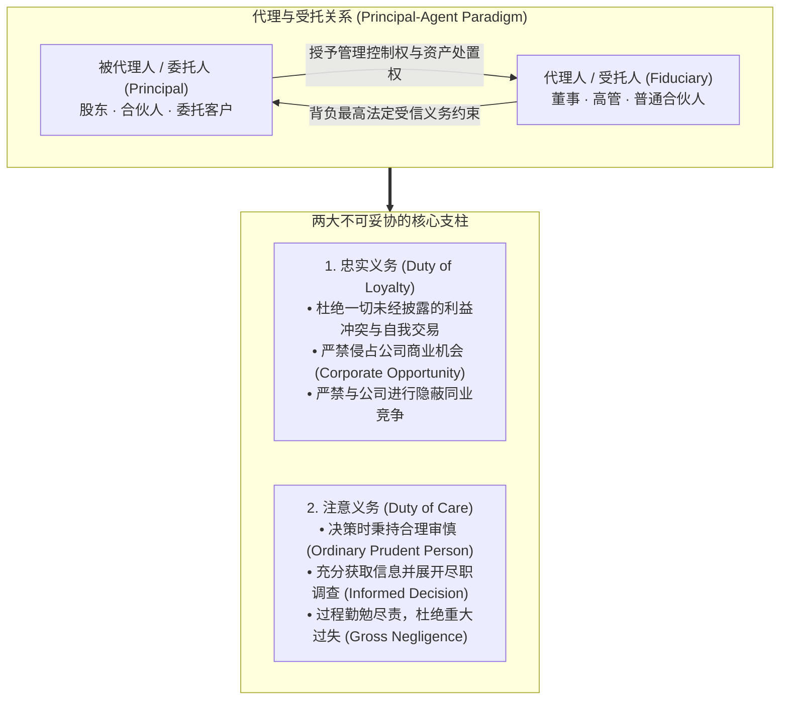

# Lec 1 商业受信义务与受托责任导论 (Introduction & The Law of Duties I)

> MIT Sloan 15.615 · Law for the Entrepreneur and Manager · 主讲 Dr. John Akula

## TL;DR

- 受信义务（Fiduciary Duties）是英美商业法约束高管、董事与合伙人权力的最高法律准则。
- 确立受托关系两大基石：忠实义务（Duty of Loyalty）与注意义务（Duty of Care）。
- 剖析经典代理人法则：代理人在权限范围内行事拘束被代理人，并承担不得自我交易的绝对义务。
- 引入卡多佐大法官在 *Meinhard v. Salmon* 案中的传世判词：“不仅是寻常诚实，而是最敏感的荣誉准则”。

## 为什么法学思维是高管的核心战略资产

在麻省理工斯隆管理学院，15.615 的开篇明确界定了管理者的法律视角：企业高管与创业者的核心诉求不是成为法学研究者，而是建立敏锐的“法律风险与架构判断力（Legal Astuteness）”。法律绝非事后收拾残局的合规羁绊，而是商业架构设计中不可或缺的承重墙。

商业社会的一切协作，本质上建立在“委托-代理（Principal-Agent）”的基础之上。当资本所有者将数千万资金交给职业经理人，或者合伙人共同开创事业时，信息不对称与道德风险必然滋生。英美法系历经数百年演进，演化出了商业法中位阶最高的治理武器——**受信义务（Fiduciary Duties）**。

从架构师视角审视上述受托图景，管理者必须清醒认识到：普通合同法建立在“自利假定（Self-interest Assumption）”之上——双方当事人各自为自身商业利益最大化锱铢必较，法律仅要求诚实信用、不构成欺诈即可。但在受托关系范式下，法律规则发生根本性倒置。受托人被赋予管理公司资金与核心商业机密的垄断性自由裁量权，而委托人由于信息屏蔽往往处于极度被动的监控弱势地位。

正因如此，司法审查在此类纠纷中采取了极其不对称的举证责任分配：一旦原告证明受托人存在哪怕微小的自利关涉，举证责任立即倒置给受托人，强制要求其证明该项交易在实体价值与审批程序上达到了绝对的“内在公允（Entire Fairness）”。高管若缺乏对这一不对称责任机制的敬畏，任何精巧的商业闭环都将沦为法庭上无可辩驳的违信证据。

## 忠实义务（Duty of Loyalty）与利益冲突

忠实义务要求受托人必须将公司或委托人的利益置于自身个人利益之上。当个人利益与公司利益发生潜在碰撞时，法律推导出一套极其严苛的禁令体系。

### 传世先例：*Meinhard v. Salmon* (1928)

本案被誉为全美商法中被引用频率最高的宪章级案例。原告 Meinhard 与被告 Salmon 共同出资成立合伙企业，租下一处位于纽约市中心的商业物业进行改造运营，由 Salmon 全权负责日常经营。在租约即将到期的前四个月，房东找到 Salmon，提议将包含周边更广大地块在内的整片商业街区全部打包出租进行大规模翻建。Salmon 独自与房东签署了新租约并成立了个人控股公司，完全未将这一商业机会告知出资合伙人 Meinhard。

本杰明·卡多佐（Benjamin N. Cardozo）大法官代表纽约上诉法院撰写了载入史册的多数派判词：

::: definition 卡多佐大法官的“荣誉之戒”
“共同冒险者（Joint Adventurers）之间相互负有受托责任，如同合伙人一样。商业世界里许多在普通市场交易中被允许的自利行为，在受托人之间是严格被禁止的。受托人所受约束的准则，**绝非集市上尔虞我诈的寻常道德，而是某种最为敏感的荣誉准则（A punctilio of an honor the most sensitive）**。唯有通过确立这种毫无妥协余地的严苛标准，法院才能有效维系受托关系的纯洁与崇高。”
:::

法院最终判决 Salmon 必须将其新租约的半数股权连同管理收益转让给 Meinhard。

## 注意义务（Duty of Care）与勤勉审查

如果说忠实义务防范的是“恶意与背叛”，那么注意义务防范的则是“懈怠与失职”。

::: definition 注意义务的法律标准
董事或高管在做出商业决策时，必须达到“一个处于类似地位的通情达理之人（Reasonably Prudent Person），在类似环境与情境下应当付出的同等关照与审慎程度”。注意义务考核的核心是**决策过程是否充分知情（Informed Decision-Making）**，而非事后的商业结果盈亏。
:::

高管在签署重大并购合约、处置核心资产或发布财报前，必须证明自身进行了合理的尽职调查、审阅了核心审计报告并听取了独立专业顾问的意见。

::: pitfall “无害自我交易”的认知误区
许多初创企业创始人常犯的错误是：“我私下用自己另一家软件公司的名义为初创公司开发了一套系统，价格比市场中介报价还要便宜 20%，我没有占公司便宜，因此合情合理。”在公司法中，**未向独立董事会或无利益关联股东充分披露并获得豁免的自我交易（Self-dealing），无论价格多么公允，均构成对忠实义务的严重侵犯**。一旦发生诉讼，受托人需承担举证责任证明该交易具备绝对公允性（Entire Fairness），面临被全额剥夺利益并承担赔偿的巨大法律风险。
:::

::: insight 受信责任是降低交易成本的制度技术
从新制度经济学视角审视，商业法律如果试图在合同中详尽列举高管在未来 10 年里“能做什么、不能做什么”，将面临不可承受的契约不完全性（Contract Incompleteness）。受信义务正是英美法发明的一种高阶制度技术：它不事无巨细列举条款，而是设定一道极高的“信托伦理天花板”。正因为投资者确信法律会像达摩克利斯之剑一样悬在受托人头顶，现代资本市场才得以维系大规模陌生人之间的委托代理协作。
:::
