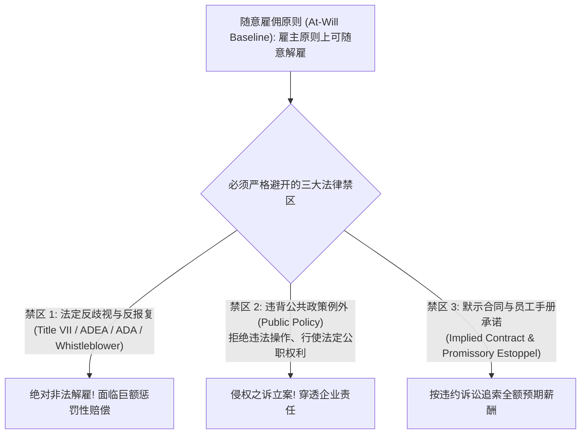
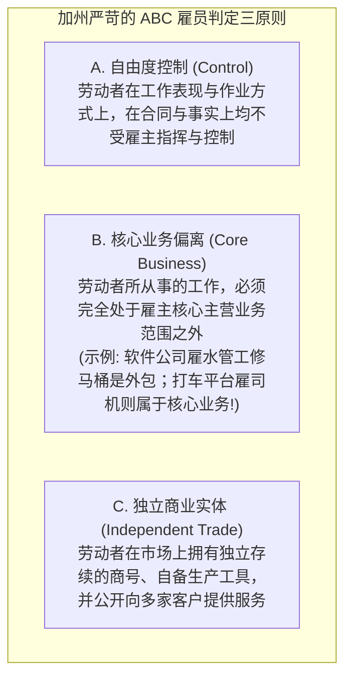

# Lec 10 劳动雇佣合规与“随意雇佣”例外 (Employment Law & At-Will Employment)

> MIT Sloan 15.615 · Law for the Entrepreneur and Manager · 主讲 Dr. John Akula

## TL;DR

- 理解美国雇佣法的基石原则：随意雇佣原则（At-Will Employment Doctrine）。
- 掌握随意雇佣的三大法定破除例外：反歧视法、公共政策例外与默示契约例外。
- 剖析独立承包商（1099） vs. 正式雇员（W-2）分类测试及其引发的劳工法与税务灾难。
- 确立解雇面谈与绩效改进计划（PIP）的合规防御流程，阻断非法解雇（Wrongful Termination）诉讼。

## 美国劳动法核心：随意雇佣原则（At-Will Employment）

与欧陆法系以及中国劳动合同法设立极其严格的法定解雇保护不同，美国（除蒙大拿州外）的雇佣法律关系建立在一个极其自由主义的普通法基石之上——**随意雇佣原则（At-Will Employment）**。

::: definition 随意雇佣原则的标准表述
在没有明确书面约定固定聘用期限的前提下，雇佣关系可由**雇主或员工任何一方，在任何时间，出于任何正当理由、甚至毫无理由、哪怕出于在道德上值得商榷的理由，随时单方解除（Terminated at any time, for any reason, or no reason at all），且无需承担违约赔偿责任**。
:::

这意味着，如果老板单纯看员工今天穿的鞋子颜色不顺眼，在纯粹的随意雇佣原则下，老板有权当场宣布解雇，而无需支付任何经济补偿金。

## 随意雇佣的三大绝对例外

虽然雇主有权“无理由”解雇，但绝不等于雇主有权“出于非法理由”解雇。司法实践中演化出了三大阻击随意雇佣的法律例外：

### 1. 法定反歧视与反报复保护（Statutory Prohibitions）
- **民权法案第七章（Title VII of the Civil Rights Act of 1964）**：严禁因种族、肤色、宗教、性别或国籍而做出解雇、降薪或拒绝录用决策；
- **年龄歧视雇佣法（ADEA）**：保护 40 岁及以上的资深员工；
- **美国残疾人法案（ADA）**：要求雇主为残疾员工提供“合理便利（Reasonable Accommodation）”；
- **反报复红线（Anti-Retaliation）**：如果员工向 HR 或监管机构举报性骚扰、财务造假或安全隐患（吹哨人），雇主随后在 6 个月内对其降职或解雇，法官将直接推断该解雇构成非法恶意报复（Retaliation），这是原告胜诉率最高、赔偿金额最惊人的诉由。

### 2. 公共政策例外（Public Policy Exception）
如果雇主解雇员工的原因，直接破坏了社会公共秩序的基石，解雇无效。例如：
- 员工因拒绝替老板在伪造的纳税申报单上做伪证而被解雇；
- 员工因履行公民法定陪审员义务（Jury Duty）请假出庭而被解雇；
- 员工因工伤依法向工伤赔偿委员会申请理赔金而被解雇。

### 3. 默示合同例外（Implied Contract Exception）
许多公司在《员工手册》（Employee Handbook）中写道：“本公司员工只要表现良好，即可享受终身稳定的职业发展；在解雇前，公司保证遵循三阶段纪律处分程序。”
法院认定：**员工手册中的这类陈词滥调，事实上推翻了“随意雇佣”属性，构成了受法律保护的默示劳动契约**！如果公司未按三阶段流程直接开人，员工可以违约为由发起索赔。

## 独立承包商（1099） vs. 正式雇员（W-2）分类炸弹

在平台经济、零工经济与初创企业中，管理层为了节省高达 20%–30% 的员工薪酬税（FICA）、失业保险金、带薪年假与医保福利，往往倾向于将工人或软件外包人员定义为**独立承包商（Independent Contractor，报税填 1099 表）**，而非**正式全职雇员（Employee，报税填 W-2 表）**。

监管机构与法院在判定劳动者身份时，推行了著名的**“经济现实与控制权测试（Economic Realities & Control Test）”**，加州更通过立法确立了严苛的 **ABC 测试**：

::: pitfall 错误分类（Worker Misclassification）引发的集体诉讼海啸
如果初创企业贪图便宜，将实质上全职在公司坐班、听从主管每日指令、使用公司电脑办公的 20 名程序员登记为“1099 独立承包商”，一旦被劳工部（DOL）或国税局（IRS）突击审计，或者被离职员工发起集体诉讼：**公司不仅需要全额补缴过往数年的全部雇主税金与利息，面临翻倍的法定惩罚性罚款，更需全额补发这些员工在过往全部法定加班时间（Overtime）的 1.5 倍工时工资**！Uber、Lyft 等巨头为此付出了数十亿美元的和解与抗辩代价。
:::

::: insight 雇佣合规的核心是过程留痕与尊严治理
当企业决定辞退一名不能胜任的员工时，最愚蠢的做法是管理层在愤怒之下“当场让他滚蛋”。卓越的管理者深谙现代雇佣法的攻防艺术：启动正式且真实的**绩效改进计划（Performance Improvement Plan, PIP）**，设定清晰客观的量化考核指标，给予定期复盘指导；每一次谈话均由 HR 陪同并形成书面签字备忘录。这套严谨的文书留痕体系，不仅能最大限度打消员工的怨怼心理促成体面和解，更能在未来可能发生的劳动仲裁与诉讼中，为企业铸就牢不可摧的合法防御铁壁。
:::
