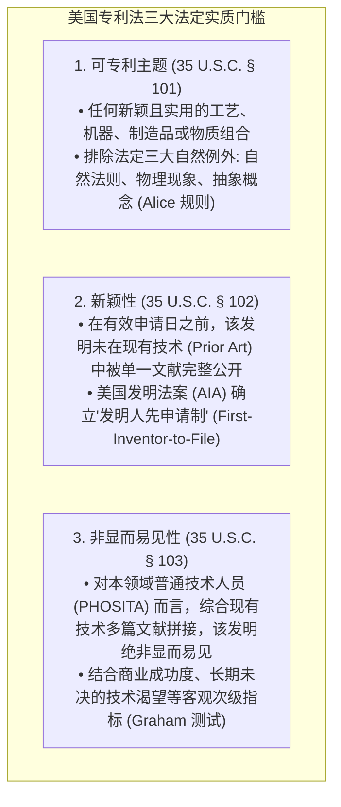
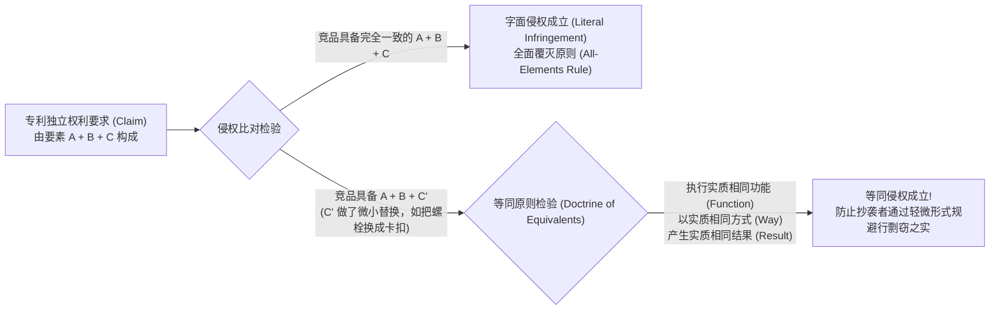

# Lec 11 美国专利法实务：可专利性、申请与侵权防范 (Introduction to U.S. Patent Law)

> MIT Sloan 15.615 · Law for the Entrepreneur and Manager · 主讲 Dr. John Akula

## TL;DR

- 掌握美国专利法核心三大实质授权要件：可专利主题（§101）、新颖性（§102）与非显而易见性（§103）。
- 厘清临时专利申请（Provisional Patent Application）在锁定优先权日与商业验证中的低成本杠杆价值。
- 剖析字面侵权（Literal Infringement）与等同原则（Doctrine of Equivalents）的司法判定边界。
- 建立初创科技企业的自由实施分析（Freedom-to-Operate, FTO）与专利流氓（NPEs）防卫策略。

## 专利的本质：技术公开换取排他垄断

美国宪法第一条第八款第八项明确赋予国会权力：“通过保障作者与发明人对其作品与发现享有有限时间的排他权，以促进科学与实用技艺的进步。”

专利绝非政府赋予权利人“实施某项技术的许可”，而是**赋予权利人“在法定时间内（自申请日起算 20 年），排他性地禁止任何其他人在美国制造、使用、许诺销售、销售或进口该发明”的绝对垄断武器**。

理解专利作为“国家与发明人之间的社会契约”这一法哲学本质，是避免盲目申请专利或专利策略落空的前提。专利权不是自然法赋予的天赋人权，而是主权国家为了鼓励科技创新公开、打破技术密谋垄断而设立的人为法定特许权。发明人必须向全社会充分披露其技术的最佳实施例（Best Mode）与技术细节，以达到“同领域普通技术人员无需不当实验即可复现”的充分公开标准；作为代价，国家在有限期限内赋予其在法域内排除他人制造、使用、许诺销售和进口的独占排他垄断特权。

对于高科技企业而言，专利布局绝非仅仅为了“炫耀技术实力”，其实质是构筑商业竞争的防御护城河与跨国谈判的筹码资产包。一项缺乏清晰商业场景保护的专利犹如废纸一张；而一组精心围绕产品核心功能织就的严密权利要求网（Claims Network），即便产品本身尚未完全上市，就足以在行业巨头面前构筑起高达数亿美元的排他准入门槛。

## 创业者的利器：临时专利申请（Provisional Application）

对于资金匮乏、产品仍处于快速迭代期的初创团队，正式提交一份动辄花费 1–3 万美元律师费的非临时发明专利申请（Non-provisional Patent）往往是不切实际的。

美国专利商标局（USPTO）设立了极具商业弹性的**临时专利申请（Provisional Patent Application）**：

::: definition 临时专利申请的战略杠杆
1. **费用极低**：官方规费仅需数百美元，无需撰写正式权利要求书（Claims），无需提供正式誓言；
2. **锁定优先权日（Priority Date）**：自提交之日起，申请人获得长达 **12 个月的锁定保护窗口**，并合法享有标注“Patent Pending（专利申请中）”的商业信誉背书；
3. **12 个月的商业验证期**：在这 1 年内，创始人可安全地向投资人路演、向客户展示样机并测试市场真实需求。若市场证伪，可任由其自然失效；若市场火爆，可在第 12 个月届满前正式转换为正式非临时专利，并承接初始优先权日！
:::

## 侵权判定的双轨体系：字面侵权 vs. 等同原则

如果竞争对手的产品侵犯了你的专利权利要求，原告可在法庭上主张两条路径：

全要件原则与等同原则的辩证博弈，是专利诉讼中最扣人心弦的战场。字面侵权的判定犹如一把精密的游标卡尺，只要被控侵权产品缺少了权利要求书中所记载的任何一个技术要件，哪怕只是缺少了一颗特定材质的螺丝或一个次要的数据校验步骤，字面侵权指控便不攻自破。这也是为什么专利流氓在发起索赔时，总是竭力寻找措辞宽泛且要件精简的上位权利要求。

然而，如果法律仅仅止步于字面侵权，抄袭者便可以通过微不足道的细微替代（例如将螺栓固定改为铆钉固定、将特定常数微调 0.01%）轻松绕过专利保护，使发明人的心血付诸东流。正因如此，“等同原则”赋予了法官穿透表象的自由裁量权：只要被控侵权物以基本上相同的方式、执行基本上相同的功能、取得基本上相同的结果，法律依然判定其落入专利垄断范畴。而原告在专利申请过程中向审查员所作的任何妥协性限缩陈述，又将受到“审查历史禁反言”的严酷锁定，形成极其精妙的攻守平衡。

## 自由实施分析（FTO）与专利流氓（Patent Trolls）防御

初创企业常犯的最致命法律常识错误是：“**我已经拿到了美国发明专利，所以我生产销售该产品一定是合法的**。”

这是完全错误的理解。专利是“禁止权”而非“通行权”。例如：A 拥有“带四条腿的椅子”的基础专利，B 随后发明并在其上加装了靠背，成功获得了“带靠背的椅子”的新专利。然而，B 制造销售带靠背的椅子，依然因为包含了“四条腿”而直接侵犯了 A 的基础专利！

::: definition 自由实施分析（Freedom-to-Operate, FTO）
企业在耗费数千万元开模量产新产品之前，必须委托专业专利律师对全球主要市场的存量专利池进行地毯式检索排查，出具正式的 **FTO 法律意见书（Clearance Opinion）**。唯有确认产品未落入任何第三方仍处于有效期的有效权利要求保护范围内，企业才能安全投产。
:::

::: pitfall 忽视专利流氓（NPEs）诱发的故意侵权三倍赔偿
在软件、半导体与互联网领域，存在大量不从事任何实体制造、专门以低价打包破产企业专利并通过恶意诉讼敲诈创业公司的**专利流氓（Non-Practicing Entities, NPEs）**。当收到 NPE 的索赔警告函（Demand Letter）时，高管绝不能置之不理。如果装作没看见继续销售，一旦败诉，法官可能认定构成**故意侵权（Willful Infringement）**，依法判处高达**三倍的惩罚性损害赔偿金（Treble Damages）**！高管应第一时间交由专利律师评估，并利用多方复审程序（IPR）向专利审判委员会（PTAB）发起专利无效反击。
:::

::: insight 专利布局是防御性核武器，而非花架子
初创企业的专利战略，核心目标不是为了在政府申报材料上凑数字，而是为了构建“相互保证毁灭（Mutual Assured Destruction）”的防御性专利池。当行业巨头试图用专利侵权绞杀新兴挑战者时，如果初创企业在关键核心工序上预先埋伏了数项无法规避的基础专利，双方就能在法庭风暴中坐回谈判桌，达成互不侵犯的专利交叉许可（Cross-licensing），从而在巨头环伺的丛林中捍卫宝贵的生存空间。
:::
