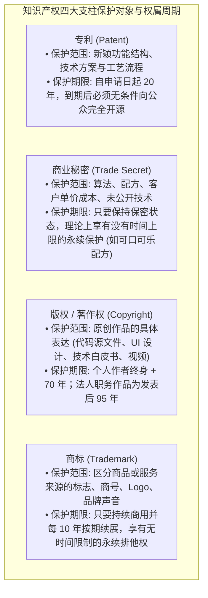
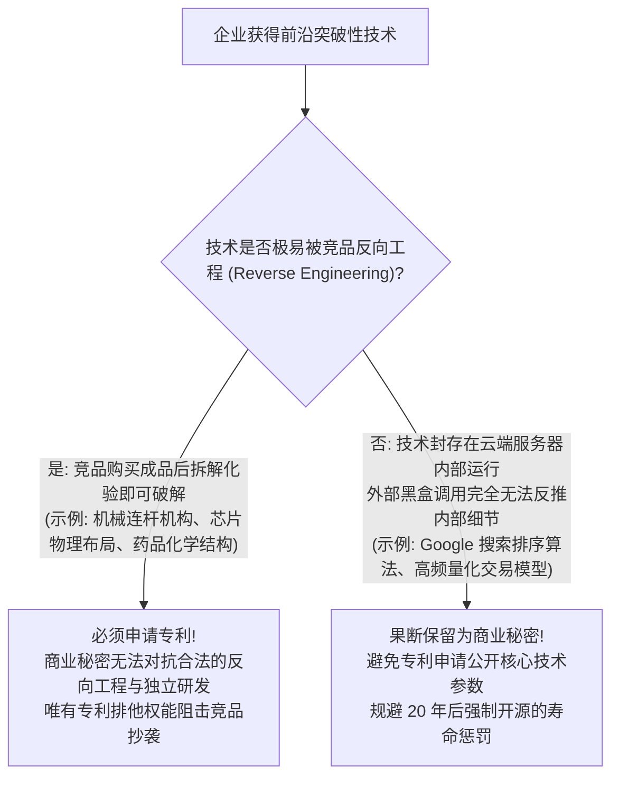
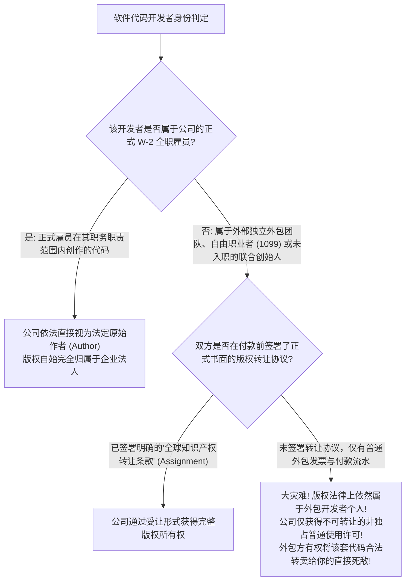
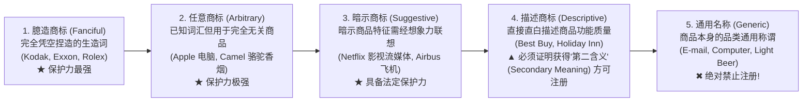

# Lec 12 商业秘密、版权与商标保护策略 (Trade Secrets, Copyright & Trademark Strategy)

> MIT Sloan 15.615 · Law for the Entrepreneur and Manager · 主讲 Dr. John Akula

## TL;DR

- 掌握知识产权大厦四大支柱中另外三大关键维度：商业秘密、版权与商标。
- 深度对比“专利公开换垄断”与“商业秘密永续保护”之间的战略取舍权衡。
- 剖析美国版权法“职务作品原则”（Work-for-Hire Doctrine）在软件代码归属中的绝对陷阱。
- 掌握商标显著性光谱（Abercrombie 阶梯），避免将企业核心品牌设计为不受保护的通用词。

## 知识产权的立体武器库

在技术创新与品牌运营中，单一维度的法律保护往往漏洞百出。高管必须学会综合运用**专利（Patent）、商业秘密（Trade Secret）、版权（Copyright）与商标（Trademark）**构筑多层纵深防御体系：

构建一个立体化的知识产权矩阵，是高科技创业公司必须在创业初期完成的顶层制度设计。很多技术型创始人容易产生“重专利、轻秘密、轻商标”的片面偏见，殊不知商业竞争往往是全方位的降维打击。当一项核心算法具有极强的代码反编译难度、且一旦公开便无法在竞争对手的黑盒服务器内取证侵权时，盲目申请专利等于将自己的核心算法源码向全球竞争对手拱手相让，反而是自寻绝路。

相反，成熟的知识产权战略是将技术成果进行精密分层：底层无法被外部逆向工程探知的专有数据模型与训练流水线，严格作为商业秘密予以深锁；面向终端用户、具备可视形态与外部接口的硬件构造与功能交互，申请严密的实用专利进行跑马圈地；软件底层源码通过版权法自动获得自创作之日起的长达数十年的低成本反抄袭保护；而承载企业商誉、客户信任与品牌溢价的产品标识与视觉识别，则通过商标法在核心业务类别及关联防御类别全面注册，形成坚不可摧的立体防护网。

## 终极抉择：专利保护 vs. 商业秘密保护

面对一项前沿技术创新，企业必须在 Day 1 做出抉择：**是申请专利，还是作为商业秘密封存？**

这一抉择矩阵深刻揭示了研发资产保护中的制度博弈逻辑。专利法与商业秘密保护法在法学逻辑上是彻底互斥的两条平行线：专利要求“大白于天下”，以公开换取垄断，换取的是对抗全世界的绝对排他特权；商业秘密则要求“深藏不露”，以严密保密措施换取无时间上限的永久保护，但其致命弱点在于根本无法对抗第三方的独立自主研发与合法逆向工程。

可口可乐拥有百余年历史的神秘配方正是商业秘密永生神话的经典代表——如果可口可乐在 19 世纪末申请了专利，该配方的垄断保护期早在一百年前便已依法届满，如今其核心配方早已沦为全球各大饮料厂合法免费使用的公知公用技术。企业在进行知识产权战略推演时，必须先对自身产品的可逆向性展开残酷的工程红蓝对抗：若竞品工程师仅凭拆解芯片或抓包数据就能在两周内逆向还原技术逻辑，专利保护是唯一的避难所；若核心技术隐藏于云端黑盒之中，商业秘密才是维持长期超额利润的最佳容器。

## 版权法与软件陷阱：职务作品原则（Work-for-Hire）

许多软件初创企业高管普遍持有一个致命直觉：“**我花钱雇佣外包团队写代码，我付了款，代码版权自然百分之百归我公司所有**。”

在普通法系版权法中，这一认知是完全错误的！

根据美国版权法（17 U.S.C. § 101），企业要真正拥有作品的原始版权，必须严格满足**职务作品原则（Work Made for Hire）**：

这一权利归属流程图揭示了软件科技创业中最高频爆发的“致命法律黑洞”。在公司初创阶段，由于预算紧张，创始人往往大量借助外部兼职外包团队、自由职业程序员或高校博士生撰写核心系统代码。绝大多数创始人直觉地认为：“我已经全额支付了外包费用，代码的所有权理所当然属于我的公司”。这种朴素的直觉认知在版权法面前是彻底错误的！

根据美国与大多数法域的版权法规定，“职务作品（Work-for-Hire）”原则严格仅适用于“全职正式雇员在其职务范围内创作的作品”。对于外部独立承包商或兼职顾问，无论公司支付了多么高昂的报酬，在没有一份白纸黑字明确约定了“将作品一切版权转让给公司（Assignment of Copyright）”的书面协议的前提下，代码的底层版权始终牢固地归属于外包程序员个人，公司仅仅获得了一个非独占的使用许可。一旦未来公司估值飙升迈向 IPO，原外包程序员即可凭借其合法的原始版权人身份发起巨额索赔，甚至申请法院发布禁令下架整个公司的核心软件产品。

## 商标法：显著性阶梯（Abercrombie Spectrum）

一个响亮的名字是企业最核心的商业资产。然而在商标法中，越符合日常语言习惯的词汇，往往法律保护力度越弱。

美国第二巡回上诉法院在 *Abercrombie & Fitch Co. v. Hunting World* (1976) 案中确立了著名的**商标显著性五级阶梯**：

::: pitfall 商标通用化（Genericide）导致的价值蒸发
即使注册了强力商标，如果企业长期默许公众将其品牌名作为整个品类的代名词使用，商标将会遭遇**通用化死亡（Genericide）**，被法院判定彻底作废！历史上著名的惨痛案例包括：阿司匹林（Aspirin，原拜耳商标）、海洛因（Heroin）、自动扶梯（Escalator）、蹦床（Trampoline）、赛璐珞（Celluloid）。现代巨头（如 Google 要求媒体使用“利用 Google 引擎搜索”而非将 google 作为动词）常年投入数千万美元维护商标显著性。
:::

::: insight 知识产权是资产负债表上的防御性护城河
在知识经济时代，实物厂房和存货在企业总估值中的占比往往不足 15%，剩余 85% 的价值完全由知识产权与无形资产支撑。卓越的高管懂得将 IP 战略与企业商业模式进行咬合：用商标牢牢锁死终端消费者心智，用商业秘密守护底层高毛利黑盒，用版权防范代码与内容资产被恶意克隆，用核心专利构筑针对同业巨头的威慑平衡。
:::
