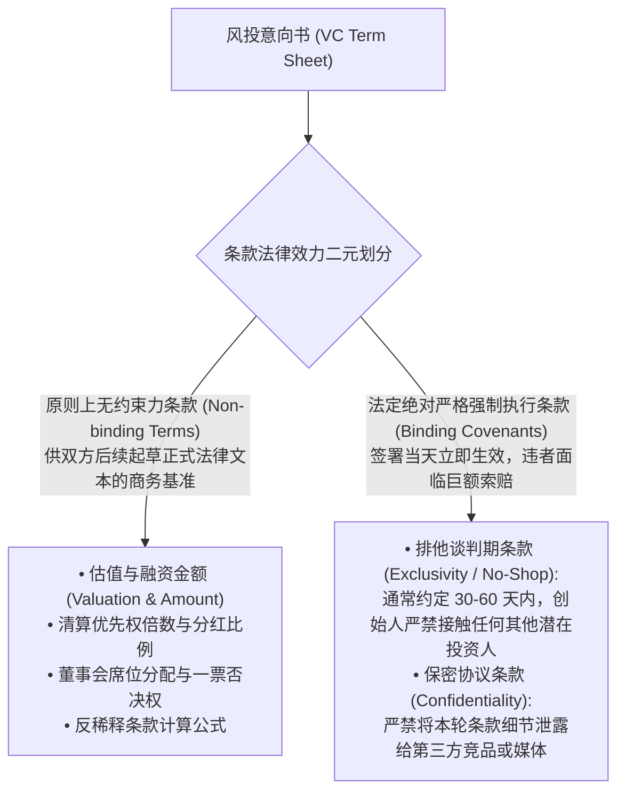
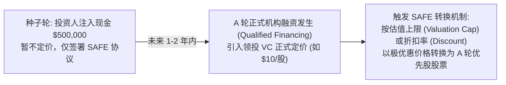
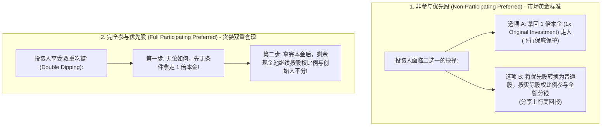

# Lec 13 风险投资法律实务：投资意向书核心条款 (Venture Capital I: Term Sheet Mechanics)

> MIT Sloan 15.615 · Law for the Entrepreneur and Manager · 主讲 Dr. John Akula

## TL;DR

- 解构风投意向书（VC Term Sheet）的法律约束力边界：排他期（Exclusivity）与保密义务。
- 厘清投资前估值（Pre-Money）与投资后估值（Post-Money）数学模型，剖析期权池挤压（Option Pool Shuffle）的隐形稀释。
- 掌握可转债（Convertible Note）与未来股权简单协议（SAFE）的估值上限（Cap）与折扣率（Discount）机制。
- 深度拆解清算优先权（Liquidation Preference）的底层逻辑：1 倍非参与优先股 vs. 完全参与优先股。

## 意向书的解剖学：约束力与非约束力

当风险投资基金（VC）决定投资一家初创企业时，双方签署的第一份里程碑文件是**投资意向书（Term Sheet）**。

虽然意向书通常开门见山写道“本意向书不具有法律约束力”，但高管必须清醒识别其中**具有法定绝对强制约束力的两大核心例外**：

Term Sheet 的精妙之处正在于其“非约束性与约束性交织的双面神结构”。很多缺乏融资经验的初创团队在拿到一份看似诚意满满的 Term Sheet 时，往往因估值数字而欣喜若狂，却忽视了意向书尾部几段极不起眼的排他期（Exclusivity）与保密（Confidentiality）条款的杀伤力。这短短几段看似常规的法律条文，是整份 Term Sheet 中极少数具有 100% 法律约束力的核心条款。

一旦创始人草率签字，公司就将在长达 45 到 60 天内被剥夺与任何其他投资机构接洽、谈判或接收报价的权利。在这段漫长的排他期内，企业不仅要向资方完全敞开最核心的技术、客户与财务底牌接受严苛的法律与财务尽调，自身的银行账户现金储备也在随之极速消耗。如果该投资机构在排他期最后一周以“尽调发现瑕疵”为由突然要求大幅压低估值或强加严苛的清算优先权，早已耗尽现金流且无法引入竞争买家的创业者将彻底丧失议价能力，陷入任人宰割的被动绝境。

## 估值数学与期权池洗牌陷阱（The Option Pool Shuffle）

投资意向书最显眼的核心数字是**估值（Valuation）**。然而，同样的估值数字背后，期权池的设立时机将带来截然不同的股权稀释结果。

### 经典公式
$$	ext{Post-Money Valuation（投后估值）} = 	ext{Pre-Money Valuation（投前估值）} + 	ext{Investment Amount（本轮投资额）}$$
$$	ext{VC 持股比例} = rac{	ext{Investment Amount}}{	ext{Post-Money Valuation}}$$

::: example 期权池洗牌（Option Pool Shuffle）的隐形刀法
假设某初创企业与 VC 达成共识：
- 投前估值 $Pre = \$1{,}000 	ext{ 万美元}$，VC 本轮出资 $\$250 	ext{ 万美元}$；
- 投后估值 $Post = \$1{,}250 	ext{ 万美元}$，VC 占股目标为 $rac{250}{1250} = 20\%$；
- VC 在意向书中附带了一句行话：“**要求在交割前（Pre-money）设立一个占投后 15% 的未分配员工期权池（Unallocated Option Pool）**。”
很多创始人误以为“期权池是留给未来团队的，大家共同稀释”。但注意“Pre-money”这一致命限定词：
1. 15% 的期权池价值为 $\$1{,}250 	ext{ 万} 	imes 15\% = \$187.5 	ext{ 万美元}$；
2. VC 要求将这 187.5 万美元**全部从创始人的投前估值中提前扣除**！
3. 创始人实际生效的真实投前估值跌至：
   $$	ext{True Pre-money} = 1{,}000 - 187.5 = \mathbf{\$812.5 	ext{ 万美元}}！$$
4. 创始团队的实际股权在瞬间被稀释为：
   $$rac{812.5}{1{,}250} = \mathbf{65\%} \quad (	ext{VC 独占 20\%，期权池占 15\%})$$
创始人独自承担了期权池设立的全部稀释成本！
:::

## 早期轻量化融资：可转债与 SAFE

在种子轮（Seed Round）由于商业模式尚未验证、对公司精准定价极其困难，硅谷 Y Combinator 联合创始人 Paul Graham 发明了**未来股权简单协议（SAFE, Simple Agreement for Future Equity）**与**可转换可转债（Convertible Notes）**：

SAFE 不是借款（无利息、无到期日），本质上是一份“未来股票认购期权合约”，极大免除了早期繁重的法律起草成本。

## 清算优先权（Liquidation Preference）的深水区

清算优先权决定了当企业发生**流动性变现事件（Liquidation Event，包括破产清算、公司被整体出售并购、控股权转移）**时，现金池在各个股东之间的流转分配顺序。

优先股股东永远排在普通股（创始人与员工）之前分钱。核心条款通常区分为两类：

::: example 非参与 vs. 完全参与的实际分钱差距
某初创公司融资时 VC 投资 500 万美元获得 20% 股权（投前 2,000 万，投后 2,500 万）。三年后，公司因发展不及预期，以 1,500 万美元被竞品折价并购收购：
- **情况 A（1x 非参与优先股）**：
  - 若 VC 选按 20% 比例分钱：只能分得 $1{,}500 	imes 20\% = 300 	ext{ 万美元}$；
  - 聪明的 VC 选择行使优先清算权：优先拿走 **500 万美元**本金走人；
  - 剩余 $1{,}500 - 500 = \mathbf{1{,}000 	ext{ 万美元}}$ 全部留给创始团队与员工分配！
- **情况 B（1x 完全参与优先股）**：
  - 第一步：VC 凭借清算权先拔走 **500 万美元**；
  - 第二步：剩余 1,000 万美元中，VC 继续按 20% 提走 $1{,}000 	imes 20\% = \mathbf{200 	ext{ 万美元}}$（VC 累计卷走 700 万）；
  - 创始团队与核心员工最终仅剩下可怜的 **800 万美元**。
:::

::: pitfall 忽视清算倍数积累导致的“零元退出”
许多创始人在连续遭遇多轮融资后，为了维持高纸面估值，盲目接受后续投资人提出的“2 倍清算优先权（2x Liquidation Preference）”或附加高额累积股息（Cumulative Dividends）。在公司最终以 8,000 万美元出售时，由于前序几轮优先股投资人的清算包袱高达 9,000 万美元，所有卖身所得全部被 VC 分食殆尽，辛勤打拼数年的创始人与员工最终拿到的分红竟然是绝对的零！
:::

::: insight 估值是虚荣，条款才是真实
创投圈有一句至理名言：“**你给我定估值，但我来定条款；无论你把估值叫得多高，我都有办法在条款里把钱全部拿回来**。”优秀的企业家绝不能被名义上的“独角兽估值”冲昏头脑。在签署投资协议时，必须在法律顾问协助下，对清算优先权、期权池计算时点、董事会控制权等隐形条款进行逐行攻防，守住控制权与清算底线。
:::
