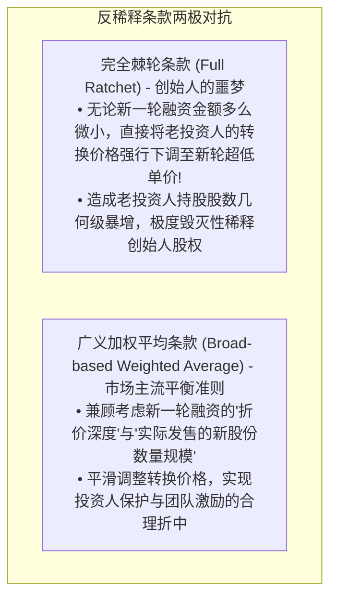
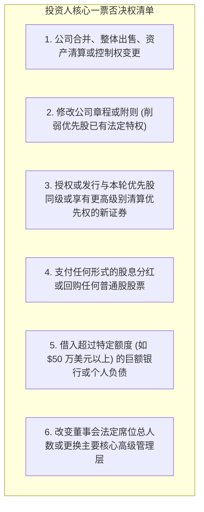
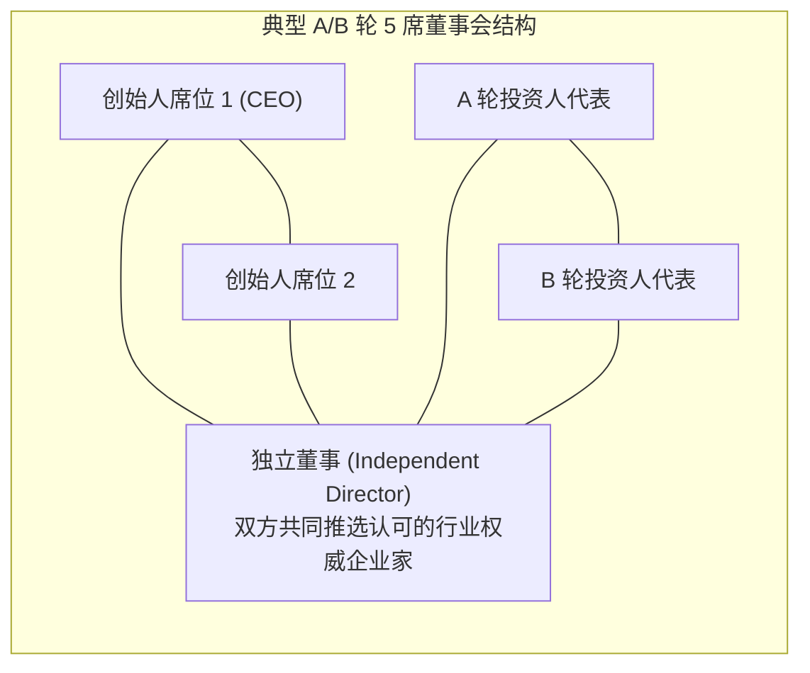

# Lec 14 风险投资治理条款：反稀释、保护性条款与投票权 (Venture Capital II: Anti-dilution & Governance)
> MIT Sloan 15.615 · Law for the Entrepreneur and Manager · 主讲 Dr. John Akula

## TL;DR

- 掌握下行轮融资（Down Round）中反稀释条款（Anti-dilution Provisions）的经济与数学原理。
- 深度对比残酷的“完全棘轮”（Full Ratchet）与主流温和的“广义加权平均”（Broad-based Weighted Average）。
- 剖析保护性条款（Protective Provisions）作为投资人“超级一票否决权”的运行机理。
- 掌握董事会席位平衡（Board Composition）与带售权（Drag-along Rights）对公司战略终局控制权的决定性影响。

## 资本寒冬与下行轮的洗牌冲击

在创业顺境中，公司的每一轮融资估值都水涨船高（Up Round），所有股东共享账面财富的增值；然而，一旦遭遇宏观资本寒冬、业务指标未达预期或技术研发受挫，企业为了维持现金流，被迫以**低于前一轮融资的价格发行新股票**——这就是创投界闻风丧胆的**下行轮（Down Round）**。

早期的优先股投资人在入场时，为了防范后续下行轮导致自己的投资价值被严重稀释，普遍在投资协议中设立了**反稀释保护机制（Anti-dilution Protection）**。

## 广义加权平均反稀释的数学机制

当触发反稀释时，投资人所持有的优先股股票数量本身不发生改变，而是通过**调低其优先股向普通股转换的“转换价格（Conversion Price, $CP$）”**，从而使其在未来转换时能换取更多的普通股股票。

### 经典广义加权平均计算公式

$$CP_2 = CP_1 	imes \left( rac{A + B}{A + C} 
ight)$$

其中各项参数定义具有极其严密的经济学含义：
- $CP_1$：调整前的旧优先股转换价格（即老投资人入场时的购买价格）；
- $CP_2$：经反稀释调整后的新优先股转换价格（$CP_2 < CP_1$）；
- $A$：本次下行轮融资前，公司按**完全摊薄基准（Fully-diluted Basis）**计算的全部存量股份总数（包含所有已发行普通股、优先股转换数、以及已发放和期权池预留的全部期权）；
- $B$：以**旧价格 $CP_1$** 测算，公司在本次下行轮融到的新资金本应发行的新股数量（$B = rac{	ext{新融资总额}}{CP_1}$）；
- $C$：在本次下行轮中，按**实际折价新价格 $P_2$** 实际发行给新投资人的新股数量（$C = rac{	ext{新融资总额}}{P_2}$，显然 $C > B$）。

::: example 加权平均 vs. 完全棘轮的震撼对比
A 轮投资人以每股 $CP_1 = \$10$ 投资 1,000 万美元，持有 100 万股 A 轮优先股。
一年后遭遇危机，公司被迫按每股 $P_2 = \$2$ 开展下行轮融资，发行 50 万股新股融入 100 万美元。
1. **在完全棘轮（Full Ratchet）下**：
   - 转换价直接从 $\$10$ 暴跌至 $\$2$！
   - A 轮投资人未来可转换的普通股股数瞬间变为 $rac{\$10{,}000{,}000}{\$2} = \mathbf{500 	ext{ 万股}}$（凭空凭空暴增 400 万股！）；
   - 创始人股权几乎被就地清零！
2. **在广义加权平均（Broad-based WA）下**：
   - 假设全摊薄总股本 $A = 1{,}000 	ext{ 万股}$。
   - $B = rac{\$1{,}000{,}000}{\$10} = 10 	ext{ 万股}$，$C = rac{\$1{,}000{,}000}{\$2} = 50 	ext{ 万股}$。
   - 新转换价格计算：
     $$CP_2 = 10 	imes \left( rac{1{,}000 + 10}{1{,}000 + 50} 
ight) = 10 	imes rac{1{,}010}{1{,}050} pprox \mathbf{\$9.62}$$
   - A 轮优先股可转换股数仅微调为 $rac{\$10{,}000{,}000}{\$9.62} pprox 103.95 	ext{ 万股}$（仅微调增加约 3.95 万股）。
:::

## 保护性条款（Protective Provisions）：隐形的一票否决权

很多创始人以为自己持有 51% 的普通股多数票，就能在公司内部乾坤独断。然而，优先股投资人必然会在公司章程中设立**保护性条款（Protective Provisions）**。

这些条款约定：公司在进行下列重大事项时，**除需经法定股东大会批准外，必须单独获得优先股独立类别的单独过半数（甚至特定多数）表决通过**，否则绝对无效：

这意味着，哪怕创始人持有 70% 股权，只要投资人行使一票否决权，公司既不能对外兼并出售，也不能向银行借款度日。

## 董事会席位平衡与带售权（Drag-Along Rights）

公司的日常商业战略控制权，最终集中体现为**董事会席位（Board Composition）**的投票权结构：

### 带售权（Drag-Along Rights，拖售权 / 领售权）

当第三方买家（如科技巨头）提出以 1 亿美元溢价全资收购公司时，投资人和大多数股东渴望现金退出，但个别持有 5% 股权的小股东或者某个执拗的创始人出于个人情怀拒绝签字。

根据带售权条款：**只要董事会与特定多数优先股股东（如 60% 以上）同意该笔并购交易，他们有权“强行拉带（Drag）”全体其他股东，强制所有持股人必须以同等条件交出股票并在收购协议上签字**，任何人不得以少数股权要挟阻挠交易交割。

::: pitfall 忽视领售权触发价格门槛（Floor Price）的毁灭性出局
如果创始人签署了没有设立保底价格的带售权条款，一旦公司陷入低谷，持有绝对多数优先股的 VC 机构为了止损，可以单方启动带售权，以仅仅相当于其投资本金的极低价格（例如 1,000 万美元）将公司贱卖给竞争对手。虽然 VC 凭借清算优先权全额收回了本金，但创始人持有的全部普通股价值瞬间清零，且被合法强制签字赶出公司！创始人必须坚持为带售权设立**最低门槛底价（例如出售估值必须达到 $Post 	imes 3$ 倍以上方可强制带售）**。
:::

::: insight 治理结构是权力的精巧天平
公司治理的真谛，绝非零和博弈下的“权力争夺战”，而是在“保护投资人资金安全”与“维护创始人战略灵感空间”之间建立动态平衡。反稀释机制让投资人免于恶意背刺，保护性条款阻断了草率资产处置，而合理的董事会席位分配则为管理层提供了纠偏智囊。高管必须学会用尊重的姿态拥抱资本的理性约束，用契约的智慧护航企业驶向星辰大海。
:::
