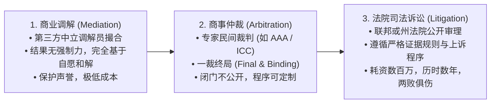
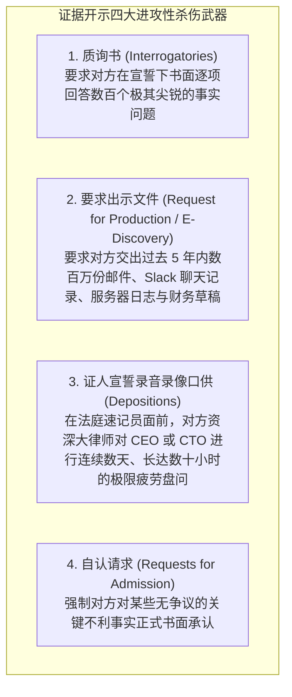
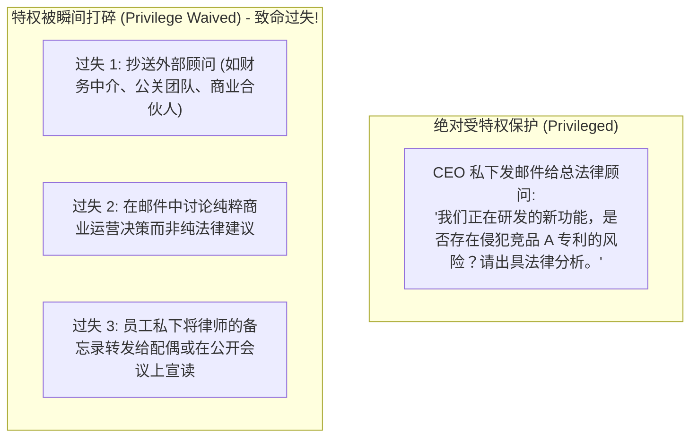

# Lec 15 商业争议解决：诉讼、仲裁与调解战略 (Business Disputes & Litigation Strategy)

> MIT Sloan 15.615 · Law for the Entrepreneur and Manager · 主讲 Dr. John Akula

## TL;DR

- 剖析商业纠纷解决三大法定通道：国家司法诉讼（Litigation）、商事仲裁（Arbitration）与中立调解（Mediation）。
- 解构美国民事诉讼最具杀伤力的环节：证据开示程序（Discovery）与电子证据检索（E-Discovery）的巨额成本。
- 严密守护商业机密的法律金钟罩：律师-委托人保密特权（Attorney-Client Privilege）及其意外丧失边界。
- 掌握强制仲裁条款（Mandatory Arbitration）与集体诉讼豁免（Class Action Waiver）的企业防御设计。

## 商业冲突的解决光谱：从协商到对抗

商业世界充满不确定性。当合同履约破裂、专利面临剽窃侵权、或者合伙人之间决裂时，企业高管必须从纯粹的商业运营逻辑，切换进入**争议解决（Dispute Resolution）的战术推演**。

商业争议的解决路径构成了一道由温和妥协走向绝对对抗的光谱：

这一争议解决光谱完整展现了商业纠纷中不同制度路径的成本与收益权衡。在激烈的商业竞争中，缺乏诉讼实务经验的年轻高管往往在发生分歧时轻率地喊出“法庭上见”，而完全没有意识到诉讼一旦启动，就如同点燃了一台吞噬资金、精力和公司声誉的碎纸机。在普通法民商事诉讼体系下，证据开示（Discovery）程序极其漫长且成本惊人，双方必须在法官监督下交出成千上万封内部未公开邮件、聊天记录与财务凭证，任何轻率的言辞都会在宣誓作证（Deposition）中被对方律师反复撕咬放大。

相比之下，具有终局裁决效力且全程不公开审理的国际商事仲裁（Arbitration），由于其保密性极高、仲裁员通常具备深厚的垂直行业商业素养，并且能够依据《纽约公约》在全球 160 多个成员国轻松获得强制执行，因而成为了跨国重大技术交易与股权合作的首选争议解决通道。而在合同中精心设置“协商-调解-仲裁”的三阶梯式争端升级条款，则是优秀法务与管理者为企业筑起的最具成本效益的冲突减压阀。

## 美国诉讼碎钞机：证据开示程序（Discovery）

在许多大陆法系国家，原告起诉必须“谁主张谁举证”，法院仅审查当事人主动提交的现有证据；而在美国民事诉讼中，一旦正式立案，案件将立即进入漫长而残忍的**证据开示程序（Pre-trial Discovery）**：

::: definition 电子证据检索（E-Discovery）的财务灾难
现代跨国诉讼中，70% 以上的法律账单发生于 E-Discovery。原告律所可以通过发出广泛的关键词检索要求（如检索包含“竞争对手”、“定价”的所有邮件），强制被告企业雇佣庞大的初级律师团队，逐封人工审阅数百万封企业内部邮件以排查保密特权。仅此一项证据开示，便足以让一家初创企业在开庭前耗尽数百万美元现金储备，被迫屈辱和解。
:::

## 律师-委托人保密特权（Attorney-Client Privilege）的生死界限

在残酷的证据开示中，企业唯一的绝对法律避难所是**律师-委托人保密特权（Attorney-Client Privilege）**：

::: theorem 保密特权的法定构成四要件
1. 沟通的主体之间存在合法的专业执业律师与委托人关系；
2. 沟通的内容是为了**寻求或提供专业的法律建议（Legal Advice）**；
3. 沟通是在高度保密的环境下私下进行的；
4. 委托人并未自愿向任何第三方披露该内容。
:::

只要属于特权通信，法官绝对无权强迫企业交出该往来邮件，对方律师连看一眼的资格都没有。

::: pitfall “抄送法务（CC Legal）”的花招伪装
很多高管在讨论敏感商业定价或裁员阴谋的内部邮件最后，习惯性地抄送一下公司法务人员，以为这样就能给邮件贴上“特权标签”。美国联邦法官对此类伎俩极其严厉：**如果一封邮件的实质内容是关于商业营销、产品定价或财务测算的商业沟通，单纯抄送法务绝不享有特权！** 检方和对方律师不仅能强制调取该邮件，法官更可能因当事人试图欺瞒法庭而施以严厉制裁。
:::

## 商事仲裁条款（Arbitration Clause）的战略设计

为了避开失控的陪审团民粹裁判与巨额公开诉讼对企业声誉的毁灭，现代商业合同（无论是 B2B 供应链协议，还是面向终端消费者的服务协议）几乎普遍嵌入了**强制约束性商事仲裁条款（Mandatory Binding Arbitration）**：

| 争议解决维度 | 法院司法诉讼（Litigation） | 商事仲裁（Arbitration） |
| :--- | :--- | :--- |
| **审理公开性** | 绝对公开，判决书任何人可在网上查阅，极易引发公关危机 | **绝对闭门保密（Confidential）**，商业机密与纠纷细节永不对外流传 |
| **裁判者专业性** | 随机分派法官，陪审团多由缺乏商业常识的普通平民组成 | **双方共同指定业内资深商事仲裁员**（如资深科技律师或退休法官）|
| **程序耗时** | 漫长拖沓（通常 2–4 年，面临多级上诉折磨） | **高效迅捷（通常 6–12 个月审结）** |
| **终局性** | 允许多次上诉与再审 | **一裁终局**（除极其罕见的腐败外，法庭绝对不接受实体错误上诉）|

::: definition 集体诉讼豁免（Class Action Waiver）的商业盾牌
在面向数亿消费者的互联网平台条款（如 Uber、Amazon、Apple 服务条款）中，仲裁条款必定深度绑定**集体诉讼豁免协议**。它强制要求：任何消费者若发生争议，必须且只能**以个人名义逐一提起独立个案仲裁**，严禁串联发起动辄索赔数十亿美元的消费者集体诉讼。这一法律机制从制度上直接瓦解了原告风险代理律所针对巨头的系统性勒索模式。
:::

::: insight 诉讼不是正义的竞技，而是资本的消耗战
企业高管必须从古典法治浪漫主义中彻底清醒过来：**商业诉讼从来不是关于“谁是正义的”，而是关于“谁的现金流与心理承受力能支撑到最后一刻”**。卓越的高管在争议爆发之初，就懂得从博弈论和期望收益净现值（NPV）的视角审视纠纷：精确测算律师费账单、管理层注意力被分散的沉没机会成本、以及商业声誉折损。在手握致命证据形成最大威慑力的黄金瞬间，果断推动商业和解，才是保护股东价值的最理性法学智慧。
:::
