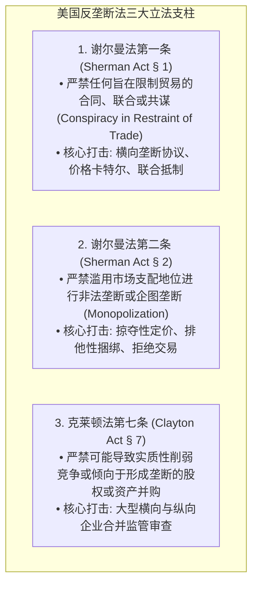
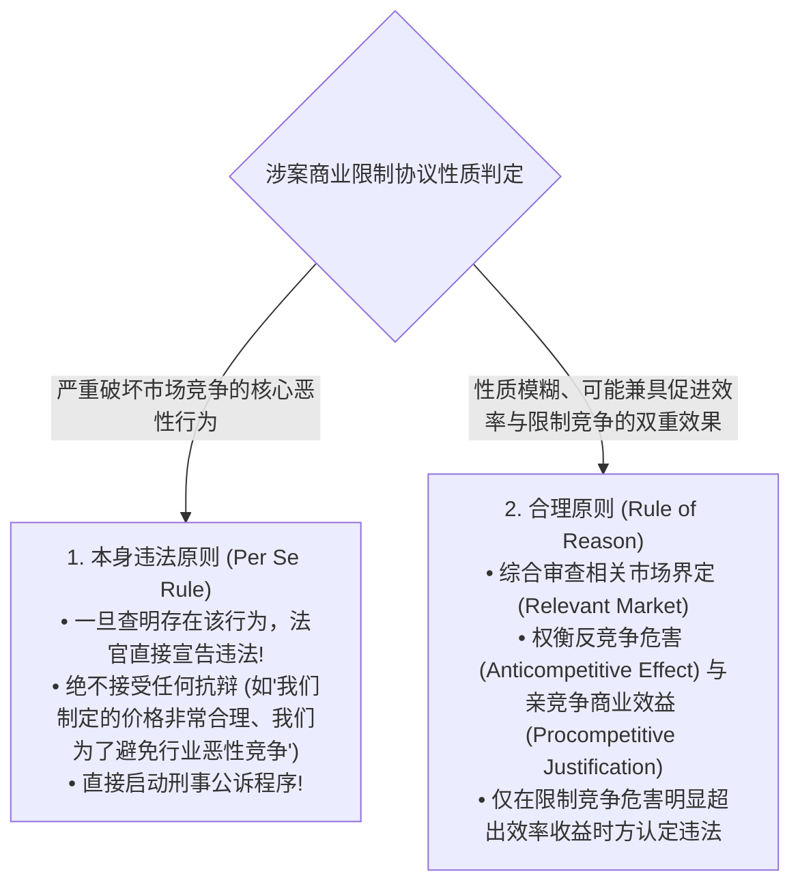
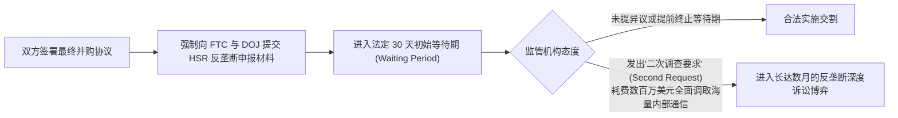

# Lec 16 反垄断法与不正当竞争红线 (Antitrust Law & Unfair Competition)
> MIT Sloan 15.615 · Law for the Entrepreneur and Manager · 主讲 Dr. John Akula

## TL;DR

- 掌握美国反垄断法双子塔：谢尔曼法第一条（反垄断共谋）与第二条（非法垄断化）。
- 厘清本身违法原则（Per Se Illegality）：横向价格卡特尔、串通投标与市场划分的绝对刑法红线。
- 剖析合理原则（Rule of Reason）在纵向商业限制中的反竞争效益与抗辩逻辑。
- 掌握哈特-斯科特-罗迪诺法案（HSR Act）的并购事前反垄断审查申报申报门槛。

## 竞争的宪法：为什么反垄断法长着獠牙

在美国法律传统中，反垄断法被最高法院誉为“自由企业制度的大宪章（The Magna Charta of Free Enterprise）”。它保护的不是单个具体竞争对手的利益，而是**整个市场充满活力的竞争机制本身（Competition, not competitors）**。

与一般的商业违规不同，违反反垄断法将直接触发美国司法部（DOJ）反垄断局与联邦贸易委员会（FTC）的联合打击，不仅面临数亿美元的法人罚金，企业高管更将直接被剥夺人身自由判处数年联邦监狱监禁！

反垄断法（Antitrust Law）被称为资本主义自由市场的“经济宪法”，其根本宗旨在于维护竞争机制本身的活力，而非保护个别低效的竞争对手。许多成长中的商业管理者误以为反垄断只是微软、谷歌、亚马逊等万亿级巨头才会面临的烦恼，这种误解在商业实践中往往招致毁灭性的打击。以《谢尔曼法》第 1 条规制的横向垄断协议为例，哪怕是几家年营业额仅有数百万美元的中小企业，只要企业高管在行业展会、高尔夫球场或微信群中非正式地就“统一下季度产品提价幅度”或“彼此划分销售省份互不抢单”达成默契，便直接构成无可辩驳的违法行为（Per Se Illegal）。

在反垄断执法的重锤下，这类横向卡特尔垄断不接受任何“为了避免恶性竞争促进产业发展”的合理商业借口抗辩，而且直接属于联邦刑事重罪！涉案的高管与销售总监不仅将面临个人数百万美元的刑事罚金，还将面临最高长达 10 年的联邦监禁。更致命的是，在后续由下游受害者发起的反垄断民事诉讼中，原告依法享有“三倍惩罚性赔偿（Treble Damages）”特权，足以让一家蒸蒸日上的成长型企业在瞬间陷入破产深渊。敬畏竞争红线，是每一位雄心勃勃的管理者必须时刻紧绷的神经之弦。

## 本身违法原则 vs. 合理原则

在审查商业协议是否违法时，法院推行了两套截然不同的审判显微镜：

### 绝对不可试探的四大“本身违法”死刑罪名

1. **横向固定价格（Horizontal Price-Fixing）**：同行竞争对手之间通过任何口头承诺、晚餐密谈或邮件暗示，就商品售价、折扣幅度或定价公式达成默契协调；
2. **横向市场或客户划分（Market Allocation）**：竞争对手之间瓜分地盘（如“你负责长江以北，我负责长江以南，谁也不碰谁的客户”）；
3. **串通招投标（Bid-Rigging）**：在政府或大型企业招投标中私下串通轮流坐庄、陪标抬价；
4. **联合拒绝交易 / 联合抵制（Group Boycotts）**：同业巨头联合向供应商或客户施压，要求其不得与某个新兴挑战者开展业务。

::: example 液晶面板与汽车零部件高管的跨国牢狱之灾
在著名的全球 LCD 液晶面板价格操纵案中，三星、LG、友达光电等巨头的高管定期在五星级酒店举办秘密的“水晶会议”，口头协商下一季度向戴尔、惠普供货的最低出厂底价。美国司法部动用窃听与突击搜查手段彻底锁死证据。最终，涉案企业被处以逾数十亿美元刑事罚金，**数十位跨国企业高级副总裁被引渡至美国，在联邦监狱服刑 12 至 36 个月**。
:::

## 垄断与垄断化：巨头的合法性边界

拥有 90% 的市场份额本身违法吗？**不违法！**

法律惩罚的不是“成功本身”。如果一家企业完全凭借卓越的产品研发、非凡的商业远见或历史偶然（Historic Accident），在市场上自然获得了 99% 的支配地位，这是市场经济对其技术创新的最高奖赏。

::: definition 构成谢尔曼法第二条“非法垄断罪”的两大要件
1. **拥有相关市场的真实垄断力（Monopoly Power in Relevant Market）**：通常要求在经过严密界定的产品市场与地理市场中，占据持续稳定的 70% 以上份额，且存在极高的行业进入壁垒；
2. **故意采取了非法的反竞争排他手段（Willful Acquisition or Maintenance of that Power）**：企业并非依靠更好的产品取胜，而是滥用支配力，通过**掠夺性定价（Predatory Pricing，以低于自身平均可变成本的价格倾销以掐死新进入者）**、**技术性排他捆绑（Tying）**或**封杀关键必要基础设施（Essential Facilities）**，扼杀竞争对手。
:::

## 交易合并审查：哈特-斯科特-罗迪诺法案（HSR Act）

根据《哈特-斯科特-罗迪诺反托拉斯改进法》（HSR Act），大型企业并购在正式交割前，绝不是双方签字打款就能了事的。

凡是达到特定法定规模门槛的交易（以交易总对价与交易双方资产/营业额为指标，门槛每年根据 GDP 动态调整，通常交易金额超过约 1.1 亿美元即触发）：

::: pitfall 违规“抢先交割（Gun-Jumping）”的巨额按日罚款
在 HSR 法定等待期届满前，收购方往往急于介入被收购方的日常运营，例如提前派驻高管接管销售团队、要求被收购方重大定价先向自己审批、或者提前共享核心敏感客户名单。在反垄断法中，这属于严重的**抢先交割（Gun-Jumping）违法行为**！司法部对此推行**按日计罚（每日罚金高达数万美元）**，曾对数家违规提前整合的跨国企业开出数千万美元的巨额行政罚单。
:::

::: insight 反垄断红线要求高管戒除“同行小圈子”傲慢
许多高管在行业协会年会或产业论坛的高尔夫球场上，习惯与同行业老朋友私下抱怨“最近价格杀得太惨了，咱们大家各退一步稳住利润吧”。这种自以为心照不宣的“高情商聊天”，在反垄断检察官的录音笔下就是铁证如山的刑事重罪共谋。真正的现代商业领袖必须建立绝对的法律警觉：永远在公开市场凭产品与效率展开光明正大的较量，彻底割席任何形式的私下价格默契。
:::
