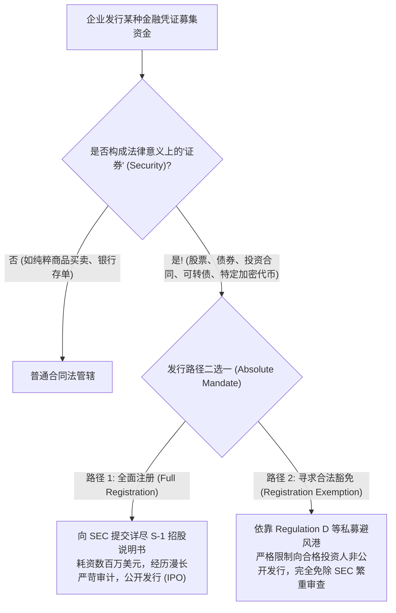
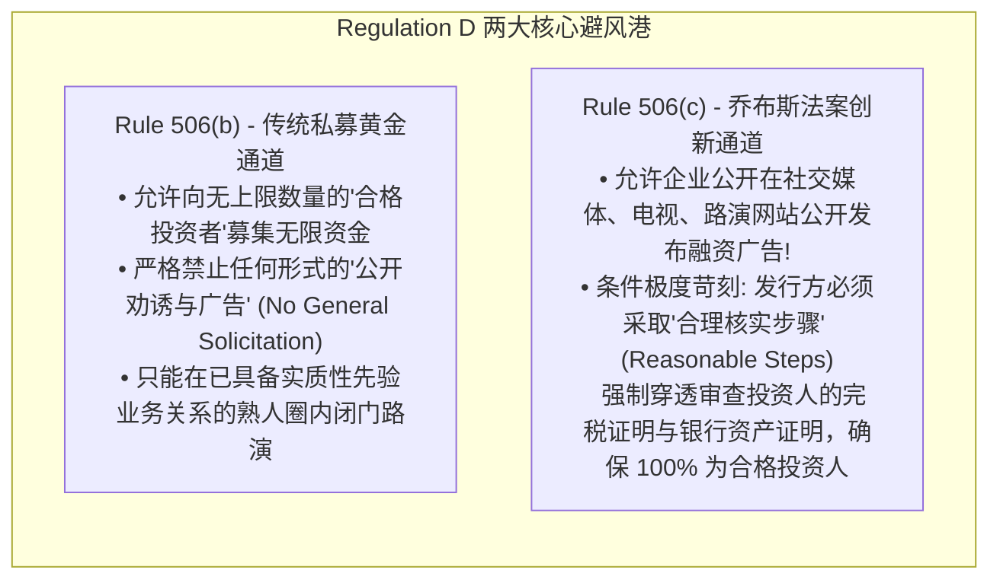

# Lec 17 企业上市合规与证券法注册豁免 (Going Public: Securities Act & Registration Exemptions)
> MIT Sloan 15.615 · Law for the Entrepreneur and Manager · 主讲 Dr. John Akula

## TL;DR

- 掌握现代证券监管的基石法则：1933 年《证券法》的“全面注册与充分披露”哲学。
- 剖析美国最高法院传世判例 *SEC v. W.J. Howey Co.* 确立的“证券四要件测试”（Howey Test）。
- 解构初创企业私募融资的法定避风港：Regulation D、Rule 506(b) 与合格投资者（Accredited Investors）。
- 厘清首次公开发行（IPO）的核心流程、S-1 招股书起草责任与静默期（Quiet Period）监管红线。

## 证券监管的起源：对“卖蓝天骗局”的终结

在 1929 年华尔街大崩盘之前的自由放任时代，资本市场充斥着肆无忌惮的虚假宣传。投机分子可以随意成立一家空壳公司，向无知的公众兜售所谓“在远方开采金矿”的股票，当时堪萨斯州法官愤慨地斥责这些骗子“连天上的蓝天（Blue Sky）都敢按平方尺打包切块卖给老百姓”，著名的**蓝天法（Blue Sky Laws）**由此得名。

1929 年大萧条爆发后，罗斯福新政出台了奠定现代全球金融监管框架的两大基石：
1. **1933 年《证券法》（Securities Act of 1933）**：管辖证券的“首次发行与销售”，确立了“未经向 SEC 注册或取得合法豁免，任何人不得向公众发售任何证券”的绝对禁令；
2. **1934 年《证券交易法》（Securities Exchange Act of 1934）**：设立证券交易委员会（SEC），管辖证券在二级市场的持续交易与信息披露。

## 什么是“证券”？豪威测试（The Howey Test）

很多互联网创业者或 Web3 极客经常辩称：“我们发行的不是股票，我们发行的是平台积分、会员权益或者加密治理代币，因此不受证券法管辖。”

美国最高法院在 *SEC v. W.J. Howey Co.* (1946) 案中彻底粉碎了这种咬文嚼字的文字游戏。Howey 公司在佛罗里达州拥有大片柑橘林，它将果园土地细分成极小的单元卖给外地游客，同时与游客签订一份服务合同，由 Howey 公司全权负责种植、采摘、榨汁并销售柑橘，利润按投资额向买家分红。

最高法院确立了穿透一切形式外壳的**豪威测试（Howey Test）**：

::: theorem 投资合同与证券判定四要件 (The Howey Test)
一项交易无论被包装成何种名称或合同形式，只要同时满足以下四项经济实质要件，在法律上即自动构成“证券（Investment Contract / Security）”：
1. **金钱投资（An investment of money）**：投资者付出了法定货币、实物资产或加密资产；
2. **共同事业（In a common enterprise）**：投资者的资金汇聚在一起，投资者的财富与发起人或全体投资人的整体命运休戚与共（Horizontal or Vertical Commonality）；
3. **合理的利润期待（With an expectation of profits）**：投资者掏钱的核心动机是为了获取资本增值或现金分红，而非为了自己买回去消费使用；
4. **利润完全来源于他人的努力（Derived solely from the efforts of others）**：投资人自身作为被动的甩手掌柜，收益完全取决于项目发起人、企业管理团队的经营与运作。
:::

按照这一测试，无论是柑橘园合同、名表分割理财计划、还是现代加密资产中的 ICO 代币，一律被 SEC 认定为法定证券！

## 初创企业融资的避风港：Regulation D 规则

99% 的初创企业在上市之前，根本没有财力向 SEC 提交数百页的注册文件。初创企业之所以能合法完成数轮融资，完全依托于 SEC 设立的**私募发行豁免规则（Regulation D）**：

::: definition 什么是“合格投资者”（Accredited Investor）？
法律假设合格投资者具备充分的财务成熟度与风险承受力，无需联邦保姆式的全额招股书保护。满足下列标准之一的自然人即为合格投资者：
- 个人过去两年年收入连续超过 **20 万美元**（或夫妻双方合并年收入超过 **30 万美元**），且合理预期本年度将维持该收入水平；
- 个人或夫妻合并净资产超过 **100 万美元**（**必须严格扣除主要自住居所的房产净值**）；
- 持有特定专业金融证券从业牌照（如 Series 7, 65, 82）。
:::

## 迈向 IPO：S-1 招股书与静默期（Quiet Period）

当企业决定通过公开发行（IPO）挂牌纽交所或纳斯达克时，整个组织将进入最高级别的合规战备状态：

1. **S-1 招股说明书起草**：由顶尖投行、审计师与律所耗时数月共同编制。根据 1933 年《证券法》第 11 条，**招股书中如果存在任何关于重大事实的虚假记载（Misstatement）或重大遗漏（Omission），所有在招股书签名的董事、高管、以及出具审计意见的会计师事务所，承担几乎无法抗辩的连带民事赔偿责任**！
2. **静默期（Quiet Period）与跑风漏气禁令**：在向 SEC 递交 S-1 表格直至正式挂牌期间，公司高管严禁接受财经媒体采访、严禁公开发表对未来营收的激进预测，防止被认定为未批先宣的非法营销（Gun-jumping）。

::: pitfall 盲目进行公开集资引发的“买方退款撤单权（Rescission Rights）”
很多早期创业者在网站上发布众筹链接或在朋友圈公开喊话“公司出让 10% 股份融资 200 万元”。这种行为直接击碎了 Rule 506(b) 的非公开庇护，构成了未注册公开发行证券的严重违法行为！根据证券法第 12 条，**所有受害投资人享有法定无条件退款撤单权（Rescission Rights）**——一旦未来公司经营困难，任何投资人都有权随时要求公司连同法定利息全额退还初始投资款，足以将初创企业瞬间推向破产深渊。
:::

::: insight 证券合规是商业信用的终极背书
现代资本市场最神奇的魔力，在于能将成千上万互不相识的陌生公众的微小储蓄，汇聚成数十亿美元的巨型资金池去支撑前沿科技的伟大探索。这种奇迹得以发生的唯一基石，就是证券法建立起的“彻底信息披露（Full Disclosure）”契约。对于企业家而言，敬畏证券法、坚守不欺瞒公众投资人的诚实底线，是商业生命走得长远的根本根基。
:::
