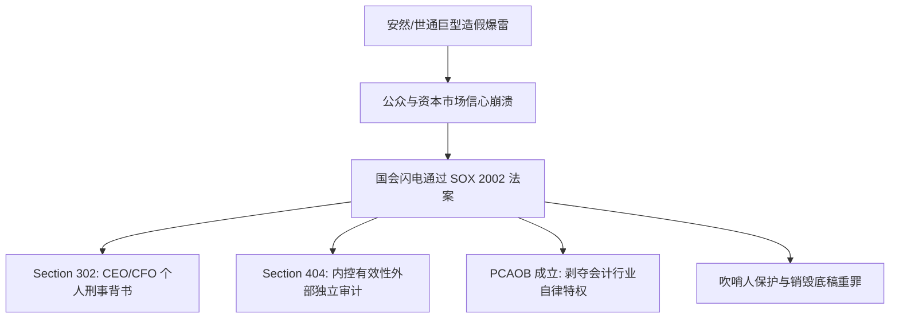
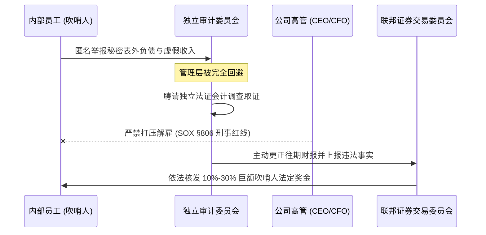

# Lec 18 上市公司合规运作与萨班斯法案 (Public Company Governance & SOX)

> MIT Sloan 15.615 · Law for the Entrepreneur and Manager · 主讲 Dr. John Akula

## TL;DR

- 2002 年萨班斯-奥克斯利法案（SOX）彻底颠覆了美国资本市场的自律神话，将公司合规上升为严苛的刑事法律防线。
- Section 302 确立 CEO 与 CFO 对财报真实性签署个人连带保证书制度，伪证可判处最高 20 年监禁与巨额刑事罚款。
- Section 404 要求建立并外部审计严密的财务报告内部控制体系（ICFR），成为高成长型企业最沉重的合规成本项。
- 强制要求设立完全由独立董事构成的审计委员会（Audit Committee），并引入全天候吹哨人（Whistleblower）法定免报复保护机制。

## SOX 法案的诞生背景：安然与世通的毁灭之路

在 2000 年代初之前，美国公众上市公司很大程度上仰赖行业自律、外部独立会计师事务所的信誉背书以及董事会的松散监督。然而，2001 至 2002 年接连爆发的**安然（Enron）**与**世界通信（WorldCom）**巨型财务舞弊案，使全球投资人蒸发了数千亿美元资产：

- **安然事件**：管理层通过设立成千上万个表外特殊目的实体（SPE），将巨额负债从资产负债表剥离，虚增收入，而外部审计机构安达信（Arthur Andersen）不仅未予揭露，反而在 SEC 介入调查前夜大规模销毁审计底稿文件；
- **世界通信事件**：管理层明目张胆地将数十亿美元日常经营网络线路成本（Operating Expenses）资本化为固定资产投入（Capital Expenditures），创造虚假账面盈利。

针对空前的资本信任危机，美国国会以雷霆手段通过了《2002 年萨班斯-奥克斯利法案》（Sarbanes-Oxley Act of 2002，简称 **SOX 法案**）。

## Section 302：高管个人签字与刑事背书

在 SOX 法案之前，当财报被查出财务造假时，CEO 与 CFO 经常以“自己不懂复杂会计细节，完全信赖下属和审计师”为由脱罪。SOX 第 302 条彻底封死了这扇逃避之门：

::: definition Section 302 个人签署认证制度
上市公司提交给 SEC 的每份季度报告（10-Q）与年度报告（10-K），**首席执行官（CEO）与首席财务官（CFO）必须在报告尾部亲自签署法定陈述文件**，书面证明：
1. 自己已亲自审阅了该份报告；
2. 依据其个人所知，该报告**不存在任何关于重大事实的虚假陈述或重大遗漏**；
3. 财务报表在所有重大方面均公允反映了公司的财务状况与经营成果；
4. 签字高管亲自负责设计、建立并定期评估公司的信息披露控制系统（Disclosure Controls and Procedures）。
:::

配合法案第 906 条的严酷刑法修正案：
- **明知造假而签字（Knowingly violates）**：最高可处 **100 万美元罚款及 10 年监禁**；
- **故意欺诈而签字（Willfully violates）**：最高可处 **500 万美元罚款及 20 年监禁**。

这使得“无知”不再构成法庭辩护的抗辩事由，倒逼高管必须建立渗透到公司基层业务的披露审计穿透体系。

## Section 404：财务报告内部控制体系（ICFR）

SOX 法案争议最大、实施成本最高昂的条款是第 404 条（Section 404）。

| 维度 | Section 404(a) | Section 404(b) |
| :--- | :--- | :--- |
| **执行主体** | 公司管理层（Management） | 独立外部注册会计师（External Auditor） |
| **法定义务** | 建立、维持并评估财务报告内部控制体系（ICFR）的健全性与有效性 | 对管理层的内控评估结论进行独立审查，并出具专项内控审计报告 |
| **审计重点** | 梳理每一笔交易从发起、审批、入账到入表的端到端控制节点（IT系统、权限分离） | 抽样穿行测试关键风控节点，检验防范财务舞弊的实际运行效果 |
| **成本影响** | 耗费内部 IT 与财务大量人工编写流程 SOP | 每年向安永、德勤、普华永道、毕马威支付巨额附加审计费（可达数百万美元） |

::: pitfall “权限分离（Segregation of Duties）”的内控硬伤
在创业公司早期，出纳常常同时兼任会计，或者单一管理人员拥有 ERP 系统后台的任意调账权限。这种做法在 IPO 阶段面临 Section 404 审查时将被判定为**重大缺陷（Material Weakness）**，直接导致外部会计师无法出具无保留意见内控报告，迫使 IPO 进程延误半年以上。
:::

## 独立审计委员会与全流程吹哨人制度

为彻底打破管理层与外部审计师之间的“利益同盟”，SOX 法案重塑了上市公司治理结构：

1. **完全独立的审计委员会（Audit Committee）**：
   - 外部独立会计师事务所的聘用、薪酬、解雇与日常监督权力，**直接划归董事会下设的审计委员会，严禁由 CEO、CFO 或管理层插手**；
   - 审计委员会成员必须全员为独立董事，不得从公司领取除董事津贴之外的任何咨询顾问报酬；
   - 委员会中至少包含一名具有资深会计师或上市公司财务总监背景的“财务专家（Financial Expert）”。
2. **法定吹哨人保护机制（Whistleblower Protection, Section 806）**：
   - 上市公司必须建立匿名举报通道，允许员工直接向审计委员会绕过管理层反映可疑财务舞弊行为；
   - 任何针对吹哨人实施降薪、降职、调岗、解雇或职场霸凌的行为均属联邦违法；吹哨人不仅享有复职与双倍补发工资救济，向 SEC 举报确证违法事实的，还能从执法罚金中分得 **10% 至 30% 的巨额赏金**。

## JOBS 法案的松绑：新兴成长型公司（EGC）

由于 SOX 404(b) 带来的天价合规审计负担，许多中小高科技企业对赴美 IPO 望而却步。为此，美国国会于 2012 年通过了《促进创业企业融资法案》（JOBS Act），设立了**新兴成长型公司（Emerging Growth Company, EGC）**制度：
- 年营业收入低于 12.35 亿美元的成长型初创企业；
- 在上市后最长 5 年的过渡期内，**全面豁免执行 SOX 404(b) 外部审计师内控鉴证要求**；
- 允许以秘密草案形式向 SEC 提交 S-1 注册文件，大幅降低了科技初创公司走向公开市场的门槛。

::: insight 合规成本是优秀企业构建的信任护城河
很多创业者将 SOX 等合规框架视为官僚主义的繁文缛节与金钱浪费。然而，现代金融资本之所以愿意以 20 倍甚至 50 倍市盈率将巨额资金托付给一家公众公司，其底气完全建立在信息真实与内控可信的法治秩序之上。将规范内控视为企业的神经中枢而非外在枷锁，是企业家完成从“游击创业者”向“商业领袖”跃升的关键分水岭。
:::
