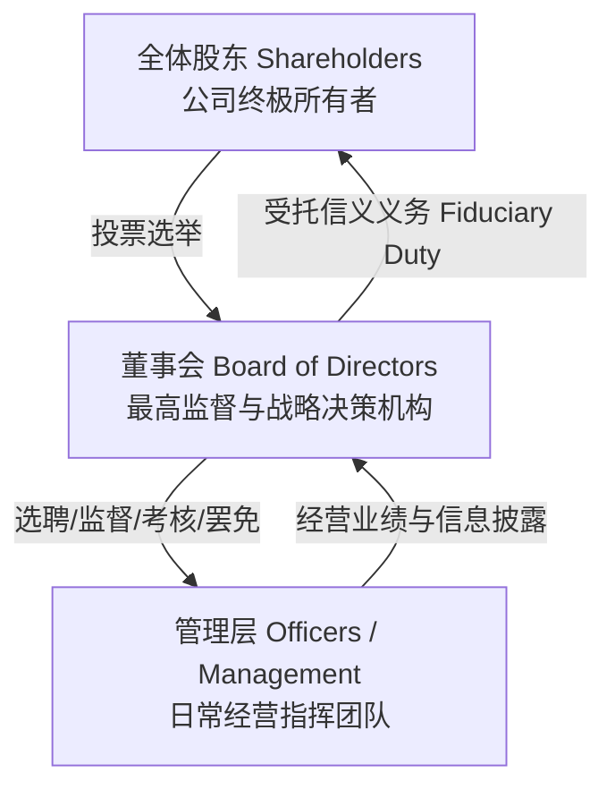
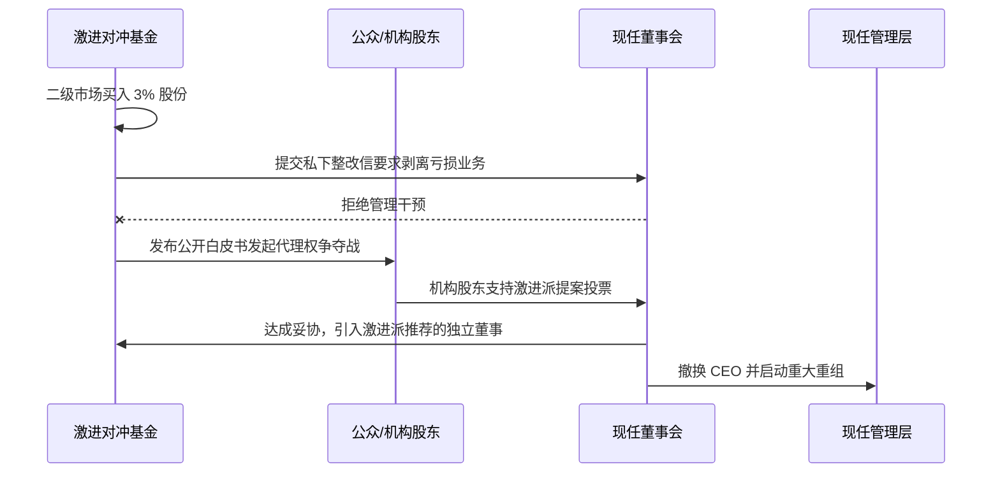

# Lec 19 公司治理与董事会权责架构 (Corporate Governance & Board Architecture)

> MIT Sloan 15.615 · Law for the Entrepreneur and Manager · 主讲 Dr. John Akula

## TL;DR

- 现代公司治理的核心命题是解决两权分离下的代理人问题（Agency Problem），理顺股东、董事会与高级管理层的三角权力制衡。
- 董事会的核心职责是“监督（Oversight）”而非“经营（Management）”，聚焦聘任/评估 CEO、重大战略决策与合规内控把关。
- 董事会下设三大核心法定委员会（审计、薪酬、提名与治理），必须满足独立董事过半或全员独立的合规要求。
- 双重股权结构（Dual-Class Shares）成为科技独角兽创始人巩固控制权的标准配置，但正面临机构股东与激进投资人的日益严苛审视。

## 公司权力的三角架构：两权分离与代理成本

自伯利和米恩斯（Berle & Means）在 1932 年提出“所有权与控制权分离”理论以来，公司治理（Corporate Governance）的永恒命题就是如何防范掌握控制权的高管团队损害外部所有者（股东）的利益：

在法律上，股东是公司的所有者（Owners），但并不直接享有公司资产的处分权或日常经营权；股东行使权力的法定途径是：
1. **选举和更换董事会成员**；
2. **就公司章程修改、合并分立、重大资产出售等基础宪则事项进行投票**；
3. **针对高管薪酬进行咨询性表决（Say-on-Pay）**。

## 董事会的核心权责：监督还是插手？

很多创业者转型的董事容易混淆“监督（Oversight）”与“微观管理（Micromanagement）”的边界：

::: definition 董事会的法定职责清单
根据特拉华州公司法（DGCL § 141(a)），公司的业务和事务应由董事会管理或在其监督下管理。董事会的核心职责聚焦于：
1. **选聘、考核、决定薪酬及必要时撤换首席执行官（CEO）**；
2. **审查并批准公司的长期战略规划与重大资本分配（M&A、发债、增发）**；
3. **监督全公司范围的风险管理与合规控制体系（Caremark 监督义务）**；
4. **确保对外财务报告与信息披露的真实公允**。
:::

董事不得直接发号施令插手日常运营、替代部门主管做具体招聘，否则既破坏管理层的指挥链条，又可能使自身丧失独立监督地位。

## 董事会的三大核心委员会

成熟企业及公众公司的董事会绝大部分实质性工作在专业委员会中开展：

| 委员会名称 | 成员构成要求 | 核心职能与审批边界 |
| :--- | :--- | :--- |
| **审计委员会 (Audit Committee)** | 100% 独立董事，且至少 1 名财务专家 | 聘用与考核外部独立审计机构；监督财务报告质量；评估内部控制（ICFR）；受理吹哨人举报 |
| **薪酬委员会 (Compensation Committee)** | 100% 独立董事 | 制定 CEO 与核心高管的薪酬包（基本薪资、年终奖、期权股权激励）；设定业绩考核挂钩指标；防止高管自定天价薪酬 |
| **提名与公司治理委员会 (Nominating & Governance)** | 绝大多数或全员独立董事 | 遴选与推荐新董事候选人；规划高管接班人梯队；制定公司治理准则与董事会自我评估流程 |

::: pitfall “亲友团”董事会的灾难性隐患
很多早期创始人为了省事，拉自己的配偶、父母或大学死党进入董事会。当公司完成 A/B 轮融资时，这种非正规架构将面临投资人的强制清洗。更危险的是，当公司面临危机或诉讼时，非独立董事针对创始人利益输送的表决无法享受“商业判断法则”保护，董事个人将被法院直接判定承担连带赔偿责任。
:::

## 代理投票制与股东激进主义（Shareholder Activism）

随着先锋领航（Vanguard）、贝莱德（BlackRock）、道富（State Street）等超级机构投资者的崛起，以及华尔街激进对冲基金（如 Elliott Management, Icahn Enterprises）的活跃，上市公司董事会面临前所未有的外部问责压力：

1. **代理权争夺（Proxy Contest）**：激进投资人仅买入公司 1%-5% 的股份，通过公开发布白皮书抨击管理层无能、资本分配低效，并在年度股东大会上发起代理投票呼吁全体股东改选董事席位；
2. **股东提案权（Rule 14a-8）**：持有法定最低市值股份的股东，有权要求公司将关于 ESG、高管薪酬封顶、拆分非核心业务的提案直接印在官方代理投票委托书（Proxy Statement）上提交全员表决。

## 独角兽的防御法宝：双重股权结构（Dual-Class Shares）

为了抵御外部华尔街短期资本的骚扰，保持创始团队对企业长期科技研发的绝对掌控力，以谷歌、Facebook、阿里巴巴为代表的科技巨头广泛采用双重股权结构：

::: definition 双重股权结构运作机制
- **Class A 普通股**：向公众公开发售，**每股享有 1 票表决权**；
- **Class B 特别投票权股**：仅由创始人及核心合伙人持有，**每股享有 10 票至 20 票甚至更高表决权**；
- 转换与日落机制（Sunset Provisions）：Class B 股票一旦发生继承、转让或创始人离职/身故，通常会自动 1:1 降级转换为 Class A 普通股。
:::

| 维度 | 赞成方主张（创始人视角） | 反对方批评（机构投资者视角） |
| :--- | :--- | :--- |
| **长期研发投入** | 允许管理层不顾短期季度财报波动，坚定执行耗时数年的前沿技术重资本投入 | 缺乏外部监督与罢免威胁，极易滋生管理层自大自满与帝国建造行为 |
| **防御恶意收购** | 彻底粉碎华尔街“野蛮人”通过杠杆收购强行拆解公司的企图 | 违反“一股一权（One Share, One Vote）”的资本民主基本正义 |
| **治理风险** | 保护创始人独特的远见与商业直觉（Founder's Premium） | 一旦创始人决策失误（如激进元宇宙投资），股东毫无制衡与止损工具 |

::: insight 治理不是限制自由，而是为长期航行构筑压舱石
年轻创业者往往把董事会看作挑刺的婆婆，总想通过股权设计完全架空董事会。然而，无数商业案例证明：没有刹车系统的跑车开得越快，车毁人亡的概率越高。一个由具备深厚产业洞察、严谨财务法务素养与客观独立立场的董事组成的董事会，是企业渡过资本寒冬、抵御合规风暴最宝贵的智囊团与防护网。
:::
