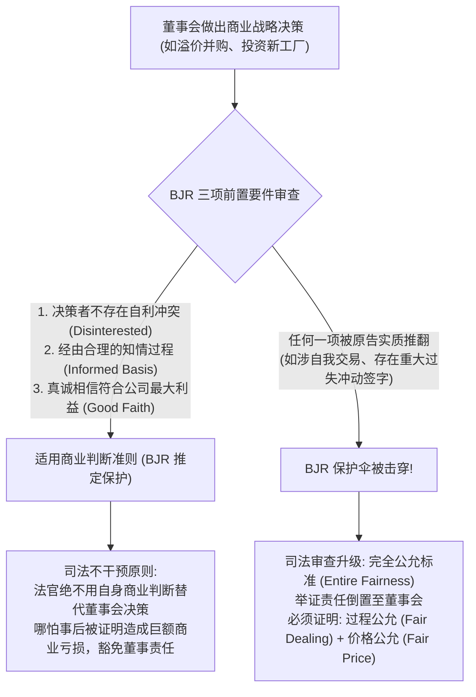
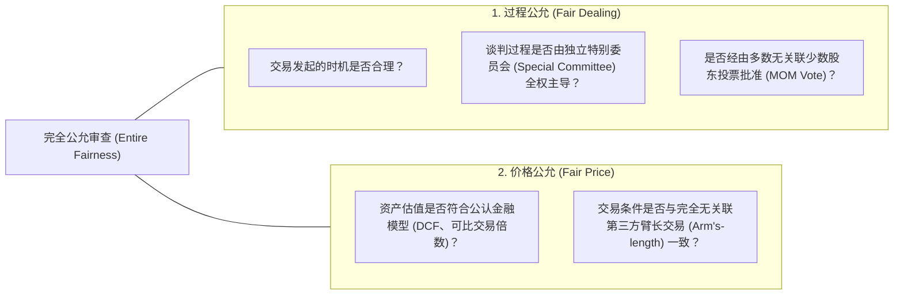

# Lec 2 商业判断准则与利益冲突治理 (The Law of Duties II: Business Judgment Rule & Conflicts)

> MIT Sloan 15.615 · Law for the Entrepreneur and Manager · 主讲 Dr. John Akula

## TL;DR

- 商业判断准则（Business Judgment Rule, BJR）是保护董事和高管承担商业风险的司法避风港。
- 确立 BJR 司法推定的前置门槛：无利益冲突、充分知情（Informed）且出于真诚善意（Good Faith）。
- 剖析特拉华州公司法里程碑案例 *Smith v. Van Gorkom*，量化过程尽职调查不足导致的重大过失责任。
- 掌握当 BJR 保护伞被打破时，司法审查切换至“完全公允标准”（Entire Fairness）的严苛证明逻辑。

## 商业风险与司法审查的边界

商业投资的本质是拥抱不确定性。如果法官允许不满意的股东在每次新产品失败或股价下跌后，利用后见之明（Hindsight Bias）随意起诉董事会并判定高管赔偿损失，那么全天下将没有任何理性的商业精英愿意担任公司高管，整个资本市场的风险创新活力将彻底窒息。

为了给企业家的冒险决策提供合法的安全屏障，特拉华州法院确立了公司法最著名的基石学说——**商业判断准则（Business Judgment Rule, BJR）**。

这一分析矩阵深刻揭示了现代公司治理的制度妥协：商业世界充满高度不确定性，没有任何一位卓越的商业领袖可以打包票所有前瞻性投资都能百分之百取得回报。如果司法系统以“事后诸葛亮（Hindsight Bias）”的姿态，依据最终的亏损结果去倒推惩罚决策者的商业误判，其必然结果是导致全社会职业经理人陷入风险厌恶的官僚僵局，创新与风险投资机制将彻底瘫痪。

因此，“商业判断准则（BJR）”构成了资本市场最重要的创新保护伞。法院对商业决策的实质合理性（Substantive Reasonableness）保持高度谦抑与敬畏，转而将全部审查重心置于“程序合规性（Procedural Integrity）”之上：决策团队是否事先展开了详尽的市场调研？是否聘请了独立的财务与法律顾问出具专业意见？决策程序中是否存在未予回避的重大利益冲突？只要程序无瑕疵、动机真诚，商业亏损的代价就属于股东自甘风险的范畴，法律绝不越俎代庖。

## 击碎 BJR 幻想的警钟：*Smith v. Van Gorkom* (1985)

在 1985 年特拉华州最高法院审理的 *Smith v. Van Gorkom* 案之前，许多上市公司董事会认为只要自己没有贪污腐败，注意义务的追责就只是纸上谈兵。本案彻底粉碎了这一幻觉。

Trans Union 公司的董事长兼 CEO Jerome Van Gorkom 临近退休，在未聘请投行进行正规估值分析的情况下，私下与著名企业并购家 Jay Pritzker 会面，并草率提出了以每股 55 美元（当时市场交易价格约为 38 美元，溢价近 45%）将公司整体出售的方案。

在随后的董事会上：
- 会议仅持续了短短 2 小时；
- 董事会成员在开会前没有收到任何书面合并协议草案或财务模型；
- Van Gorkom 仅做了 20 分钟口头陈述，投行顾问当场表示未准备公正性意见书（Fairness Opinion）；
- 外部董事大部分是全美极具声望的商界领袖，他们仅凭每股 55 美元的高溢价表面诱惑，便全票表决批准了该笔数十亿美元的合并案。

特拉华州最高法院做出了震动全美华尔街的裁决：

::: theorem 审慎知情过程的法定底线
法院判定 Trans Union 全体董事在批准合并时构成了**重大过失（Gross Negligence）**！
1. 巨额溢价绝不能替代审慎调查；董事会连协议文本都没有逐条审阅就草率签字，属于程序性失职；
2. 董事会缺乏对公司内在清算价值与分拆价值的严密估值支撑；
3. 全体董事必须对股东因此遭受的差额损失承担连带赔偿责任（最终通过保险与和解金赔偿了 2,350 万美元）。
:::

## 利益冲突下的司法升级：完全公允标准（Entire Fairness）

一旦原告股东证明某项交易存在利益关联（例如控股股东私下将自己的不动产高价卖给上市公司，或者董事在交易对手方持有巨额期权），商业判断准则立即可被推翻。

此时，举证责任（Burden of Proof）将发生根本性倒置：不再由股东证明董事有错，而是**由涉事董事会必须自证交易达到“完全公允”（Entire Fairness）**：

::: pitfall 迷信“高管责任保险（D&O Insurance）万能论”
很多高管误以为“反正公司买了昂贵的 D&O 董事高管责任险，出了事保险公司赔”。实际上，所有 D&O 保险保单均明确将“故意违法行为、恶意违背忠实义务、非法获取个人私利”列为绝对免责条款。如果法院认定高管存在故意利益输送或恶意欺瞒，保险公司将拒绝支付哪怕一分钱赔偿，高管需以个人全额家庭财产承担无限连带赔偿责任。
:::

::: insight 程序的正义就是实体的盾牌
特拉华州公司法审判实践向所有高管揭示的最核心机理是：**法官并不关心你的商业决策最终是赚了 1 亿还是赔了 1 亿，法官唯一审查的是你做出这个决策时的“程序严密性”**。保留完整的会议纪要、聘请中立独立的外部财务和法务顾问出具正式备忘录、设立无利益关联的独立董事特别委员会，这些看似官僚繁琐的程序性动作，恰恰是在法庭风暴来袭时保护管理层免遭灭顶之灾的绝对铠甲。
:::
