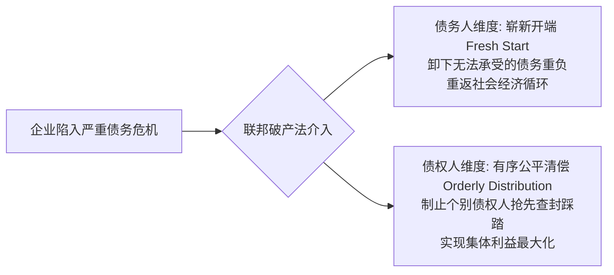
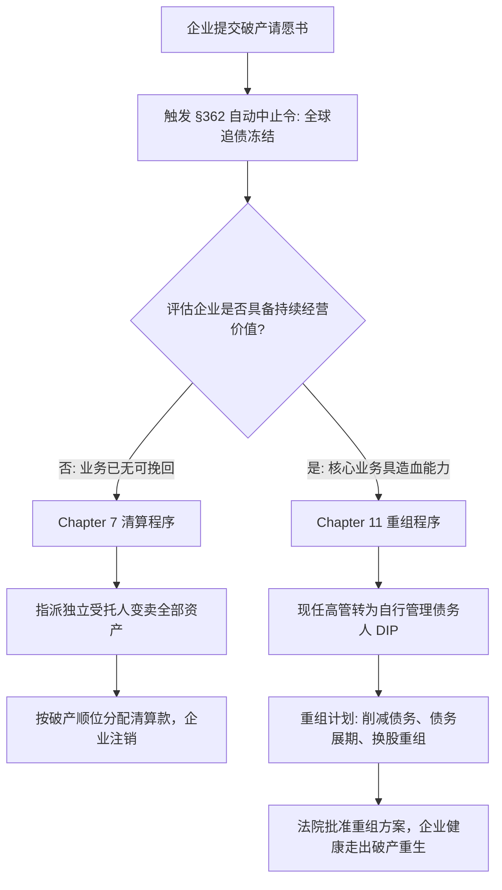

# Lec 20 企业困境与破产法基础 (Bankruptcy Law: Chapter 7 vs Chapter 11)

> MIT Sloan 15.615 · Law for the Entrepreneur and Manager · 主讲 Dr. John Akula

## TL;DR

- 破产法（Bankruptcy Law）的核心职能是平衡两大社会价值：给陷入泥潭的诚实债务人重生的“崭新开端”，并防止债权人踩踏实现公平受偿。
- 破产界定包含“资不抵债（资产负债表破产）”与“无法偿还到期债务（现金流破产）”，后者是触发破产申请的最常见诱因。
- 破产申请一旦递交，立即触发强大的**自动中止令（Automatic Stay, § 362）**，瞬间冻结所有债权催收、抵押物查封与诉讼执行程序。
- **Chapter 7（破产清算）**由外部受托人全面接管并变卖企业资产按顺位分钱；**Chapter 11（破产重组）**则允许债务人自行管理（DIP），在法律防火墙下脱胎换骨。

## 破产法的两大终极价值目标

在古代罗马法和早期的英国法中，无力偿还债务被视为刑事犯罪，债务人会被关入债务人监狱甚至被卖为奴隶。现代文明的破产法（美国联邦破产法典，Title 11, U.S. Code）实现了法哲学层面的重大转向：

如果没有破产法，一旦公司出现流动性短缺，债权人将陷入“囚徒困境”：每个人都会争先恐后申请法院冻结账户、扣押机器设备，从而导致原本尚有盈利希望的企业瞬间四分五裂，造成全社会财富的净损失。破产法建立了一个集体谈判的法治竞技场。

## 破产的法定界定：资产负债表破产 vs 现金流破产

法律与财务在认定企业是否陷入破产状态时主要依据两个基准：

::: definition 破产判定的两大标准
1. **资产负债表破产（Balance Sheet Insolvency / 实体破产）**：
   $$	ext{总负债（Liabilities）} > 	ext{全部资产公允价值（Fair Value of Assets）}$$
   即所有资产即使按公允市场价值全额变现，也无法清偿所有债务，股东权益账面净值为负。
2. **现金流破产（Equitable Insolvency / 支付不能破产）**：
   企业无法在正常经营过程中**按期支付已到期的合法债务**（Unable to pay debts as they mature）。
:::

一家企业即使拥有大量难以变现的土地或专利（资产负债表净资产为正），但如果账面没有流动资金兑付下周到期的巨额商业票据，即构成现金流破产，可被合法依法申请破产。

## 破产的超级核武器：自动中止令（Automatic Stay, § 362）

在破产法所有的救济措施中，最具威慑力的是联邦破产法第 362 条规定的**自动中止令（Automatic Stay）**：

::: definition 自动中止令（Automatic Stay, 11 U.S.C. § 362）
一旦债务人向联邦破产法院正式提交破产请愿书（Petition），无论债权人是否知情，**法律自动在全球范围内瞬间生效一项强制禁令**：
- 严禁任何债权人继续进行或提起针对债务人的民事诉讼或仲裁；
- 严禁任何担保债权人没收、扣押、拍卖债务人的任何机器、房产、专利等担保物；
- 严禁银行等金融机构单方面从债务人存款账户中扣划资金进行抵销（Setoff）；
- 严禁任何向债务人催讨旧债的电话、信函或断供威胁。
:::

任何明知存在自动中止令而故意违反的债权人，构成蔑视法庭罪，将面临法院直接处以惩罚性赔偿金及巨额罚款。这项禁令为奄奄一息的企业争取到了极其宝贵的喘息窗口。

## Chapter 7（清算） vs Chapter 11（重组）：路径抉择

破产法典为企业破产提供了两条截然不同的法律轨道：

| 比较维度 | 第 7 章：破产清算 (Chapter 7 Liquidation) | 第 11 章：破产重组 (Chapter 11 Reorganization) |
| :--- | :--- | :--- |
| **企业存续状态** | 企业彻底死亡解散，停止一切生产经营活动 | 企业继续开门营业，保留品牌、客户与核心骨干 |
| **最高管理掌权人** | 董事会与高管被**立即免职**，由破产法院指派的外部受托人（Trustee）全面接管 | 现任管理层原则上继续掌权，成为**自行管理债务人（Debtor-in-Possession, DIP）** |
| **财产处置方式** | 受托人以拍卖、拆分等方式尽快变卖全部资产换取现金 | 制定并执行重组计划（Plan of Reorganization），进行债务展期、削债或债转股 |
| **适用企业类型** | 商业模式已彻底失败、毫无重组价值或被欺诈掏空的空壳企业 | 核心主业仍有可观现金流，但被历史沉重利息包袱或巨额法律诉讼压垮的企业 |
| **员工与供应链** | 员工全员遣散解雇，供应商停止供货 | 员工继续工作拿工资，破产后新增供货享有最高清偿特权 |

## 破产财产（Estate）与欺诈性转移（Fraudulent Conveyance）的追回

很多初创公司负责人在破产前夕，企图将公司的核心源码、专利低价转移到自己新成立的另一家公司，或者将账面资金优先偿还给给自己借钱的亲戚朋友。这些行为在破产法下是极其危险的雷区：

1. **破产财产（Bankruptcy Estate, § 541）**：破产申请一旦提出，债务人名下所有的合法与衡平权益自动合成为一个法定的“破产财产独立实体”；
2. **偏颇清偿（Preferences, § 547）**：破产申请前 90 天内（如接收方是公司内部人/亲友，则延长至 1 年），债务人针对往期旧债所做的任何清偿，受托人均有权向法院起诉**强制全额追回（Clawback）**；
3. **欺诈性转让（Fraudulent Transfer, § 548）**：破产前 2 年内，如果债务人以低于公允价值的对价转让财产，或者明知将陷入破产而恶意转移财产，法院将无条件撤销该交易，并依法追究相关责任人的刑事犯罪责任。

::: pitfall 濒临破产时“转移资产保命”的致命陷阱
一些创业者在公司资金链断裂时，听信不良中介建议将公司核心知识产权以 1 元名义价格过户给个人。破产程序启动后，受托人不仅会启动追回权夺回专利，还会以“恶意欺诈债权人”提起刺破公司面纱之诉，使创始人个人为公司全部债务承担无限连带清偿责任！
:::

::: insight 破产不是终结，而是资本主义最伟大的纠错与重生机制
商业探索是一场充满未知风险的远航。如果失败的代价是终生被债务奴役、家破人亡，整个社会将无人敢于冒险创新。美国之所以能够源源不断涌现打破常规的科技颠覆者，其制度秘诀之一就在于拥有全世界最成熟包容的破产重组机制。敬畏破产规则、在阳光下坦荡面对失败并依法寻求重生，是成熟商业领袖的必修一课。
:::
