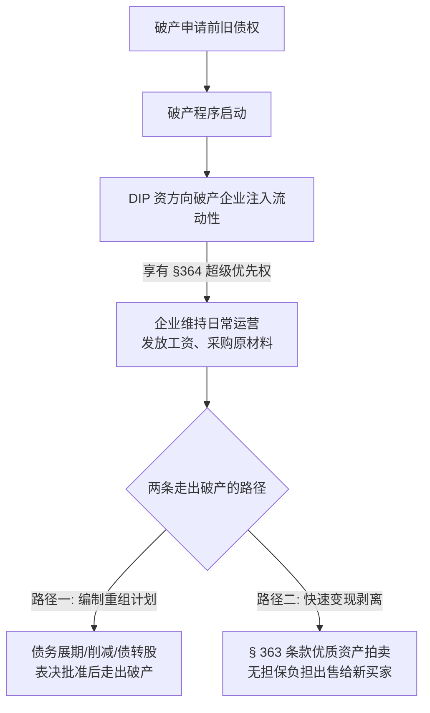
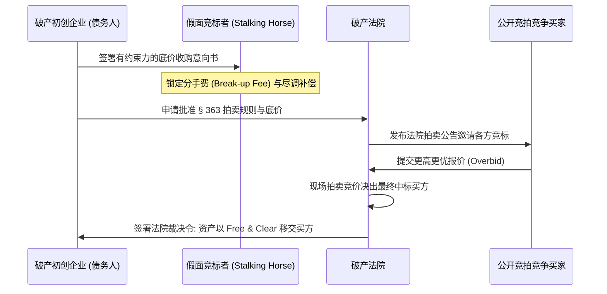

# Lec 21 破产重组程序与 363 条款出售 (Reorganization Plan, APR & Section 363 Sales)

> MIT Sloan 15.615 · Law for the Entrepreneur and Manager · 主讲 Dr. John Akula

## TL;DR

- Chapter 11 重组的核心产物是**重组计划（Plan of Reorganization）**，通过对债权分类（Classification）并获得受损类别的表决通过。
- **绝对优先原则（Absolute Priority Rule）**是破产清偿铁律：除非高顺位债权人得到全额清偿，否则低顺位债权人与原有普通股股东不得保留任何权益。
- 法院可通过**强行批准（Cram-Down）**机制，在至少一个实质受损类别同意的前提下，越过异议类别的阻挠强行裁定重组方案生效。
- **§ 363 资产出售（Section 363 Sale）**允许以“无任何权利负担（Free and Clear）”的方式快速剥离优质核心资产，是科技创业企业破产变现的最主流通道。

## Chapter 11 重组的核心机制：DIP 融资与自行管理

在 Chapter 11 框架下，公司进入“自行管理债务人”（Debtor-in-Possession, DIP）状态。管理层在法院监督下拥有双重身份：既是企业的经营管理者，又是对全体债权人负有最高受托责任的破产财产托管人。

为了让重组期间的企业维持运转，企业必须获得新的现金流注入。破产法第 364 条创设了极具吸引力的**DIP 融资（DIP Financing）**特权：

::: definition DIP 融资超级优先权（Superpriority Lien, 11 U.S.C. § 364）
破产法院有权赋予破产申请后愿意向企业提供借款的新资方以下特许权利：
1. **行政管理费用优先权（Administrative Expense Priority）**：优先于所有破产申请前的无担保债权；
2. **超级优先权（Superpriority Claim）**：优先于所有其他行政管理费用；
3. **首位担保抵押权（Priming Lien）**：破产法院甚至可以在原有已抵押资产上，强行为新资方设立一个顺位高于原有抵押权人的第一抵押权（前提是给予原抵押权人“充分保护 Adequate Protection”）。
:::

这种法律特许使得华尔街困境投资基金（Distressed Debt Funds）敢于向濒临破产的企业继续输送数亿美元资金。

## 债权分类、表决与绝对优先原则（Absolute Priority Rule）

编制重组计划时，管理层必须将所有债权人和股权持有人划分为不同的**类别（Classes）**：

1. **类别受损判定（Impaired vs Unimpaired）**：如果重组计划削减了某一类债权的本息、延后了还款期限或剥夺了原有合同权利，则该类别为“受损类别（Impaired Class）”；未受损类别法律自动推定为同意重组；
2. **法定表决通过门槛**：每一个受损类别中，必须获得满足以下双重条件的投票同意：
   - 投同意票的债权人代表该类别**至少三分之二（2/3）的债权金额**；
   - 投同意票的债权人占该类别**过半数（>50%）的表决人数**。

当所有类别均投票同意时，重组方案自然达成。然而，当部分债权人因利益受损拒绝签字时，破产法确立了现代资本秩序的基石——**绝对优先原则（Absolute Priority Rule）**：

::: theorem 绝对优先原则（Absolute Priority Rule, 11 U.S.C. § 1129(b)）
在重组方案中，**任何顺位较低的权利持有人（如无担保债权人、优先股股东、普通股股东），在所有顺位高于其的异议类别（Dissenting Class）获得 100% 全额清偿之前，绝不能从破产财产中获得或保留任何财产权益！**
:::

清偿顺位金字塔如下：

| 清偿顺位 | 权利类别 | 绝对优先原则下的清偿安排 |
| :---: | :--- | :--- |
| **第一顺位** | 有担保债权（Secured Creditors） | 以其特定担保财产的公允价值为限获得 100% 优先兑付 |
| **第二顺位** | 破产费用及行政优先债权（Administrative Expenses） | DIP 融资借款、重组期间律师/会计师费、重组期间员工薪资与供货 |
| **第三顺位** | 优先无担保债权（Priority Unsecured Claims） | 破产前 180 天内拖欠的员工基本工资与社保（有法定上限）、税款 |
| **第四顺位** | 普通无担保债权（General Unsecured Claims） | 商业供应商应付账款、无担保债券持有人、违约租约赔偿 |
| **第五顺位** | 优先股股东（Preferred Shareholders） | 风险投资人（VC/PE）持有的清算优先权 |
| **末位（底层）**| 普通股股东（Common Stock / 创始人团队） | **只有当上述全部 1 至 5 顺位本息全额赔付后，才能保留残值** |

在 99% 的破产案件中，破产财产根本无法满足第四顺位普通无担保债权的本金。因此，根据绝对优先原则，**原有普通股股东（包括创始团队和普通股期权员工）的全部股权将被依法 100% 彻底注销归零（Wipe Out）**！

## 强行批准（Cram-Down）机制

如果某个关键债权人类别坚决投反对票阻挠重组，债务人可以申请法院启动**强行批准（Cram-Down）**：

::: definition 强行批准（Cram-Down）的核心条件
只要满足下列严苛法律标准，破产法官有权无视反对类别的否决，强行批准重组计划：
1. **至少有一个实质受损的债权人类别投票赞成**（排除了任何公司内部人士的关联投票）；
2. 方案对任何持异议的类别是“公允且平等的（Fair and Equitable）”；
3. 严格遵循**绝对优先原则**；
4. 方案没有针对任何反对类别进行“不正当歧视（No Unfair Discrimination）”。
:::

强行批准是债务人用来打破恶意投机债权人敲诈勒索的最强法律杠杆。

## 科技企业的生命通道：破产法第 363 条款出售（Section 363 Sale）

对于许多现金流断裂但拥有优秀技术团队和专有算法的科技初创企业而言，耗时 12 至 24 个月的漫长 Chapter 11 重组是不可承受的（人才会流失殆尽、客户会全部解约）。因此，**§ 363 快速资产出售**成为了最受青睐的解决方案：

::: definition § 363 资产出售（Section 363 Sale）
根据联邦破产法第 363(f) 条，债务人有权在无需制定冗长重组计划、无需全员类别投票的情况下，向破产法院申请紧急拍卖核心资产：
- **无权利负担出售（Free and Clear of All Liens）**：买方收购的服务器、代码库、专利与品牌，**被法院裁定彻底剥离所有原有抵押权、历史诉讼与历史负债**；
- 历史债务与官司留在旧壳公司中，由拍卖所得的现金在壳公司内按顺位分配给债权人；
- 新买家以干干净净的资产快速整合进自身业务。
:::

在 363 出售中，债务人通常会先寻找一个愿意出底价的**假面竞标者（Stalking Horse Bidder）**。为激励其花费尽调成本出底价，协议中会约定 2%-3% 的**分手费（Break-up Fee）**。随后，法院举行公开竞价拍卖，确保全体债权人利益实现最大化变现。

::: insight 商业的尽头是制度的优雅与冷酷
在破产法庭的法槌落下之际，商业世界展现出它最极致的残酷与理性：无论昔日的科技独角兽估值曾攀升到多高，在绝对优先原则面前，资本的层级规则不容撼动；但与此同时，破产法又以 § 363 条款和 DIP 融资展现了惊人的制度智慧——它将凝结着工程师心血的技术资产从坏账泥潭中迅速剥离洗净，重新注入新的经济生命。理解了破产法，才真正理解了现代商业资本的运行闭环。
:::
